# Legs — page 1/2

[Item database](../README.md)

Pages: [1](type-7-1.md) | [2](type-7-2.md)

| LOT | Item | Rarity | Description | Source evidence |
| --- | --- | --- | --- | --- |
| 6888 | { .lu-ti width="24" loading="lazy" } [Unnamed LOT 6888 (LOT 6888)](../6888.md) | 1 | No client description | 0 matrices; 0 rewards; 0 community references |
| 6891 | { .lu-ti width="24" loading="lazy" } [Unnamed LOT 6891 (LOT 6891)](../6891.md) | 1 | No client description | 0 matrices; 0 rewards; 0 community references |
| 6893 | 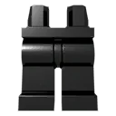{ .lu-ti width="24" loading="lazy" } [Unnamed LOT 6893 (LOT 6893)](../6893.md) | 1 | No client description | 0 matrices; 0 rewards; 0 community references |
| 6896 | 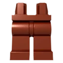{ .lu-ti width="24" loading="lazy" } [Unnamed LOT 6896 (LOT 6896)](../6896.md) | 1 | No client description | 0 matrices; 0 rewards; 0 community references |
| 12787 | 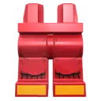{ .lu-ti width="24" loading="lazy" } [Unnamed LOT 12787 (LOT 12787)](../12787.md) | 2 | No client description | 0 matrices; 0 rewards; 0 community references |
| 12790 | { .lu-ti width="24" loading="lazy" } [Unnamed LOT 12790 (LOT 12790)](../12790.md) | 2 | No client description | 0 matrices; 0 rewards; 0 community references |
| 12791 | { .lu-ti width="24" loading="lazy" } [Unnamed LOT 12791 (LOT 12791)](../12791.md) | 2 | No client description | 0 matrices; 0 rewards; 0 community references |
| 12794 | { .lu-ti width="24" loading="lazy" } [Unnamed LOT 12794 (LOT 12794)](../12794.md) | 2 | No client description | 0 matrices; 0 rewards; 0 community references |
| 12795 | { .lu-ti width="24" loading="lazy" } [Unnamed LOT 12795 (LOT 12795)](../12795.md) | 2 | No client description | 0 matrices; 0 rewards; 0 community references |
| 12799 | { .lu-ti width="24" loading="lazy" } [Unnamed LOT 12799 (LOT 12799)](../12799.md) | 2 | No client description | 0 matrices; 0 rewards; 0 community references |
| 12800 | { .lu-ti width="24" loading="lazy" } [Unnamed LOT 12800 (LOT 12800)](../12800.md) | 2 | No client description | 0 matrices; 0 rewards; 0 community references |
| 12803 | { .lu-ti width="24" loading="lazy" } [Unnamed LOT 12803 (LOT 12803)](../12803.md) | 1 | No client description | 0 matrices; 0 rewards; 0 community references |
| 14171 | { .lu-ti width="24" loading="lazy" } [Unnamed LOT 14171 (LOT 14171)](../14171.md) | 4 | No client description | 0 matrices; 0 rewards; 0 community references |
| 16108 | 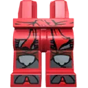{ .lu-ti width="24" loading="lazy" } [Unnamed LOT 16108 (LOT 16108)](../16108.md) | 3 | No client description | 0 matrices; 0 rewards; 0 community references |
| 16109 | 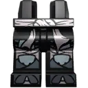{ .lu-ti width="24" loading="lazy" } [Unnamed LOT 16109 (LOT 16109)](../16109.md) | 3 | No client description | 0 matrices; 0 rewards; 0 community references |
| 16110 | 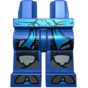{ .lu-ti width="24" loading="lazy" } [Unnamed LOT 16110 (LOT 16110)](../16110.md) | 3 | No client description | 0 matrices; 0 rewards; 0 community references |
| 16111 | 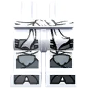{ .lu-ti width="24" loading="lazy" } [Unnamed LOT 16111 (LOT 16111)](../16111.md) | 3 | No client description | 0 matrices; 0 rewards; 0 community references |
| 16112 | 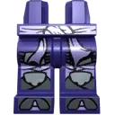{ .lu-ti width="24" loading="lazy" } [Unnamed LOT 16112 (LOT 16112)](../16112.md) | 3 | No client description | 0 matrices; 0 rewards; 0 community references |
| 16113 | 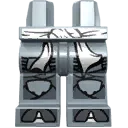{ .lu-ti width="24" loading="lazy" } [Unnamed LOT 16113 (LOT 16113)](../16113.md) | 3 | No client description | 0 matrices; 0 rewards; 0 community references |
| 16114 | 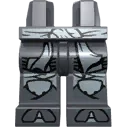{ .lu-ti width="24" loading="lazy" } [Unnamed LOT 16114 (LOT 16114)](../16114.md) | 3 | No client description | 0 matrices; 0 rewards; 0 community references |
| 16115 | { .lu-ti width="24" loading="lazy" } [Unnamed LOT 16115 (LOT 16115)](../16115.md) | 3 | No client description | 0 matrices; 0 rewards; 0 community references |
| 16116 | 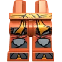{ .lu-ti width="24" loading="lazy" } [Unnamed LOT 16116 (LOT 16116)](../16116.md) | 3 | No client description | 0 matrices; 0 rewards; 0 community references |
| 16117 | 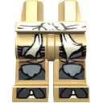{ .lu-ti width="24" loading="lazy" } [Unnamed LOT 16117 (LOT 16117)](../16117.md) | 3 | No client description | 0 matrices; 0 rewards; 0 community references |
| 16124 | { .lu-ti width="24" loading="lazy" } [Unnamed LOT 16124 (LOT 16124)](../16124.md) | 3 | No client description | 0 matrices; 0 rewards; 0 community references |
| 16125 | { .lu-ti width="24" loading="lazy" } [Unnamed LOT 16125 (LOT 16125)](../16125.md) | 3 | No client description | 0 matrices; 0 rewards; 0 community references |
| 16126 | { .lu-ti width="24" loading="lazy" } [Unnamed LOT 16126 (LOT 16126)](../16126.md) | 3 | No client description | 0 matrices; 0 rewards; 0 community references |
| 16127 | 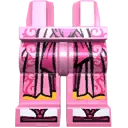{ .lu-ti width="24" loading="lazy" } [Unnamed LOT 16127 (LOT 16127)](../16127.md) | 3 | No client description | 0 matrices; 0 rewards; 0 community references |
| 16128 | 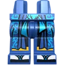{ .lu-ti width="24" loading="lazy" } [Unnamed LOT 16128 (LOT 16128)](../16128.md) | 3 | No client description | 0 matrices; 0 rewards; 0 community references |
| 16129 | { .lu-ti width="24" loading="lazy" } [Unnamed LOT 16129 (LOT 16129)](../16129.md) | 3 | No client description | 0 matrices; 0 rewards; 0 community references |
| 16130 | 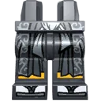{ .lu-ti width="24" loading="lazy" } [Unnamed LOT 16130 (LOT 16130)](../16130.md) | 3 | No client description | 0 matrices; 0 rewards; 0 community references |
| 7508 | 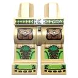{ .lu-ti width="24" loading="lazy" } [Adventurer Pants 1 (LOT 7508)](../7508.md) | 4 | Rank 1 Specialty Kit Item | 2 matrices; 0 rewards; 0 community references |
| 7509 | 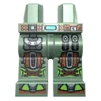{ .lu-ti width="24" loading="lazy" } [Adventurer Pants 2 (LOT 7509)](../7509.md) | 4 | Rank 2 Specialty Kit Item | 1 matrices; 0 rewards; 0 community references |
| 7510 | 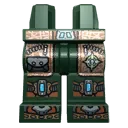{ .lu-ti width="24" loading="lazy" } [Adventurer Pants 3 (LOT 7510)](../7510.md) | 4 | Rank 3 Specialty Kit Item | 1 matrices; 0 rewards; 0 community references |
| 14355 | 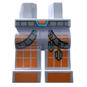{ .lu-ti width="24" loading="lazy" } [Assembly Gear - Summoner - legs proxy (LOT 14355)](../14355.md) | 4 | No client description | 0 matrices; 0 rewards; 0 community references |
| 6305 | { .lu-ti width="24" loading="lazy" } [Back Wheels (LOT 6305)](../6305.md) | 1 | No client description | 0 matrices; 0 rewards; 0 community references |
| 13000 | 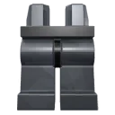{ .lu-ti width="24" loading="lazy" } [Bat Lord Pants (LOT 13000)](../13000.md) | 4 | No client description | 40 matrices; 0 rewards; 1 community references |
| 8640 | 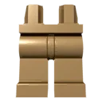{ .lu-ti width="24" loading="lazy" } [Bell Bottoms (LOT 8640)](../8640.md) | 2 | No client description | 20 matrices; 0 rewards; 1 community references |
| 2524 | { .lu-ti width="24" loading="lazy" } [Black Pants (LOT 2524)](../2524.md) | 1 | No client description | 33 matrices; 0 rewards; 0 community references |
| 6301 | { .lu-ti width="24" loading="lazy" } [Blue Chassis (LOT 6301)](../6301.md) | 1 | No client description | 0 matrices; 0 rewards; 0 community references |
| 12798 | 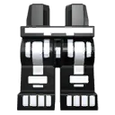{ .lu-ti width="24" loading="lazy" } [Bone Suit Pants (LOT 12798)](../12798.md) | 4 | No client description | 40 matrices; 0 rewards; 1 community references |
| 2511 | 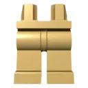{ .lu-ti width="24" loading="lazy" } [Brick Yellow Pants (LOT 2511)](../2511.md) | 1 | No client description | 32 matrices; 0 rewards; 0 community references |
| 2519 | { .lu-ti width="24" loading="lazy" } [Bright Blue Pants (LOT 2519)](../2519.md) | 1 | No client description | 33 matrices; 0 rewards; 0 community references |
| 2509 | { .lu-ti width="24" loading="lazy" } [Bright Orange Pants (LOT 2509)](../2509.md) | 1 | No client description | 33 matrices; 0 rewards; 0 community references |
| 2508 | 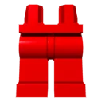{ .lu-ti width="24" loading="lazy" } [Bright Red Pants (LOT 2508)](../2508.md) | 1 | No client description | 33 matrices; 0 rewards; 0 community references |
| 6303 | { .lu-ti width="24" loading="lazy" } [Brown Chassis (LOT 6303)](../6303.md) | 1 | No client description | 0 matrices; 0 rewards; 0 community references |
| 7388 | 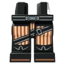{ .lu-ti width="24" loading="lazy" } [Buccaneer Pantaloons 1 (LOT 7388)](../7388.md) | 4 | Rank 1 Specialty Kit Item | 2 matrices; 0 rewards; 0 community references |
| 7389 | { .lu-ti width="24" loading="lazy" } [Buccaneer Pantaloons 2 (LOT 7389)](../7389.md) | 4 | Rank 2 Specialty Kit Item | 1 matrices; 0 rewards; 0 community references |
| 7390 | 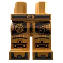{ .lu-ti width="24" loading="lazy" } [Buccaneer Pantaloons 3 (LOT 7390)](../7390.md) | 4 | Rank 3 Specialty Kit Item | 1 matrices; 0 rewards; 0 community references |
| 12955 | 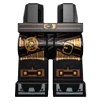{ .lu-ti width="24" loading="lazy" } [Buccaneer Pantaloons 3 (LOT 12955)](../12955.md) | 4 | Rank 3 Specialty Kit Item | 1 matrices; 0 rewards; 0 community references |
| 8643 | { .lu-ti width="24" loading="lazy" } [Capris (LOT 8643)](../8643.md) | 3 | No client description | 8 matrices; 0 rewards; 1 community references |
| 8647 | { .lu-ti width="24" loading="lazy" } [Cargo Pants (LOT 8647)](../8647.md) | 3 | No client description | 17 matrices; 0 rewards; 1 community references |
| 8649 | { .lu-ti width="24" loading="lazy" } [Chaps (LOT 8649)](../8649.md) | 2 | No client description | 15 matrices; 0 rewards; 1 community references |
| 8667 | { .lu-ti width="24" loading="lazy" } [Clam Diggers (LOT 8667)](../8667.md) | 2 | No client description | 24 matrices; 0 rewards; 1 community references |
| 16640 | 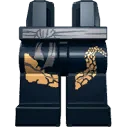{ .lu-ti width="24" loading="lazy" } [Cole's DX Pants of Quakes (LOT 16640)](../16640.md) | 4 | Wear this to look like Cole DX! | 2 matrices; 0 rewards; 0 community references |
| 16096 | 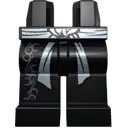{ .lu-ti width="24" loading="lazy" } [Cole's First Gi Pants (LOT 16096)](../16096.md) | 2 | No client description | 27 matrices; 0 rewards; 1 community references |
| 16607 | 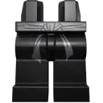{ .lu-ti width="24" loading="lazy" } [Cole's Pants of Quakes (LOT 16607)](../16607.md) | 3 | Wear this to look like Cole! | 1 matrices; 0 rewards; 1 community references |
| 12788 | { .lu-ti width="24" loading="lazy" } [Comfy Jeans (LOT 12788)](../12788.md) | 2 | No client description | 1 matrices; 0 rewards; 1 community references |
| 16118 | 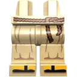{ .lu-ti width="24" loading="lazy" } [Common Kosode Pants (LOT 16118)](../16118.md) | 1 | No client description | 1 matrices; 0 rewards; 1 community references |
| 13747 | [Crate Disguise Proxy Pants (LOT 13747)](../13747.md) | 1 | No client description | 0 matrices; 0 rewards; 0 community references |
| 6927 | { .lu-ti width="24" loading="lazy" } [Creative Pants (LOT 6927)](../6927.md) | 4 | No client description | 1 matrices; 0 rewards; 1 community references |
| 12770 | { .lu-ti width="24" loading="lazy" } [Cutoff Jeans (LOT 12770)](../12770.md) | 1 | No client description | 1 matrices; 0 rewards; 1 community references |
| 16105 | { .lu-ti width="24" loading="lazy" } [Daidaiiro Gi Pants (LOT 16105)](../16105.md) | 3 | No client description | 27 matrices; 0 rewards; 1 community references |
| 7511 | 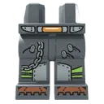{ .lu-ti width="24" loading="lazy" } [Daredevil Pants 1 (LOT 7511)](../7511.md) | 4 | Rank 1 Specialty Kit Item | 2 matrices; 0 rewards; 0 community references |
| 7512 | { .lu-ti width="24" loading="lazy" } [Daredevil Pants 2 (LOT 7512)](../7512.md) | 4 | Rank 2 Specialty Kit Item | 1 matrices; 0 rewards; 0 community references |
| 7513 | 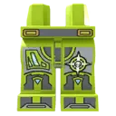{ .lu-ti width="24" loading="lazy" } [Daredevil Pants 3 (LOT 7513)](../7513.md) | 4 | Rank 3 Specialty Kit Item | 1 matrices; 0 rewards; 0 community references |
| 12957 | 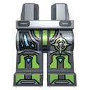{ .lu-ti width="24" loading="lazy" } [Daredevil Pants 3 (LOT 12957)](../12957.md) | 4 | Rank 3 Specialty Kit Item | 1 matrices; 0 rewards; 0 community references |
| 2515 | { .lu-ti width="24" loading="lazy" } [Dark Green Pants (LOT 2515)](../2515.md) | 1 | No client description | 32 matrices; 0 rewards; 0 community references |
| 16119 | 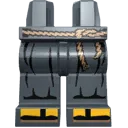{ .lu-ti width="24" loading="lazy" } [Dark Kosode Pants (LOT 16119)](../16119.md) | 2 | No client description | 1 matrices; 0 rewards; 1 community references |
| 2527 | 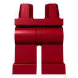{ .lu-ti width="24" loading="lazy" } [Dark Red Pants (LOT 2527)](../2527.md) | 1 | No client description | 32 matrices; 0 rewards; 0 community references |
| 2521 | 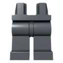{ .lu-ti width="24" loading="lazy" } [Dark Stone Grey Pants (LOT 2521)](../2521.md) | 1 | No client description | 32 matrices; 0 rewards; 0 community references |
| 13757 | [Dragon Disguise Proxy Pants (LOT 13757)](../13757.md) | 1 | No client description | 0 matrices; 0 rewards; 0 community references |
| 8642 | { .lu-ti width="24" loading="lazy" } [Dungarees (LOT 8642)](../8642.md) | 3 | No client description | 0 matrices; 1 rewards; 1 community references |
| 2517 | { .lu-ti width="24" loading="lazy" } [Earth Blue Pants (LOT 2517)](../2517.md) | 1 | No client description | 32 matrices; 0 rewards; 0 community references |
| 2516 | { .lu-ti width="24" loading="lazy" } [Earth Green Pants (LOT 2516)](../2516.md) | 1 | No client description | 32 matrices; 0 rewards; 0 community references |
| 7382 | 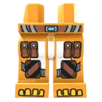{ .lu-ti width="24" loading="lazy" } [Engineer Pants 1 (LOT 7382)](../7382.md) | 4 | Rank 1 Specialty Kit Item | 2 matrices; 0 rewards; 0 community references |
| 7383 | { .lu-ti width="24" loading="lazy" } [Engineer Pants 2 (LOT 7383)](../7383.md) | 4 | Rank 2 Specialty Kit Item | 1 matrices; 0 rewards; 0 community references |
| 7384 | 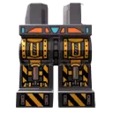{ .lu-ti width="24" loading="lazy" } [Engineer Pants 3 (LOT 7384)](../7384.md) | 4 | Rank 3 Specialty Kit Item | 1 matrices; 0 rewards; 0 community references |
| 12949 | 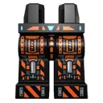{ .lu-ti width="24" loading="lazy" } [Engineer Pants 3 (LOT 12949)](../12949.md) | 4 | Rank 3 Specialty Kit Item | 1 matrices; 0 rewards; 0 community references |
| 12426 | 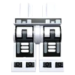{ .lu-ti width="24" loading="lazy" } [Explorien Bot Pants (LOT 12426)](../12426.md) | 3 | No client description | 0 matrices; 1 rewards; 1 community references |
| 16101 | { .lu-ti width="24" loading="lazy" } [Faded Gi Pants (LOT 16101)](../16101.md) | 2 | No client description | 0 matrices; 1 rewards; 1 community references |
| 16120 | 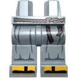{ .lu-ti width="24" loading="lazy" } [Faded Kosode Pants (LOT 16120)](../16120.md) | 3 | No client description | 0 matrices; 0 rewards; 1 community references |
| 12291 | { .lu-ti width="24" loading="lazy" } [Flannel Pants (LOT 12291)](../12291.md) | 2 | No client description | 1 matrices; 0 rewards; 1 community references |
| 7797 | { .lu-ti width="24" loading="lazy" } [Flash Pants (LOT 7797)](../7797.md) | 2 | No client description | 0 matrices; 1 rewards; 1 community references |
| 12789 | 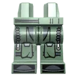{ .lu-ti width="24" loading="lazy" } [Flight Suit Legs (LOT 12789)](../12789.md) | 2 | No client description | 0 matrices; 1 rewards; 1 community references |
| 6306 | { .lu-ti width="24" loading="lazy" } [Front Left Wheel (LOT 6306)](../6306.md) | 1 | No client description | 0 matrices; 0 rewards; 0 community references |
| 6307 | { .lu-ti width="24" loading="lazy" } [Front Right Wheel (LOT 6307)](../6307.md) | 1 | No client description | 0 matrices; 0 rewards; 0 community references |
| 8644 | { .lu-ti width="24" loading="lazy" } [Gauchos (LOT 8644)](../8644.md) | 4 | No client description | 11 matrices; 0 rewards; 1 community references |
| 6304 | { .lu-ti width="24" loading="lazy" } [Green Chassis (LOT 6304)](../6304.md) | 1 | No client description | 0 matrices; 0 rewards; 0 community references |
| 16102 | 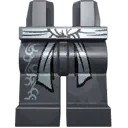{ .lu-ti width="24" loading="lazy" } [Haiiro Gi Pants (LOT 16102)](../16102.md) | 3 | No client description | 27 matrices; 1 rewards; 1 community references |
| 8651 | 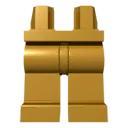{ .lu-ti width="24" loading="lazy" } [Hammer Pants (LOT 8651)](../8651.md) | 2 | No client description | 18 matrices; 0 rewards; 1 community references |
| 12792 | 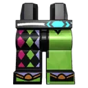{ .lu-ti width="24" loading="lazy" } [Harlequin Costume Legs (LOT 12792)](../12792.md) | 3 | No client description | 0 matrices; 0 rewards; 0 community references |
| 13762 | [Horseman Disguise Proxy Pants (LOT 13762)](../13762.md) | 1 | No client description | 0 matrices; 0 rewards; 0 community references |
| 12920 | 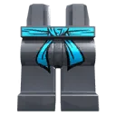{ .lu-ti width="24" loading="lazy" } [Imagination Spinjitzu Pants (LOT 12920)](../12920.md) | 3 | No client description | 1 matrices; 1 rewards; 0 community references |
| 7502 | 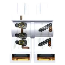{ .lu-ti width="24" loading="lazy" } [Inventor Pants 1 (LOT 7502)](../7502.md) | 4 | Rank 1 Specialty Kit Item | 2 matrices; 0 rewards; 0 community references |
| 7503 | 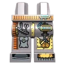{ .lu-ti width="24" loading="lazy" } [Inventor Pants 2 (LOT 7503)](../7503.md) | 4 | Rank 2 Specialty Kit Item | 1 matrices; 0 rewards; 0 community references |
| 7504 | { .lu-ti width="24" loading="lazy" } [Inventor Pants 3 (LOT 7504)](../7504.md) | 4 | Rank 3 Specialty Kit Item | 1 matrices; 0 rewards; 0 community references |
| 8645 | { .lu-ti width="24" loading="lazy" } [Iron Legs (LOT 8645)](../8645.md) | 3 | No client description | 11 matrices; 0 rewards; 1 community references |
| 13837 | 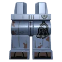{ .lu-ti width="24" loading="lazy" } [Janitor Uniform Proxy Pants (LOT 13837)](../13837.md) | 1 | No client description | 0 matrices; 0 rewards; 0 community references |
| 16638 | { .lu-ti width="24" loading="lazy" } [Jay's DX Pants of Storms (LOT 16638)](../16638.md) | 4 | Wear this to look like Jay DX! | 2 matrices; 0 rewards; 0 community references |
| 16098 | { .lu-ti width="24" loading="lazy" } [Jay's First Gi Pants (LOT 16098)](../16098.md) | 3 | No client description | 0 matrices; 1 rewards; 1 community references |
| 16610 | { .lu-ti width="24" loading="lazy" } [Jay's Pants of Storms (LOT 16610)](../16610.md) | 3 | Wear this to look like Jay! | 1 matrices; 0 rewards; 1 community references |
| 14092 | { .lu-ti width="24" loading="lazy" } [Jazzy Pants (LOT 14092)](../14092.md) | 3 | For Silver Trophy Winners! | 0 matrices; 0 rewards; 0 community references |
| 8648 | { .lu-ti width="24" loading="lazy" } [Jeans (LOT 8648)](../8648.md) | 3 | No client description | 4 matrices; 0 rewards; 1 community references |
| 8664 | { .lu-ti width="24" loading="lazy" } [Jodhpurs (LOT 8664)](../8664.md) | 2 | No client description | 24 matrices; 0 rewards; 1 community references |
| 16633 | { .lu-ti width="24" loading="lazy" } [Kai's DX Pants of Flames (LOT 16633)](../16633.md) | 4 | Wear this to look like Kai DX! | 2 matrices; 0 rewards; 0 community references |
| 16095 | { .lu-ti width="24" loading="lazy" } [Kai's First Gi Pants (LOT 16095)](../16095.md) | 3 | No client description | 0 matrices; 1 rewards; 1 community references |
| 16122 | { .lu-ti width="24" loading="lazy" } [Kai's Loungy Pants (LOT 16122)](../16122.md) | 3 | No client description | 0 matrices; 1 rewards; 0 community references |
| 16616 | { .lu-ti width="24" loading="lazy" } [Kai's Pants of Flames (LOT 16616)](../16616.md) | 3 | Wear this to look like Kai! | 1 matrices; 0 rewards; 1 community references |
| 8646 | { .lu-ti width="24" loading="lazy" } [Khakis (LOT 8646)](../8646.md) | 2 | No client description | 3 matrices; 0 rewards; 1 community references |
| 7379 | { .lu-ti width="24" loading="lazy" } [Knight Leggings 1 (LOT 7379)](../7379.md) | 4 | Rank 1 Specialty Kit Item | 2 matrices; 0 rewards; 0 community references |
| 7380 | { .lu-ti width="24" loading="lazy" } [Knight Leggings 2 (LOT 7380)](../7380.md) | 4 | Rank 2 Specialty Kit Item | 1 matrices; 0 rewards; 0 community references |
| 7381 | { .lu-ti width="24" loading="lazy" } [Knight Leggings 3 (LOT 7381)](../7381.md) | 4 | Rank 3 Specialty Kit Item | 1 matrices; 0 rewards; 0 community references |
| 12951 | { .lu-ti width="24" loading="lazy" } [Knight Leggings 3 (LOT 12951)](../12951.md) | 4 | Rank 3 Specialty Kit Item | 1 matrices; 0 rewards; 0 community references |
| 16121 | { .lu-ti width="24" loading="lazy" } [Kuro Hakama (LOT 16121)](../16121.md) | 2 | No client description | 0 matrices; 1 rewards; 1 community references |
| 12793 | { .lu-ti width="24" loading="lazy" } [Lederhosen Legs (LOT 12793)](../12793.md) | 2 | No client description | 0 matrices; 0 rewards; 0 community references |
| 10701 | [LEGO Club Proxy Pants (LOT 10701)](../10701.md) | 5 | Pants object created dynamically by lot:9875 | 0 matrices; 0 rewards; 0 community references |
| 2513 | { .lu-ti width="24" loading="lazy" } [Medium Blue Pants (LOT 2513)](../2513.md) | 1 | No client description | 32 matrices; 0 rewards; 0 community references |
| 2522 | { .lu-ti width="24" loading="lazy" } [Medium Stone Grey Pants (LOT 2522)](../2522.md) | 1 | No client description | 32 matrices; 0 rewards; 0 community references |
| 6202 | { .lu-ti width="24" loading="lazy" } [Metal Legs, Solid (LOT 6202)](../6202.md) | 2 | No client description | 0 matrices; 1 rewards; 1 community references |
| 16103 | { .lu-ti width="24" loading="lazy" } [Midori Gi Pants (LOT 16103)](../16103.md) | 4 | No client description | 27 matrices; 0 rewards; 1 community references |
| 12801 | { .lu-ti width="24" loading="lazy" } [Mosaic Pants (LOT 12801)](../12801.md) | 2 | No client description | 0 matrices; 1 rewards; 1 community references |
| 16123 | { .lu-ti width="24" loading="lazy" } [Murasaki Hakama (LOT 16123)](../16123.md) | 4 | No client description | 1 matrices; 0 rewards; 0 community references |
| 16100 | { .lu-ti width="24" loading="lazy" } [Murasaki Pants (LOT 16100)](../16100.md) | 4 | No client description | 27 matrices; 0 rewards; 1 community references |
| 9961 | { .lu-ti width="24" loading="lazy" } [Nexus Astronaut Pants (LOT 9961)](../9961.md) | 2 | No client description | 1 matrices; 0 rewards; 0 community references |
| 14433 | { .lu-ti width="24" loading="lazy" } [NPC Earth Spinjitzu Pants (LOT 14433)](../14433.md) | 3 | No client description | 0 matrices; 0 rewards; 0 community references |
| 16271 | { .lu-ti width="24" loading="lazy" } [Pants of Flames (LOT 16271)](../16271.md) | 3 | Wear this to look like a Ninja of Fire and rocket directly to the Ninjago Caves! | 2 matrices; 1 rewards; 1 community references |
| 16270 | { .lu-ti width="24" loading="lazy" } [Pants of Frost (LOT 16270)](../16270.md) | 3 | Wear this to look like a Ninja of Ice and rocket directly to the Ninjago Caves! | 2 matrices; 1 rewards; 1 community references |
| 14172 | { .lu-ti width="24" loading="lazy" } [Pants of Quakes (LOT 14172)](../14172.md) | 3 | Wear this to look like a Ninja of Earth and rocket directly to the Ninjago Caves! | 2 matrices; 1 rewards; 1 community references |
| 16269 | { .lu-ti width="24" loading="lazy" } [Pants of Storms (LOT 16269)](../16269.md) | 3 | Wear this to look like a Ninja of Lightning and rocket directly to the Ninjago Caves! | 2 matrices; 1 rewards; 1 community references |
| 14323 | { .lu-ti width="24" loading="lazy" } [Paradox Gear - Space Marauder - legs proxy (LOT 14323)](../14323.md) | 4 | No client description | 0 matrices; 0 rewards; 0 community references |
| 13546 | { .lu-ti width="24" loading="lazy" } [Parrot Pants (LOT 13546)](../13546.md) | 2 | No client description | 0 matrices; 1 rewards; 1 community references |
| 7601 | { .lu-ti width="24" loading="lazy" } [Party Pants (LOT 7601)](../7601.md) | 2 | Somewhere, a Minifigure is embarrassed. | 1 matrices; 0 rewards; 1 community references |
| 12796 | { .lu-ti width="24" loading="lazy" } [Pinstripe Pant Legs (LOT 12796)](../12796.md) | 2 | No client description | 1 matrices; 0 rewards; 1 community references |
| 12797 | { .lu-ti width="24" loading="lazy" } [Racing Legs (LOT 12797)](../12797.md) | 2 | No client description | 1 matrices; 0 rewards; 1 community references |
| 6302 | { .lu-ti width="24" loading="lazy" } [Red Chassis (LOT 6302)](../6302.md) | 1 | No client description | 0 matrices; 0 rewards; 0 community references |
| 2526 | { .lu-ti width="24" loading="lazy" } [Reddish Brown Pants (LOT 2526)](../2526.md) | 1 | No client description | 33 matrices; 0 rewards; 0 community references |
| 7493 | { .lu-ti width="24" loading="lazy" } [Samurai Leggings 1 (LOT 7493)](../7493.md) | 4 | Rank 1 Specialty Kit Item | 2 matrices; 0 rewards; 0 community references |
| 7494 | { .lu-ti width="24" loading="lazy" } [Samurai Leggings 2 (LOT 7494)](../7494.md) | 4 | Rank 2 Specialty Kit Item | 1 matrices; 0 rewards; 0 community references |
| 7495 | { .lu-ti width="24" loading="lazy" } [Samurai Leggings 3 (LOT 7495)](../7495.md) | 4 | Rank 3 Specialty Kit Item | 1 matrices; 0 rewards; 0 community references |
| 12953 | { .lu-ti width="24" loading="lazy" } [Samurai Leggings 3 (LOT 12953)](../12953.md) | 4 | Rank 3 Specialty Kit Item | 1 matrices; 0 rewards; 0 community references |
| 2520 | { .lu-ti width="24" loading="lazy" } [Sand Blue Pants (LOT 2520)](../2520.md) | 1 | No client description | 32 matrices; 0 rewards; 0 community references |
| 2514 | { .lu-ti width="24" loading="lazy" } [Sand Green Pants (LOT 2514)](../2514.md) | 1 | No client description | 32 matrices; 0 rewards; 0 community references |
| 14317 | { .lu-ti width="24" loading="lazy" } [Sentinel Gear - Knight - Legs proxy (LOT 14317)](../14317.md) | 4 | No client description | 0 matrices; 0 rewards; 0 community references |
| 7499 | { .lu-ti width="24" loading="lazy" } [Shinobi Leggings 1 (LOT 7499)](../7499.md) | 4 | Rank 1 Specialty Kit Item | 2 matrices; 0 rewards; 0 community references |
| 7500 | { .lu-ti width="24" loading="lazy" } [Shinobi Leggings 2 (LOT 7500)](../7500.md) | 4 | Rank 2 Specialty Kit Item | 1 matrices; 0 rewards; 0 community references |
| 7501 | { .lu-ti width="24" loading="lazy" } [Shinobi Leggings 3 (LOT 7501)](../7501.md) | 4 | Rank 3 Specialty Kit Item | 1 matrices; 0 rewards; 0 community references |
| 13752 | [Skeleton Disguise Proxy Pants (LOT 13752)](../13752.md) | 1 | No client description | 0 matrices; 0 rewards; 0 community references |
| 14091 | { .lu-ti width="24" loading="lazy" } [Snazzy Pants (LOT 14091)](../14091.md) | 4 | For Gold Trophy Winners! | 0 matrices; 0 rewards; 0 community references |
| 7385 | { .lu-ti width="24" loading="lazy" } [Sorcerer Pants 1 (LOT 7385)](../7385.md) | 4 | Rank 1 Specialty Kit Item | 2 matrices; 0 rewards; 0 community references |
| 7386 | { .lu-ti width="24" loading="lazy" } [Sorcerer Pants 2 (LOT 7386)](../7386.md) | 4 | Rank 2 Specialty Kit Item | 1 matrices; 0 rewards; 0 community references |
| 7387 | { .lu-ti width="24" loading="lazy" } [Sorcerer Pants 3 (LOT 7387)](../7387.md) | 4 | Rank 3 Specialty Kit Item | 1 matrices; 0 rewards; 0 community references |
| 12959 | { .lu-ti width="24" loading="lazy" } [Sorcerer Pants 3 (LOT 12959)](../12959.md) | 4 | Rank 3 Specialty Kit Item | 1 matrices; 0 rewards; 0 community references |
| 7496 | { .lu-ti width="24" loading="lazy" } [Space Marauder Pants 1 (LOT 7496)](../7496.md) | 4 | Rank 1 Specialty Kit Item | 2 matrices; 0 rewards; 0 community references |
| 7497 | { .lu-ti width="24" loading="lazy" } [Space Marauder Pants 2 (LOT 7497)](../7497.md) | 4 | Rank 2 Specialty Kit Item | 1 matrices; 0 rewards; 0 community references |
| 7498 | { .lu-ti width="24" loading="lazy" } [Space Marauder Pants 3 (LOT 7498)](../7498.md) | 4 | Rank 3 Specialty Kit Item | 1 matrices; 0 rewards; 0 community references |
| 12961 | { .lu-ti width="24" loading="lazy" } [Space Marauder Pants 3 (LOT 12961)](../12961.md) | 4 | Rank 3 Specialty Kit Item | 1 matrices; 0 rewards; 0 community references |
| 7490 | { .lu-ti width="24" loading="lazy" } [Space Ranger Pants 1 (LOT 7490)](../7490.md) | 4 | Rank 1 Specialty Kit Item | 2 matrices; 0 rewards; 0 community references |
| 7491 | { .lu-ti width="24" loading="lazy" } [Space Ranger Pants 2 (LOT 7491)](../7491.md) | 4 | Rank 2 Specialty Kit Item | 1 matrices; 0 rewards; 0 community references |
| 7492 | { .lu-ti width="24" loading="lazy" } [Space Ranger Pants 3 (LOT 7492)](../7492.md) | 4 | Rank 3 Specialty Kit Item | 1 matrices; 0 rewards; 0 community references |
| 10164 | { .lu-ti width="24" loading="lazy" } [Splendid Pants (LOT 10164)](../10164.md) | 4 | No client description | 1 matrices; 0 rewards; 1 community references |
| 8641 | { .lu-ti width="24" loading="lazy" } [Steel Legs (LOT 8641)](../8641.md) | 2 | No client description | 15 matrices; 0 rewards; 1 community references |
| 7505 | { .lu-ti width="24" loading="lazy" } [Summoner Pants 1 (LOT 7505)](../7505.md) | 4 | Rank 1 Specialty Kit Item | 2 matrices; 0 rewards; 0 community references |
| 7506 | { .lu-ti width="24" loading="lazy" } [Summoner Pants 2 (LOT 7506)](../7506.md) | 4 | Rank 2 Specialty Kit Item | 1 matrices; 0 rewards; 0 community references |
| 7507 | { .lu-ti width="24" loading="lazy" } [Summoner Pants 3 (LOT 7507)](../7507.md) | 4 | Rank 3 Specialty Kit Item | 1 matrices; 0 rewards; 0 community references |
| 12946 | { .lu-ti width="24" loading="lazy" } [Summoner Pants 3 (LOT 12946)](../12946.md) | 4 | Rank 3 Specialty Kit Item | 1 matrices; 0 rewards; 0 community references |
| 8666 | { .lu-ti width="24" loading="lazy" } [Sweat Pants (LOT 8666)](../8666.md) | 2 | No client description | 24 matrices; 0 rewards; 1 community references |
| 6647 | { .lu-ti width="24" loading="lazy" } [Test 4 pts life pants (LOT 6647)](../6647.md) | 5 | Increases life point pool | 0 matrices; 0 rewards; 0 community references |
| 6791 | { .lu-ti width="24" loading="lazy" } [Test Animated Equippable (LOT 6791)](../6791.md) | 5 | Test horse | 0 matrices; 0 rewards; 0 community references |
| 8162 | { .lu-ti width="24" loading="lazy" } [Test broken item components (LOT 8162)](../8162.md) | 5 | Test Samurai KIT Helmet | 0 matrices; 0 rewards; 0 community references |
| 8170 | { .lu-ti width="24" loading="lazy" } [Test Model Candle Holder (LOT 8170)](../8170.md) | 5 | test A model for your property | 0 matrices; 0 rewards; 0 community references |
| 9681 | { .lu-ti width="24" loading="lazy" } [Test Pants Decal 1 (LOT 9681)](../9681.md) | 5 | Test for Randall the Pants Hater | 0 matrices; 0 rewards; 0 community references |
| 9682 | { .lu-ti width="24" loading="lazy" } [Test Pants Decal 1 (LOT 9682)](../9682.md) | 5 | Test for Randall the Pants Hater | 0 matrices; 0 rewards; 0 community references |
| 9683 | { .lu-ti width="24" loading="lazy" } [Test Pants Decal 2 (LOT 9683)](../9683.md) | 5 | Test for Randall the Pants Hater | 0 matrices; 0 rewards; 0 community references |
| 9684 | { .lu-ti width="24" loading="lazy" } [Test Pants Decal 3 (LOT 9684)](../9684.md) | 5 | Test for Randall the Pants Hater | 0 matrices; 0 rewards; 0 community references |
| 9685 | { .lu-ti width="24" loading="lazy" } [Test Pants Decal 4 (LOT 9685)](../9685.md) | 5 | Test for Randall the Pants Hater | 0 matrices; 0 rewards; 0 community references |
| 9686 | { .lu-ti width="24" loading="lazy" } [Test Pants Decal 5 (LOT 9686)](../9686.md) | 5 | Test for Randall the Pants Hater | 0 matrices; 0 rewards; 0 community references |
| 9687 | { .lu-ti width="24" loading="lazy" } [Test Pants Decal 6 (LOT 9687)](../9687.md) | 5 | Test for Randall the Pants Hater | 0 matrices; 0 rewards; 0 community references |
| 9688 | { .lu-ti width="24" loading="lazy" } [Test Pants Decal 7 (LOT 9688)](../9688.md) | 5 | Test for Randall the Pants Hater | 0 matrices; 0 rewards; 0 community references |
| 9689 | { .lu-ti width="24" loading="lazy" } [Test Pants Decal 8 (LOT 9689)](../9689.md) | 5 | Test for Randall the Pants Hater | 0 matrices; 0 rewards; 0 community references |
| 9690 | { .lu-ti width="24" loading="lazy" } [Test Pants Decal 9 (LOT 9690)](../9690.md) | 5 | Test for Randall the Pants Hater | 0 matrices; 0 rewards; 0 community references |
| 13981 | { .lu-ti width="24" loading="lazy" } [Test Rank 1 Pants (LOT 13981)](../13981.md) | 4 | No client description | 0 matrices; 0 rewards; 0 community references |
| 13982 | { .lu-ti width="24" loading="lazy" } [Test Rank 2 Pants (LOT 13982)](../13982.md) | 4 | No client description | 0 matrices; 0 rewards; 0 community references |
| 13989 | { .lu-ti width="24" loading="lazy" } [Test Rank 3 Pants (LOT 13989)](../13989.md) | 4 | No client description | 0 matrices; 0 rewards; 0 community references |
| 8145 | { .lu-ti width="24" loading="lazy" } [Test Samurai KIT Skirt (LOT 8145)](../8145.md) | 5 | Test Samurai KIT Skirt | 0 matrices; 0 rewards; 0 community references |
| 6246 | { .lu-ti width="24" loading="lazy" } [Test Skateboard Wheels (LOT 6246)](../6246.md) | 5 | Test Skateboard mount part | 0 matrices; 0 rewards; 0 community references |
| 8169 | { .lu-ti width="24" loading="lazy" } [Test Venture Grunt Helmet (LOT 8169)](../8169.md) | 5 | test Venture Grunt Helm | 0 matrices; 0 rewards; 0 community references |
| 7101 | { .lu-ti width="24" loading="lazy" } [Test Whirlwind 1 (LOT 7101)](../7101.md) | 5 | Test Whirlwind Asset | 0 matrices; 0 rewards; 0 community references |
| 7102 | { .lu-ti width="24" loading="lazy" } [Test Whirlwind 2 (LOT 7102)](../7102.md) | 5 | Test Whirlwind Asset | 0 matrices; 0 rewards; 0 community references |
| 7103 | { .lu-ti width="24" loading="lazy" } [Test Whirlwind 3 (LOT 7103)](../7103.md) | 5 | Test Whirlwind Asset | 0 matrices; 0 rewards; 0 community references |
| 7104 | { .lu-ti width="24" loading="lazy" } [Test Whirlwind 4 (LOT 7104)](../7104.md) | 5 | Test Whirlwind Asset | 0 matrices; 0 rewards; 0 community references |
| 7105 | { .lu-ti width="24" loading="lazy" } [Test Whirlwind 5 (LOT 7105)](../7105.md) | 5 | Test Whirlwind Asset | 0 matrices; 0 rewards; 0 community references |
| 8158 | { .lu-ti width="24" loading="lazy" } [Test Will&#95;L Test Skirt (LOT 8158)](../8158.md) | 5 | Test Will&#95;L Test Skirt | 0 matrices; 0 rewards; 0 community references |
| 8012 | { .lu-ti width="24" loading="lazy" } [Test&#95;Acc&#95;ProxyLegsSkirt (LOT 8012)](../8012.md) | 5 | Test object for brett | 0 matrices; 0 rewards; 0 community references |
| 8650 | { .lu-ti width="24" loading="lazy" } [Tights (LOT 8650)](../8650.md) | 3 | No client description | 8 matrices; 0 rewards; 1 community references |
| 12771 | { .lu-ti width="24" loading="lazy" } [Trousers (LOT 12771)](../12771.md) | 2 | No client description | 1 matrices; 0 rewards; 1 community references |
| 14361 | { .lu-ti width="24" loading="lazy" } [Venture Gear - Daredevil - legs proxy (LOT 14361)](../14361.md) | 4 | No client description | 0 matrices; 0 rewards; 0 community references |
| 2523 | { .lu-ti width="24" loading="lazy" } [White Pants (LOT 2523)](../2523.md) | 1 | No client description | 32 matrices; 0 rewards; 0 community references |
| 16106 | { .lu-ti width="24" loading="lazy" } [Worn Gi Pants (LOT 16106)](../16106.md) | 2 | No client description | 0 matrices; 1 rewards; 1 community references |
| 16636 | { .lu-ti width="24" loading="lazy" } [Zane's DX Pants of Frost (LOT 16636)](../16636.md) | 4 | Wear this to look like ZaneDX ! | 2 matrices; 0 rewards; 0 community references |
| 16099 | { .lu-ti width="24" loading="lazy" } [Zane's First Gi Pants (LOT 16099)](../16099.md) | 3 | No client description | 0 matrices; 1 rewards; 1 community references |
