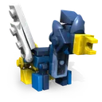

# Gryphon — LOT 12433

<!-- media:start (generated by scripts/build_media.py) -->
{ .lu-icon .lu-on-light width="128" loading="lazy" }
<!-- media:end -->

[Pet database](./README.md) | [Methodology](./Methodology.md)

**Classification:** Tamable pet template (cross-checked local markers + historical named roster).

| Template field | Local snapshot value |
| --- | --- |
| LOT | 12433 |
| Objects name | Gryphon Pet |
| Display name | (blank) |
| Object type | NPC |
| Client description | Tamable Pet |
| English client name (locale.xml) | Gryphon Pet |
| English client description (locale.xml) | Tamable Pet |
| PET component registration | component 32 |
| PET component definition IDs | 32 |
| Raw locStatus | 2 |
| Object gate&#95;version | nexustower |

## Historical community entry

| Field | Reported in the cited article |
| --- | --- |
| Historical group | Faction pet: Sentinel |
| Historical location | (not given for faction pets) |
| Historical imagination cost | (not given) |
| Historical item condition | (none stated in that roster row) |
| Historical mission condition | (not stated in that roster row) |
| Historical achievement condition | (not stated in that roster row) |

These are summarized from the historical [Pets (revision 160061)](https://legouniverse.fandom.com/wiki/Pets?oldid=160061) article. The article does not provide a local LOT identifier; the LOT crosswalk here uses the matching local template name and pet record. Historical locations are not exact coordinates and do not establish current server availability.

## Taming puzzle data

| Client puzzle model LOT¹ | Client puzzle label | Imagination cost | Time limit | Valid pieces | Valid-pieces file |
| --- | --- | --- | --- | --- | --- |
| 13554 | Treasure Chest | 10 per build attempt | 30 s | 6 of 16 | ptmg&#95;TreasureChest&#95;Griffin&#95;Correct.lxfml |

The local server uses the puzzle lookup keyed by NPC LOT, validates its required imagination and valid-brick set, and consumes the configured imagination cost in its build-attempt handler. The timer is enforced server-side. The reviewed loader does **not** load the client fields for model LOT, difficulty, total pieces, model name, full model, or duration; it uses the NPC LOT as its in-memory model LOT. Treat column ¹ and the descriptive labels as client-table data, not proof of the server’s rendered puzzle model.

## Pet inventory and related item definitions

| Item type | LOT | Local name | Client description | Item page |
| --- | --- | --- | --- | --- |
| PET&#95;INVENTORY&#95;ITEM | 12433 | Gryphon Pet | Tamable Pet | [Item LOT 12433](../items/12433.md) |

For taming success, the server stores the selected pet LOT in the player’s pet data and adds an inventory model entry using that LOT. This explains the matching PET_INVENTORY_ITEM component; it is not evidence of a separate tradable/drop item. See [the server implementation](https://github.com/DarkflameUniverse/DarkflameServer/blob/8b7d1b946b5e7df18f2c82ccabcb2634aefc11f4/dGame/dComponents/PetComponent.cpp) and [Item LOT 12433](../items/12433.md).

## Mission and achievement task associations

| Definition | Kind | Client task text (locale.xml) | Local task fields | Definition metadata |
| --- | --- | --- | --- | --- |
| [Achievement 1334: Faction Pet Tamer](../quests/1334.md) | Achievement; shared task: taming any of the 4 listed pet templates counts | “Tame your Faction pet in Nexus Tower.” | taskType 22; target 12432; group 12431,12433,12434; targetValue 1; taskParam1 (blank) | Location/Nexus Tower; gate nexustower; prerequisite (none) |
| [Achievement 1720](../quests/1720.md) | Achievement; shared task: taming any of the 4 listed pet templates counts | (no client string) | taskType 22; target 12431; group 12432,12433,12434; targetValue 1; taskParam1 (blank) | Hidden/Hidden; gate (blank); prerequisite (none) |

**Shared tasks:** Achievement 1334 (“Faction Pet Tamer”) covers 4 templates; Achievement 1720 covers 4 templates. Taming any of the listed pet templates advances these tasks, so they are general taming objectives, not requirements or rewards specific to this pet.

## Direct mission-reward associations

No direct mission reward item LOT association was found. The ordinary local path for the 26 confirmed templates is the taming flow, not a Mission reward_item field.

## Mapped static placements

These are map-file placements and spawner waypoints, not proof of a live spawn. The source keeps inactive and gated spawners; client-only and invalid-position rows are excluded. XYZ uses the map coordinate system.

No valid placement was found in the matched local LUZ/LVL assets.

## PetComponent data

| Component ID | Audio set | Sprint speed | Imagination drain rate | Element type | Pet form | percentTameChance | tamability |
| --- | --- | --- | --- | --- | --- | --- | --- |
| 32 | Pet&#95;Buffalo | 10 | 60 | 1 | 0 | 101 | 100 |

In this server revision, the loader actively uses `sprintSpeed` for pet movement and `imaginationDrainRate` for the configurable drain timer. It marks percentTameChance, tamability, elementType, petForm, audio set, and other client columns unused; therefore the numeric chance/tamability values are not presented as live odds or requirements. The component may also read a scene `CheckPrecondition` setting, shown above when present.

Historical article citation: [Pets (revision 160061)](https://legouniverse.fandom.com/wiki/Pets?oldid=160061) (revision timestamp 2018-04-03T23:13:01Z).

## Evidence links

- [Local Objects row](../../db/Objects.md)
- [ComponentsRegistry](../../db/ComponentsRegistry.md), [PetComponent](../../db/PetComponent.md), and [TamingBuildPuzzles](../../db/TamingBuildPuzzles.md)
- [Pet/mission behavior source](https://github.com/DarkflameUniverse/DarkflameServer/blob/8b7d1b946b5e7df18f2c82ccabcb2634aefc11f4/dGame/dComponents/PetComponent.cpp)
- [Mapped zones index](./locations/README.md)
