# Pet Guide and Database

[Game Guide](../README.md) | [Pet Guide](../Pet%20Guide.md) | [Item Guide](../Item%20Guide.md)

If you want to try taming, start with the practical [Pet Guide](../Pet%20Guide.md).
This database helps you check a particular pet's requirements, puzzle, and
possible locations before you go looking for it.

The local data supports **26 confirmed tamable templates**. Other entries
are included for completeness but may be test objects, technical records, or
creatures whose tamability is unknown. A database entry or map location does
not guarantee that the pet is available in your current game.

## Find a pet

Browse the confirmed pet entries below, or use your browser's Find command to
search for a species. Each page links to possible map placements and, where
known, taming puzzle details. Follow the in-game instructions; recorded map
positions may be inactive or gated.

## Pet entries

- [Elephant (3050)](./3050.md) — Tamable
- [Elephant (3051)](./3051.md) — PET component; tamability unknown
- [Cat (3054)](./3054.md) — Tamable
- [Triceratops (3055)](./3055.md) — PET component; tamability unknown
- [Wild Elephant (3194)](./3194.md) — PET component; tamability unknown
- [Triceratops (3195)](./3195.md) — Tamable
- [Reindeer (3253)](./3253.md) — PET component; tamability unknown
- [Terrier (3254)](./3254.md) — Tamable
- [Skunk (3261)](./3261.md) — Tamable
- [Wild Reindeer (3266)](./3266.md) — PET component; tamability unknown
- [Lion (3520)](./3520.md) — Tamable
- [Bunny (3672)](./3672.md) — Tamable
- [Crocodile (3994)](./3994.md) — Tamable
- [Nancy the Lion - Coalessa's Pet (3995)](./3995.md) — PET component; tamability unknown
- [Special Pet (4826)](./4826.md) — PET component; tamability unknown
- [Doberman (5635)](./5635.md) — Tamable
- [Buffalo (5636)](./5636.md) — Tamable
- [Robot Dog (5637)](./5637.md) — Tamable
- [Unresolved pet LOT 5638 (5638)](./5638.md) — Puzzle / PET candidate
- [Red Dragon (5639)](./5639.md) — Tamable
- [Tortoise (5640)](./5640.md) — Tamable
- [Green Dragon (5641)](./5641.md) — Tamable
- [Mantis (5642)](./5642.md) — Tamable
- [Panda (5643)](./5643.md) — Tamable
- [AG - Min Spec Pets (6554)](./6554.md) — PET component; tamability unknown
- [Warthog (6720)](./6720.md) — Tamable
- [Goat (7638)](./7638.md) — Tamable
- [Crab (7694)](./7694.md) — Tamable
- [TEST NS Skunk enemy (8047)](./8047.md) — Puzzle / PET candidate
- [Reindeer (12294)](./12294.md) — Tamable
- [Stegosaurus (12431)](./12431.md) — Tamable
- [Saber Cat (12432)](./12432.md) — Tamable
- [Gryphon (12433)](./12433.md) — Tamable
- [Alien (12434)](./12434.md) — Tamable
- [TEST Shane Pet (12806)](./12806.md) — Puzzle / PET candidate
- [Skeleton Dragon (13067)](./13067.md) — Tamable
- [Unresolved pet LOT 13192 (13192)](./13192.md) — PET component; tamability unknown
- [Earth Dragon (16210)](./16210.md) — Tamable
- [Unresolved pet LOT 16479 (16479)](./16479.md) — Puzzle / PET candidate

**Completeness check against the client strings:** locale.xml marks exactly 26 objects as “Tamable Pet” (Alien, Buffalo, Bunny, Cat, Crab, Crocodile, Doberman, Earth Dragon, Elephant, Goat, Green Dragon, Gryphon, Lion, Mantis, Panda, Red Dragon, Reindeer, Robot Dog, Saber Cat, Skeleton Dragon, Skunk, Stegosaurus, Terrier, Tortoise, Triceratops, Warthog), the same 26 templates listed as Tamable above, so no tamable pet is missing. LOT 5638 and LOT 16479 have taming-puzzle rows but no Objects row and no client name; see their pages for details.

## More pet references

- [Mapped pet-template locations and coordinates](./locations/README.md)
- [Related pet items](#related-inventory-item-definitions)
- [Pet-related quests and achievements](../quests/README.md)
- [Technical methodology and evidence rules](./Methodology.md)
- [Component-only definition rows](./components/README.md)
- [Coverage report](./Coverage.json)

## Behind the reference data

The tables below summarize what was found in the local files. They are
technical coverage counts, not a list of pets you can necessarily find in
game. The [methodology](./Methodology.md) explains how records were classified
and what the server source does or does not use.

### Coverage summary

- **Tamable pet templates:** 26
- **Other PET templates:** 9
- **Other PET / puzzle templates:** 4

| Evidence | Count |
|---|---:|
| PET component registrations | 38 |
| PetComponent table rows | 35 |
| Unreferenced PetComponent rows | 4 |
| PET_CONTROL registrations | 0 |
| PET_TAMING_CONTROL registrations | 0 |
| ItemEggData rows | 3 |
| Unique LOTs with PET component | 38 |
| Unique LOTs with taming puzzle rows | 30 |
| Confirmed tamable pet templates | 26 |
| Other PET-component or puzzle records retained | 13 |
| Pet inventory item LOTs | 31 |
| Egg item LOTs | 2 |
| Pet food item LOTs | 1 |
| Static tamable templates with matched map placements | 16 of 26 |
| Pet-taming mission-task rows | 38 |
| Public historical species matches | 26 |

Evidence counts have different scopes and are not additive. See the [coverage file](./Coverage.json) and [methodology](./Methodology.md) before interpreting them.

### Related inventory item definitions

These rows use the local CDClient ITEM component and are cross-linked to the full [item detail pages](../items/README.md). Pet inventory items may be generated by taming; their presence is not proof of a drop route. Entries with “test”/“no longer used” source descriptions are preserved as such.

| Item type | Local object name | English client name (locale.xml) | Item LOT | Client description |
| --- | --- | --- | --- | --- |
| PET&#95;INVENTORY&#95;ITEM | Elephant Pet | Elephant Pet | { .lu-ti width="24" loading="lazy" } [LOT 3050](../items/3050.md) | Tamable Pet |
| PET&#95;INVENTORY&#95;ITEM | Cat Pet | Cat Pet | { .lu-ti width="24" loading="lazy" } [LOT 3054](../items/3054.md) | Tamable Pet |
| EGG | Test Terrier Egg | (no client string) | { .lu-ti width="24" loading="lazy" } [LOT 3191](../items/3191.md) | no longer used |
| EGG | Test Reindeer Egg | (no client string) | { .lu-ti width="24" loading="lazy" } [LOT 3193](../items/3193.md) | no longer used |
| PET&#95;INVENTORY&#95;ITEM | Triceratops Pet | Triceratops Pet | { .lu-ti width="24" loading="lazy" } [LOT 3195](../items/3195.md) | Tamable Pet |
| PET&#95;FOOD | Test Pet Food | (no client string) | { .lu-ti width="24" loading="lazy" } [LOT 3227](../items/3227.md) | no longer used |
| PET&#95;INVENTORY&#95;ITEM | Terrier Pet | Terrier Pet | 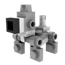{ .lu-ti width="24" loading="lazy" } [LOT 3254](../items/3254.md) | Tamable Pet |
| PET&#95;INVENTORY&#95;ITEM | Skunk Pet | Skunk Pet | { .lu-ti width="24" loading="lazy" } [LOT 3261](../items/3261.md) | Tamable Pet |
| PET&#95;INVENTORY&#95;ITEM | Lion Pet | Lion Pet | 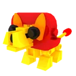{ .lu-ti width="24" loading="lazy" } [LOT 3520](../items/3520.md) | Tamable Pet |
| PET&#95;INVENTORY&#95;ITEM | Bunny Pet | Bunny Pet | 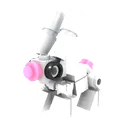{ .lu-ti width="24" loading="lazy" } [LOT 3672](../items/3672.md) | Tamable Pet |
| PET&#95;INVENTORY&#95;ITEM | Pet Inventory Item | (no client string) | [LOT 3903](../items/3903.md) | Template object for all tamable pets |
| PET&#95;INVENTORY&#95;ITEM | Crocodile Pet | Crocodile Pet | 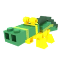{ .lu-ti width="24" loading="lazy" } [LOT 3994](../items/3994.md) | Tamable Pet |
| PET&#95;INVENTORY&#95;ITEM | Special Pet | (no client string) | [LOT 4826](../items/4826.md) | Don't use |
| PET&#95;INVENTORY&#95;ITEM | Doberman Pet | Doberman Pet | { .lu-ti width="24" loading="lazy" } [LOT 5635](../items/5635.md) | Tamable Pet |
| PET&#95;INVENTORY&#95;ITEM | Buffalo Pet | Buffalo Pet | 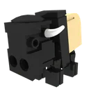{ .lu-ti width="24" loading="lazy" } [LOT 5636](../items/5636.md) | Tamable Pet |
| PET&#95;INVENTORY&#95;ITEM | Robot Dog Pet | Robot Dog Pet | 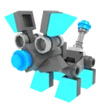{ .lu-ti width="24" loading="lazy" } [LOT 5637](../items/5637.md) | Tamable Pet |
| PET&#95;INVENTORY&#95;ITEM | Red Dragon Pet | Red Dragon Pet | { .lu-ti width="24" loading="lazy" } [LOT 5639](../items/5639.md) | Tamable Pet |
| PET&#95;INVENTORY&#95;ITEM | Tortoise Pet | Tortoise Pet | 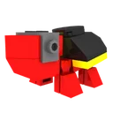{ .lu-ti width="24" loading="lazy" } [LOT 5640](../items/5640.md) | Tamable Pet |
| PET&#95;INVENTORY&#95;ITEM | Green Dragon Pet | Green Dragon Pet | 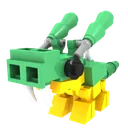{ .lu-ti width="24" loading="lazy" } [LOT 5641](../items/5641.md) | Tamable Pet |
| PET&#95;INVENTORY&#95;ITEM | Mantis Pet | Mantis Pet | 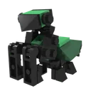{ .lu-ti width="24" loading="lazy" } [LOT 5642](../items/5642.md) | Tamable Pet |
| PET&#95;INVENTORY&#95;ITEM | Panda Pet | Panda Pet | 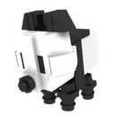{ .lu-ti width="24" loading="lazy" } [LOT 5643](../items/5643.md) | Tamable Pet |
| PET&#95;INVENTORY&#95;ITEM | AG - Min Spec Pets | (no client string) | [LOT 6554](../items/6554.md) | Min spec test |
| PET&#95;INVENTORY&#95;ITEM | Warthog Pet | Warthog Pet | { .lu-ti width="24" loading="lazy" } [LOT 6720](../items/6720.md) | Tamable Pet |
| PET&#95;INVENTORY&#95;ITEM | Goat Pet | Goat Pet | { .lu-ti width="24" loading="lazy" } [LOT 7638](../items/7638.md) | Tamable Pet |
| PET&#95;INVENTORY&#95;ITEM | Crab Pet | Crab Pet | { .lu-ti width="24" loading="lazy" } [LOT 7694](../items/7694.md) | Tamable Pet |
| PET&#95;INVENTORY&#95;ITEM | Reindeer Pet | Reindeer | { .lu-ti width="24" loading="lazy" } [LOT 12294](../items/12294.md) | Tamable Pet |
| PET&#95;INVENTORY&#95;ITEM | Stegosaurus Pet | Stegosaurus Pet | 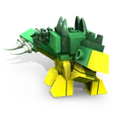{ .lu-ti width="24" loading="lazy" } [LOT 12431](../items/12431.md) | Tamable Pet |
| PET&#95;INVENTORY&#95;ITEM | Saber Cat Pet | Saber Cat Pet | 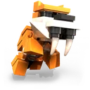{ .lu-ti width="24" loading="lazy" } [LOT 12432](../items/12432.md) | Tamable Pet |
| PET&#95;INVENTORY&#95;ITEM | Gryphon Pet | Gryphon Pet | 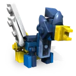{ .lu-ti width="24" loading="lazy" } [LOT 12433](../items/12433.md) | Tamable Pet |
| PET&#95;INVENTORY&#95;ITEM | Alien Pet | Alien Pet | 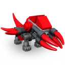{ .lu-ti width="24" loading="lazy" } [LOT 12434](../items/12434.md) | Tamable Pet |
| PET&#95;INVENTORY&#95;ITEM | TEST Untamable Pet for Property | TEST Shane Pet | 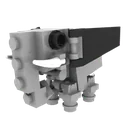{ .lu-ti width="24" loading="lazy" } [LOT 12806](../items/12806.md) | (blank) |
| PET&#95;INVENTORY&#95;ITEM | Skeleton Dragon Pet | Skeleton Dragon Pet | 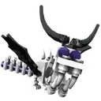{ .lu-ti width="24" loading="lazy" } [LOT 13067](../items/13067.md) | Tamable Pet |
| PET&#95;INVENTORY&#95;ITEM | Ninjago Earth Dragon Pet | Earth Dragon Pet | 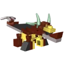{ .lu-ti width="24" loading="lazy" } [LOT 16210](../items/16210.md) | Tamable Pet |
| PET&#95;INVENTORY&#95;ITEM | (missing Objects name) | (no client string) | 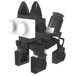{ .lu-ti width="24" loading="lazy" } [LOT 16479](../items/16479.md) | (blank) |

### Historical taming prerequisite

The cited [Pets (revision 160061)](https://legouniverse.fandom.com/wiki/Pets?oldid=160061) article says a player first had to speak with Coalessa in Pet Cove to learn taming. This is historical community guidance, not a local server-wide gate verified for every deployment.

### Global pet ability table

These rows are global definitions, not assignments to individual species. The server component currently initializes the pet ability as invalid and documents abilities as unused; no species-to-ability mapping is inferred.

| ID | Ability name | Client display name (locale.xml) | Imagination cost | Raw locStatus |
| --- | --- | --- | --- | --- |
| 0 | invalid | Ability | 0 | 2 |
| 1 | Go To Object | Ability | 0 | 2 |
| 2 | Jump On Object | Jump | 2 | 2 |
| 3 | Dig At Position | Dig | 1 | 2 |

### Taming minigame and pet behaviors

The server source starts the pet-taming interaction on an eligible untamed PET entity, checks scene preconditions and the local puzzle definition, requires the configured imagination amount, and presents the valid-brick puzzle with a server timer. Successful completion asks for a pet name, routes it through the naming-moderation flow, stores a pet record, and creates the matching inventory model entry. See a species page for its exact local puzzle fields and [PetComponent.cpp](https://github.com/DarkflameUniverse/DarkflameServer/blob/8b7d1b946b5e7df18f2c82ccabcb2634aefc11f4/dGame/dComponents/PetComponent.cpp).

The local code handles owner-following, interaction with pet switches/bouncers, and treasure digging after the Pet Cove mission [Quest 842: Lost Tags](../quests/842.md) is complete. A code comment/branch restricts bone treasure to the Skeleton Dragon template (LOT 13067). The available [PetAbilities](../../db/PetAbilities.md) table is not a per-species ability map; this server revision initializes the ability as invalid and treats the ability as currently unused. No ability is assigned to a species here.

For historical context, see the cited [Pet Cove article revision](https://legouniverse.fandom.com/wiki/Pet_Cove?oldid=163381) in [methodology](./Methodology.md). This database itself does not assert which features a live server enables.
