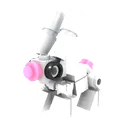
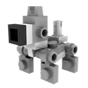

# Tame a Pet - Quest 110

[Quest database](./README.md) | [Quest Guide](../Quest%20Guide.md) | [Methodology](./Methodology.md)

**Definition ID: 110** | Quest | Location / Pet Cove | Repeatable: False

**Official client name** from the client locale.xml (`Missions_110_name`, en&#95;US). The historical community association below agrees with this name.

## Description

Official client text from locale.xml (en&#95;US):

**Offer text:** The Universe is alive with wonderful animals just waiting to be your friend! Use this Pet Emote to play the Pet Taming mini-game!

**Accept reply:** Pick a Pet and interact with it - or try your new Pet Emote!

**In-progress text:** Interact with an animal in Pet Cove to start the Pet Taming mini-game.

**Objectives-complete tip:** Return to Coalessa in Pet Cove and tell her you have tamed a Pet!

**Turn-in text:** You really have a way with animals! I bet your new friends can even help you use Pet Bouncers now!

### Objectives

Client task text from locale.xml is shown where it exists; the indented line is the data-derived summary of the same MissionTasks row.

- Tame a pet in Pet Cove.
    - Data summary: Tame 1 matching pet(s): Bunny Pet / Terrier Pet / Cat Pet.

## Start, turn-in, and locations

| Role | NPC / object | Mapped candidate zones | Association evidence |
| --- | --- | --- | --- |
| Defined offer object | [Coalessa - Assembly Mystic (LOT 3257)](sources/object-3257.md) | [Pet Cove (1201)](locations/zone-1201.md) | Missions.offer&#95;objectID |
| Defined turn-in object | [Coalessa - Assembly Mystic (LOT 3257)](sources/object-3257.md) | [Pet Cove (1201)](locations/zone-1201.md) | Missions.target&#95;objectID |
| Offers mission | [Coalessa - Assembly Mystic (LOT 3257)](sources/object-3257.md) | [Pet Cove (1201)](locations/zone-1201.md) | MissionNPCComponent 2 |
| Accepts turn-in | [Coalessa - Assembly Mystic (LOT 3257)](sources/object-3257.md) | [Pet Cove (1201)](locations/zone-1201.md) | MissionNPCComponent 2 |

Follow a named object for exact XYZ and scene/spawner conditions. Static placements do not prove that the NPC is currently spawned, offers this quest to your character, or is reachable in a deployed server.

## Requirements and quest chain

- Stored prerequisite expression: (empty).
- Inspected server evaluation: TRUE.
- UIPrereqID: (not recorded); shown separately, not misread as a mission ID.
- Cooldown: not recorded (loader default -1); -1 means no cooldown in CanAccept.
- Stored feature gate / localization status: (none) / 2. The generic mission/task loaders mark gate_version unused; other scripts, map gates, and client checks can still restrict availability.
- Referenced as a prerequisite by: [Fetch! &#91;111&#93;](111.md); [Mysterious Pet &#91;1180&#93;](1180.md); [Hidden and Dangerous &#91;1384&#93;](1384.md); [In Pursuit of a Pet &#91;1387&#93;](1387.md); [I Am the Egg Man &#91;1390&#93;](1390.md); [The Perfect Paradox Pet &#91;1393&#93;](1393.md). These are potential follow-ups, not a guarantee of an immediate offer.

## Walkthrough / checklist

1. Satisfy the prerequisites and any client, map, or script conditions. Check the giver listed above; where none is resolved, the acceptance route remains unknown.
2. Accept the quest before relying on objective credit. Inventory gather tasks, existing flags, and racing parameter-4 tasks have limited acceptance catch-up; other earlier actions are not assumed to count.
3. Tame 1 matching pet(s): Bunny Pet / Terrier Pet / Cat Pet. See objective **1** below for target references and conditions.
4. After all objective counters are satisfied, complete the recorded turn-in interaction. If offered a reward choice, select the desired item rather than assuming all alternatives are granted.

**These numbered entries are a readable checklist, not evidence that the objective rows must be completed in this order.** Scripted phases, travel routes, puzzle interactions, and custom conditions are not reconstructed unless the data/source evidence supports them.

## Objective details

### Objective 1: Tame pet (UID 115)

**Client task text:** Tame a pet in Pet Cove.

Tame 1 matching pet(s): Bunny Pet / Terrier Pet / Cat Pet.

Target namespace: **LOT**. Stored target value/threshold: **1**.

| Matching / associated object | Mapped zones | Item acquisition data |
| --- | --- | --- |
| [Bunny Pet (LOT 3672)](sources/object-3672.md) | [Pet Cove (1201)](locations/zone-1201.md) | { .lu-ti width="24" loading="lazy" } [Bunny Pet (LOT 3672)](../items/3672.md) |
| [Terrier Pet (LOT 3254)](sources/object-3254.md) | [Pet Cove (1201)](locations/zone-1201.md) | { .lu-ti width="24" loading="lazy" } [Terrier Pet (LOT 3254)](../items/3254.md) |
| [Cat Pet (LOT 3054)](sources/object-3054.md) | [Pet Cove (1201)](locations/zone-1201.md) | { .lu-ti width="24" loading="lazy" } [Cat Pet (LOT 3054)](../items/3054.md) |

| Raw task field | Value |
| --- | --- |
| taskType | 22 |
| target | 3672 |
| targetGroup | 3254,3054 |
| targetValue | 1 |
| taskParam1 |  |
| uid | 115 |
| gate_version |  |

## Rewards

The item slots below are listed completion rewards, not random loot-table rolls. Player eligibility and completion still apply.

No positive item reward LOT is defined for the displayed completion modes.

| Reward | First completion / stored value | Repeat behavior |
| --- | --- | --- |
| Coins | 125 | Not advertised as repeatable |
| U-Score | 20 | Not advertised as repeatable |
| Reputation | 0 | Not advertised as repeatable |
| Maximum Life | No positive grant defined | First completion only |
| Maximum Imagination | No positive grant defined | First completion only |
| Item backpack slots | No positive grant defined | First completion only |
| Vault item AND vault model slots | No positive grant defined | First completion only |

Emote unlocks (first completion): none with positive IDs recorded.

At the configured level cap, U-Score can be converted into coins using server configuration. Stored base coins are not a quote for that conversion. Reputation and U-Score are processed before the repeat-reward branch; stat increases and emote unlocks are first-completion only.

## Historical community references

- [Tame a Pet](https://legouniverse.fandom.com/wiki/Tame_a_Pet?oldid=159789) — candidate title from Tame a Pet. Matching evidence groups: **U-Score, coins, NPC, region**. Revision 159789; retrieved 2026-11-17T09:38:18.243Z.
  Reported factual methods: not categorized; location labels: Pet Cove; named objective references: none extracted; named reward references: none extracted.

This page provides an original data-derived checklist, not copied wiki dialogue or a claim that the historical walkthrough exactly matches the deployed server.

## Evidence and limitations

[Missions](../../db/Missions.md), [MissionTasks](../../db/MissionTasks.md), [MissionNPCComponent](../../db/MissionNPCComponent.md), [MissionText](../../db/MissionText.md), [MissionEmail](../../db/MissionEmail.md). [Task interpretation and coverage](./Methodology.md). Availability, client presentation, puzzle phases, and custom script behavior can differ.
