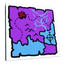

# Pieces of Eight - Quest 1132

[Quest database](./README.md) | [Quest Guide](../Quest%20Guide.md) | [Methodology](./Methodology.md)

**Definition ID: 1132** | Quest | Location / Nexus Tower | Repeatable: False

**Official client name** from the client locale.xml (`Missions_1132_name`, en&#95;US). The historical community association below agrees with this name.

## Description

Official client text from locale.xml (en&#95;US):

**Offer text:** Blimey! Me compasses have been scattered to the winds while I was peeping in the spyglass. Snap to it and bring back all 8 of 'em!

**Accept reply:** Can't go anywhere without me compasses! Or me shoes, for that matter.

**In-progress text:** Collect the 8 compasses in the Venture League Map Room of Nexus Tower.

**Objectives-complete tip:** Return the compasses to Hael Storm in the Venture League Observatory.

**Turn-in text:** I ain't seen fleet-footin' like that since Trek Furino got chased off by Doc Overeasy's mechanical dog! Har!

### Objectives

Client task text from locale.xml is shown where it exists; the indented line is the data-derived summary of the same MissionTasks row.

- Collect 8 compasses in the Venture League Map Room for Hael Storm.
    - Data summary: Collect 8 distinct collectible(s) matching Compass Collectable Spawner. Collection identity includes the collectible ID and zone; repeated collection of the same identity does not add credit.

## Start, turn-in, and locations

| Role | NPC / object | Mapped candidate zones | Association evidence |
| --- | --- | --- | --- |
| Defined offer object | [Hael Storm - Venture League Faction Leader (LOT 12258)](sources/object-12258.md) | [Nexus Tower (1900)](locations/zone-1900.md) | Missions.offer&#95;objectID |
| Defined turn-in object | [Hael Storm - Venture League Faction Leader (LOT 12258)](sources/object-12258.md) | [Nexus Tower (1900)](locations/zone-1900.md) | Missions.target&#95;objectID |
| Offers mission | [Hael Storm - Venture League Faction Leader (LOT 12258)](sources/object-12258.md) | [Nexus Tower (1900)](locations/zone-1900.md) | MissionNPCComponent 112 |
| Accepts turn-in | [Hael Storm - Venture League Faction Leader (LOT 12258)](sources/object-12258.md) | [Nexus Tower (1900)](locations/zone-1900.md) | MissionNPCComponent 112 |

Follow a named object for exact XYZ and scene/spawner conditions. Static placements do not prove that the NPC is currently spawned, offers this quest to your character, or is reachable in a deployed server.

## Requirements and quest chain

- Stored prerequisite expression: 999 &#124; 1676 &#124; 1675 &#124; 1001.
- Inspected server evaluation: ([Venture Forth &#91;999&#93;](999.md) is complete OR ([Parley with the Pirate &#91;1676&#93;](1676.md) is complete OR ([Occidental Orienteer &#91;1675&#93;](1675.md) is complete OR [Hearty and Hael &#91;1001&#93;](1001.md) is complete))).
- UIPrereqID: (not recorded); shown separately, not misread as a mission ID.
- Cooldown: not recorded (loader default -1); -1 means no cooldown in CanAccept.
- Stored feature gate / localization status: nexustower / 2. The generic mission/task loaders mark gate_version unused; other scripts, map gates, and client checks can still restrict availability.
- Referenced prerequisite definitions: [Venture Forth &#91;999&#93;](999.md); [Parley with the Pirate &#91;1676&#93;](1676.md); [Occidental Orienteer &#91;1675&#93;](1675.md); [Hearty and Hael &#91;1001&#93;](1001.md).
- Referenced as a prerequisite by: [Nexus Force Vault &#91;1383&#93;](1383.md); [Target Locked &#91;1667&#93;](1667.md); [Compass Courier &#91;1677&#93;](1677.md); [The Pirate’s Reply &#91;1678&#93;](1678.md); [Hael's Dark Flame &#91;1686&#93;](1686.md). These are potential follow-ups, not a guarantee of an immediate offer.

## Walkthrough / checklist

1. Satisfy the prerequisites and any client, map, or script conditions. Check the giver listed above; where none is resolved, the acceptance route remains unknown.
2. Accept the quest before relying on objective credit. Inventory gather tasks, existing flags, and racing parameter-4 tasks have limited acceptance catch-up; other earlier actions are not assumed to count.
3. Collect 8 distinct collectible(s) matching Compass Collectable Spawner. Collection identity includes the collectible ID and zone; repeated collection of the same identity does not add credit. See objective **1** below for target references and conditions.
4. After all objective counters are satisfied, complete the recorded turn-in interaction. If offered a reward choice, select the desired item rather than assuming all alternatives are granted.

**These numbered entries are a readable checklist, not evidence that the objective rows must be completed in this order.** Scripted phases, travel routes, puzzle interactions, and custom conditions are not reconstructed unless the data/source evidence supports them.

## Objective details

### Objective 1: Unique collectibles (UID 1580)

**Client task text:** Collect 8 compasses in the Venture League Map Room for Hael Storm.

Collect 8 distinct collectible(s) matching Compass Collectable Spawner. Collection identity includes the collectible ID and zone; repeated collection of the same identity does not add credit.

Target namespace: **LOT**. Stored target value/threshold: **8**.

| Matching / associated object | Mapped zones | Item acquisition data |
| --- | --- | --- |
| [Compass Collectable Spawner (LOT 12404)](sources/object-12404.md) | [Nexus Tower (1900)](locations/zone-1900.md) | Not an item-template registration |

- Stored task gate: nexustower (not enforced by the inspected generic task loader)
- Unique collectibles are tracked, not just repeated events against one object.

| Raw task field | Value |
| --- | --- |
| taskType | 3 |
| target | 12404 |
| targetGroup |  |
| targetValue | 8 |
| taskParam1 |  |
| uid | 1580 |
| gate_version | nexustower |

## Rewards

The item slots below are listed completion rewards, not random loot-table rolls. Player eligibility and completion still apply.

| Item reward slot | Item | Granted quantity | Stored count / notes |
| --- | --- | --- | --- |
| First completion / 1 | { .lu-ti width="24" loading="lazy" } [Treasure Finder (LOT 14169)](../items/14169.md) | 1 | 1 |

| Reward | First completion / stored value | Repeat behavior |
| --- | --- | --- |
| Coins | 0 | Not advertised as repeatable |
| U-Score | 220 | Not advertised as repeatable |
| Reputation | 0 | Not advertised as repeatable |
| Maximum Life | No positive grant defined | First completion only |
| Maximum Imagination | No positive grant defined | First completion only |
| Item backpack slots | No positive grant defined | First completion only |
| Vault item AND vault model slots | No positive grant defined | First completion only |

Emote unlocks (first completion): none with positive IDs recorded.

At the configured level cap, U-Score can be converted into coins using server configuration. Stored base coins are not a quote for that conversion. Reputation and U-Score are processed before the repeat-reward branch; stat increases and emote unlocks are first-completion only.

## Historical community references

- [Pieces of Eight](https://legouniverse.fandom.com/wiki/Pieces_of_Eight?oldid=140693) — candidate title from Pieces of Eight. Matching evidence groups: **U-Score, NPC, reward item, objective kind, objective threshold**. Revision 140693; retrieved 2026-11-17T09:38:24.051Z.
  Reported factual methods: collect/gather; location labels: not extracted; named objective references: none extracted; named reward references: Treasure Finder.
- [Pieces of Eight](https://legouniverse.fandom.com/wiki/Pieces_of_Eight?oldid=140693) — candidate title from Pieces of Eight. Matching evidence groups: **U-Score, NPC, reward item, objective kind, objective threshold**. Revision 140693; retrieved 2026-11-17T09:38:24.051Z.
  Reported factual methods: collect/gather; location labels: not extracted; named objective references: none extracted; named reward references: Treasure Finder.
- [Pieces of Eight](https://legouniverse.fandom.com/wiki/Pieces_of_Eight?oldid=140693) — candidate title from Pieces of Eight. Matching evidence groups: **U-Score, NPC, reward item, objective kind, objective threshold**. Revision 140693; retrieved 2026-11-17T09:38:24.051Z.
  Reported factual methods: collect/gather; location labels: not extracted; named objective references: none extracted; named reward references: Treasure Finder.
- [Pieces of Eight](https://legouniverse.fandom.com/wiki/Pieces_of_Eight?oldid=140693) — candidate title from Pieces of Eight. Matching evidence groups: **U-Score, NPC, reward item, objective kind, objective threshold**. Revision 140693; retrieved 2026-11-17T09:38:24.051Z.
  Reported factual methods: collect/gather; location labels: not extracted; named objective references: none extracted; named reward references: Treasure Finder.

This page provides an original data-derived checklist, not copied wiki dialogue or a claim that the historical walkthrough exactly matches the deployed server.

## Evidence and limitations

[Missions](../../db/Missions.md), [MissionTasks](../../db/MissionTasks.md), [MissionNPCComponent](../../db/MissionNPCComponent.md), [MissionText](../../db/MissionText.md), [MissionEmail](../../db/MissionEmail.md). [Task interpretation and coverage](./Methodology.md). Availability, client presentation, puzzle phases, and custom script behavior can differ.
