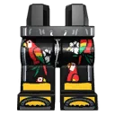

# Burst Pipes - Quest 1150

[Quest database](./README.md) | [Quest Guide](../Quest%20Guide.md) | [Methodology](./Methodology.md)

**Definition ID: 1150** | Quest | Location / Nexus Tower | Repeatable: False

**Official client name** from the client locale.xml (`Missions_1150_name`, en&#95;US).

## Description

Official client text from locale.xml (en&#95;US):

**Offer text:** Ya know, Imagination's a powerful thing - sometimes too powerful! Can you fix 4 of the burst Imagination pipes around the Tower?

**Accept reply:** You gotta search all over the Tower for the burst Imagination pipes.

**In-progress text:** Quick Build 4 Imagination pipes around Nexus Tower.

**Objectives-complete tip:** Return to Augie Ninewells in the Nexus Core.

**Turn-in text:** Eh, sometimes our little pipe dream here turns into a nightmare. Thanks for pitchin' in!

### Objectives

Client task text from locale.xml is shown where it exists; the indented line is the data-derived summary of the same MissionTasks row.

- Quick Build 4 Imagination pipes in Nexus Tower.
    - Data summary: Complete 4 matching activity / Quick Build event(s): NT - Pipe Rebuild6 / NT - Pipe Rebuild1.

## Start, turn-in, and locations

| Role | NPC / object | Mapped candidate zones | Association evidence |
| --- | --- | --- | --- |
| Defined offer object | [Augie Ninewells - Assembly Guard (LOT 12257)](sources/object-12257.md) | [Nexus Tower (1900)](locations/zone-1900.md) | Missions.offer&#95;objectID |
| Defined turn-in object | [Augie Ninewells - Assembly Guard (LOT 12257)](sources/object-12257.md) | [Nexus Tower (1900)](locations/zone-1900.md) | Missions.target&#95;objectID |
| Offers mission | [Augie Ninewells - Assembly Guard (LOT 12257)](sources/object-12257.md) | [Nexus Tower (1900)](locations/zone-1900.md) | MissionNPCComponent 115 |
| Accepts turn-in | [Augie Ninewells - Assembly Guard (LOT 12257)](sources/object-12257.md) | [Nexus Tower (1900)](locations/zone-1900.md) | MissionNPCComponent 115 |

Follow a named object for exact XYZ and scene/spawner conditions. Static placements do not prove that the NPC is currently spawned, offers this quest to your character, or is reachable in a deployed server.

## Requirements and quest chain

- Stored prerequisite expression: 1296.
- Inspected server evaluation: [Forbidden Trophies &#91;1296&#93;](1296.md) is complete.
- UIPrereqID: (not recorded); shown separately, not misread as a mission ID.
- Cooldown: not recorded (loader default -1); -1 means no cooldown in CanAccept.
- Stored feature gate / localization status: nexustower / 2. The generic mission/task loaders mark gate_version unused; other scripts, map gates, and client checks can still restrict availability.
- Referenced prerequisite definitions: [Forbidden Trophies &#91;1296&#93;](1296.md).

## Walkthrough / checklist

1. Satisfy the prerequisites and any client, map, or script conditions. Check the giver listed above; where none is resolved, the acceptance route remains unknown.
2. Accept the quest before relying on objective credit. Inventory gather tasks, existing flags, and racing parameter-4 tasks have limited acceptance catch-up; other earlier actions are not assumed to count.
3. Complete 4 matching activity / Quick Build event(s): NT - Pipe Rebuild6 / NT - Pipe Rebuild1. See objective **1** below for target references and conditions.
4. After all objective counters are satisfied, complete the recorded turn-in interaction. If offered a reward choice, select the desired item rather than assuming all alternatives are granted.

**These numbered entries are a readable checklist, not evidence that the objective rows must be completed in this order.** Scripted phases, travel routes, puzzle interactions, and custom conditions are not reconstructed unless the data/source evidence supports them.

## Objective details

### Objective 1: Activity / Quick Build (UID 1600)

**Client task text:** Quick Build 4 Imagination pipes in Nexus Tower.

Complete 4 matching activity / Quick Build event(s): NT - Pipe Rebuild6 / NT - Pipe Rebuild1.

Target namespace: **ACTIVITY&#95;OR&#95;EVENT&#95;ID**. Stored target value/threshold: **4**.

| Matching / associated object | Mapped zones | Item acquisition data |
| --- | --- | --- |
| [NT - Pipe Rebuild6 (LOT 12416)](sources/object-12416.md) | [Nexus Tower (1900)](locations/zone-1900.md) | Not an item-template registration |
| [NT - Pipe Rebuild1 (LOT 12411)](sources/object-12411.md) | [Nexus Tower (1900)](locations/zone-1900.md) | Not an item-template registration |

The listed objects are candidate activities joined through SCRIPTED_ACTIVITY (39) or RebuildComponent.activityID, not an assumption that the activity number is a LOT. Script-created activities can be missing.

- Stored task gate: nexustower (not enforced by the inspected generic task loader)

| Raw task field | Value |
| --- | --- |
| taskType | 2 |
| target | 12416 |
| targetGroup | 12411 |
| targetValue | 4 |
| taskParam1 |  |
| uid | 1600 |
| gate_version | nexustower |

## Rewards

The item slots below are listed completion rewards, not random loot-table rolls. Player eligibility and completion still apply.

| Item reward slot | Item | Granted quantity | Stored count / notes |
| --- | --- | --- | --- |
| First completion / 1 | { .lu-ti width="24" loading="lazy" } [Parrot Pants (LOT 13546)](../items/13546.md) | 1 | 1 |

| Reward | First completion / stored value | Repeat behavior |
| --- | --- | --- |
| Coins | 0 | Not advertised as repeatable |
| U-Score | 220 | Not advertised as repeatable |
| Reputation | 0 | Not advertised as repeatable |
| Maximum Life | No positive grant defined | First completion only |
| Maximum Imagination | No positive grant defined | First completion only |
| Item backpack slots | No positive grant defined | First completion only |
| Vault item AND vault model slots | No positive grant defined | First completion only |

Emote unlocks (first completion): none with positive IDs recorded.

At the configured level cap, U-Score can be converted into coins using server configuration. Stored base coins are not a quote for that conversion. Reputation and U-Score are processed before the repeat-reward branch; stat increases and emote unlocks are first-completion only.

## Historical community references

No unique, sufficiently corroborated association was established in the researched community infoboxes. Similar names or matching numeric IDs were not treated as proof.

This page provides an original data-derived checklist, not copied wiki dialogue or a claim that the historical walkthrough exactly matches the deployed server.

## Evidence and limitations

[Missions](../../db/Missions.md), [MissionTasks](../../db/MissionTasks.md), [MissionNPCComponent](../../db/MissionNPCComponent.md), [MissionText](../../db/MissionText.md), [MissionEmail](../../db/MissionEmail.md). [Task interpretation and coverage](./Methodology.md). Availability, client presentation, puzzle phases, and custom script behavior can differ.
