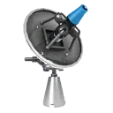

# Smash and Awe - Quest 1152

<!-- media:start (generated by scripts/build_media.py) -->
{ .lu-icon .lu-on-dark width="128" loading="lazy" }
<!-- media:end -->

[Quest database](./README.md) | [Quest Guide](../Quest%20Guide.md) | [Methodology](./Methodology.md)

**Definition ID: 1152** | Quest | Location / Avant Gardens | Repeatable: False

**Official client name** from the client locale.xml (`Missions_1152_name`, en&#95;US).

## Description

Official client text from locale.xml (en&#95;US):

**Offer text:** We need more airstrikes! **Quick Build all 4 Satellite Beacons** on the battlefield.

**Accept reply:** Don't forget the one in the Sentinel Base Camp!

**In-progress text:** **Quick Build all 4 Satellite Beacons** on the Avant Gardens battlefield.

**Objectives-complete tip:** You built the last Satellite Beacon. Use the console to report back to the pilot.

**Turn-in text:** Those Stromlings never see that coming!

### Objectives

Client task text from locale.xml is shown where it exists; the indented line is the data-derived summary of the same MissionTasks row.

- Quick Build the Satellite Beacon in the Sentinel Base Camp.
    - Data summary: Complete 1 matching activity / Quick Build event(s): 111.
- Quick Build the Satellite Beacon near the entrance to the Paradox ruins.
    - Data summary: Complete 1 matching activity / Quick Build event(s): 112.
- Quick Build the Satellite Beacon under the damaged roadway.
    - Data summary: Complete 1 matching activity / Quick Build event(s): 113.
- Quick Build the Satellite Beacon near the Paradox Facility ruins.
    - Data summary: Complete 1 matching activity / Quick Build event(s): 114.

## Start, turn-in, and locations

| Role | NPC / object | Mapped candidate zones | Association evidence |
| --- | --- | --- | --- |
| Defined offer object | [Outpost Console (LOT 7973)](sources/object-7973.md) | [Avant Gardens (1100)](locations/zone-1100.md) | Missions.offer&#95;objectID |
| Defined turn-in object | [Outpost Console (LOT 7973)](sources/object-7973.md) | [Avant Gardens (1100)](locations/zone-1100.md) | Missions.target&#95;objectID |
| Offers mission | [Outpost Console (LOT 7973)](sources/object-7973.md) | [Avant Gardens (1100)](locations/zone-1100.md) | MissionNPCComponent 1 |
| Accepts turn-in | [Outpost Console (LOT 7973)](sources/object-7973.md) | [Avant Gardens (1100)](locations/zone-1100.md) | MissionNPCComponent 1 |

Follow a named object for exact XYZ and scene/spawner conditions. Static placements do not prove that the NPC is currently spawned, offers this quest to your character, or is reachable in a deployed server.

## Requirements and quest chain

- Stored prerequisite expression: 322.
- Inspected server evaluation: [Avant Gardens Air Strike &#91;322&#93;](322.md) is complete.
- UIPrereqID: (not recorded); shown separately, not misread as a mission ID.
- Cooldown: not recorded (loader default -1); -1 means no cooldown in CanAccept.
- Stored feature gate / localization status: dec2010content / 2. The generic mission/task loaders mark gate_version unused; other scripts, map gates, and client checks can still restrict availability.
- Referenced prerequisite definitions: [Avant Gardens Air Strike &#91;322&#93;](322.md).
- Referenced as a prerequisite by: [Smashdown &#91;1864&#93;](1864.md). These are potential follow-ups, not a guarantee of an immediate offer.

## Walkthrough / checklist

1. Satisfy the prerequisites and any client, map, or script conditions. Check the giver listed above; where none is resolved, the acceptance route remains unknown.
2. Accept the quest before relying on objective credit. Inventory gather tasks, existing flags, and racing parameter-4 tasks have limited acceptance catch-up; other earlier actions are not assumed to count.
3. Complete 1 matching activity / Quick Build event(s): 111. See objective **1** below for target references and conditions.
4. Complete 1 matching activity / Quick Build event(s): 112. See objective **2** below for target references and conditions.
5. Complete 1 matching activity / Quick Build event(s): 113. See objective **3** below for target references and conditions.
6. Complete 1 matching activity / Quick Build event(s): 114. See objective **4** below for target references and conditions.
7. After all objective counters are satisfied, complete the recorded turn-in interaction. If offered a reward choice, select the desired item rather than assuming all alternatives are granted.

**These numbered entries are a readable checklist, not evidence that the objective rows must be completed in this order.** Scripted phases, travel routes, puzzle interactions, and custom conditions are not reconstructed unless the data/source evidence supports them.

## Objective details

### Objective 1: Activity / Quick Build (UID 1602)

**Client task text:** Quick Build the Satellite Beacon in the Sentinel Base Camp.

Complete 1 matching activity / Quick Build event(s): 111.

Target namespace: **ACTIVITY&#95;OR&#95;EVENT&#95;ID**. Stored target value/threshold: **1**.

The listed objects are candidate activities joined through SCRIPTED_ACTIVITY (39) or RebuildComponent.activityID, not an assumption that the activity number is a LOT. Script-created activities can be missing.

- Stored task gate: dec2010content (not enforced by the inspected generic task loader)

| Raw task field | Value |
| --- | --- |
| taskType | 2 |
| target | 111 |
| targetGroup |  |
| targetValue | 1 |
| taskParam1 |  |
| uid | 1602 |
| gate_version | dec2010content |
### Objective 2: Activity / Quick Build (UID 1604)

**Client task text:** Quick Build the Satellite Beacon near the entrance to the Paradox ruins.

Complete 1 matching activity / Quick Build event(s): 112.

Target namespace: **ACTIVITY&#95;OR&#95;EVENT&#95;ID**. Stored target value/threshold: **1**.

The listed objects are candidate activities joined through SCRIPTED_ACTIVITY (39) or RebuildComponent.activityID, not an assumption that the activity number is a LOT. Script-created activities can be missing.

- Stored task gate: dec2010content (not enforced by the inspected generic task loader)

| Raw task field | Value |
| --- | --- |
| taskType | 2 |
| target | 112 |
| targetGroup |  |
| targetValue | 1 |
| taskParam1 |  |
| uid | 1604 |
| gate_version | dec2010content |
### Objective 3: Activity / Quick Build (UID 1605)

**Client task text:** Quick Build the Satellite Beacon under the damaged roadway.

Complete 1 matching activity / Quick Build event(s): 113.

Target namespace: **ACTIVITY&#95;OR&#95;EVENT&#95;ID**. Stored target value/threshold: **1**.

The listed objects are candidate activities joined through SCRIPTED_ACTIVITY (39) or RebuildComponent.activityID, not an assumption that the activity number is a LOT. Script-created activities can be missing.

- Stored task gate: dec2010content (not enforced by the inspected generic task loader)

| Raw task field | Value |
| --- | --- |
| taskType | 2 |
| target | 113 |
| targetGroup |  |
| targetValue | 1 |
| taskParam1 |  |
| uid | 1605 |
| gate_version | dec2010content |
### Objective 4: Activity / Quick Build (UID 1606)

**Client task text:** Quick Build the Satellite Beacon near the Paradox Facility ruins.

Complete 1 matching activity / Quick Build event(s): 114.

Target namespace: **ACTIVITY&#95;OR&#95;EVENT&#95;ID**. Stored target value/threshold: **1**.

The listed objects are candidate activities joined through SCRIPTED_ACTIVITY (39) or RebuildComponent.activityID, not an assumption that the activity number is a LOT. Script-created activities can be missing.

- Stored task gate: dec2010content (not enforced by the inspected generic task loader)

| Raw task field | Value |
| --- | --- |
| taskType | 2 |
| target | 114 |
| targetGroup |  |
| targetValue | 1 |
| taskParam1 |  |
| uid | 1606 |
| gate_version | dec2010content |

## Rewards

The item slots below are listed completion rewards, not random loot-table rolls. Player eligibility and completion still apply.

No positive item reward LOT is defined for the displayed completion modes.

| Reward | First completion / stored value | Repeat behavior |
| --- | --- | --- |
| Coins | 250 | Not advertised as repeatable |
| U-Score | 30 | Not advertised as repeatable |
| Reputation | 0 | Not advertised as repeatable |
| Maximum Life | No positive grant defined | First completion only |
| Maximum Imagination | No positive grant defined | First completion only |
| Item backpack slots | No positive grant defined | First completion only |
| Vault item AND vault model slots | No positive grant defined | First completion only |

Emote unlocks (first completion): none with positive IDs recorded.

At the configured level cap, U-Score can be converted into coins using server configuration. Stored base coins are not a quote for that conversion. Reputation and U-Score are processed before the repeat-reward branch; stat increases and emote unlocks are first-completion only.

## Historical community references

No unique, sufficiently corroborated association was established in the researched community infoboxes. Similar names or matching numeric IDs were not treated as proof.

This page provides an original data-derived checklist, not copied wiki dialogue or a claim that the historical walkthrough exactly matches the deployed server.

## Evidence and limitations

[Missions](../../db/Missions.md), [MissionTasks](../../db/MissionTasks.md), [MissionNPCComponent](../../db/MissionNPCComponent.md), [MissionText](../../db/MissionText.md), [MissionEmail](../../db/MissionEmail.md). [Task interpretation and coverage](./Methodology.md). Availability, client presentation, puzzle phases, and custom script behavior can differ.
