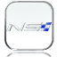

# Nerves of Steel - Quest 1165

<!-- media:start (generated by scripts/build_media.py) -->
{ .lu-icon .lu-on-dark width="128" loading="lazy" }
<!-- media:end -->

[Quest database](./README.md) | [Quest Guide](../Quest%20Guide.md) | [Methodology](./Methodology.md)

**Definition ID: 1165** | Quest | Racing / Forbidden Valley | Repeatable: False

**Official client name** from the client locale.xml (`Missions_1165_name`, en&#95;US). The historical community association below agrees with this name.

## Description

Official client text from locale.xml (en&#95;US):

**Offer text:** A Ninja cannot be harmed by danger. Prove you can be a Ninja by completing a race without wrecking!

**Accept reply:** The Chasm is not the only danger - beware the other players as well!

**In-progress text:** Complete a race at the Dragonmaw Chasm racetrack without wrecking.

**Objectives-complete tip:** Return to Zip Lash at the Forbidden Valley Race Place.

**Turn-in text:** Not even the Stromlings' jeers could touch you!

### Objectives

Client task text from locale.xml is shown where it exists; the indented line is the data-derived summary of the same MissionTasks row.

- Complete a race at the Dragonmaw Chasm racetrack without wrecking.
    - Data summary: Finish 1 matching race(s) without being smashed: Dragonmaw Chasm Racetrack.

## Start, turn-in, and locations

| Role | NPC / object | Mapped candidate zones | Association evidence |
| --- | --- | --- | --- |
| Defined offer object | [Zip Lash - Racing Ninja (LOT 12044)](sources/object-12044.md) | [Forbidden Valley (1400)](locations/zone-1400.md) | Missions.offer&#95;objectID |
| Defined turn-in object | [Zip Lash - Racing Ninja (LOT 12044)](sources/object-12044.md) | [Forbidden Valley (1400)](locations/zone-1400.md) | Missions.target&#95;objectID |
| Offers mission | [Zip Lash - Racing Ninja (LOT 12044)](sources/object-12044.md) | [Forbidden Valley (1400)](locations/zone-1400.md) | MissionNPCComponent 124 |
| Accepts turn-in | [Zip Lash - Racing Ninja (LOT 12044)](sources/object-12044.md) | [Forbidden Valley (1400)](locations/zone-1400.md) | MissionNPCComponent 124 |

Follow a named object for exact XYZ and scene/spawner conditions. Static placements do not prove that the NPC is currently spawned, offers this quest to your character, or is reachable in a deployed server.

## Requirements and quest chain

- Stored prerequisite expression: 1160.
- Inspected server evaluation: [Faster! Faster! &#91;1160&#93;](1160.md) is complete.
- UIPrereqID: (not recorded); shown separately, not misread as a mission ID.
- Cooldown: not recorded (loader default -1); -1 means no cooldown in CanAccept.
- Stored feature gate / localization status: FVracetrack / 2. The generic mission/task loaders mark gate_version unused; other scripts, map gates, and client checks can still restrict availability.
- Referenced prerequisite definitions: [Faster! Faster! &#91;1160&#93;](1160.md).
- Referenced as a prerequisite by: [Dragonmaw Top 3 &#91;1163&#93;](1163.md). These are potential follow-ups, not a guarantee of an immediate offer.

## Walkthrough / checklist

1. Satisfy the prerequisites and any client, map, or script conditions. Check the giver listed above; where none is resolved, the acceptance route remains unknown.
2. Accept the quest before relying on objective credit. Inventory gather tasks, existing flags, and racing parameter-4 tasks have limited acceptance catch-up; other earlier actions are not assumed to count.
3. Finish 1 matching race(s) without being smashed: Dragonmaw Chasm Racetrack. See objective **1** below for target references and conditions.
4. After all objective counters are satisfied, complete the recorded turn-in interaction. If offered a reward choice, select the desired item rather than assuming all alternatives are granted.

**These numbered entries are a readable checklist, not evidence that the objective rows must be completed in this order.** Scripted phases, travel routes, puzzle interactions, and custom conditions are not reconstructed unless the data/source evidence supports them.

## Objective details

### Objective 1: Racing (UID 1618)

**Client task text:** Complete a race at the Dragonmaw Chasm racetrack without wrecking.

Finish 1 matching race(s) without being smashed: Dragonmaw Chasm Racetrack.

Target namespace: **ZONE&#95;ID**. Stored target value/threshold: **1**.

Target worlds: [Dragonmaw Chasm Racetrack (1403)](locations/zone-1403.md).

- Stored task gate: FVracetrack (not enforced by the inspected generic task loader)

| Raw task field | Value |
| --- | --- |
| taskType | 23 |
| target | 1403 |
| targetGroup |  |
| targetValue | 1 |
| taskParam1 | 10 |
| uid | 1618 |
| gate_version | FVracetrack |

## Rewards

The item slots below are listed completion rewards, not random loot-table rolls. Player eligibility and completion still apply.

No positive item reward LOT is defined for the displayed completion modes.

| Reward | First completion / stored value | Repeat behavior |
| --- | --- | --- |
| Coins | 500 | Not advertised as repeatable |
| U-Score | 220 | Not advertised as repeatable |
| Reputation | 0 | Not advertised as repeatable |
| Maximum Life | No positive grant defined | First completion only |
| Maximum Imagination | No positive grant defined | First completion only |
| Item backpack slots | No positive grant defined | First completion only |
| Vault item AND vault model slots | No positive grant defined | First completion only |

Emote unlocks (first completion): none with positive IDs recorded.

At the configured level cap, U-Score can be converted into coins using server configuration. Stored base coins are not a quote for that conversion. Reputation and U-Score are processed before the repeat-reward branch; stat increases and emote unlocks are first-completion only.

## Historical community references

- [Nerves of Steel](https://legouniverse.fandom.com/wiki/Nerves_of_Steel?oldid=146559) — candidate title from Nerves of Steel. Matching evidence groups: **U-Score, coins, NPC**. Revision 146559; retrieved 2026-11-17T09:38:27.616Z.
  Reported factual methods: not categorized; location labels: not extracted; named objective references: none extracted; named reward references: none extracted.

This page provides an original data-derived checklist, not copied wiki dialogue or a claim that the historical walkthrough exactly matches the deployed server.

## Evidence and limitations

[Missions](../../db/Missions.md), [MissionTasks](../../db/MissionTasks.md), [MissionNPCComponent](../../db/MissionNPCComponent.md), [MissionText](../../db/MissionText.md), [MissionEmail](../../db/MissionEmail.md). [Task interpretation and coverage](./Methodology.md). Availability, client presentation, puzzle phases, and custom script behavior can differ.
