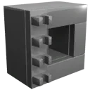

# Is It Safe? - Quest 1170

[Quest database](./README.md) | [Quest Guide](../Quest%20Guide.md) | [Methodology](./Methodology.md)

**Definition ID: 1170** | Quest | Location / Nexus Tower | Repeatable: False

**Official client name** from the client locale.xml (`Missions_1170_name`, en&#95;US).

## Description

Official client text from locale.xml (en&#95;US):

**Offer text:** Would you like to access your Vault account while on your Property? Duke Exeter, Hael Storm, and Vanda Darkflame can help!

**Accept reply:** Talk to Duke, Vanda and Hael to find out where the Safe parts are.

**In-progress text:** Talk to Duke Exeter, Vanda Darkflame and Hael Storm about a Safe, find the pieces and then talk to Dr. Overbuild.

**Objectives-complete tip:** Return to Dr. Overbuild in the Nexus Core in Nexus Tower.

**Turn-in text:** You've found all of the pieces for the Safe? Excellent.

### Objectives

Client task text from locale.xml is shown where it exists; the indented line is the data-derived summary of the same MissionTasks row.

- Get the Housing for the Property Safe.
    - Data summary: Gather 1 item(s) from the allowed templates, sharing one counter: Safe Housing.
- Get the Lock for the Property Safe.
    - Data summary: Gather 1 item(s) from the allowed templates, sharing one counter: Safe Lock.
- Get the Functionator for the Property Safe.
    - Data summary: Gather 1 item(s) from the allowed templates, sharing one counter: Safe Functionator.

## Start, turn-in, and locations

| Role | NPC / object | Mapped candidate zones | Association evidence |
| --- | --- | --- | --- |
| Defined offer object | [Nexus Naomi - Nexus Tower Artificial Intelligence (LOT 12841)](sources/object-12841.md) | [Nexus Tower (1900)](locations/zone-1900.md) | Missions.offer&#95;objectID |
| Defined turn-in object | [Dr. Overbuild - Assembly Faction Leader (LOT 12259)](sources/object-12259.md) | [Nexus Tower (1900)](locations/zone-1900.md) | Missions.target&#95;objectID |
| Accepts turn-in | [Dr. Overbuild - Assembly Faction Leader (LOT 12259)](sources/object-12259.md) | [Nexus Tower (1900)](locations/zone-1900.md) | MissionNPCComponent 116 |
| Offers mission | [Nexus Naomi - Nexus Tower Artificial Intelligence (LOT 12841)](sources/object-12841.md) | [Nexus Tower (1900)](locations/zone-1900.md) | MissionNPCComponent 132 |

Follow a named object for exact XYZ and scene/spawner conditions. Static placements do not prove that the NPC is currently spawned, offers this quest to your character, or is reachable in a deployed server.

## Requirements and quest chain

- Stored prerequisite expression: 1203, (1685&#124;1321&#124;1448&#124;1292).
- Inspected server evaluation: ([Vault Account &#91;1203&#93;](1203.md) is complete AND ([Cooling the Fury &#91;1685&#93;](1685.md) is complete OR ([Venture League Stakeout &#91;1321&#93;](1321.md) is complete OR ([I Have the Power! &#91;1448&#93;](1448.md) is complete OR [Loosed from the Roost &#91;1292&#93;](1292.md) is complete)))).
- UIPrereqID: (not recorded); shown separately, not misread as a mission ID.
- Cooldown: not recorded (loader default -1); -1 means no cooldown in CanAccept.
- Stored feature gate / localization status: nexustower / 2. The generic mission/task loaders mark gate_version unused; other scripts, map gates, and client checks can still restrict availability.
- **Grouping caveat:** the inspected server parser is right-recursive and does not implement conventional parenthesis grouping. The evaluation above intentionally follows that implementation rather than rewriting the stored expression as ordinary Boolean algebra.
- Referenced prerequisite definitions: [Vault Account &#91;1203&#93;](1203.md); [Cooling the Fury &#91;1685&#93;](1685.md); [Venture League Stakeout &#91;1321&#93;](1321.md); [I Have the Power! &#91;1448&#93;](1448.md); [Loosed from the Roost &#91;1292&#93;](1292.md).
- Referenced as a prerequisite by: [Safe as Houses &#91;1173&#93;](1173.md); [Lock Step &#91;1174&#93;](1174.md); [Secrets are Safe &#91;1175&#93;](1175.md); [Assembling It All &#91;1177&#93;](1177.md). These are potential follow-ups, not a guarantee of an immediate offer.

## Walkthrough / checklist

1. Satisfy the prerequisites and any client, map, or script conditions. Check the giver listed above; where none is resolved, the acceptance route remains unknown.
2. Accept the quest before relying on objective credit. Inventory gather tasks, existing flags, and racing parameter-4 tasks have limited acceptance catch-up; other earlier actions are not assumed to count.
3. Gather 1 item(s) from the allowed templates, sharing one counter: Safe Housing. See objective **1** below for target references and conditions.
4. Gather 1 item(s) from the allowed templates, sharing one counter: Safe Lock. See objective **2** below for target references and conditions.
5. Gather 1 item(s) from the allowed templates, sharing one counter: Safe Functionator. See objective **3** below for target references and conditions.
6. After all objective counters are satisfied, complete the recorded turn-in interaction. If offered a reward choice, select the desired item rather than assuming all alternatives are granted.

**These numbered entries are a readable checklist, not evidence that the objective rows must be completed in this order.** Scripted phases, travel routes, puzzle interactions, and custom conditions are not reconstructed unless the data/source evidence supports them.

## Objective details

### Objective 1: Gather items (UID 1625)

**Client task text:** Get the Housing for the Property Safe.

Gather 1 item(s) from the allowed templates, sharing one counter: Safe Housing.

Target namespace: **LOT**. Stored target value/threshold: **1**.

| Matching / associated object | Mapped zones | Item acquisition data |
| --- | --- | --- |
| [Safe Housing (LOT 12464)](sources/object-12464.md) | No matched local placement found | { .lu-ti width="24" loading="lazy" } [Safe Housing (LOT 12464)](../items/12464.md) |

- Stored task gate: nexustower (not enforced by the inspected generic task loader)
- Gathered targets can be removed from item/quest inventory when rewards are granted.
- Losing required items can reduce progress and return a ready quest to active.

| Raw task field | Value |
| --- | --- |
| taskType | 11 |
| target | 12464 |
| targetGroup |  |
| targetValue | 1 |
| taskParam1 |  |
| uid | 1625 |
| gate_version | nexustower |
### Objective 2: Gather items (UID 1634)

**Client task text:** Get the Lock for the Property Safe.

Gather 1 item(s) from the allowed templates, sharing one counter: Safe Lock.

Target namespace: **LOT**. Stored target value/threshold: **1**.

| Matching / associated object | Mapped zones | Item acquisition data |
| --- | --- | --- |
| [Safe Lock (LOT 12465)](sources/object-12465.md) | No matched local placement found | { .lu-ti width="24" loading="lazy" } [Safe Lock (LOT 12465)](../items/12465.md) |

- Stored task gate: nexustower (not enforced by the inspected generic task loader)
- Gathered targets can be removed from item/quest inventory when rewards are granted.
- Losing required items can reduce progress and return a ready quest to active.

| Raw task field | Value |
| --- | --- |
| taskType | 11 |
| target | 12465 |
| targetGroup |  |
| targetValue | 1 |
| taskParam1 |  |
| uid | 1634 |
| gate_version | nexustower |
### Objective 3: Gather items (UID 1635)

**Client task text:** Get the Functionator for the Property Safe.

Gather 1 item(s) from the allowed templates, sharing one counter: Safe Functionator.

Target namespace: **LOT**. Stored target value/threshold: **1**.

| Matching / associated object | Mapped zones | Item acquisition data |
| --- | --- | --- |
| [Safe Functionator (LOT 12466)](sources/object-12466.md) | No matched local placement found | { .lu-ti width="24" loading="lazy" } [Safe Functionator (LOT 12466)](../items/12466.md) |

- Stored task gate: nexustower (not enforced by the inspected generic task loader)
- Gathered targets can be removed from item/quest inventory when rewards are granted.
- Losing required items can reduce progress and return a ready quest to active.

| Raw task field | Value |
| --- | --- |
| taskType | 11 |
| target | 12466 |
| targetGroup |  |
| targetValue | 1 |
| taskParam1 |  |
| uid | 1635 |
| gate_version | nexustower |

## Rewards

The item slots below are listed completion rewards, not random loot-table rolls. Player eligibility and completion still apply.

No positive item reward LOT is defined for the displayed completion modes.

| Reward | First completion / stored value | Repeat behavior |
| --- | --- | --- |
| Coins | 500 | Not advertised as repeatable |
| U-Score | 30 | Not advertised as repeatable |
| Reputation | 0 | Not advertised as repeatable |
| Maximum Life | No positive grant defined | First completion only |
| Maximum Imagination | No positive grant defined | First completion only |
| Item backpack slots | No positive grant defined | First completion only |
| Vault item AND vault model slots | No positive grant defined | First completion only |

Emote unlocks (first completion): none with positive IDs recorded.

At the configured level cap, U-Score can be converted into coins using server configuration. Stored base coins are not a quote for that conversion. Reputation and U-Score are processed before the repeat-reward branch; stat increases and emote unlocks are first-completion only.

## Historical community references

No unique, sufficiently corroborated association was established in the researched community infoboxes. Similar names or matching numeric IDs were not treated as proof.

This page provides an original data-derived checklist, not copied wiki dialogue or a claim that the historical walkthrough exactly matches the deployed server.

## Evidence and limitations

[Missions](../../db/Missions.md), [MissionTasks](../../db/MissionTasks.md), [MissionNPCComponent](../../db/MissionNPCComponent.md), [MissionText](../../db/MissionText.md), [MissionEmail](../../db/MissionEmail.md). [Task interpretation and coverage](./Methodology.md). Availability, client presentation, puzzle phases, and custom script behavior can differ.
