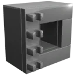

# Safe as Houses - Quest 1173

[Quest database](./README.md) | [Quest Guide](../Quest%20Guide.md) | [Methodology](./Methodology.md)

**Definition ID: 1173** | Quest | Location / Nexus Tower | Repeatable: False

**Official client name** from the client locale.xml (`Missions_1173_name`, en&#95;US). The historical community association below agrees with this name.

## Description

Official client text from locale.xml (en&#95;US):

**Offer text:** No one knows more about security than the Sentinels. Beck Strongheart on Avant Gardens can help you find a housing for a Property Safe.

**Accept reply:** While you're there, make sure that Maelstrom outbreak is still under control!

**In-progress text:** Talk to Beck Strongheart in Avant Gardens about a housing for your Property Safe.

**Objectives-complete tip:** Talk to Beck Strongheart in Avant Gardens about a housing for your safe.

**Turn-in text:** Building a safe? Good thinking. Here's a secure housing unit. See Dr. Overbuild when you have all 3 parts.

### Objectives

Client task text from locale.xml is shown where it exists; the indented line is the data-derived summary of the same MissionTasks row.

- Talk to Beck Strongheart in Avant Gardens about a Housing for your Property Safe.
    - Data summary: Talk to Beck Strongheart - Sentinel Faction Commander; required progress 0.

## Start, turn-in, and locations

| Role | NPC / object | Mapped candidate zones | Association evidence |
| --- | --- | --- | --- |
| Defined offer object | [Duke Exeter - Sentinel Faction Leader (LOT 12261)](sources/object-12261.md) | [Nexus Tower (1900)](locations/zone-1900.md) | Missions.offer&#95;objectID |
| Defined turn-in object | [Beck Strongheart - Sentinel Faction Commander (LOT 6008)](sources/object-6008.md) | [Avant Gardens (1100)](locations/zone-1100.md) | Missions.target&#95;objectID |
| Accepts turn-in | [Beck Strongheart - Sentinel Faction Commander (LOT 6008)](sources/object-6008.md) | [Avant Gardens (1100)](locations/zone-1100.md) | MissionNPCComponent 23 |
| Offers mission | [Duke Exeter - Sentinel Faction Leader (LOT 12261)](sources/object-12261.md) | [Nexus Tower (1900)](locations/zone-1900.md) | MissionNPCComponent 118 |

Follow a named object for exact XYZ and scene/spawner conditions. Static placements do not prove that the NPC is currently spawned, offers this quest to your character, or is reachable in a deployed server.

## Requirements and quest chain

- Stored prerequisite expression: 1170:2.
- Inspected server evaluation: [Is It Safe? &#91;1170&#93;](1170.md) is in exact state 2.
- UIPrereqID: (not recorded); shown separately, not misread as a mission ID.
- Cooldown: not recorded (loader default -1); -1 means no cooldown in CanAccept.
- Stored feature gate / localization status: nexustower / 2. The generic mission/task loaders mark gate_version unused; other scripts, map gates, and client checks can still restrict availability.
- Referenced prerequisite definitions: [Is It Safe? &#91;1170&#93;](1170.md).

## Walkthrough / checklist

1. Satisfy the prerequisites and any client, map, or script conditions. Check the giver listed above; where none is resolved, the acceptance route remains unknown.
2. Accept the quest before relying on objective credit. Inventory gather tasks, existing flags, and racing parameter-4 tasks have limited acceptance catch-up; other earlier actions are not assumed to count.
3. Talk to Beck Strongheart - Sentinel Faction Commander; required progress 0. See objective **1** below for target references and conditions.
4. After all objective counters are satisfied, complete the recorded turn-in interaction. If offered a reward choice, select the desired item rather than assuming all alternatives are granted.

**These numbered entries are a readable checklist, not evidence that the objective rows must be completed in this order.** Scripted phases, travel routes, puzzle interactions, and custom conditions are not reconstructed unless the data/source evidence supports them.

## Objective details

### Objective 1: Talk to NPC (UID 1630)

**Client task text:** Talk to Beck Strongheart in Avant Gardens about a Housing for your Property Safe.

Talk to Beck Strongheart - Sentinel Faction Commander; required progress 0.

Target namespace: **LOT**. Stored target value/threshold: **0**.

| Matching / associated object | Mapped zones | Item acquisition data |
| --- | --- | --- |
| [Beck Strongheart - Sentinel Faction Commander (LOT 6008)](sources/object-6008.md) | [Avant Gardens (1100)](locations/zone-1100.md) | Not an item-template registration |

- Stored task gate: nexustower (not enforced by the inspected generic task loader)

| Raw task field | Value |
| --- | --- |
| taskType | 4 |
| target | 6008 |
| targetGroup |  |
| targetValue | 0 |
| taskParam1 |  |
| uid | 1630 |
| gate_version | nexustower |

## Rewards

The item slots below are listed completion rewards, not random loot-table rolls. Player eligibility and completion still apply.

| Item reward slot | Item | Granted quantity | Stored count / notes |
| --- | --- | --- | --- |
| First completion / 1 | { .lu-ti width="24" loading="lazy" } [Safe Housing (LOT 12464)](../items/12464.md) | 1 | 1 |

| Reward | First completion / stored value | Repeat behavior |
| --- | --- | --- |
| Coins | 0 | Not advertised as repeatable |
| U-Score | 30 | Not advertised as repeatable |
| Reputation | 0 | Not advertised as repeatable |
| Maximum Life | No positive grant defined | First completion only |
| Maximum Imagination | No positive grant defined | First completion only |
| Item backpack slots | No positive grant defined | First completion only |
| Vault item AND vault model slots | No positive grant defined | First completion only |

Emote unlocks (first completion): none with positive IDs recorded.

At the configured level cap, U-Score can be converted into coins using server configuration. Stored base coins are not a quote for that conversion. Reputation and U-Score are processed before the repeat-reward branch; stat increases and emote unlocks are first-completion only.

## Historical community references

- [Safe as Houses](https://legouniverse.fandom.com/wiki/Safe_as_Houses?oldid=127091) — candidate title from Safe as Houses. Matching evidence groups: **NPC, reward item, objective kind**. Revision 127091; retrieved 2026-11-17T09:38:27.023Z.
  Reported factual methods: talk; location labels: not extracted; named objective references: none extracted; named reward references: Safe Housing.

This page provides an original data-derived checklist, not copied wiki dialogue or a claim that the historical walkthrough exactly matches the deployed server.

## Evidence and limitations

[Missions](../../db/Missions.md), [MissionTasks](../../db/MissionTasks.md), [MissionNPCComponent](../../db/MissionNPCComponent.md), [MissionText](../../db/MissionText.md), [MissionEmail](../../db/MissionEmail.md). [Task interpretation and coverage](./Methodology.md). Availability, client presentation, puzzle phases, and custom script behavior can differ.
