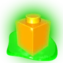

# Close Encounter - Quest 1183

[Quest database](./README.md) | [Quest Guide](../Quest%20Guide.md) | [Methodology](./Methodology.md)

**Definition ID: 1183** | Quest | Location / Pet Cove | Repeatable: False

**Official client name** from the client locale.xml (`Missions_1183_name`, en&#95;US).

## Description

Official client text from locale.xml (en&#95;US):

**Offer text:** Crews aboard the Venture Explorer saw an Alien Creature roaming the halls, but it's gone missing since the attack. You should look for it.

**Accept reply:** When you search the ship, look for bright bits in hidden places. And watch out for those Maelstrom beasties!

**In-progress text:** Search the Venture Explorer for the 3 Alien pieces, then return to Vanda Darkflame in Nexus Tower.

**Objectives-complete tip:** Return to Vanda Darkflame in Nexus Tower.

**Turn-in text:** Doesn't look like much yet, but if Coalessa says it was scaring the Venture Explorer crew, it might be a wonderful pet!

### Objectives

Client task text from locale.xml is shown where it exists; the indented line is the data-derived summary of the same MissionTasks row.

- Find the Alien Pod aboard the Venture Explorer.
    - Data summary: Gather 1 item(s) from the allowed templates, sharing one counter: Alien Pod.
- Find the Alien Shell aboard the Venture Explorer.
    - Data summary: Gather 1 item(s) from the allowed templates, sharing one counter: Alien Shell.
- Find the Alien Core aboard the Venture Explorer.
    - Data summary: Gather 1 item(s) from the allowed templates, sharing one counter: Alien Core.

## Start, turn-in, and locations

| Role | NPC / object | Mapped candidate zones | Association evidence |
| --- | --- | --- | --- |
| Defined offer object | [Coalessa - Assembly Mystic (LOT 3257)](sources/object-3257.md) | [Pet Cove (1201)](locations/zone-1201.md) | Missions.offer&#95;objectID |
| Defined turn-in object | [Vanda Darkflame - Paradox Faction Leader (LOT 12262)](sources/object-12262.md) | [Nexus Tower (1900)](locations/zone-1900.md) | Missions.target&#95;objectID |
| Offers mission | [Coalessa - Assembly Mystic (LOT 3257)](sources/object-3257.md) | [Pet Cove (1201)](locations/zone-1201.md) | MissionNPCComponent 2 |
| Accepts turn-in | [Vanda Darkflame - Paradox Faction Leader (LOT 12262)](sources/object-12262.md) | [Nexus Tower (1900)](locations/zone-1900.md) | MissionNPCComponent 114 |

Follow a named object for exact XYZ and scene/spawner conditions. Static placements do not prove that the NPC is currently spawned, offers this quest to your character, or is reachable in a deployed server.

## Requirements and quest chain

- Stored prerequisite expression: 1393.
- Inspected server evaluation: [The Perfect Paradox Pet &#91;1393&#93;](1393.md) is complete.
- UIPrereqID: 48; shown separately, not misread as a mission ID.
- Cooldown: 0 minute(s) after previous completion.
- Stored feature gate / localization status: nexustower / 2. The generic mission/task loaders mark gate_version unused; other scripts, map gates, and client checks can still restrict availability.
- Referenced prerequisite definitions: [The Perfect Paradox Pet &#91;1393&#93;](1393.md).
- Referenced as a prerequisite by: [Build-a-Beastie &#91;1188&#93;](1188.md). These are potential follow-ups, not a guarantee of an immediate offer.

## Walkthrough / checklist

1. Satisfy the prerequisites and any client, map, or script conditions. Check the giver listed above; where none is resolved, the acceptance route remains unknown.
2. Accept the quest before relying on objective credit. Inventory gather tasks, existing flags, and racing parameter-4 tasks have limited acceptance catch-up; other earlier actions are not assumed to count.
3. Gather 1 item(s) from the allowed templates, sharing one counter: Alien Pod. See objective **1** below for target references and conditions.
4. Gather 1 item(s) from the allowed templates, sharing one counter: Alien Shell. See objective **2** below for target references and conditions.
5. Gather 1 item(s) from the allowed templates, sharing one counter: Alien Core. See objective **3** below for target references and conditions.
6. After all objective counters are satisfied, complete the recorded turn-in interaction. If offered a reward choice, select the desired item rather than assuming all alternatives are granted.

**These numbered entries are a readable checklist, not evidence that the objective rows must be completed in this order.** Scripted phases, travel routes, puzzle interactions, and custom conditions are not reconstructed unless the data/source evidence supports them.

## Objective details

### Objective 1: Gather items (UID 1645)

**Client task text:** Find the Alien Pod aboard the Venture Explorer.

Gather 1 item(s) from the allowed templates, sharing one counter: Alien Pod.

Target namespace: **LOT**. Stored target value/threshold: **1**.

| Matching / associated object | Mapped zones | Item acquisition data |
| --- | --- | --- |
| [Alien Pod (LOT 12479)](sources/object-12479.md) | No matched local placement found | { .lu-ti width="24" loading="lazy" } [Alien Pod (LOT 12479)](../items/12479.md) |

- Stored task gate: nexustower (not enforced by the inspected generic task loader)
- Gathered items are retained by the generic reward-removal path (parameter bit 1).
- Inventory loss does not reduce this task in the inspected decrement path (parameter bit 4).

| Raw task field | Value |
| --- | --- |
| taskType | 11 |
| target | 12479 |
| targetGroup |  |
| targetValue | 1 |
| taskParam1 | 5 |
| uid | 1645 |
| gate_version | nexustower |
### Objective 2: Gather items (UID 1646)

**Client task text:** Find the Alien Shell aboard the Venture Explorer.

Gather 1 item(s) from the allowed templates, sharing one counter: Alien Shell.

Target namespace: **LOT**. Stored target value/threshold: **1**.

| Matching / associated object | Mapped zones | Item acquisition data |
| --- | --- | --- |
| [Alien Shell (LOT 12480)](sources/object-12480.md) | No matched local placement found | { .lu-ti width="24" loading="lazy" } [Alien Shell (LOT 12480)](../items/12480.md) |

- Stored task gate: nexustower (not enforced by the inspected generic task loader)
- Gathered items are retained by the generic reward-removal path (parameter bit 1).
- Inventory loss does not reduce this task in the inspected decrement path (parameter bit 4).

| Raw task field | Value |
| --- | --- |
| taskType | 11 |
| target | 12480 |
| targetGroup |  |
| targetValue | 1 |
| taskParam1 | 5 |
| uid | 1646 |
| gate_version | nexustower |
### Objective 3: Gather items (UID 1647)

**Client task text:** Find the Alien Core aboard the Venture Explorer.

Gather 1 item(s) from the allowed templates, sharing one counter: Alien Core.

Target namespace: **LOT**. Stored target value/threshold: **1**.

| Matching / associated object | Mapped zones | Item acquisition data |
| --- | --- | --- |
| [Alien Core (LOT 12481)](sources/object-12481.md) | No matched local placement found | { .lu-ti width="24" loading="lazy" } [Alien Core (LOT 12481)](../items/12481.md) |

- Stored task gate: nexustower (not enforced by the inspected generic task loader)
- Gathered items are retained by the generic reward-removal path (parameter bit 1).
- Inventory loss does not reduce this task in the inspected decrement path (parameter bit 4).

| Raw task field | Value |
| --- | --- |
| taskType | 11 |
| target | 12481 |
| targetGroup |  |
| targetValue | 1 |
| taskParam1 | 5 |
| uid | 1647 |
| gate_version | nexustower |

## Rewards

The item slots below are listed completion rewards, not random loot-table rolls. Player eligibility and completion still apply.

No positive item reward LOT is defined for the displayed completion modes.

| Reward | First completion / stored value | Repeat behavior |
| --- | --- | --- |
| Coins | 500 | Not advertised as repeatable |
| U-Score | 15 | Not advertised as repeatable |
| Reputation | 0 | Not advertised as repeatable |
| Maximum Life | No positive grant defined | First completion only |
| Maximum Imagination | No positive grant defined | First completion only |
| Item backpack slots | No positive grant defined | First completion only |
| Vault item AND vault model slots | No positive grant defined | First completion only |

Emote unlocks (first completion): none with positive IDs recorded.

At the configured level cap, U-Score can be converted into coins using server configuration. Stored base coins are not a quote for that conversion. Reputation and U-Score are processed before the repeat-reward branch; stat increases and emote unlocks are first-completion only.

## Historical community references

No unique, sufficiently corroborated association was established in the researched community infoboxes. Similar names or matching numeric IDs were not treated as proof.

This page provides an original data-derived checklist, not copied wiki dialogue or a claim that the historical walkthrough exactly matches the deployed server.

## Evidence and limitations

[Missions](../../db/Missions.md), [MissionTasks](../../db/MissionTasks.md), [MissionNPCComponent](../../db/MissionNPCComponent.md), [MissionText](../../db/MissionText.md), [MissionEmail](../../db/MissionEmail.md). [Task interpretation and coverage](./Methodology.md). Availability, client presentation, puzzle phases, and custom script behavior can differ.
