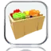

# A Creative Opportunity - Achievement 1191

<!-- media:start (generated by scripts/build_media.py) -->
{ .lu-icon width="128" loading="lazy" }
<!-- media:end -->

[Quest database](./README.md) | [Quest Guide](../Quest%20Guide.md) | [Methodology](./Methodology.md)

**Definition ID: 1191** | Achievement | Location / Nexus Tower | Repeatable: False

**Official client name** from the client locale.xml (`Missions_1191_name`, en&#95;US).

## Description

Official client text from locale.xml (en&#95;US):

**Description:** Collect the Imagination Brick in Nexus Tower.

**Objectives-complete tip:** By finding the Imagination Brick in Nexus Tower, you've unlocked an extra Imagination Point!

### Objectives

Client task text from locale.xml is shown where it exists; the indented line is the data-derived summary of the same MissionTasks row.

- Collect the Imagination Brick in Nexus Tower.
    - Data summary: Collect 1 distinct collectible(s) matching NT - Imagination Brick Collectible Spawner. Collection identity includes the collectible ID and zone; repeated collection of the same identity does not add credit.

## Start, turn-in, and locations

This is an achievement: it is normally discovered/tracked by qualifying progress events once prerequisites permit it, not accepted from a quest giver. Any stored NPC associations below are data references, not an instruction to accept an achievement.

No quest-giver or turn-in association is recorded for this achievement.

Follow a named object for exact XYZ and scene/spawner conditions. Static placements do not prove that the NPC is currently spawned, offers this quest to your character, or is reachable in a deployed server.

## Requirements and quest chain

- Stored prerequisite expression: (empty).
- Inspected server evaluation: TRUE.
- UIPrereqID: (not recorded); shown separately, not misread as a mission ID.
- Cooldown: not recorded (loader default -1); -1 means no cooldown in CanAccept.
- Stored feature gate / localization status: nexustower / 2. The generic mission/task loaders mark gate_version unused; other scripts, map gates, and client checks can still restrict availability.

## Walkthrough / checklist

1. Satisfy the achievement prerequisites. Produce a qualifying progress event so the server can discover/track the achievement; prior actions are not assumed to be retroactive for every task type.
2. Collect 1 distinct collectible(s) matching NT - Imagination Brick Collectible Spawner. Collection identity includes the collectible ID and zone; repeated collection of the same identity does not add credit. See objective **1** below for target references and conditions.
3. When all objectives complete, the normal achievement path grants completion/rewards automatically; there is no generic NPC turn-in step.

**These numbered entries are a readable checklist, not evidence that the objective rows must be completed in this order.** Scripted phases, travel routes, puzzle interactions, and custom conditions are not reconstructed unless the data/source evidence supports them.

## Objective details

### Objective 1: Unique collectibles (UID 1658)

**Client task text:** Collect the Imagination Brick in Nexus Tower.

Collect 1 distinct collectible(s) matching NT - Imagination Brick Collectible Spawner. Collection identity includes the collectible ID and zone; repeated collection of the same identity does not add credit.

Target namespace: **LOT**. Stored target value/threshold: **1**.

| Matching / associated object | Mapped zones | Item acquisition data |
| --- | --- | --- |
| [NT - Imagination Brick Collectible Spawner (LOT 12494)](sources/object-12494.md) | [Nexus Tower (1900)](locations/zone-1900.md) | Not an item-template registration |

- Stored task gate: nexustower (not enforced by the inspected generic task loader)
- Unique collectibles are tracked, not just repeated events against one object.

| Raw task field | Value |
| --- | --- |
| taskType | 3 |
| target | 12494 |
| targetGroup |  |
| targetValue | 1 |
| taskParam1 |  |
| uid | 1658 |
| gate_version | nexustower |

## Rewards

The item slots below are listed completion rewards, not random loot-table rolls. Player eligibility and completion still apply.

No positive item reward LOT is defined for the displayed completion modes.

| Reward | First completion / stored value | Repeat behavior |
| --- | --- | --- |
| Coins | 250 | Not advertised as repeatable |
| U-Score | 35 | Not advertised as repeatable |
| Reputation | 0 | Not advertised as repeatable |
| Maximum Life | No positive grant defined | First completion only |
| Maximum Imagination | +1 | First completion only |
| Item backpack slots | No positive grant defined | First completion only |
| Vault item AND vault model slots | No positive grant defined | First completion only |

Emote unlocks (first completion): none with positive IDs recorded.

At the configured level cap, U-Score can be converted into coins using server configuration. Stored base coins are not a quote for that conversion. Reputation and U-Score are processed before the repeat-reward branch; stat increases and emote unlocks are first-completion only.

### Completion mail / announcements

| Row | Type | Attachment definition | Meaning |
| --- | --- | --- | --- |
| 280 | 2 | None recorded | Chat achievement announcement; this branch does not send an attachment |

## Historical community references

No unique, sufficiently corroborated association was established in the researched community infoboxes. Similar names or matching numeric IDs were not treated as proof.

This page provides an original data-derived checklist, not copied wiki dialogue or a claim that the historical walkthrough exactly matches the deployed server.

## Evidence and limitations

[Missions](../../db/Missions.md), [MissionTasks](../../db/MissionTasks.md), [MissionNPCComponent](../../db/MissionNPCComponent.md), [MissionText](../../db/MissionText.md), [MissionEmail](../../db/MissionEmail.md). [Task interpretation and coverage](./Methodology.md). Availability, client presentation, puzzle phases, and custom script behavior can differ.
