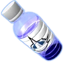

# Water Friends For - Quest 1282

[Quest database](./README.md) | [Quest Guide](../Quest%20Guide.md) | [Methodology](./Methodology.md)

**Definition ID: 1282** | Quest | Location / Nexus Tower | Repeatable: False

**Official client name** from the client locale.xml (`Missions_1282_name`, en&#95;US).

## Description

Official client text from locale.xml (en&#95;US):

**Offer text:** Dirt levels in the Tower are unnaturally high! Can you help me clean up? Start by collecting some clean water from one of the drinking fountains.

**Accept reply:** Simply interact with a drinking fountain in the Tower to collect some water.

**In-progress text:** Collect some clean water from a drinking fountain in Nexus Tower.

**Objectives-complete tip:** Return to the Nexus Naomi console with the clean water.

**Turn-in text:** We pride ourselves on clean, drinkable tap water. Now we need some fizzy hiccup tablets.

### Objectives

Client task text from locale.xml is shown where it exists; the indented line is the data-derived summary of the same MissionTasks row.

- Collect some clean water from a drinking fountain in Nexus Tower for Nexus Naomi.
    - Data summary: Gather 1 item(s) from the allowed templates, sharing one counter: Bottled Water.

## Start, turn-in, and locations

| Role | NPC / object | Mapped candidate zones | Association evidence |
| --- | --- | --- | --- |
| Defined offer object | [Nexus Naomi - Nexus Tower Artificial Intelligence (LOT 12841)](sources/object-12841.md) | [Nexus Tower (1900)](locations/zone-1900.md) | Missions.offer&#95;objectID |
| Defined turn-in object | [Nexus Naomi - Nexus Tower Artificial Intelligence (LOT 12841)](sources/object-12841.md) | [Nexus Tower (1900)](locations/zone-1900.md) | Missions.target&#95;objectID |
| Offers mission | [Nexus Naomi - Nexus Tower Artificial Intelligence (LOT 12841)](sources/object-12841.md) | [Nexus Tower (1900)](locations/zone-1900.md) | MissionNPCComponent 132 |
| Accepts turn-in | [Nexus Naomi - Nexus Tower Artificial Intelligence (LOT 12841)](sources/object-12841.md) | [Nexus Tower (1900)](locations/zone-1900.md) | MissionNPCComponent 132 |

Follow a named object for exact XYZ and scene/spawner conditions. Static placements do not prove that the NPC is currently spawned, offers this quest to your character, or is reachable in a deployed server.

## Requirements and quest chain

- Stored prerequisite expression: 1296.
- Inspected server evaluation: [Forbidden Trophies &#91;1296&#93;](1296.md) is complete.
- UIPrereqID: (not recorded); shown separately, not misread as a mission ID.
- Cooldown: not recorded (loader default -1); -1 means no cooldown in CanAccept.
- Stored feature gate / localization status: nexustower / 2. The generic mission/task loaders mark gate_version unused; other scripts, map gates, and client checks can still restrict availability.
- Referenced prerequisite definitions: [Forbidden Trophies &#91;1296&#93;](1296.md).
- Referenced as a prerequisite by: [Scrubby Bubbles &#91;1665&#93;](1665.md). These are potential follow-ups, not a guarantee of an immediate offer.

## Walkthrough / checklist

1. Satisfy the prerequisites and any client, map, or script conditions. Check the giver listed above; where none is resolved, the acceptance route remains unknown.
2. Accept the quest before relying on objective credit. Inventory gather tasks, existing flags, and racing parameter-4 tasks have limited acceptance catch-up; other earlier actions are not assumed to count.
3. Gather 1 item(s) from the allowed templates, sharing one counter: Bottled Water. See objective **1** below for target references and conditions.
4. After all objective counters are satisfied, complete the recorded turn-in interaction. If offered a reward choice, select the desired item rather than assuming all alternatives are granted.

**These numbered entries are a readable checklist, not evidence that the objective rows must be completed in this order.** Scripted phases, travel routes, puzzle interactions, and custom conditions are not reconstructed unless the data/source evidence supports them.

## Objective details

### Objective 1: Gather items (UID 1782)

**Client task text:** Collect some clean water from a drinking fountain in Nexus Tower for Nexus Naomi.

Gather 1 item(s) from the allowed templates, sharing one counter: Bottled Water.

Target namespace: **LOT**. Stored target value/threshold: **1**.

| Matching / associated object | Mapped zones | Item acquisition data |
| --- | --- | --- |
| [Bottled Water (LOT 13587)](sources/object-13587.md) | No matched local placement found | { .lu-ti width="24" loading="lazy" } [Bottled Water (LOT 13587)](../items/13587.md) |

- Stored task gate: nexustower (not enforced by the inspected generic task loader)
- Gathered targets can be removed from item/quest inventory when rewards are granted.
- Losing required items can reduce progress and return a ready quest to active.

| Raw task field | Value |
| --- | --- |
| taskType | 11 |
| target | 13587 |
| targetGroup |  |
| targetValue | 1 |
| taskParam1 |  |
| uid | 1782 |
| gate_version | nexustower |

## Rewards

The item slots below are listed completion rewards, not random loot-table rolls. Player eligibility and completion still apply.

No positive item reward LOT is defined for the displayed completion modes.

| Reward | First completion / stored value | Repeat behavior |
| --- | --- | --- |
| Coins | 0 | Not advertised as repeatable |
| U-Score | 30 | Not advertised as repeatable |
| Reputation | 0 | Not advertised as repeatable |
| Maximum Life | No positive grant defined | First completion only |
| Maximum Imagination | No positive grant defined | First completion only |
| Item backpack slots | No positive grant defined | First completion only |
| Vault item AND vault model slots | No positive grant defined | First completion only |

Emote unlocks (first completion): none with positive IDs recorded.

At the configured level cap, U-Score can be converted into coins using server configuration. Stored base coins are not a quote for that conversion. Reputation and U-Score are processed before the repeat-reward branch; stat increases and emote unlocks are first-completion only.

## Historical community references

No unique, sufficiently corroborated association was established in the researched community infoboxes. Similar names or matching numeric IDs were not treated as proof.

This page provides an original data-derived checklist, not copied wiki dialogue or a claim that the historical walkthrough exactly matches the deployed server.

## Evidence and limitations

[Missions](../../db/Missions.md), [MissionTasks](../../db/MissionTasks.md), [MissionNPCComponent](../../db/MissionNPCComponent.md), [MissionText](../../db/MissionText.md), [MissionEmail](../../db/MissionEmail.md). [Task interpretation and coverage](./Methodology.md). Availability, client presentation, puzzle phases, and custom script behavior can differ.
