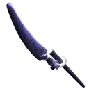

# Forbidden Trophies - Quest 1296

[Quest database](./README.md) | [Quest Guide](../Quest%20Guide.md) | [Methodology](./Methodology.md)

**Definition ID: 1296** | Quest | Location / Nexus Tower | Repeatable: False

**Official client name** from the client locale.xml (`Missions_1296_name`, en&#95;US).

## Description

Official client text from locale.xml (en&#95;US):

**Offer text:** We need you on the battlefield below. But first, prove you can survive a mission in Forbidden Valley!

**Accept reply:** Forbidden Valley is dangerous, but it is nothing compared to Crux Prime!

**In-progress text:** Retrieve 5 Cracked Ronin's Helms and 1 Splintered Lance from enemies in Forbidden Valley. Return them to Duke Exeter in Nexus Tower

**Objectives-complete tip:** Return to Nexus Tower and talk to Duke Exeter in the Sentinel Command Center.

**Turn-in text:** Okay, so you can handle a few Ronin and Horsemen. But Crux Prime's got hundreds of them! You've been warned.

### Objectives

Client task text from locale.xml is shown where it exists; the indented line is the data-derived summary of the same MissionTasks row.

- Smash Dark Ronin in Forbidden Valley to collect 5 Cracked Ronin's Helms. Return them to Duke Exeter in Nexus Tower.
    - Data summary: Gather 5 item(s) from the allowed templates, sharing one counter: Cracked Ronin's Helm.
- Smash Maelstrom Horsemen in Forbidden Valley to collect 1 Splintered Horseman's Lance. Return it to Duke Exeter in Nexus Tower.
    - Data summary: Gather 1 item(s) from the allowed templates, sharing one counter: Splintered Horseman's Lance.

## Start, turn-in, and locations

| Role | NPC / object | Mapped candidate zones | Association evidence |
| --- | --- | --- | --- |
| Defined offer object | [Duke Exeter - Sentinel Faction Leader (LOT 12261)](sources/object-12261.md) | [Nexus Tower (1900)](locations/zone-1900.md) | Missions.offer&#95;objectID |
| Defined turn-in object | [Duke Exeter - Sentinel Faction Leader (LOT 12261)](sources/object-12261.md) | [Nexus Tower (1900)](locations/zone-1900.md) | Missions.target&#95;objectID |
| Offers mission | [Duke Exeter - Sentinel Faction Leader (LOT 12261)](sources/object-12261.md) | [Nexus Tower (1900)](locations/zone-1900.md) | MissionNPCComponent 118 |
| Accepts turn-in | [Duke Exeter - Sentinel Faction Leader (LOT 12261)](sources/object-12261.md) | [Nexus Tower (1900)](locations/zone-1900.md) | MissionNPCComponent 118 |

Follow a named object for exact XYZ and scene/spawner conditions. Static placements do not prove that the NPC is currently spawned, offers this quest to your character, or is reachable in a deployed server.

## Requirements and quest chain

- Stored prerequisite expression: 835.
- Inspected server evaluation: [Anchor Management &#91;835&#93;](835.md) is complete.
- UIPrereqID: (not recorded); shown separately, not misread as a mission ID.
- Cooldown: 0 minute(s) after previous completion.
- Stored feature gate / localization status: nexustower / 2. The generic mission/task loaders mark gate_version unused; other scripts, map gates, and client checks can still restrict availability.
- Referenced prerequisite definitions: [Anchor Management &#91;835&#93;](835.md).
- Referenced as a prerequisite by: [The Battle of Crux Prime &#91;964&#93;](964.md); [Burst Pipes &#91;1150&#93;](1150.md); [Luxuriant Purple &#91;1190&#93;](1190.md); [Water Friends For &#91;1282&#93;](1282.md); [Find the Fragments &#91;1670&#93;](1670.md); [Deliver the Dish &#91;1693&#93;](1693.md). These are potential follow-ups, not a guarantee of an immediate offer.

## Walkthrough / checklist

1. Satisfy the prerequisites and any client, map, or script conditions. Check the giver listed above; where none is resolved, the acceptance route remains unknown.
2. Accept the quest before relying on objective credit. Inventory gather tasks, existing flags, and racing parameter-4 tasks have limited acceptance catch-up; other earlier actions are not assumed to count.
3. Gather 5 item(s) from the allowed templates, sharing one counter: Cracked Ronin's Helm. See objective **1** below for target references and conditions.
4. Gather 1 item(s) from the allowed templates, sharing one counter: Splintered Horseman's Lance. See objective **2** below for target references and conditions.
5. After all objective counters are satisfied, complete the recorded turn-in interaction. If offered a reward choice, select the desired item rather than assuming all alternatives are granted.

**These numbered entries are a readable checklist, not evidence that the objective rows must be completed in this order.** Scripted phases, travel routes, puzzle interactions, and custom conditions are not reconstructed unless the data/source evidence supports them.

## Objective details

### Objective 1: Gather items (UID 2385)

**Client task text:** Smash Dark Ronin in Forbidden Valley to collect 5 Cracked Ronin's Helms. Return them to Duke Exeter in Nexus Tower.

Gather 5 item(s) from the allowed templates, sharing one counter: Cracked Ronin's Helm.

Target namespace: **LOT**. Stored target value/threshold: **5**.

| Matching / associated object | Mapped zones | Item acquisition data |
| --- | --- | --- |
| [Cracked Ronin's Helm (LOT 13058)](sources/object-13058.md) | No matched local placement found | { .lu-ti width="24" loading="lazy" } [Cracked Ronin's Helm (LOT 13058)](../items/13058.md) |

- Stored task gate: nexustower (not enforced by the inspected generic task loader)
- Gathered targets can be removed from item/quest inventory when rewards are granted.
- Losing required items can reduce progress and return a ready quest to active.

| Raw task field | Value |
| --- | --- |
| taskType | 11 |
| target | 13058 |
| targetGroup |  |
| targetValue | 5 |
| taskParam1 |  |
| uid | 2385 |
| gate_version | nexustower |
### Objective 2: Gather items (UID 2386)

**Client task text:** Smash Maelstrom Horsemen in Forbidden Valley to collect 1 Splintered Horseman's Lance. Return it to Duke Exeter in Nexus Tower.

Gather 1 item(s) from the allowed templates, sharing one counter: Splintered Horseman's Lance.

Target namespace: **LOT**. Stored target value/threshold: **1**.

| Matching / associated object | Mapped zones | Item acquisition data |
| --- | --- | --- |
| [Splintered Horseman's Lance (LOT 13059)](sources/object-13059.md) | No matched local placement found | { .lu-ti width="24" loading="lazy" } [Splintered Horseman's Lance (LOT 13059)](../items/13059.md) |

- Stored task gate: nexustower (not enforced by the inspected generic task loader)
- Gathered targets can be removed from item/quest inventory when rewards are granted.
- Losing required items can reduce progress and return a ready quest to active.

| Raw task field | Value |
| --- | --- |
| taskType | 11 |
| target | 13059 |
| targetGroup |  |
| targetValue | 1 |
| taskParam1 |  |
| uid | 2386 |
| gate_version | nexustower |

## Rewards

**Choice reward:** listed item slots are alternatives when the normal mission-choice flow applies; do not assume that all are granted. A selected reward LOT filters item slots in the inspected handler.

| Item reward slot | Item | Granted quantity | Stored count / notes |
| --- | --- | --- | --- |
| First completion / 1 | { .lu-ti width="24" loading="lazy" } [Superior Gem Pack (LOT 13113)](../items/13113.md) | 1 | 1 |
| First completion / 2 | { .lu-ti width="24" loading="lazy" } [Quality Surprise Pack (LOT 13102)](../items/13102.md) | 1 | 1 |

| Reward | First completion / stored value | Repeat behavior |
| --- | --- | --- |
| Coins | 0 | Not advertised as repeatable |
| U-Score | 30 | Not advertised as repeatable |
| Reputation | 0 | Not advertised as repeatable |
| Maximum Life | No positive grant defined | First completion only |
| Maximum Imagination | No positive grant defined | First completion only |
| Item backpack slots | No positive grant defined | First completion only |
| Vault item AND vault model slots | No positive grant defined | First completion only |

Emote unlocks (first completion): none with positive IDs recorded.

At the configured level cap, U-Score can be converted into coins using server configuration. Stored base coins are not a quote for that conversion. Reputation and U-Score are processed before the repeat-reward branch; stat increases and emote unlocks are first-completion only.

## Historical community references

No unique, sufficiently corroborated association was established in the researched community infoboxes. Similar names or matching numeric IDs were not treated as proof.

This page provides an original data-derived checklist, not copied wiki dialogue or a claim that the historical walkthrough exactly matches the deployed server.

## Evidence and limitations

[Missions](../../db/Missions.md), [MissionTasks](../../db/MissionTasks.md), [MissionNPCComponent](../../db/MissionNPCComponent.md), [MissionText](../../db/MissionText.md), [MissionEmail](../../db/MissionEmail.md). [Task interpretation and coverage](./Methodology.md). Availability, client presentation, puzzle phases, and custom script behavior can differ.
