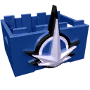
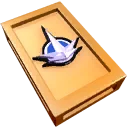
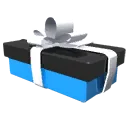

# Ninja Avenger - Quest 1306

[Quest database](./README.md) | [Quest Guide](../Quest%20Guide.md) | [Methodology](./Methodology.md)

**Definition ID: 1306** | Quest | Hidden / Hidden | Repeatable: True

**Official client name** from the client locale.xml (`Missions_1306_name`, en&#95;US).

## Description

Official client text from locale.xml (en&#95;US):

**Offer text:** Now that we know why the Skeletons search for Maelstrom, we must prevent them from mining for more of it!

**Repeat offer text:** Ready to smash more of the Skeletons and their infernal machines?

**Accept reply:** The Skeletons need Maelstrom - but they fear Spinjitzu! Go and show them fear!

**In-progress text:** Smash 15 Skeleton Miners, 6 Skeleton Engineers and 3 Skeleton Pit Bosses on Crux Prime.

**Objectives-complete tip:** Return to Neido at the Ninjago Ruins on Crux Prime.

**Turn-in text:** No mining, no Maelstrom! Such sad, sad Skeletons.

### Objectives

Client task text from locale.xml is shown where it exists; the indented line is the data-derived summary of the same MissionTasks row.

- Smash 15 Skeleton Miners on Crux Prime.
    - Data summary: Smash matching targets until the combined counter reaches 15: Skeleton Miner.
- Smash 6 Skeleton Engineers on Crux Prime.
    - Data summary: Smash matching targets until the combined counter reaches 6: Skeleton Engineer.
- Smash 3 Skeleton Pit Bosses on Crux Prime.
    - Data summary: Smash matching targets until the combined counter reaches 3: Skeleton Pit Boss.

## Start, turn-in, and locations

| Role | NPC / object | Mapped candidate zones | Association evidence |
| --- | --- | --- | --- |
| Defined offer object | [Neido - Ninja of Imagination (LOT 11998)](sources/object-11998.md) | [Crux Prime (1800)](locations/zone-1800.md) | Missions.offer&#95;objectID |
| Defined turn-in object | [Neido - Ninja of Imagination (LOT 11998)](sources/object-11998.md) | [Crux Prime (1800)](locations/zone-1800.md) | Missions.target&#95;objectID |
| Offers mission | [Neido - Ninja of Imagination (LOT 11998)](sources/object-11998.md) | [Crux Prime (1800)](locations/zone-1800.md) | MissionNPCComponent 106 |
| Accepts turn-in | [Neido - Ninja of Imagination (LOT 11998)](sources/object-11998.md) | [Crux Prime (1800)](locations/zone-1800.md) | MissionNPCComponent 106 |
| Random-pool candidate giver | [Neido - Ninja of Imagination (LOT 11998)](sources/object-11998.md) | [Crux Prime (1800)](locations/zone-1800.md) | Selector mission 1304; eligible pool choice only |

Follow a named object for exact XYZ and scene/spawner conditions. Static placements do not prove that the NPC is currently spawned, offers this quest to your character, or is reachable in a deployed server.

## Requirements and quest chain

- Stored prerequisite expression: 1303.
- Inspected server evaluation: [Skeleton Secret &#91;1303&#93;](1303.md) is complete.
- UIPrereqID: (not recorded); shown separately, not misread as a mission ID.
- Cooldown: 1300 minute(s) after previous completion.
- Stored feature gate / localization status: auramar / 2. The generic mission/task loaders mark gate_version unused; other scripts, map gates, and client checks can still restrict availability.
- Referenced prerequisite definitions: [Skeleton Secret &#91;1303&#93;](1303.md).
- Appears in random selector pool(s): [Quest 1304 &#91;1304&#93;](1304.md). Eligibility and current quest state affect selection.
- This definition is a random mission selector. Pool: empty (the inspected offer handler does not offer an empty selector pool).

## Walkthrough / checklist

1. Satisfy the prerequisites and any client, map, or script conditions. Check the giver listed above; where none is resolved, the acceptance route remains unknown.
2. Accept the quest before relying on objective credit. Inventory gather tasks, existing flags, and racing parameter-4 tasks have limited acceptance catch-up; other earlier actions are not assumed to count.
3. Smash matching targets until the combined counter reaches 15: Skeleton Miner. See objective **1** below for target references and conditions.
4. Smash matching targets until the combined counter reaches 6: Skeleton Engineer. See objective **2** below for target references and conditions.
5. Smash matching targets until the combined counter reaches 3: Skeleton Pit Boss. See objective **3** below for target references and conditions.
6. After all objective counters are satisfied, complete the recorded turn-in interaction. If offered a reward choice, select the desired item rather than assuming all alternatives are granted.

**These numbered entries are a readable checklist, not evidence that the objective rows must be completed in this order.** Scripted phases, travel routes, puzzle interactions, and custom conditions are not reconstructed unless the data/source evidence supports them.

## Objective details

### Objective 1: Smash (UID 1811)

**Client task text:** Smash 15 Skeleton Miners on Crux Prime.

Smash matching targets until the combined counter reaches 15: Skeleton Miner.

Target namespace: **LOT**. Stored target value/threshold: **15**.

| Matching / associated object | Mapped zones | Item acquisition data |
| --- | --- | --- |
| [Skeleton Miner (LOT 12000)](sources/object-12000.md) | [Crux Prime (1800)](locations/zone-1800.md) | Not an item-template registration |

- Stored task gate: auramar (not enforced by the inspected generic task loader)

| Raw task field | Value |
| --- | --- |
| taskType | 0 |
| target | 12000 |
| targetGroup |  |
| targetValue | 15 |
| taskParam1 |  |
| uid | 1811 |
| gate_version | auramar |
### Objective 2: Smash (UID 1821)

**Client task text:** Smash 6 Skeleton Engineers on Crux Prime.

Smash matching targets until the combined counter reaches 6: Skeleton Engineer.

Target namespace: **LOT**. Stored target value/threshold: **6**.

| Matching / associated object | Mapped zones | Item acquisition data |
| --- | --- | --- |
| [Skeleton Engineer (LOT 12002)](sources/object-12002.md) | [Crux Prime (1800)](locations/zone-1800.md) | Not an item-template registration |

- Stored task gate: auramar (not enforced by the inspected generic task loader)

| Raw task field | Value |
| --- | --- |
| taskType | 0 |
| target | 12002 |
| targetGroup |  |
| targetValue | 6 |
| taskParam1 |  |
| uid | 1821 |
| gate_version | auramar |
### Objective 3: Smash (UID 1822)

**Client task text:** Smash 3 Skeleton Pit Bosses on Crux Prime.

Smash matching targets until the combined counter reaches 3: Skeleton Pit Boss.

Target namespace: **LOT**. Stored target value/threshold: **3**.

| Matching / associated object | Mapped zones | Item acquisition data |
| --- | --- | --- |
| [Skeleton Pit Boss (LOT 12004)](sources/object-12004.md) | [Crux Prime (1800)](locations/zone-1800.md) | Not an item-template registration |

- Stored task gate: auramar (not enforced by the inspected generic task loader)

| Raw task field | Value |
| --- | --- |
| taskType | 0 |
| target | 12004 |
| targetGroup |  |
| targetValue | 3 |
| taskParam1 |  |
| uid | 1822 |
| gate_version | auramar |

## Rewards

**Choice reward:** listed item slots are alternatives when the normal mission-choice flow applies; do not assume that all are granted. A selected reward LOT filters item slots in the inspected handler.

| Item reward slot | Item | Granted quantity | Stored count / notes |
| --- | --- | --- | --- |
| First completion / 1 | { .lu-ti width="24" loading="lazy" } [Nexus Force Supply Crate (LOT 12115)](../items/12115.md) | 1 | 1 |
| First completion / 2 | { .lu-ti width="24" loading="lazy" } [S.N.A.C.K. (LOT 12114)](../items/12114.md) | 3 | 3 |
| First completion / 3 | { .lu-ti width="24" loading="lazy" } [Premium Gem Pack (LOT 13109)](../items/13109.md) | 1 | 1 |
| First completion / 4 | { .lu-ti width="24" loading="lazy" } [Surprise Model Pack (LOT 13117)](../items/13117.md) | 1 | 1 |
| Repeat / 1 | { .lu-ti width="24" loading="lazy" } [Nexus Force Supply Crate (LOT 12115)](../items/12115.md) | 1 | 1 |
| Repeat / 2 | { .lu-ti width="24" loading="lazy" } [S.N.A.C.K. (LOT 12114)](../items/12114.md) | 3 | 3 |
| Repeat / 3 | { .lu-ti width="24" loading="lazy" } [Premium Gem Pack (LOT 13109)](../items/13109.md) | 1 | 1 |
| Repeat / 4 | { .lu-ti width="24" loading="lazy" } [Surprise Model Pack (LOT 13117)](../items/13117.md) | 1 | 1 |

| Reward | First completion / stored value | Repeat behavior |
| --- | --- | --- |
| Coins | 0 | 0 |
| U-Score | 120 | 120 |
| Reputation | 0 | 0 |
| Maximum Life | No positive grant defined | First completion only |
| Maximum Imagination | No positive grant defined | First completion only |
| Item backpack slots | No positive grant defined | First completion only |
| Vault item AND vault model slots | No positive grant defined | First completion only |

Emote unlocks (first completion): none with positive IDs recorded.

At the configured level cap, U-Score can be converted into coins using server configuration. Stored base coins are not a quote for that conversion. Reputation and U-Score are processed before the repeat-reward branch; stat increases and emote unlocks are first-completion only.

## Historical community references

No unique, sufficiently corroborated association was established in the researched community infoboxes. Similar names or matching numeric IDs were not treated as proof.

This page provides an original data-derived checklist, not copied wiki dialogue or a claim that the historical walkthrough exactly matches the deployed server.

## Evidence and limitations

[Missions](../../db/Missions.md), [MissionTasks](../../db/MissionTasks.md), [MissionNPCComponent](../../db/MissionNPCComponent.md), [MissionText](../../db/MissionText.md), [MissionEmail](../../db/MissionEmail.md). [Task interpretation and coverage](./Methodology.md). Availability, client presentation, puzzle phases, and custom script behavior can differ.
