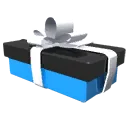

# Like Clockwork 4 - Achievement 1353

[Quest database](./README.md) | [Quest Guide](../Quest%20Guide.md) | [Methodology](./Methodology.md)

**Definition ID: 1353** | Achievement | General / No subtype | Repeatable: False

**Official client name** from the client locale.xml (`Missions_1353_name`, en&#95;US). The historical community association below agrees with this name.

## Description

Official client text from locale.xml (en&#95;US):

**Description:** Complete 500 Daily Missions.

**Objectives-complete tip:** Like Clockwork 4!

### Objectives

Client task text from locale.xml is shown where it exists; the indented line is the data-derived summary of the same MissionTasks row.

- Complete 500 Daily Missions.
    - Data summary: Complete 500 matching mission/achievement completion event(s): ID 920 / ID 921 / ID 922. This is an objective, not automatically a prerequisite for accepting the quest.

## Start, turn-in, and locations

This is an achievement: it is normally discovered/tracked by qualifying progress events once prerequisites permit it, not accepted from a quest giver. Any stored NPC associations below are data references, not an instruction to accept an achievement.

No quest-giver or turn-in association is recorded for this achievement.

Follow a named object for exact XYZ and scene/spawner conditions. Static placements do not prove that the NPC is currently spawned, offers this quest to your character, or is reachable in a deployed server.

## Requirements and quest chain

- Stored prerequisite expression: 1352.
- Inspected server evaluation: [Like Clockwork 3 &#91;1352&#93;](1352.md) is complete.
- UIPrereqID: (not recorded); shown separately, not misread as a mission ID.
- Cooldown: not recorded (loader default -1); -1 means no cooldown in CanAccept.
- Stored feature gate / localization status: nexustower / 2. The generic mission/task loaders mark gate_version unused; other scripts, map gates, and client checks can still restrict availability.
- Referenced prerequisite definitions: [Like Clockwork 3 &#91;1352&#93;](1352.md).
- Referenced as a prerequisite by: [Like Clockwork &#91;1354&#93;](1354.md). These are potential follow-ups, not a guarantee of an immediate offer.

## Walkthrough / checklist

1. Satisfy the achievement prerequisites. Produce a qualifying progress event so the server can discover/track the achievement; prior actions are not assumed to be retroactive for every task type.
2. Complete 500 matching mission/achievement completion event(s): ID 920 / ID 921 / ID 922. This is an objective, not automatically a prerequisite for accepting the quest. See objective **1** below for target references and conditions.
3. When all objectives complete, the normal achievement path grants completion/rewards automatically; there is no generic NPC turn-in step.

**These numbered entries are a readable checklist, not evidence that the objective rows must be completed in this order.** Scripted phases, travel routes, puzzle interactions, and custom conditions are not reconstructed unless the data/source evidence supports them.

## Objective details

### Objective 1: Complete missions / achievements (UID 1882)

**Client task text:** Complete 500 Daily Missions.

Complete 500 matching mission/achievement completion event(s): ID 920 / ID 921 / ID 922. This is an objective, not automatically a prerequisite for accepting the quest.

Target namespace: **MISSION&#95;ID**. Stored target value/threshold: **500**.

Completion targets: ID 920 (no Missions definition in snapshot); ID 921 (no Missions definition in snapshot); ID 922 (no Missions definition in snapshot); ID 923 (no Missions definition in snapshot); ID 924 (no Missions definition in snapshot); ID 925 (no Missions definition in snapshot); ID 926 (no Missions definition in snapshot); ID 927 (no Missions definition in snapshot); ID 929 (no Missions definition in snapshot); ID 930 (no Missions definition in snapshot); ID 931 (no Missions definition in snapshot); ID 932 (no Missions definition in snapshot); ID 1062 (no Missions definition in snapshot); ID 1064 (no Missions definition in snapshot); ID 1065 (no Missions definition in snapshot); ID 1066 (no Missions definition in snapshot); ID 1067 (no Missions definition in snapshot); ID 1068 (no Missions definition in snapshot); ID 1069 (no Missions definition in snapshot); ID 1070 (no Missions definition in snapshot); [Avant Gardens Property Visitor &#91;1194&#93;](1194.md); [Nimbus Station Property Visitor &#91;1196&#93;](1196.md); [Chantey Shanty Visitor &#91;1197&#93;](1197.md); [Raven Bluff Visitor &#91;1198&#93;](1198.md); [Hammer the Hammers &#91;1222&#93;](1222.md); [Robot Rampage &#91;1223&#93;](1223.md); [Another Bug Hunt &#91;1224&#93;](1224.md); [Do You Speak Chaos? &#91;1225&#93;](1225.md); [Mutiny on Crux Prime &#91;1254&#93;](1254.md); [Horsemaster &#91;1255&#93;](1255.md); [Spider Slayer &#91;1256&#93;](1256.md); [Dragonlord &#91;1257&#93;](1257.md); [Invaders! &#91;1258&#93;](1258.md); [Bone Patrol &#91;1259&#93;](1259.md); [Arrr is for Robot &#91;1260&#93;](1260.md); [Boss Battler &#91;1261&#93;](1261.md); [Maelstrom Mangler &#91;1262&#93;](1262.md); [Chaos Crusher &#91;1263&#93;](1263.md); [Smash Pack &#91;1264&#93;](1264.md); [Bone Voyage &#91;1265&#93;](1265.md); [Easy and Hard &#91;1266&#93;](1266.md); [The Bone Builder &#91;1300&#93;](1300.md); [Mining Marauder &#91;1305&#93;](1305.md); [Ninja Avenger &#91;1306&#93;](1306.md); [Breaking Ranks &#91;1307&#93;](1307.md); [Your Spinjitzu is Strong &#91;1308&#93;](1308.md); [Compound Fracture &#91;1309&#93;](1309.md); [Cannon Cove Crackshot &#91;1404&#93;](1404.md); ID 1405 (no Missions definition in snapshot); [Vertigo Debris &#91;1406&#93;](1406.md); [Dragonmaw Debris &#91;1407&#93;](1407.md); [Drive Five &#91;1408&#93;](1408.md); [Flower Hour &#91;1409&#93;](1409.md); [Cannon Cove Champion &#91;1410&#93;](1410.md); [Time Trooper &#91;1411&#93;](1411.md); [Super Survivor &#91;1412&#93;](1412.md); [Pet Cove Clean Up &#91;1413&#93;](1413.md); [Pet Cove Perk Up &#91;1414&#93;](1414.md); [Back to the Front &#91;1415&#93;](1415.md); [Monument Maintenance &#91;1416&#93;](1416.md); [Mechanized Assault &#91;1417&#93;](1417.md); [Hat Trick &#91;1425&#93;](1425.md); [Ultra Survivor &#91;1426&#93;](1426.md); [Chaos Ahoy! &#91;1427&#93;](1427.md); [Sweet Siren Songs &#91;1428&#93;](1428.md); [Tiki Party &#91;1429&#93;](1429.md); [Mushroom Masher &#91;1430&#93;](1430.md); [Victory in the Valley &#91;1431&#93;](1431.md); [Rock Fury &#91;1432&#93;](1432.md); [Avant Guardin' &#91;1433&#93;](1433.md); [Cannon Cove Commander &#91;1434&#93;](1434.md); [Gnarly Hike &#91;1435&#93;](1435.md); [Cannon Cove Corsair &#91;1436&#93;](1436.md); [Time Thrasher &#91;1437&#93;](1437.md); [Cannon Cove Crackshot &#91;1502&#93;](1502.md); ID 1503 (no Missions definition in snapshot); [Vertigo Debris &#91;1504&#93;](1504.md); [Dragonmaw Debris &#91;1505&#93;](1505.md); [Drive Five &#91;1506&#93;](1506.md); [Flower Hour &#91;1507&#93;](1507.md); [Cannon Cove Champion &#91;1508&#93;](1508.md); [Time Trooper &#91;1509&#93;](1509.md); [Super Survivor &#91;1510&#93;](1510.md); [Pet Cove Clean Up &#91;1511&#93;](1511.md); [Pet Cove Perk Up &#91;1512&#93;](1512.md); [Back to the Front &#91;1513&#93;](1513.md); [Monument Maintenance &#91;1514&#93;](1514.md); [Mechanized Assault &#91;1515&#93;](1515.md); [Hat Trick &#91;1523&#93;](1523.md); [Ultra Survivor &#91;1524&#93;](1524.md); [Chaos Ahoy! &#91;1525&#93;](1525.md); [Sweet Siren Songs &#91;1526&#93;](1526.md); [Tiki Party &#91;1527&#93;](1527.md); [Mushroom Masher &#91;1528&#93;](1528.md); [Victory in the Valley &#91;1529&#93;](1529.md); [Rock Fury &#91;1530&#93;](1530.md); [Avant Guardin' &#91;1531&#93;](1531.md); [Cannon Cove Commander &#91;1532&#93;](1532.md); [Gnarly Hike &#91;1533&#93;](1533.md); [Cannon Cove Corsair &#91;1534&#93;](1534.md); [Time Thrasher &#91;1535&#93;](1535.md); [Cannon Cove Crackshot &#91;1539&#93;](1539.md); ID 1540 (no Missions definition in snapshot); [Vertigo Debris &#91;1541&#93;](1541.md); [Dragonmaw Debris &#91;1542&#93;](1542.md); [Drive Five &#91;1543&#93;](1543.md); [Flower Hour &#91;1544&#93;](1544.md); [Cannon Cove Champion &#91;1545&#93;](1545.md); [Time Trooper &#91;1546&#93;](1546.md); [Super Survivor &#91;1547&#93;](1547.md); [Pet Cove Clean Up &#91;1548&#93;](1548.md); [Pet Cove Perk Up &#91;1549&#93;](1549.md); [Back to the Front &#91;1550&#93;](1550.md); [Monument Maintenance &#91;1551&#93;](1551.md); [Mechanized Assault &#91;1552&#93;](1552.md); [Hat Trick &#91;1560&#93;](1560.md); [Ultra Survivor &#91;1561&#93;](1561.md); [Chaos Ahoy! &#91;1562&#93;](1562.md); [Sweet Siren Songs &#91;1563&#93;](1563.md); [Tiki Party &#91;1564&#93;](1564.md); [Mushroom Masher &#91;1565&#93;](1565.md); [Victory in the Valley &#91;1566&#93;](1566.md); [Rock Fury &#91;1567&#93;](1567.md); [Avant Guardin' &#91;1568&#93;](1568.md); [Cannon Cove Commander &#91;1569&#93;](1569.md); [Gnarly Hike &#91;1570&#93;](1570.md); [Cannon Cove Corsair &#91;1571&#93;](1571.md); [Time Thrasher &#91;1572&#93;](1572.md); [Cannon Cove Crackshot &#91;1576&#93;](1576.md); ID 1577 (no Missions definition in snapshot); [Vertigo Debris &#91;1578&#93;](1578.md); [Dragonmaw Debris &#91;1579&#93;](1579.md); [Drive Five &#91;1580&#93;](1580.md); [Flower Hour &#91;1581&#93;](1581.md); [Cannon Cove Champion &#91;1582&#93;](1582.md); [Time Trooper &#91;1583&#93;](1583.md); [Super Survivor &#91;1584&#93;](1584.md); [Pet Cove Clean Up &#91;1585&#93;](1585.md); [Pet Cove Perk Up &#91;1586&#93;](1586.md); [Back to the Front &#91;1587&#93;](1587.md); [Monument Maintenance &#91;1588&#93;](1588.md); [Mechanized Assault &#91;1589&#93;](1589.md); [Robot, Pirates and Rocks &#91;1597&#93;](1597.md); [Ultra Survivor &#91;1598&#93;](1598.md); [Chaos Ahoy! &#91;1599&#93;](1599.md); [Sweet Siren Songs &#91;1600&#93;](1600.md); [Tiki Party &#91;1601&#93;](1601.md); [Mushroom Masher &#91;1602&#93;](1602.md); [Victory in the Valley &#91;1603&#93;](1603.md); [Rock Fury &#91;1604&#93;](1604.md); [Avant Guardin' &#91;1605&#93;](1605.md); [Cannon Cove Commander &#91;1606&#93;](1606.md); [Gnarly Hike &#91;1607&#93;](1607.md); [Cannon Cove Corsair &#91;1608&#93;](1608.md); [Time Thrasher &#91;1609&#93;](1609.md); [Epic Survivor &#91;1618&#93;](1618.md); [Maelstrom Scourge &#91;1619&#93;](1619.md); [Smack in Time &#91;1621&#93;](1621.md); [Forbidden Valiance &#91;1622&#93;](1622.md); [Forbidden Vandal &#91;1623&#93;](1623.md); [Keelhaul Canyon Pro &#91;1624&#93;](1624.md); [Vertigo Loop Pro &#91;1625&#93;](1625.md); [Dragonmaw Chasm Pro &#91;1626&#93;](1626.md); [Explosive Personality &#91;1627&#93;](1627.md); [Epic Survivor &#91;1628&#93;](1628.md); [Maelstrom Scourge &#91;1629&#93;](1629.md); [Smack in Time &#91;1631&#93;](1631.md); [Forbidden Valiance &#91;1632&#93;](1632.md); [Forbidden Vandal &#91;1633&#93;](1633.md); [Keelhaul Canyon Pro &#91;1634&#93;](1634.md); [Vertigo Loop Pro &#91;1635&#93;](1635.md); [Dragonmaw Chasm Pro &#91;1636&#93;](1636.md); [Explosive Personality &#91;1637&#93;](1637.md); [Epic Survivor &#91;1638&#93;](1638.md); [Maelstrom Scourge &#91;1639&#93;](1639.md); [Smack in Time &#91;1641&#93;](1641.md); [Forbidden Valiance &#91;1642&#93;](1642.md); [Forbidden Vandal &#91;1643&#93;](1643.md); [Keelhaul Canyon Pro &#91;1644&#93;](1644.md); [Vertigo Loop Pro &#91;1645&#93;](1645.md); [Dragonmaw Chasm Pro &#91;1646&#93;](1646.md); [Explosive Personality &#91;1647&#93;](1647.md); [Epic Survivor &#91;1648&#93;](1648.md); [Maelstrom Scourge &#91;1649&#93;](1649.md); [Smack in Time &#91;1651&#93;](1651.md); [Forbidden Valiance &#91;1652&#93;](1652.md); [Forbidden Vandal &#91;1653&#93;](1653.md); [Keelhaul Canyon Pro &#91;1654&#93;](1654.md); [Vertigo Loop Pro &#91;1655&#93;](1655.md); [Dragonmaw Chasm Pro &#91;1656&#93;](1656.md); [Explosive Personality &#91;1657&#93;](1657.md); ID 1658 (no Missions definition in snapshot); ID 1659 (no Missions definition in snapshot); ID 1660 (no Missions definition in snapshot); [Six Shooter &#91;1880&#93;](1880.md); [Spare Parts &#91;1879&#93;](1879.md); [Help Wanted! &#91;1882&#93;](1882.md); [Bring Back the Booty &#91;1881&#93;](1881.md); [Wrecking Crew &#91;1873&#93;](1873.md); [Care to Repair? &#91;1874&#93;](1874.md); [Bye Bye Birdies &#91;1875&#93;](1875.md); [Do the Monster Smash &#91;1858&#93;](1858.md); [Reboot the Robots &#91;1859&#93;](1859.md); [Clean-Up Squad &#91;1860&#93;](1860.md); [Brick Patrol &#91;1869&#93;](1869.md); [Spackle Fixes Everything &#91;1870&#93;](1870.md); [Creepy Crawlies &#91;1862&#93;](1862.md); [Web of Destruction &#91;1863&#93;](1863.md); [Faster and More Furious &#91;1884&#93;](1884.md); ID 1857 (no Missions definition in snapshot); [Test Your Metal &#91;1865&#93;](1865.md); [Smashdown &#91;1864&#93;](1864.md); [Protect the Monastery! &#91;2040&#93;](2040.md); [Fracture the Frontlines 1 &#91;2028&#93;](2028.md); [Fracture the Frontlines 2 &#91;2029&#93;](2029.md); [The Siege of Ninjago &#91;2032&#93;](2032.md); [Ready, Aim, Dragonfire! &#91;2033&#93;](2033.md); [Let's Bounce! &#91;2034&#93;](2034.md); [Mud in Your Mouth &#91;2037&#93;](2037.md); [Clear Out the Caves 1 &#91;2030&#93;](2030.md); [Clear Out the Caves 2 &#91;2031&#93;](2031.md); [Acquired Tastes &#91;2038&#93;](2038.md); [Smash Some Scents 1 &#91;2036&#93;](2036.md); [Smash Some Scents 2 &#91;2035&#93;](2035.md); [Trapped! Again! &#91;2039&#93;](2039.md); [Gonna Need a Bigger Boat &#91;1897&#93;](1897.md).

- Stored task gate: nexustower (not enforced by the inspected generic task loader)

| Raw task field | Value |
| --- | --- |
| taskType | 16 |
| target | 920 |
| targetGroup | 921, 922, 923, 924, 925, 926, 927, 929, 930, 931, 932,1062, 1064, 1065, 1066, 1067, 1068, 1069, 1070, 1194, 1196, 1197, 1198, 1222, 1223, 1224, 1225, 1254, 1255, 1256, 1257, 1258, 1259, 1260, 1261, 1262, 1263, 1264, 1265, 1266,1300, 1305, 1306, 1307, 1308, 1309, 1404, 1405, 1406, 1407, 1408, 1409, 1410, 1411, 1412, 1413, 1414, 1415, 1416, 1417, 1425, 1426, 1427, 1428, 1429, 1430, 1431, 1432, 1433, 1434, 1435, 1436, 1437, 1502, 1503, 1504, 1505, 1506, 1507, 1508, 1509, 1510, 1511, 1512, 1513, 1514, 1515, 1523, 1524, 1525, 1526, 1527, 1528, 1529, 1530, 1531, 1532, 1533, 1534, 1535, 1539, 1540, 1541, 1542, 1543, 1544, 1545, 1546, 1547, 1548, 1549, 1550, 1551, 1552, 1560, 1561, 1562, 1563, 1564, 1565, 1566, 1567, 1568, 1569, 1570, 1571, 1572, 1576, 1577, 1578, 1579, 1580, 1581, 1582, 1583, 1584, 1585, 1586, 1587, 1588, 1589, 1597, 1598, 1599, 1600, 1601, 1602, 1603, 1604, 1605, 1606, 1607, 1608, 1609, 1618, 1619, 1621, 1622, 1623, 1624, 1625, 1626, 1627, 1628, 1629, 1631, 1632, 1633, 1634, 1635, 1636, 1637, 1638, 1639, 1641, 1642, 1643, 1644, 1645, 1646, 1647, 1648, 1649, 1651, 1652, 1653, 1654, 1655, 1656, 1657, 1658, 1659, 1660, 1880,1879,1882,1881,1873,1874,1875,1858,1859,1860,1869,1870,1862,1863,1884,1857,1865,1864,2040,2028,2029,2032,2033,2034,2037,2030,2031,2038,2036,2035,2039,1897 |
| targetValue | 500 |
| taskParam1 |  |
| uid | 1882 |
| gate_version | nexustower |

## Rewards

**Choice reward:** listed item slots are alternatives when the normal mission-choice flow applies; do not assume that all are granted. A selected reward LOT filters item slots in the inspected handler.

| Item reward slot | Item | Granted quantity | Stored count / notes |
| --- | --- | --- | --- |
| First completion / 1 | { .lu-ti width="24" loading="lazy" } [Superior Gem Pack (LOT 13113)](../items/13113.md) | 1 | 1 |
| First completion / 2 | { .lu-ti width="24" loading="lazy" } [Superior Surprise Pack (LOT 13103)](../items/13103.md) | 1 | 1 |
| First completion / 3 | { .lu-ti width="24" loading="lazy" } [Surprise Model Pack (LOT 13117)](../items/13117.md) | 1 | 1 |

| Reward | First completion / stored value | Repeat behavior |
| --- | --- | --- |
| Coins | 0 | Not advertised as repeatable |
| U-Score | 200 | Not advertised as repeatable |
| Reputation | 0 | Not advertised as repeatable |
| Maximum Life | No positive grant defined | First completion only |
| Maximum Imagination | No positive grant defined | First completion only |
| Item backpack slots | No positive grant defined | First completion only |
| Vault item AND vault model slots | No positive grant defined | First completion only |

Emote unlocks (first completion): none with positive IDs recorded.

At the configured level cap, U-Score can be converted into coins using server configuration. Stored base coins are not a quote for that conversion. Reputation and U-Score are processed before the repeat-reward branch; stat increases and emote unlocks are first-completion only.

## Historical community references

- [Like Clockwork 4](https://legouniverse.fandom.com/wiki/Like_Clockwork?oldid=157515) — candidate title from Like Clockwork. Matching evidence groups: **U-Score, reward item, objective kind, objective threshold**. Revision 157515; retrieved 2026-11-17T09:38:36.911Z.
  Reported factual methods: complete objectives; location labels: not extracted; named objective references: none extracted; named reward references: Superior Gem Pack, Superior Surprise Pack.

This page provides an original data-derived checklist, not copied wiki dialogue or a claim that the historical walkthrough exactly matches the deployed server.

## Evidence and limitations

[Missions](../../db/Missions.md), [MissionTasks](../../db/MissionTasks.md), [MissionNPCComponent](../../db/MissionNPCComponent.md), [MissionText](../../db/MissionText.md), [MissionEmail](../../db/MissionEmail.md). [Task interpretation and coverage](./Methodology.md). Availability, client presentation, puzzle phases, and custom script behavior can differ.
