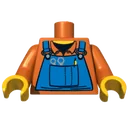

# Creative Flow 2 - Achievement 1367

[Quest database](./README.md) | [Quest Guide](../Quest%20Guide.md) | [Methodology](./Methodology.md)

**Definition ID: 1367** | Achievement | Location / Nexus Tower | Repeatable: False

**Official client name** from the client locale.xml (`Missions_1367_name`, en&#95;US). Historical community name: '''Creative Flow 2''' (a candidate association from public wiki research; see the references below).

## Description

Official client text from locale.xml (en&#95;US):

**Description:** Quick Build any of the Imagination pipes in Nexus Tower 20 more times.

**Objectives-complete tip:** Creative Flow 2!

### Objectives

Client task text from locale.xml is shown where it exists; the indented line is the data-derived summary of the same MissionTasks row.

- Quick Build any of the Imagination pipes in Nexus Tower 20 more times.
    - Data summary: Complete 20 matching activity / Quick Build event(s): NT - Pipe Rebuild6 / NT - Pipe Rebuild5 / NT - Pipe Rebuild4 / 3 further allowed templates.

## Start, turn-in, and locations

This is an achievement: it is normally discovered/tracked by qualifying progress events once prerequisites permit it, not accepted from a quest giver. Any stored NPC associations below are data references, not an instruction to accept an achievement.

No quest-giver or turn-in association is recorded for this achievement.

Follow a named object for exact XYZ and scene/spawner conditions. Static placements do not prove that the NPC is currently spawned, offers this quest to your character, or is reachable in a deployed server.

## Requirements and quest chain

- Stored prerequisite expression: 1366.
- Inspected server evaluation: [Creative Flow 1 &#91;1366&#93;](1366.md) is complete.
- UIPrereqID: (not recorded); shown separately, not misread as a mission ID.
- Cooldown: not recorded (loader default -1); -1 means no cooldown in CanAccept.
- Stored feature gate / localization status: nexustower / 2. The generic mission/task loaders mark gate_version unused; other scripts, map gates, and client checks can still restrict availability.
- Referenced prerequisite definitions: [Creative Flow 1 &#91;1366&#93;](1366.md).
- Referenced as a prerequisite by: [Creative Flow &#91;1368&#93;](1368.md). These are potential follow-ups, not a guarantee of an immediate offer.

## Walkthrough / checklist

1. Satisfy the achievement prerequisites. Produce a qualifying progress event so the server can discover/track the achievement; prior actions are not assumed to be retroactive for every task type.
2. Complete 20 matching activity / Quick Build event(s): NT - Pipe Rebuild6 / NT - Pipe Rebuild5 / NT - Pipe Rebuild4 / 3 further allowed templates. See objective **1** below for target references and conditions.
3. When all objectives complete, the normal achievement path grants completion/rewards automatically; there is no generic NPC turn-in step.

**These numbered entries are a readable checklist, not evidence that the objective rows must be completed in this order.** Scripted phases, travel routes, puzzle interactions, and custom conditions are not reconstructed unless the data/source evidence supports them.

## Objective details

### Objective 1: Activity / Quick Build (UID 1898)

**Client task text:** Quick Build any of the Imagination pipes in Nexus Tower 20 more times.

Complete 20 matching activity / Quick Build event(s): NT - Pipe Rebuild6 / NT - Pipe Rebuild5 / NT - Pipe Rebuild4 / 3 further allowed templates.

Target namespace: **ACTIVITY&#95;OR&#95;EVENT&#95;ID**. Stored target value/threshold: **20**.

| Matching / associated object | Mapped zones | Item acquisition data |
| --- | --- | --- |
| [NT - Pipe Rebuild6 (LOT 12416)](sources/object-12416.md) | [Nexus Tower (1900)](locations/zone-1900.md) | Not an item-template registration |
| [NT - Pipe Rebuild5 (LOT 12415)](sources/object-12415.md) | No matched local placement found | Not an item-template registration |
| [NT - Pipe Rebuild4 (LOT 12414)](sources/object-12414.md) | No matched local placement found | Not an item-template registration |
| [NT - Pipe Rebuild3 (LOT 12413)](sources/object-12413.md) | No matched local placement found | Not an item-template registration |
| [NT - Pipe Rebuild2 (LOT 12412)](sources/object-12412.md) | No matched local placement found | Not an item-template registration |
| [NT - Pipe Rebuild1 (LOT 12411)](sources/object-12411.md) | [Nexus Tower (1900)](locations/zone-1900.md) | Not an item-template registration |

The listed objects are candidate activities joined through SCRIPTED_ACTIVITY (39) or RebuildComponent.activityID, not an assumption that the activity number is a LOT. Script-created activities can be missing.

- Stored task gate: nexustower (not enforced by the inspected generic task loader)

| Raw task field | Value |
| --- | --- |
| taskType | 2 |
| target | 12416 |
| targetGroup | 12416,12415,12414,12413,12412,12411 |
| targetValue | 20 |
| taskParam1 |  |
| uid | 1898 |
| gate_version | nexustower |

## Rewards

The item slots below are listed completion rewards, not random loot-table rolls. Player eligibility and completion still apply.

| Item reward slot | Item | Granted quantity | Stored count / notes |
| --- | --- | --- | --- |
| First completion / 1 | { .lu-ti width="24" loading="lazy" } [Overalls (LOT 7747)](../items/7747.md) | 1 | 1 |

| Reward | First completion / stored value | Repeat behavior |
| --- | --- | --- |
| Coins | 0 | Not advertised as repeatable |
| U-Score | 55 | Not advertised as repeatable |
| Reputation | 0 | Not advertised as repeatable |
| Maximum Life | No positive grant defined | First completion only |
| Maximum Imagination | No positive grant defined | First completion only |
| Item backpack slots | No positive grant defined | First completion only |
| Vault item AND vault model slots | No positive grant defined | First completion only |

Emote unlocks (first completion): none with positive IDs recorded.

At the configured level cap, U-Score can be converted into coins using server configuration. Stored base coins are not a quote for that conversion. Reputation and U-Score are processed before the repeat-reward branch; stat increases and emote unlocks are first-completion only.

## Historical community references

- ['''Creative Flow 2'''](https://legouniverse.fandom.com/wiki/Creative_Flow?oldid=153722) — candidate title from Creative Flow. Matching evidence groups: **U-Score, reward item, region, objective kind, objective threshold**. Revision 153722; retrieved 2026-11-17T09:38:35.349Z.
  Reported factual methods: build; location labels: Nexus Tower; named objective references: none extracted; named reward references: Overalls.

This page provides an original data-derived checklist, not copied wiki dialogue or a claim that the historical walkthrough exactly matches the deployed server.

## Evidence and limitations

[Missions](../../db/Missions.md), [MissionTasks](../../db/MissionTasks.md), [MissionNPCComponent](../../db/MissionNPCComponent.md), [MissionText](../../db/MissionText.md), [MissionEmail](../../db/MissionEmail.md). [Task interpretation and coverage](./Methodology.md). Availability, client presentation, puzzle phases, and custom script behavior can differ.
