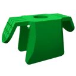

# Down They Fall - Quest 1806

[Quest database](./README.md) | [Quest Guide](../Quest%20Guide.md) | [Methodology](./Methodology.md)

**Definition ID: 1806** | Quest | Location / Ninjago Monastery | Repeatable: False

**Official client name** from the client locale.xml (`Missions_1806_name`, en&#95;US).

## Description

Official client text from locale.xml (en&#95;US):

**Offer text:** I think you're strong enough now to really topple the Skeletons' war efforts! Take down 2 of their Siege Towers!

**Accept reply:** Use the brown Earth Spinjitzu Lanterns to get inside the Siege Tower barricades!

**In-progress text:** Destroy 2 Skeleton Siege Towers on the Ninjago Battlefield.

**Objectives-complete tip:** Return to Kai in the Monastery Dojo of Fire.

**Turn-in text:** Awesome! I heard the crash from out here!

### Objectives

Client task text from locale.xml is shown where it exists; the indented line is the data-derived summary of the same MissionTasks row.

- Destroy 2 of the Skeletons' Siege Towers on the Ninjago Battlefield.
    - Data summary: Accumulate 2 progress units through the quest-specific script event. Event value(s): 15953. The exact action is not defined by the generic task row.

## Start, turn-in, and locations

| Role | NPC / object | Mapped candidate zones | Association evidence |
| --- | --- | --- | --- |
| Defined offer object | [Kai - Ninja of Fire (LOT 13793)](sources/object-13793.md) | [Ninjago Monastery (2000)](locations/zone-2000.md) | Missions.offer&#95;objectID |
| Defined turn-in object | [Kai - Ninja of Fire (LOT 13793)](sources/object-13793.md) | [Ninjago Monastery (2000)](locations/zone-2000.md) | Missions.target&#95;objectID |
| Offers mission | [Kai - Ninja of Fire (LOT 13793)](sources/object-13793.md) | [Ninjago Monastery (2000)](locations/zone-2000.md) | MissionNPCComponent 165 |
| Accepts turn-in | [Kai - Ninja of Fire (LOT 13793)](sources/object-13793.md) | [Ninjago Monastery (2000)](locations/zone-2000.md) | MissionNPCComponent 165 |

Follow a named object for exact XYZ and scene/spawner conditions. Static placements do not prove that the NPC is currently spawned, offers this quest to your character, or is reachable in a deployed server.

## Requirements and quest chain

- Stored prerequisite expression: 1794.
- Inspected server evaluation: [Target Practice &#91;1794&#93;](1794.md) is complete.
- UIPrereqID: (not recorded); shown separately, not misread as a mission ID.
- Cooldown: 0 minute(s) after previous completion.
- Stored feature gate / localization status: njhub / 2. The generic mission/task loaders mark gate_version unused; other scripts, map gates, and client checks can still restrict availability.
- Referenced prerequisite definitions: [Target Practice &#91;1794&#93;](1794.md).
- Referenced as a prerequisite by: [The Power of Fire &#91;1949&#93;](1949.md); [Fracture the Frontlines 1 &#91;2028&#93;](2028.md); [Fracture the Frontlines 2 &#91;2029&#93;](2029.md); [The Siege of Ninjago &#91;2032&#93;](2032.md); [Ready, Aim, Dragonfire! &#91;2033&#93;](2033.md); [Let's Bounce! &#91;2034&#93;](2034.md); [Mud in Your Mouth &#91;2037&#93;](2037.md); [Quest 2062 &#91;2062&#93;](2062.md). These are potential follow-ups, not a guarantee of an immediate offer.

## Walkthrough / checklist

1. Satisfy the prerequisites and any client, map, or script conditions. Check the giver listed above; where none is resolved, the acceptance route remains unknown.
2. Accept the quest before relying on objective credit. Inventory gather tasks, existing flags, and racing parameter-4 tasks have limited acceptance catch-up; other earlier actions are not assumed to count.
3. Accumulate 2 progress units through the quest-specific script event. Event value(s): 15953. The exact action is not defined by the generic task row. See objective **1** below for target references and conditions.
4. After all objective counters are satisfied, complete the recorded turn-in interaction. If offered a reward choice, select the desired item rather than assuming all alternatives are granted.

**These numbered entries are a readable checklist, not evidence that the objective rows must be completed in this order.** Scripted phases, travel routes, puzzle interactions, and custom conditions are not reconstructed unless the data/source evidence supports them.

## Objective details

### Objective 1: Script event (UID 2567)

**Client task text:** Destroy 2 of the Skeletons' Siege Towers on the Ninjago Battlefield.

Accumulate 2 progress units through the quest-specific script event. Event value(s): 15953. The exact action is not defined by the generic task row.

Target namespace: **SCRIPT&#95;EVENT&#95;VALUE**. Stored target value/threshold: **2**.

- Stored task gate: njhub (not enforced by the inspected generic task loader)

| Raw task field | Value |
| --- | --- |
| taskType | 1 |
| target | 15953 |
| targetGroup |  |
| targetValue | 2 |
| taskParam1 |  |
| uid | 2567 |
| gate_version | njhub |

## Rewards

The item slots below are listed completion rewards, not random loot-table rolls. Player eligibility and completion still apply.

| Item reward slot | Item | Granted quantity | Stored count / notes |
| --- | --- | --- | --- |
| First completion / 1 | { .lu-ti width="24" loading="lazy" } [Scale Mail (LOT 15993)](../items/15993.md) | 1 | 1 |

| Reward | First completion / stored value | Repeat behavior |
| --- | --- | --- |
| Coins | 500 | Not advertised as repeatable |
| U-Score | 105 | Not advertised as repeatable |
| Reputation | 0 | Not advertised as repeatable |
| Maximum Life | No positive grant defined | First completion only |
| Maximum Imagination | No positive grant defined | First completion only |
| Item backpack slots | No positive grant defined | First completion only |
| Vault item AND vault model slots | No positive grant defined | First completion only |

Emote unlocks (first completion): none with positive IDs recorded.

At the configured level cap, U-Score can be converted into coins using server configuration. Stored base coins are not a quote for that conversion. Reputation and U-Score are processed before the repeat-reward branch; stat increases and emote unlocks are first-completion only.

## Historical community references

No unique, sufficiently corroborated association was established in the researched community infoboxes. Similar names or matching numeric IDs were not treated as proof.

This page provides an original data-derived checklist, not copied wiki dialogue or a claim that the historical walkthrough exactly matches the deployed server.

## Evidence and limitations

[Missions](../../db/Missions.md), [MissionTasks](../../db/MissionTasks.md), [MissionNPCComponent](../../db/MissionNPCComponent.md), [MissionText](../../db/MissionText.md), [MissionEmail](../../db/MissionEmail.md). [Task interpretation and coverage](./Methodology.md). Availability, client presentation, puzzle phases, and custom script behavior can differ.
