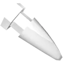

# Tools from Ghouls - Quest 1813

[Quest database](./README.md) | [Quest Guide](../Quest%20Guide.md) | [Methodology](./Methodology.md)

**Definition ID: 1813** | Quest | Location / Ninjago Monastery | Repeatable: False

**Official client name** from the client locale.xml (`Missions_1813_name`, en&#95;US).

## Description

Official client text from locale.xml (en&#95;US):

**Offer text:** I need some tools to finish this Chaos Cleaner. Smash Skeletons and get me 1 Shoulder Socket Wrench, 3 Hammer Toes and 5 Finger Nails!

**Accept reply:** I bet those Skeletons will have the tools I need!

**In-progress text:** Smash Skeleton Marksmen and Commandos to get 1 Shoulder Socket Wrench, 3 Hammer Toes and 5 Finger Nails.

**Objectives-complete tip:** Return the Bone Tools to Jay in the Dojo of Lightning.

**Turn-in text:** Got all the Bone Tools? Bet those Skeletons didn't let go of 'em so easily!

### Objectives

Client task text from locale.xml is shown where it exists; the indented line is the data-derived summary of the same MissionTasks row.

- Smash Skeleton Marksmen on the Ninjago Battlefield until you find 1 Shoulder Socket Wrench.
    - Data summary: Gather 1 item(s) from the allowed templates, sharing one counter: Shoulder Socket Wrench.
- Smash Skeleton Marksmen on the Ninjago Battlefield until you find 3 Hammer Toes.
    - Data summary: Gather 3 item(s) from the allowed templates, sharing one counter: Hammer Toe.
- Smash Skeleton Commandos on the Ninjago Battlefield until you find 5 Finger Nails.
    - Data summary: Gather 5 item(s) from the allowed templates, sharing one counter: Finger Nail.

## Start, turn-in, and locations

| Role | NPC / object | Mapped candidate zones | Association evidence |
| --- | --- | --- | --- |
| Defined offer object | [Jay - Ninja of Lightning (LOT 13792)](sources/object-13792.md) | [Ninjago Monastery (2000)](locations/zone-2000.md) | Missions.offer&#95;objectID |
| Defined turn-in object | [Jay - Ninja of Lightning (LOT 13792)](sources/object-13792.md) | [Ninjago Monastery (2000)](locations/zone-2000.md) | Missions.target&#95;objectID |
| Offers mission | [Jay - Ninja of Lightning (LOT 13792)](sources/object-13792.md) | [Ninjago Monastery (2000)](locations/zone-2000.md) | MissionNPCComponent 163 |
| Accepts turn-in | [Jay - Ninja of Lightning (LOT 13792)](sources/object-13792.md) | [Ninjago Monastery (2000)](locations/zone-2000.md) | MissionNPCComponent 163 |

Follow a named object for exact XYZ and scene/spawner conditions. Static placements do not prove that the NPC is currently spawned, offers this quest to your character, or is reachable in a deployed server.

## Requirements and quest chain

- Stored prerequisite expression: 1927.
- Inspected server evaluation: [Purify DIY &#91;1927&#93;](1927.md) is complete.
- UIPrereqID: (not recorded); shown separately, not misread as a mission ID.
- Cooldown: 0 minute(s) after previous completion.
- Stored feature gate / localization status: njhub / 2. The generic mission/task loaders mark gate_version unused; other scripts, map gates, and client checks can still restrict availability.
- Referenced prerequisite definitions: [Purify DIY &#91;1927&#93;](1927.md).
- Referenced as a prerequisite by: [Diamond Power &#91;1814&#93;](1814.md). These are potential follow-ups, not a guarantee of an immediate offer.

## Walkthrough / checklist

1. Satisfy the prerequisites and any client, map, or script conditions. Check the giver listed above; where none is resolved, the acceptance route remains unknown.
2. Accept the quest before relying on objective credit. Inventory gather tasks, existing flags, and racing parameter-4 tasks have limited acceptance catch-up; other earlier actions are not assumed to count.
3. Gather 1 item(s) from the allowed templates, sharing one counter: Shoulder Socket Wrench. See objective **1** below for target references and conditions.
4. Gather 3 item(s) from the allowed templates, sharing one counter: Hammer Toe. See objective **2** below for target references and conditions.
5. Gather 5 item(s) from the allowed templates, sharing one counter: Finger Nail. See objective **3** below for target references and conditions.
6. After all objective counters are satisfied, complete the recorded turn-in interaction. If offered a reward choice, select the desired item rather than assuming all alternatives are granted.

**These numbered entries are a readable checklist, not evidence that the objective rows must be completed in this order.** Scripted phases, travel routes, puzzle interactions, and custom conditions are not reconstructed unless the data/source evidence supports them.

## Objective details

### Objective 1: Gather items (UID 2574)

**Client task text:** Smash Skeleton Marksmen on the Ninjago Battlefield until you find 1 Shoulder Socket Wrench.

Gather 1 item(s) from the allowed templates, sharing one counter: Shoulder Socket Wrench.

Target namespace: **LOT**. Stored target value/threshold: **1**.

| Matching / associated object | Mapped zones | Item acquisition data |
| --- | --- | --- |
| [Shoulder Socket Wrench (LOT 14494)](sources/object-14494.md) | No matched local placement found | { .lu-ti width="24" loading="lazy" } [Shoulder Socket Wrench (LOT 14494)](../items/14494.md) |

- Stored task gate: njhub (not enforced by the inspected generic task loader)
- Gathered targets can be removed from item/quest inventory when rewards are granted.
- Losing required items can reduce progress and return a ready quest to active.

| Raw task field | Value |
| --- | --- |
| taskType | 11 |
| target | 14494 |
| targetGroup |  |
| targetValue | 1 |
| taskParam1 | 2 |
| uid | 2574 |
| gate_version | njhub |
### Objective 2: Gather items (UID 2575)

**Client task text:** Smash Skeleton Marksmen on the Ninjago Battlefield until you find 3 Hammer Toes.

Gather 3 item(s) from the allowed templates, sharing one counter: Hammer Toe.

Target namespace: **LOT**. Stored target value/threshold: **3**.

| Matching / associated object | Mapped zones | Item acquisition data |
| --- | --- | --- |
| [Hammer Toe (LOT 14495)](sources/object-14495.md) | No matched local placement found | { .lu-ti width="24" loading="lazy" } [Hammer Toe (LOT 14495)](../items/14495.md) |

- Stored task gate: njhub (not enforced by the inspected generic task loader)
- Gathered targets can be removed from item/quest inventory when rewards are granted.
- Losing required items can reduce progress and return a ready quest to active.

| Raw task field | Value |
| --- | --- |
| taskType | 11 |
| target | 14495 |
| targetGroup |  |
| targetValue | 3 |
| taskParam1 | 2 |
| uid | 2575 |
| gate_version | njhub |
### Objective 3: Gather items (UID 2576)

**Client task text:** Smash Skeleton Commandos on the Ninjago Battlefield until you find 5 Finger Nails.

Gather 5 item(s) from the allowed templates, sharing one counter: Finger Nail.

Target namespace: **LOT**. Stored target value/threshold: **5**.

| Matching / associated object | Mapped zones | Item acquisition data |
| --- | --- | --- |
| [Finger Nail (LOT 14496)](sources/object-14496.md) | No matched local placement found | { .lu-ti width="24" loading="lazy" } [Finger Nail (LOT 14496)](../items/14496.md) |

- Stored task gate: njhub (not enforced by the inspected generic task loader)
- Gathered targets can be removed from item/quest inventory when rewards are granted.
- Losing required items can reduce progress and return a ready quest to active.

| Raw task field | Value |
| --- | --- |
| taskType | 11 |
| target | 14496 |
| targetGroup |  |
| targetValue | 5 |
| taskParam1 | 2 |
| uid | 2576 |
| gate_version | njhub |

## Rewards

The item slots below are listed completion rewards, not random loot-table rolls. Player eligibility and completion still apply.

No positive item reward LOT is defined for the displayed completion modes.

| Reward | First completion / stored value | Repeat behavior |
| --- | --- | --- |
| Coins | 500 | Not advertised as repeatable |
| U-Score | 105 | Not advertised as repeatable |
| Reputation | 0 | Not advertised as repeatable |
| Maximum Life | No positive grant defined | First completion only |
| Maximum Imagination | No positive grant defined | First completion only |
| Item backpack slots | No positive grant defined | First completion only |
| Vault item AND vault model slots | No positive grant defined | First completion only |

Emote unlocks (first completion): none with positive IDs recorded.

At the configured level cap, U-Score can be converted into coins using server configuration. Stored base coins are not a quote for that conversion. Reputation and U-Score are processed before the repeat-reward branch; stat increases and emote unlocks are first-completion only.

## Historical community references

No unique, sufficiently corroborated association was established in the researched community infoboxes. Similar names or matching numeric IDs were not treated as proof.

This page provides an original data-derived checklist, not copied wiki dialogue or a claim that the historical walkthrough exactly matches the deployed server.

## Evidence and limitations

[Missions](../../db/Missions.md), [MissionTasks](../../db/MissionTasks.md), [MissionNPCComponent](../../db/MissionNPCComponent.md), [MissionText](../../db/MissionText.md), [MissionEmail](../../db/MissionEmail.md). [Task interpretation and coverage](./Methodology.md). Availability, client presentation, puzzle phases, and custom script behavior can differ.
