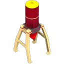

# Spackle Fixes Everything - Quest 1870

[Quest database](./README.md) | [Quest Guide](../Quest%20Guide.md) | [Methodology](./Methodology.md)

**Definition ID: 1870** | Quest | Hidden / Hidden | Repeatable: True

**Official client name** from the client locale.xml (`Missions_1870_name`, en&#95;US).

## Description

Official client text from locale.xml (en&#95;US):

**Offer text:** Those Stromlings are getting close! Hurry and **Quick Build the wall**!

**Repeat offer text:** Those Stromlings are getting close! Hurry and **Quick Build the wall**!

**Accept reply:** Hurry up and get building! They're coming through!

**In-progress text:** **Quick Build the wall** at the Sentinel Base Camp.

**Objectives-complete tip:** Report back to Fitz Vanderbuilt at the Sentinel Base Camp.

**Turn-in text:** That should hold, at least for another day! Maybe we should get Assembly to build us something stronger.

### Objectives

Client task text from locale.xml is shown where it exists; the indented line is the data-derived summary of the same MissionTasks row.

- Quick Build the wall at the Sentinel Base Camp.
    - Data summary: Complete 1 matching activity / Quick Build event(s): AG - Rebuildable Wall / SPIDER BOSS - Rebuildable / Farm Silo Model 1.

## Start, turn-in, and locations

| Role | NPC / object | Mapped candidate zones | Association evidence |
| --- | --- | --- | --- |
| Defined offer object | [Fitz Vanderbuilt - Sentinel Faction Engineer (LOT 6010)](sources/object-6010.md) | [Avant Gardens (1100)](locations/zone-1100.md) | Missions.offer&#95;objectID |
| Defined turn-in object | [Fitz Vanderbuilt - Sentinel Faction Engineer (LOT 6010)](sources/object-6010.md) | [Avant Gardens (1100)](locations/zone-1100.md) | Missions.target&#95;objectID |
| Offers mission | [Fitz Vanderbuilt - Sentinel Faction Engineer (LOT 6010)](sources/object-6010.md) | [Avant Gardens (1100)](locations/zone-1100.md) | MissionNPCComponent 29 |
| Accepts turn-in | [Fitz Vanderbuilt - Sentinel Faction Engineer (LOT 6010)](sources/object-6010.md) | [Avant Gardens (1100)](locations/zone-1100.md) | MissionNPCComponent 29 |

Follow a named object for exact XYZ and scene/spawner conditions. Static placements do not prove that the NPC is currently spawned, offers this quest to your character, or is reachable in a deployed server.

## Requirements and quest chain

- Stored prerequisite expression: 1869.
- Inspected server evaluation: [Brick Patrol &#91;1869&#93;](1869.md) is complete.
- UIPrereqID: (not recorded); shown separately, not misread as a mission ID.
- Cooldown: 1300 minute(s) after previous completion.
- Stored feature gate / localization status: freetrial / 2. The generic mission/task loaders mark gate_version unused; other scripts, map gates, and client checks can still restrict availability.
- Referenced prerequisite definitions: [Brick Patrol &#91;1869&#93;](1869.md).

## Walkthrough / checklist

1. Satisfy the prerequisites and any client, map, or script conditions. Check the giver listed above; where none is resolved, the acceptance route remains unknown.
2. Accept the quest before relying on objective credit. Inventory gather tasks, existing flags, and racing parameter-4 tasks have limited acceptance catch-up; other earlier actions are not assumed to count.
3. Complete 1 matching activity / Quick Build event(s): AG - Rebuildable Wall / SPIDER BOSS - Rebuildable / Farm Silo Model 1. See objective **1** below for target references and conditions.
4. After all objective counters are satisfied, complete the recorded turn-in interaction. If offered a reward choice, select the desired item rather than assuming all alternatives are granted.

**These numbered entries are a readable checklist, not evidence that the objective rows must be completed in this order.** Scripted phases, travel routes, puzzle interactions, and custom conditions are not reconstructed unless the data/source evidence supports them.

## Objective details

### Objective 1: Activity / Quick Build (UID 2654)

**Client task text:** Quick Build the wall at the Sentinel Base Camp.

Complete 1 matching activity / Quick Build event(s): AG - Rebuildable Wall / SPIDER BOSS - Rebuildable / Farm Silo Model 1.

Target namespace: **ACTIVITY&#95;OR&#95;EVENT&#95;ID**. Stored target value/threshold: **1**.

| Matching / associated object | Mapped zones | Item acquisition data |
| --- | --- | --- |
| [AG - Rebuildable Wall (LOT 6319)](sources/object-6319.md) | [Avant Gardens (1100)](locations/zone-1100.md); [Crux Prime (1800)](locations/zone-1800.md) | Not an item-template registration |
| [SPIDER BOSS - Rebuildable (LOT 8619)](sources/object-8619.md) | No matched local placement found | Not an item-template registration |
| [Farm Silo Model 1 (LOT 10369)](sources/object-10369.md) | No matched local placement found | { .lu-ti width="24" loading="lazy" } [Farm Silo Model 1 (LOT 10369)](../items/10369.md) |

The listed objects are candidate activities joined through SCRIPTED_ACTIVITY (39) or RebuildComponent.activityID, not an assumption that the activity number is a LOT. Script-created activities can be missing.

- Stored task gate: freetrial (not enforced by the inspected generic task loader)

| Raw task field | Value |
| --- | --- |
| taskType | 2 |
| target | 6319 |
| targetGroup |  |
| targetValue | 1 |
| taskParam1 |  |
| uid | 2654 |
| gate_version | freetrial |

## Rewards

The item slots below are listed completion rewards, not random loot-table rolls. Player eligibility and completion still apply.

No positive item reward LOT is defined for the displayed completion modes.

| Reward | First completion / stored value | Repeat behavior |
| --- | --- | --- |
| Coins | 250 | 250 |
| U-Score | 30 | 30 |
| Reputation | 0 | 0 |
| Maximum Life | No positive grant defined | First completion only |
| Maximum Imagination | No positive grant defined | First completion only |
| Item backpack slots | No positive grant defined | First completion only |
| Vault item AND vault model slots | No positive grant defined | First completion only |

Emote unlocks (first completion): none with positive IDs recorded.

At the configured level cap, U-Score can be converted into coins using server configuration. Stored base coins are not a quote for that conversion. Reputation and U-Score are processed before the repeat-reward branch; stat increases and emote unlocks are first-completion only.

## Historical community references

No unique, sufficiently corroborated association was established in the researched community infoboxes. Similar names or matching numeric IDs were not treated as proof.

This page provides an original data-derived checklist, not copied wiki dialogue or a claim that the historical walkthrough exactly matches the deployed server.

## Evidence and limitations

[Missions](../../db/Missions.md), [MissionTasks](../../db/MissionTasks.md), [MissionNPCComponent](../../db/MissionNPCComponent.md), [MissionText](../../db/MissionText.md), [MissionEmail](../../db/MissionEmail.md). [Task interpretation and coverage](./Methodology.md). Availability, client presentation, puzzle phases, and custom script behavior can differ.
