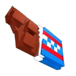

# Rock Candy - Quest 1876

[Quest database](./README.md) | [Quest Guide](../Quest%20Guide.md) | [Methodology](./Methodology.md)

**Definition ID: 1876** | Quest | Location / Ninjago Monastery | Repeatable: False

**Official client name** from the client locale.xml (`Missions_1876_name`, en&#95;US).

## Description

Official client text from locale.xml (en&#95;US):

**Offer text:** This next one is special. You'll see why. Bring me 10 Rock Fruit, 5 Hot Chocolate, 5 Onyx Gems and 5 Bamboo Bites!

**Accept reply:** Careful - this one's a dentist's worst nightmare!

**In-progress text:** Find 10 Rock Fruit, 5 Hot Chocolate, 5 Onyx Gems and 5 Bamboo Bites for Johnny Umami in the Ninjago Monastery.

**Objectives-complete tip:** Take the ingredients back to Johnny Umami in the Ninjago Monastery.

**Turn-in text:** Takes a lot of work to make a Rockolate Bar! I've heard you can use this to tame a mysterious Earth pet!

### Objectives

Client task text from locale.xml is shown where it exists; the indented line is the data-derived summary of the same MissionTasks row.

- Smash Earth Blossoms in the Ninjago Monastery to collect 10 Rock Fruit.
    - Data summary: Gather 10 item(s) from the allowed templates, sharing one counter: Rock Fruit.
- Buy 5 Hot Chocolate from Fermie LaBoosh at the Pirates' Camp in Gnarled Forest.
    - Data summary: Gather 5 item(s) from the allowed templates, sharing one counter: Hot Chocolate.
- Smash rocks in the Ninjago Caves to find 5 Onyx Gems.
    - Data summary: Gather 5 item(s) from the allowed templates, sharing one counter: Onyx Gem.
- Smash Bamboo Stalks in the Ninjago Monastery to collect 5 Bamboo Bites.
    - Data summary: Gather 5 item(s) from the allowed templates, sharing one counter: Bamboo Bite.

## Start, turn-in, and locations

| Role | NPC / object | Mapped candidate zones | Association evidence |
| --- | --- | --- | --- |
| Defined offer object | [Johnny Umami - Ninjago Supplies Vendor (LOT 13800)](sources/object-13800.md) | [Ninjago Monastery (2000)](locations/zone-2000.md) | Missions.offer&#95;objectID |
| Defined turn-in object | [Johnny Umami - Ninjago Supplies Vendor (LOT 13800)](sources/object-13800.md) | [Ninjago Monastery (2000)](locations/zone-2000.md) | Missions.target&#95;objectID |
| Offers mission | [Johnny Umami - Ninjago Supplies Vendor (LOT 13800)](sources/object-13800.md) | [Ninjago Monastery (2000)](locations/zone-2000.md) | MissionNPCComponent 171 |
| Accepts turn-in | [Johnny Umami - Ninjago Supplies Vendor (LOT 13800)](sources/object-13800.md) | [Ninjago Monastery (2000)](locations/zone-2000.md) | MissionNPCComponent 171 |

Follow a named object for exact XYZ and scene/spawner conditions. Static placements do not prove that the NPC is currently spawned, offers this quest to your character, or is reachable in a deployed server.

## Requirements and quest chain

- Stored prerequisite expression: 1872.
- Inspected server evaluation: [Icy and Spicy &#91;1872&#93;](1872.md) is complete.
- UIPrereqID: (not recorded); shown separately, not misread as a mission ID.
- Cooldown: 0 minute(s) after previous completion.
- Stored feature gate / localization status: njhub / 2. The generic mission/task loaders mark gate_version unused; other scripts, map gates, and client checks can still restrict availability.
- Referenced prerequisite definitions: [Icy and Spicy &#91;1872&#93;](1872.md).

## Walkthrough / checklist

1. Satisfy the prerequisites and any client, map, or script conditions. Check the giver listed above; where none is resolved, the acceptance route remains unknown.
2. Accept the quest before relying on objective credit. Inventory gather tasks, existing flags, and racing parameter-4 tasks have limited acceptance catch-up; other earlier actions are not assumed to count.
3. Gather 10 item(s) from the allowed templates, sharing one counter: Rock Fruit. See objective **1** below for target references and conditions.
4. Gather 5 item(s) from the allowed templates, sharing one counter: Hot Chocolate. See objective **2** below for target references and conditions.
5. Gather 5 item(s) from the allowed templates, sharing one counter: Onyx Gem. See objective **3** below for target references and conditions.
6. Gather 5 item(s) from the allowed templates, sharing one counter: Bamboo Bite. See objective **4** below for target references and conditions.
7. After all objective counters are satisfied, complete the recorded turn-in interaction. If offered a reward choice, select the desired item rather than assuming all alternatives are granted.

**These numbered entries are a readable checklist, not evidence that the objective rows must be completed in this order.** Scripted phases, travel routes, puzzle interactions, and custom conditions are not reconstructed unless the data/source evidence supports them.

## Objective details

### Objective 1: Gather items (UID 2667)

**Client task text:** Smash Earth Blossoms in the Ninjago Monastery to collect 10 Rock Fruit.

Gather 10 item(s) from the allowed templates, sharing one counter: Rock Fruit.

Target namespace: **LOT**. Stored target value/threshold: **10**.

| Matching / associated object | Mapped zones | Item acquisition data |
| --- | --- | --- |
| [Rock Fruit (LOT 14467)](sources/object-14467.md) | No matched local placement found | { .lu-ti width="24" loading="lazy" } [Rock Fruit (LOT 14467)](../items/14467.md) |

- Stored task gate: njhub (not enforced by the inspected generic task loader)
- Gathered targets can be removed from item/quest inventory when rewards are granted.
- Losing required items can reduce progress and return a ready quest to active.

| Raw task field | Value |
| --- | --- |
| taskType | 11 |
| target | 14467 |
| targetGroup |  |
| targetValue | 10 |
| taskParam1 | 2 |
| uid | 2667 |
| gate_version | njhub |
### Objective 2: Gather items (UID 2668)

**Client task text:** Buy 5 Hot Chocolate from Fermie LaBoosh at the Pirates' Camp in Gnarled Forest.

Gather 5 item(s) from the allowed templates, sharing one counter: Hot Chocolate.

Target namespace: **LOT**. Stored target value/threshold: **5**.

| Matching / associated object | Mapped zones | Item acquisition data |
| --- | --- | --- |
| [Hot Chocolate (LOT 1883)](sources/object-1883.md) | No matched local placement found | { .lu-ti width="24" loading="lazy" } [Hot Chocolate (LOT 1883)](../items/1883.md) |

- Stored task gate: njhub (not enforced by the inspected generic task loader)
- Gathered targets can be removed from item/quest inventory when rewards are granted.
- Losing required items can reduce progress and return a ready quest to active.

| Raw task field | Value |
| --- | --- |
| taskType | 11 |
| target | 1883 |
| targetGroup |  |
| targetValue | 5 |
| taskParam1 | 2 |
| uid | 2668 |
| gate_version | njhub |
### Objective 3: Gather items (UID 2669)

**Client task text:** Smash rocks in the Ninjago Caves to find 5 Onyx Gems.

Gather 5 item(s) from the allowed templates, sharing one counter: Onyx Gem.

Target namespace: **LOT**. Stored target value/threshold: **5**.

| Matching / associated object | Mapped zones | Item acquisition data |
| --- | --- | --- |
| [Onyx Gem (LOT 14512)](sources/object-14512.md) | No matched local placement found | { .lu-ti width="24" loading="lazy" } [Onyx Gem (LOT 14512)](../items/14512.md) |

- Stored task gate: njhub (not enforced by the inspected generic task loader)
- Gathered targets can be removed from item/quest inventory when rewards are granted.
- Losing required items can reduce progress and return a ready quest to active.

| Raw task field | Value |
| --- | --- |
| taskType | 11 |
| target | 14512 |
| targetGroup |  |
| targetValue | 5 |
| taskParam1 | 2 |
| uid | 2669 |
| gate_version | njhub |
### Objective 4: Gather items (UID 2670)

**Client task text:** Smash Bamboo Stalks in the Ninjago Monastery to collect 5 Bamboo Bites.

Gather 5 item(s) from the allowed templates, sharing one counter: Bamboo Bite.

Target namespace: **LOT**. Stored target value/threshold: **5**.

| Matching / associated object | Mapped zones | Item acquisition data |
| --- | --- | --- |
| [Bamboo Bite (LOT 14508)](sources/object-14508.md) | No matched local placement found | { .lu-ti width="24" loading="lazy" } [Bamboo Bite (LOT 14508)](../items/14508.md) |

- Stored task gate: njhub (not enforced by the inspected generic task loader)
- Gathered targets can be removed from item/quest inventory when rewards are granted.
- Losing required items can reduce progress and return a ready quest to active.

| Raw task field | Value |
| --- | --- |
| taskType | 11 |
| target | 14508 |
| targetGroup |  |
| targetValue | 5 |
| taskParam1 |  |
| uid | 2670 |
| gate_version | njhub |

## Rewards

The item slots below are listed completion rewards, not random loot-table rolls. Player eligibility and completion still apply.

| Item reward slot | Item | Granted quantity | Stored count / notes |
| --- | --- | --- | --- |
| First completion / 1 | { .lu-ti width="24" loading="lazy" } [Rockolate Bar (LOT 14511)](../items/14511.md) | 3 | 3 |

| Reward | First completion / stored value | Repeat behavior |
| --- | --- | --- |
| Coins | 150 | Not advertised as repeatable |
| U-Score | 105 | Not advertised as repeatable |
| Reputation | 0 | Not advertised as repeatable |
| Maximum Life | No positive grant defined | First completion only |
| Maximum Imagination | No positive grant defined | First completion only |
| Item backpack slots | No positive grant defined | First completion only |
| Vault item AND vault model slots | No positive grant defined | First completion only |

Emote unlocks (first completion): none with positive IDs recorded.

At the configured level cap, U-Score can be converted into coins using server configuration. Stored base coins are not a quote for that conversion. Reputation and U-Score are processed before the repeat-reward branch; stat increases and emote unlocks are first-completion only.

## Historical community references

No unique, sufficiently corroborated association was established in the researched community infoboxes. Similar names or matching numeric IDs were not treated as proof.

This page provides an original data-derived checklist, not copied wiki dialogue or a claim that the historical walkthrough exactly matches the deployed server.

## Evidence and limitations

[Missions](../../db/Missions.md), [MissionTasks](../../db/MissionTasks.md), [MissionNPCComponent](../../db/MissionNPCComponent.md), [MissionText](../../db/MissionText.md), [MissionEmail](../../db/MissionEmail.md). [Task interpretation and coverage](./Methodology.md). Availability, client presentation, puzzle phases, and custom script behavior can differ.
