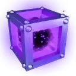

# Help Wanted! - Quest 1882

[Quest database](./README.md) | [Quest Guide](../Quest%20Guide.md) | [Methodology](./Methodology.md)

**Definition ID: 1882** | Quest | Hidden / Hidden | Repeatable: True

**Official client name** from the client locale.xml (`Missions_1882_name`, en&#95;US).

## Description

Official client text from locale.xml (en&#95;US):

**Offer text:** Psst. I'm actually a secret Paradox agent. My master in Forbidden Valley needs a **Maelstrom Cube**. Can you **talk to Wisp Lee** and get one for me?

**Repeat offer text:** Psst. I'm actually a secret Paradox agent. My master in Forbidden Valley needs a **Maelstrom Cube**. Can you **talk to Wisp Lee** and get one for me?

**Accept reply:** Hurry and find Wisp Lee while I stand here and look mysterious.

**In-progress text:** **Talk to Wisp Lee** in Avant Gardens about a **Maelstrom Cube** for Hu Where.

**Objectives-complete tip:** Take the Maelstrom Cube to Hu Where in the Avant Gardens Launch Area.

**Turn-in text:** You are most honorable, thank you for the help. Now walk away. We never had this conversation.

### Objectives

Client task text from locale.xml is shown where it exists; the indented line is the data-derived summary of the same MissionTasks row.

- Talk to Wisp Lee in Avant Gardens about a Maelstrom Cube for Hu Where.
    - Data summary: Gather 1 item(s) from the allowed templates, sharing one counter: Maelstrom Cube.

## Start, turn-in, and locations

| Role | NPC / object | Mapped candidate zones | Association evidence |
| --- | --- | --- | --- |
| Defined offer object | [Hu Where - Ninja Picnicker (LOT 3723)](sources/object-3723.md) | [Avant Gardens (1100)](locations/zone-1100.md) | Missions.offer&#95;objectID |
| Defined turn-in object | [Hu Where - Ninja Picnicker (LOT 3723)](sources/object-3723.md) | [Avant Gardens (1100)](locations/zone-1100.md) | Missions.target&#95;objectID |
| Offers mission | [Hu Where - Ninja Picnicker (LOT 3723)](sources/object-3723.md) | [Avant Gardens (1100)](locations/zone-1100.md) | MissionNPCComponent 129 |
| Accepts turn-in | [Hu Where - Ninja Picnicker (LOT 3723)](sources/object-3723.md) | [Avant Gardens (1100)](locations/zone-1100.md) | MissionNPCComponent 129 |

Follow a named object for exact XYZ and scene/spawner conditions. Static placements do not prove that the NPC is currently spawned, offers this quest to your character, or is reachable in a deployed server.

## Requirements and quest chain

- Stored prerequisite expression: 320.
- Inspected server evaluation: [Check In with Sky Lane &#91;320&#93;](320.md) is complete.
- UIPrereqID: (not recorded); shown separately, not misread as a mission ID.
- Cooldown: 1300 minute(s) after previous completion.
- Stored feature gate / localization status: freetrial / 2. The generic mission/task loaders mark gate_version unused; other scripts, map gates, and client checks can still restrict availability.
- Referenced prerequisite definitions: [Check In with Sky Lane &#91;320&#93;](320.md).
- Referenced as a prerequisite by: [Sample for Science &#91;1883&#93;](1883.md). These are potential follow-ups, not a guarantee of an immediate offer.

## Walkthrough / checklist

1. Satisfy the prerequisites and any client, map, or script conditions. Check the giver listed above; where none is resolved, the acceptance route remains unknown.
2. Accept the quest before relying on objective credit. Inventory gather tasks, existing flags, and racing parameter-4 tasks have limited acceptance catch-up; other earlier actions are not assumed to count.
3. Gather 1 item(s) from the allowed templates, sharing one counter: Maelstrom Cube. See objective **1** below for target references and conditions.
4. After all objective counters are satisfied, complete the recorded turn-in interaction. If offered a reward choice, select the desired item rather than assuming all alternatives are granted.

**These numbered entries are a readable checklist, not evidence that the objective rows must be completed in this order.** Scripted phases, travel routes, puzzle interactions, and custom conditions are not reconstructed unless the data/source evidence supports them.

## Objective details

### Objective 1: Gather items (UID 2677)

**Client task text:** Talk to Wisp Lee in Avant Gardens about a Maelstrom Cube for Hu Where.

Gather 1 item(s) from the allowed templates, sharing one counter: Maelstrom Cube.

Target namespace: **LOT**. Stored target value/threshold: **1**.

| Matching / associated object | Mapped zones | Item acquisition data |
| --- | --- | --- |
| [Maelstrom Cube (LOT 14553)](sources/object-14553.md) | No matched local placement found | { .lu-ti width="24" loading="lazy" } [Maelstrom Cube (LOT 14553)](../items/14553.md) |

- Stored task gate: freetrial (not enforced by the inspected generic task loader)
- Gathered targets can be removed from item/quest inventory when rewards are granted.
- Losing required items can reduce progress and return a ready quest to active.

| Raw task field | Value |
| --- | --- |
| taskType | 11 |
| target | 14553 |
| targetGroup |  |
| targetValue | 1 |
| taskParam1 |  |
| uid | 2677 |
| gate_version | freetrial |

## Rewards

The item slots below are listed completion rewards, not random loot-table rolls. Player eligibility and completion still apply.

No positive item reward LOT is defined for the displayed completion modes.

| Reward | First completion / stored value | Repeat behavior |
| --- | --- | --- |
| Coins | 250 | 250 |
| U-Score | 25 | 25 |
| Reputation | 0 | 0 |
| Maximum Life | No positive grant defined | First completion only |
| Maximum Imagination | No positive grant defined | First completion only |
| Item backpack slots | No positive grant defined | First completion only |
| Vault item AND vault model slots | No positive grant defined | First completion only |

Emote unlocks (first completion): none with positive IDs recorded.

At the configured level cap, U-Score can be converted into coins using server configuration. Stored base coins are not a quote for that conversion. Reputation and U-Score are processed before the repeat-reward branch; stat increases and emote unlocks are first-completion only.

## Historical community references

No unique, sufficiently corroborated association was established in the researched community infoboxes. Similar names or matching numeric IDs were not treated as proof.

This page provides an original data-derived checklist, not copied wiki dialogue or a claim that the historical walkthrough exactly matches the deployed server.

## Evidence and limitations

[Missions](../../db/Missions.md), [MissionTasks](../../db/MissionTasks.md), [MissionNPCComponent](../../db/MissionNPCComponent.md), [MissionText](../../db/MissionText.md), [MissionEmail](../../db/MissionEmail.md). [Task interpretation and coverage](./Methodology.md). Availability, client presentation, puzzle phases, and custom script behavior can differ.
