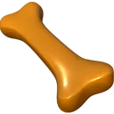

# Urufu's First Treasure - Quest 1918

[Quest database](./README.md) | [Quest Guide](../Quest%20Guide.md) | [Methodology](./Methodology.md)

**Definition ID: 1918** | Quest | Location / Ninjago Monastery | Repeatable: False

**Official client name** from the client locale.xml (`Missions_1918_name`, en&#95;US). The historical community association below agrees with this name.

## Description

Official client text from locale.xml (en&#95;US):

**Offer text:** I'll bury these Rib Bones in a special spot by the launch pad! Dig there and you might also find a treasure!

**Accept reply:** You'll need a pet to unbury this treasure!

**In-progress text:** Use a pet on the Pet Dig by the Ninjago rocket launchpad to find a treasure.

**Objectives-complete tip:** Return to Furious Urufu in the Ninjago Monastery.

**Turn-in text:** Urufuuuuu!!! You found it!

### Objectives

Client task text from locale.xml is shown where it exists; the indented line is the data-derived summary of the same MissionTasks row.

- Use a pet on the Pet Dig by the Ninjago rocket launchpad to find a treasure.
    - Data summary: Gather 1 item(s) from the allowed templates, sharing one counter: Urufu's Treasure.

## Start, turn-in, and locations

| Role | NPC / object | Mapped candidate zones | Association evidence |
| --- | --- | --- | --- |
| Defined offer object | [Furious Urufu - Dog Boy (LOT 13796)](sources/object-13796.md) | [Ninjago Monastery (2000)](locations/zone-2000.md) | Missions.offer&#95;objectID |
| Defined turn-in object | [Furious Urufu - Dog Boy (LOT 13796)](sources/object-13796.md) | [Ninjago Monastery (2000)](locations/zone-2000.md) | Missions.target&#95;objectID |
| Offers mission | [Furious Urufu - Dog Boy (LOT 13796)](sources/object-13796.md) | [Ninjago Monastery (2000)](locations/zone-2000.md) | MissionNPCComponent 172 |
| Accepts turn-in | [Furious Urufu - Dog Boy (LOT 13796)](sources/object-13796.md) | [Ninjago Monastery (2000)](locations/zone-2000.md) | MissionNPCComponent 172 |

Follow a named object for exact XYZ and scene/spawner conditions. Static placements do not prove that the NPC is currently spawned, offers this quest to your character, or is reachable in a deployed server.

## Requirements and quest chain

- Stored prerequisite expression: 1830.
- Inspected server evaluation: [Bones for Urufu &#91;1830&#93;](1830.md) is complete.
- UIPrereqID: (not recorded); shown separately, not misread as a mission ID.
- Cooldown: 0 minute(s) after previous completion.
- Stored feature gate / localization status: njhub / 2. The generic mission/task loaders mark gate_version unused; other scripts, map gates, and client checks can still restrict availability.
- Referenced prerequisite definitions: [Bones for Urufu &#91;1830&#93;](1830.md).
- Referenced as a prerequisite by: [Alpha Dog &#91;1831&#93;](1831.md). These are potential follow-ups, not a guarantee of an immediate offer.

## Walkthrough / checklist

1. Satisfy the prerequisites and any client, map, or script conditions. Check the giver listed above; where none is resolved, the acceptance route remains unknown.
2. Accept the quest before relying on objective credit. Inventory gather tasks, existing flags, and racing parameter-4 tasks have limited acceptance catch-up; other earlier actions are not assumed to count.
3. Gather 1 item(s) from the allowed templates, sharing one counter: Urufu's Treasure. See objective **1** below for target references and conditions.
4. After all objective counters are satisfied, complete the recorded turn-in interaction. If offered a reward choice, select the desired item rather than assuming all alternatives are granted.

**These numbered entries are a readable checklist, not evidence that the objective rows must be completed in this order.** Scripted phases, travel routes, puzzle interactions, and custom conditions are not reconstructed unless the data/source evidence supports them.

## Objective details

### Objective 1: Gather items (UID 2720)

**Client task text:** Use a pet on the Pet Dig by the Ninjago rocket launchpad to find a treasure.

Gather 1 item(s) from the allowed templates, sharing one counter: Urufu's Treasure.

Target namespace: **LOT**. Stored target value/threshold: **1**.

| Matching / associated object | Mapped zones | Item acquisition data |
| --- | --- | --- |
| [Urufu's Treasure (LOT 16650)](sources/object-16650.md) | No matched local placement found | { .lu-ti width="24" loading="lazy" } [Urufu's Treasure (LOT 16650)](../items/16650.md) |

- Stored task gate: njhub (not enforced by the inspected generic task loader)
- Gathered targets can be removed from item/quest inventory when rewards are granted.
- Losing required items can reduce progress and return a ready quest to active.

| Raw task field | Value |
| --- | --- |
| taskType | 11 |
| target | 16650 |
| targetGroup |  |
| targetValue | 1 |
| taskParam1 | 2 |
| uid | 2720 |
| gate_version | njhub |

## Rewards

The item slots below are listed completion rewards, not random loot-table rolls. Player eligibility and completion still apply.

| Item reward slot | Item | Granted quantity | Stored count / notes |
| --- | --- | --- | --- |
| First completion / 1 | { .lu-ti width="24" loading="lazy" } [Ninjago Hound Treat (LOT 16023)](../items/16023.md) | 1 | 1 |

| Reward | First completion / stored value | Repeat behavior |
| --- | --- | --- |
| Coins | 250 | Not advertised as repeatable |
| U-Score | 105 | Not advertised as repeatable |
| Reputation | 0 | Not advertised as repeatable |
| Maximum Life | No positive grant defined | First completion only |
| Maximum Imagination | No positive grant defined | First completion only |
| Item backpack slots | No positive grant defined | First completion only |
| Vault item AND vault model slots | No positive grant defined | First completion only |

Emote unlocks (first completion): none with positive IDs recorded.

At the configured level cap, U-Score can be converted into coins using server configuration. Stored base coins are not a quote for that conversion. Reputation and U-Score are processed before the repeat-reward branch; stat increases and emote unlocks are first-completion only.

## Historical community references

- [Urufu's First Treasure](https://legouniverse.fandom.com/wiki/Urufu's_First_Treasure?oldid=123686) — candidate title from Urufu's First Treasure. Matching evidence groups: **U-Score, coins, NPC, reward item**. Revision 123686; retrieved 2026-11-17T09:38:25.996Z.
  Reported factual methods: not categorized; location labels: not extracted; named objective references: Ninjago Monastery; named reward references: Ninjago Hound Treat.

This page provides an original data-derived checklist, not copied wiki dialogue or a claim that the historical walkthrough exactly matches the deployed server.

## Evidence and limitations

[Missions](../../db/Missions.md), [MissionTasks](../../db/MissionTasks.md), [MissionNPCComponent](../../db/MissionNPCComponent.md), [MissionText](../../db/MissionText.md), [MissionEmail](../../db/MissionEmail.md). [Task interpretation and coverage](./Methodology.md). Availability, client presentation, puzzle phases, and custom script behavior can differ.
