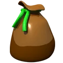
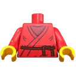
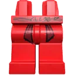

# The Power of Fire - Quest 1949

[Quest database](./README.md) | [Quest Guide](../Quest%20Guide.md) | [Methodology](./Methodology.md)

**Definition ID: 1949** | Quest | Location / Ninjago Monastery | Repeatable: False

**Official client name** from the client locale.xml (`Missions_1949_name`, en&#95;US). The historical community association below agrees with this name.

## Description

Official client text from locale.xml (en&#95;US):

**Offer text:** Okay, you know the drill. Get the Key from the attic up above. Then come down here, unlock this chest and get your Fire Ninja kit!

**Accept reply:** Check the weapon racks in the Dojo for a bouncer that will get you up top.

**In-progress text:** Get the Fire Key from the attic above the Dojo of Fire. Then use the Key to unlock the chest in front of Kai.

**Objectives-complete tip:** Talk to Kai again.

**Turn-in text:** That was some fancy, fiery footwork up there! Ready to heat it up as a Fire Ninja?

### Objectives

Client task text from locale.xml is shown where it exists; the indented line is the data-derived summary of the same MissionTasks row.

- Get the Fire Key from the attic above the Dojo of Fire.
    - Data summary: Complete 1 matching mission/achievement completion event(s): DNL - Fire Key Hidden Achievement &#91;1930&#93;. This is an objective, not automatically a prerequisite for accepting the quest.
- Use the Fire Key to open the treasure chest in front of Kai.
    - Data summary: Gather 1 item(s) from the allowed templates, sharing one counter: Fire Ninja Kit.

## Start, turn-in, and locations

| Role | NPC / object | Mapped candidate zones | Association evidence |
| --- | --- | --- | --- |
| Defined offer object | [Kai - Ninja of Fire (LOT 13793)](sources/object-13793.md) | [Ninjago Monastery (2000)](locations/zone-2000.md) | Missions.offer&#95;objectID |
| Defined turn-in object | [Kai - Ninja of Fire (LOT 13793)](sources/object-13793.md) | [Ninjago Monastery (2000)](locations/zone-2000.md) | Missions.target&#95;objectID |
| Offers mission | [Kai - Ninja of Fire (LOT 13793)](sources/object-13793.md) | [Ninjago Monastery (2000)](locations/zone-2000.md) | MissionNPCComponent 165 |
| Accepts turn-in | [Kai - Ninja of Fire (LOT 13793)](sources/object-13793.md) | [Ninjago Monastery (2000)](locations/zone-2000.md) | MissionNPCComponent 165 |

Follow a named object for exact XYZ and scene/spawner conditions. Static placements do not prove that the NPC is currently spawned, offers this quest to your character, or is reachable in a deployed server.

## Requirements and quest chain

- Stored prerequisite expression: 1806.
- Inspected server evaluation: [Down They Fall &#91;1806&#93;](1806.md) is complete.
- UIPrereqID: (not recorded); shown separately, not misread as a mission ID.
- Cooldown: 0 minute(s) after previous completion.
- Stored feature gate / localization status: njhub / 2. The generic mission/task loaders mark gate_version unused; other scripts, map gates, and client checks can still restrict availability.
- Referenced prerequisite definitions: [Down They Fall &#91;1806&#93;](1806.md).
- Referenced as a prerequisite by: [Student of Fire &#91;1962&#93;](1962.md). These are potential follow-ups, not a guarantee of an immediate offer.

## Walkthrough / checklist

1. Satisfy the prerequisites and any client, map, or script conditions. Check the giver listed above; where none is resolved, the acceptance route remains unknown.
2. Accept the quest before relying on objective credit. Inventory gather tasks, existing flags, and racing parameter-4 tasks have limited acceptance catch-up; other earlier actions are not assumed to count.
3. Complete 1 matching mission/achievement completion event(s): DNL - Fire Key Hidden Achievement &#91;1930&#93;. This is an objective, not automatically a prerequisite for accepting the quest. See objective **1** below for target references and conditions.
4. Gather 1 item(s) from the allowed templates, sharing one counter: Fire Ninja Kit. See objective **2** below for target references and conditions.
5. After all objective counters are satisfied, complete the recorded turn-in interaction. If offered a reward choice, select the desired item rather than assuming all alternatives are granted.

**These numbered entries are a readable checklist, not evidence that the objective rows must be completed in this order.** Scripted phases, travel routes, puzzle interactions, and custom conditions are not reconstructed unless the data/source evidence supports them.

## Objective details

### Objective 1: Complete missions / achievements (UID 2756)

**Client task text:** Get the Fire Key from the attic above the Dojo of Fire.

Complete 1 matching mission/achievement completion event(s): DNL - Fire Key Hidden Achievement &#91;1930&#93;. This is an objective, not automatically a prerequisite for accepting the quest.

Target namespace: **MISSION&#95;ID**. Stored target value/threshold: **1**.

Completion targets: [DNL - Fire Key Hidden Achievement &#91;1930&#93;](1930.md).

- Stored task gate: njhub (not enforced by the inspected generic task loader)

| Raw task field | Value |
| --- | --- |
| taskType | 16 |
| target | 1930 |
| targetGroup |  |
| targetValue | 1 |
| taskParam1 |  |
| uid | 2756 |
| gate_version | njhub |
### Objective 2: Gather items (UID 2908)

**Client task text:** Use the Fire Key to open the treasure chest in front of Kai.

Gather 1 item(s) from the allowed templates, sharing one counter: Fire Ninja Kit.

Target namespace: **LOT**. Stored target value/threshold: **1**.

| Matching / associated object | Mapped zones | Item acquisition data |
| --- | --- | --- |
| [Fire Ninja Kit (LOT 16497)](sources/object-16497.md) | No matched local placement found | { .lu-ti width="24" loading="lazy" } [Fire Ninja Kit (LOT 16497)](../items/16497.md) |

- Stored task gate: njhub (not enforced by the inspected generic task loader)
- Gathered targets can be removed from item/quest inventory when rewards are granted.
- Losing required items can reduce progress and return a ready quest to active.

| Raw task field | Value |
| --- | --- |
| taskType | 11 |
| target | 16497 |
| targetGroup |  |
| targetValue | 1 |
| taskParam1 |  |
| uid | 2908 |
| gate_version | njhub |

## Rewards

The item slots below are listed completion rewards, not random loot-table rolls. Player eligibility and completion still apply.

| Item reward slot | Item | Granted quantity | Stored count / notes |
| --- | --- | --- | --- |
| First completion / 1 | { .lu-ti width="24" loading="lazy" } [Hood of Flames (LOT 16277)](../items/16277.md) | 1 | 1 |
| First completion / 2 | { .lu-ti width="24" loading="lazy" } [Gi of Flames (LOT 16268)](../items/16268.md) | 1 | 1 |
| First completion / 3 | { .lu-ti width="24" loading="lazy" } [Pants of Flames (LOT 16271)](../items/16271.md) | 1 | 1 |

| Reward | First completion / stored value | Repeat behavior |
| --- | --- | --- |
| Coins | 250 | Not advertised as repeatable |
| U-Score | 105 | Not advertised as repeatable |
| Reputation | 0 | Not advertised as repeatable |
| Maximum Life | No positive grant defined | First completion only |
| Maximum Imagination | No positive grant defined | First completion only |
| Item backpack slots | No positive grant defined | First completion only |
| Vault item AND vault model slots | No positive grant defined | First completion only |

Emote unlocks (first completion): none with positive IDs recorded.

At the configured level cap, U-Score can be converted into coins using server configuration. Stored base coins are not a quote for that conversion. Reputation and U-Score are processed before the repeat-reward branch; stat increases and emote unlocks are first-completion only.

## Historical community references

- [The Power of Fire](https://legouniverse.fandom.com/wiki/The_Power_of_Fire?oldid=123621) — candidate title from The Power of Fire. Matching evidence groups: **U-Score, coins, NPC, reward item**. Revision 123621; retrieved 2026-11-17T09:38:25.494Z.
  Reported factual methods: smash/defeat, build; location labels: not extracted; named objective references: none extracted; named reward references: &#42;Hood of Flames, &#42;Gi of Flames, &#42;Pants of Flames.

This page provides an original data-derived checklist, not copied wiki dialogue or a claim that the historical walkthrough exactly matches the deployed server.

## Evidence and limitations

[Missions](../../db/Missions.md), [MissionTasks](../../db/MissionTasks.md), [MissionNPCComponent](../../db/MissionNPCComponent.md), [MissionText](../../db/MissionText.md), [MissionEmail](../../db/MissionEmail.md). [Task interpretation and coverage](./Methodology.md). Availability, client presentation, puzzle phases, and custom script behavior can differ.
