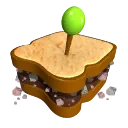

# Mud in Your Mouth - Quest 2037

[Quest database](./README.md) | [Quest Guide](../Quest%20Guide.md) | [Methodology](./Methodology.md)

**Definition ID: 2037** | Quest | Hidden / Hidden | Repeatable: True

**Official client name** from the client locale.xml (`Missions_2037_name`, en&#95;US).

## Description

Official client text from locale.xml (en&#95;US):

**Offer text:** I need to keep my strength up! Can you bring me a Dirt Sandwich and a Chilly Freezesteak from Johnny Umami?

**Repeat offer text:** I need to keep my strength up! Can you bring me a Dirt Sandwich and a Chilly Freezesteak from Johnny Umami?

**Accept reply:** Look for Johnny Umami inside the Monastery.

**In-progress text:** Toshiro Gojira wants a Dirt Sandwich and a Chilly Freezesteak from Johnny Umami.

**Objectives-complete tip:** Take the Dirt Sandwich and Chilly Freezesteak back to Toshiro Gojira.

**Turn-in text:** How can something made with dirt taste so good? Om nom nom.

### Objectives

Client task text from locale.xml is shown where it exists; the indented line is the data-derived summary of the same MissionTasks row.

- Toshiro Gojira, the Monastery Guard, wants a Dirt Sandwich from Johnny Umami.
    - Data summary: Gather 1 item(s) from the allowed templates, sharing one counter: Dirt Sandwich.
- Toshiro Gojira, the Monastery Guard, wants a Chilly Freezesteak from Johnny Umami.
    - Data summary: Gather 1 item(s) from the allowed templates, sharing one counter: Chilly Freezesteak.

## Start, turn-in, and locations

| Role | NPC / object | Mapped candidate zones | Association evidence |
| --- | --- | --- | --- |
| Defined offer object | [Toshiro Gojira - Ninjago Monastery Guard (LOT 13794)](sources/object-13794.md) | [Ninjago Monastery (2000)](locations/zone-2000.md) | Missions.offer&#95;objectID |
| Defined turn-in object | [Toshiro Gojira - Ninjago Monastery Guard (LOT 13794)](sources/object-13794.md) | [Ninjago Monastery (2000)](locations/zone-2000.md) | Missions.target&#95;objectID |
| Offers mission | [Toshiro Gojira - Ninjago Monastery Guard (LOT 13794)](sources/object-13794.md) | [Ninjago Monastery (2000)](locations/zone-2000.md) | MissionNPCComponent 160 |
| Accepts turn-in | [Toshiro Gojira - Ninjago Monastery Guard (LOT 13794)](sources/object-13794.md) | [Ninjago Monastery (2000)](locations/zone-2000.md) | MissionNPCComponent 160 |
| Random-pool candidate giver | [Toshiro Gojira - Ninjago Monastery Guard (LOT 13794)](sources/object-13794.md) | [Ninjago Monastery (2000)](locations/zone-2000.md) | Selector mission 2062; eligible pool choice only |

Follow a named object for exact XYZ and scene/spawner conditions. Static placements do not prove that the NPC is currently spawned, offers this quest to your character, or is reachable in a deployed server.

## Requirements and quest chain

- Stored prerequisite expression: 1806,1868.
- Inspected server evaluation: ([Down They Fall &#91;1806&#93;](1806.md) is complete AND [Jeet Yet? &#91;1868&#93;](1868.md) is complete).
- UIPrereqID: (not recorded); shown separately, not misread as a mission ID.
- Cooldown: 1300 minute(s) after previous completion.
- Stored feature gate / localization status: njhub / 2. The generic mission/task loaders mark gate_version unused; other scripts, map gates, and client checks can still restrict availability.
- Referenced prerequisite definitions: [Down They Fall &#91;1806&#93;](1806.md); [Jeet Yet? &#91;1868&#93;](1868.md).
- Appears in random selector pool(s): [Quest 2062 &#91;2062&#93;](2062.md). Eligibility and current quest state affect selection.
- This definition is a random mission selector. Pool: empty (the inspected offer handler does not offer an empty selector pool).

## Walkthrough / checklist

1. Satisfy the prerequisites and any client, map, or script conditions. Check the giver listed above; where none is resolved, the acceptance route remains unknown.
2. Accept the quest before relying on objective credit. Inventory gather tasks, existing flags, and racing parameter-4 tasks have limited acceptance catch-up; other earlier actions are not assumed to count.
3. Gather 1 item(s) from the allowed templates, sharing one counter: Dirt Sandwich. See objective **1** below for target references and conditions.
4. Gather 1 item(s) from the allowed templates, sharing one counter: Chilly Freezesteak. See objective **2** below for target references and conditions.
5. After all objective counters are satisfied, complete the recorded turn-in interaction. If offered a reward choice, select the desired item rather than assuming all alternatives are granted.

**These numbered entries are a readable checklist, not evidence that the objective rows must be completed in this order.** Scripted phases, travel routes, puzzle interactions, and custom conditions are not reconstructed unless the data/source evidence supports them.

## Objective details

### Objective 1: Gather items (UID 2862)

**Client task text:** Toshiro Gojira, the Monastery Guard, wants a Dirt Sandwich from Johnny Umami.

Gather 1 item(s) from the allowed templates, sharing one counter: Dirt Sandwich.

Target namespace: **LOT**. Stored target value/threshold: **1**.

| Matching / associated object | Mapped zones | Item acquisition data |
| --- | --- | --- |
| [Dirt Sandwich (LOT 14502)](sources/object-14502.md) | No matched local placement found | { .lu-ti width="24" loading="lazy" } [Dirt Sandwich (LOT 14502)](../items/14502.md) |

- Stored task gate: njhub (not enforced by the inspected generic task loader)
- Gathered targets can be removed from item/quest inventory when rewards are granted.
- Losing required items can reduce progress and return a ready quest to active.

| Raw task field | Value |
| --- | --- |
| taskType | 11 |
| target | 14502 |
| targetGroup |  |
| targetValue | 1 |
| taskParam1 | 2 |
| uid | 2862 |
| gate_version | njhub |
### Objective 2: Gather items (UID 2863)

**Client task text:** Toshiro Gojira, the Monastery Guard, wants a Chilly Freezesteak from Johnny Umami.

Gather 1 item(s) from the allowed templates, sharing one counter: Chilly Freezesteak.

Target namespace: **LOT**. Stored target value/threshold: **1**.

| Matching / associated object | Mapped zones | Item acquisition data |
| --- | --- | --- |
| [Chilly Freezesteak (LOT 14506)](sources/object-14506.md) | No matched local placement found | { .lu-ti width="24" loading="lazy" } [Chilly Freezesteak (LOT 14506)](../items/14506.md) |

- Stored task gate: njhub (not enforced by the inspected generic task loader)
- Gathered targets can be removed from item/quest inventory when rewards are granted.
- Losing required items can reduce progress and return a ready quest to active.

| Raw task field | Value |
| --- | --- |
| taskType | 11 |
| target | 14506 |
| targetGroup |  |
| targetValue | 1 |
| taskParam1 | 2 |
| uid | 2863 |
| gate_version | njhub |

## Rewards

**Choice reward:** listed item slots are alternatives when the normal mission-choice flow applies; do not assume that all are granted. A selected reward LOT filters item slots in the inspected handler.

| Item reward slot | Item | Granted quantity | Stored count / notes |
| --- | --- | --- | --- |
| First completion / 1 | { .lu-ti width="24" loading="lazy" } [Old Sushi (LOT 16037)](../items/16037.md) | 1 | 1 |
| First completion / 2 | { .lu-ti width="24" loading="lazy" } [Bancha Tea (LOT 16038)](../items/16038.md) | 3 | 3 |
| First completion / 3 | { .lu-ti width="24" loading="lazy" } [Cotton Repair Kit (LOT 16041)](../items/16041.md) | 2 | 2 |
| Repeat / 1 | { .lu-ti width="24" loading="lazy" } [Old Sushi (LOT 16037)](../items/16037.md) | 1 | 1 |
| Repeat / 2 | { .lu-ti width="24" loading="lazy" } [Bancha Tea (LOT 16038)](../items/16038.md) | 3 | 3 |
| Repeat / 3 | { .lu-ti width="24" loading="lazy" } [Cotton Repair Kit (LOT 16041)](../items/16041.md) | 2 | 2 |

| Reward | First completion / stored value | Repeat behavior |
| --- | --- | --- |
| Coins | 0 | 0 |
| U-Score | 50 | 50 |
| Reputation | 0 | 0 |
| Maximum Life | No positive grant defined | First completion only |
| Maximum Imagination | No positive grant defined | First completion only |
| Item backpack slots | No positive grant defined | First completion only |
| Vault item AND vault model slots | No positive grant defined | First completion only |

Emote unlocks (first completion): none with positive IDs recorded.

At the configured level cap, U-Score can be converted into coins using server configuration. Stored base coins are not a quote for that conversion. Reputation and U-Score are processed before the repeat-reward branch; stat increases and emote unlocks are first-completion only.

## Historical community references

No unique, sufficiently corroborated association was established in the researched community infoboxes. Similar names or matching numeric IDs were not treated as proof.

This page provides an original data-derived checklist, not copied wiki dialogue or a claim that the historical walkthrough exactly matches the deployed server.

## Evidence and limitations

[Missions](../../db/Missions.md), [MissionTasks](../../db/MissionTasks.md), [MissionNPCComponent](../../db/MissionNPCComponent.md), [MissionText](../../db/MissionText.md), [MissionEmail](../../db/MissionEmail.md). [Task interpretation and coverage](./Methodology.md). Availability, client presentation, puzzle phases, and custom script behavior can differ.
