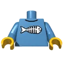

# Making Friends - Achievement 250

[Quest database](./README.md) | [Quest Guide](../Quest%20Guide.md) | [Methodology](./Methodology.md)

**Definition ID: 250** | Achievement | Location / Avant Gardens | Repeatable: False

**Official client name** from the client locale.xml (`Missions_250_name`, en&#95;US). The historical community association below agrees with this name.

## Description

Official client text from locale.xml (en&#95;US):

**Description:** Talk to the picnicking Ninja, Pirate, and Monkey at the Avant Gardens Launch Area.

**Objectives-complete tip:** Making Friends!

### Objectives

Client task text from locale.xml is shown where it exists; the indented line is the data-derived summary of the same MissionTasks row.

- Talk to Hu Where at the Avant Gardens Launch Area.
    - Data summary: Interact with matching object(s) until progress reaches 1: Hu Where - Ninja Picnicker.
- Talk to Swabby Bilgebarrel at the Avant Gardens Launch Area.
    - Data summary: Interact with matching object(s) until progress reaches 1: Swabby Bilgebarrel - Pirate Picnicker.
- Talk to Eeekums at the Avant Gardens Launch Area.
    - Data summary: Interact with matching object(s) until progress reaches 1: Eeekums - Monkey Picnicker.

## Start, turn-in, and locations

This is an achievement: it is normally discovered/tracked by qualifying progress events once prerequisites permit it, not accepted from a quest giver. Any stored NPC associations below are data references, not an instruction to accept an achievement.

No quest-giver or turn-in association is recorded for this achievement.

Follow a named object for exact XYZ and scene/spawner conditions. Static placements do not prove that the NPC is currently spawned, offers this quest to your character, or is reachable in a deployed server.

## Requirements and quest chain

- Stored prerequisite expression: (empty).
- Inspected server evaluation: TRUE.
- UIPrereqID: (not recorded); shown separately, not misread as a mission ID.
- Cooldown: not recorded (loader default -1); -1 means no cooldown in CanAccept.
- Stored feature gate / localization status: (none) / 2. The generic mission/task loaders mark gate_version unused; other scripts, map gates, and client checks can still restrict availability.

## Walkthrough / checklist

1. Satisfy the achievement prerequisites. Produce a qualifying progress event so the server can discover/track the achievement; prior actions are not assumed to be retroactive for every task type.
2. Interact with matching object(s) until progress reaches 1: Hu Where - Ninja Picnicker. See objective **1** below for target references and conditions.
3. Interact with matching object(s) until progress reaches 1: Swabby Bilgebarrel - Pirate Picnicker. See objective **2** below for target references and conditions.
4. Interact with matching object(s) until progress reaches 1: Eeekums - Monkey Picnicker. See objective **3** below for target references and conditions.
5. When all objectives complete, the normal achievement path grants completion/rewards automatically; there is no generic NPC turn-in step.

**These numbered entries are a readable checklist, not evidence that the objective rows must be completed in this order.** Scripted phases, travel routes, puzzle interactions, and custom conditions are not reconstructed unless the data/source evidence supports them.

## Objective details

### Objective 1: Interact (UID 389)

**Client task text:** Talk to Hu Where at the Avant Gardens Launch Area.

Interact with matching object(s) until progress reaches 1: Hu Where - Ninja Picnicker.

Target namespace: **LOT**. Stored target value/threshold: **1**.

| Matching / associated object | Mapped zones | Item acquisition data |
| --- | --- | --- |
| [Hu Where - Ninja Picnicker (LOT 3723)](sources/object-3723.md) | [Avant Gardens (1100)](locations/zone-1100.md) | Not an item-template registration |

| Raw task field | Value |
| --- | --- |
| taskType | 15 |
| target | 3723 |
| targetGroup |  |
| targetValue | 1 |
| taskParam1 |  |
| uid | 389 |
| gate_version |  |
### Objective 2: Interact (UID 390)

**Client task text:** Talk to Swabby Bilgebarrel at the Avant Gardens Launch Area.

Interact with matching object(s) until progress reaches 1: Swabby Bilgebarrel - Pirate Picnicker.

Target namespace: **LOT**. Stored target value/threshold: **1**.

| Matching / associated object | Mapped zones | Item acquisition data |
| --- | --- | --- |
| [Swabby Bilgebarrel - Pirate Picnicker (LOT 3724)](sources/object-3724.md) | [Avant Gardens (1100)](locations/zone-1100.md) | Not an item-template registration |

| Raw task field | Value |
| --- | --- |
| taskType | 15 |
| target | 3724 |
| targetGroup |  |
| targetValue | 1 |
| taskParam1 |  |
| uid | 390 |
| gate_version |  |
### Objective 3: Interact (UID 391)

**Client task text:** Talk to Eeekums at the Avant Gardens Launch Area.

Interact with matching object(s) until progress reaches 1: Eeekums - Monkey Picnicker.

Target namespace: **LOT**. Stored target value/threshold: **1**.

| Matching / associated object | Mapped zones | Item acquisition data |
| --- | --- | --- |
| [Eeekums - Monkey Picnicker (LOT 4746)](sources/object-4746.md) | [Avant Gardens (1100)](locations/zone-1100.md) | Not an item-template registration |

| Raw task field | Value |
| --- | --- |
| taskType | 15 |
| target | 4746 |
| targetGroup |  |
| targetValue | 1 |
| taskParam1 |  |
| uid | 391 |
| gate_version |  |

## Rewards

The item slots below are listed completion rewards, not random loot-table rolls. Player eligibility and completion still apply.

| Item reward slot | Item | Granted quantity | Stored count / notes |
| --- | --- | --- | --- |
| First completion / 1 | { .lu-ti width="24" loading="lazy" } [Fish Skeleton Shirt (LOT 9697)](../items/9697.md) | 1 | 1 |

| Reward | First completion / stored value | Repeat behavior |
| --- | --- | --- |
| Coins | 0 | Not advertised as repeatable |
| U-Score | 15 | Not advertised as repeatable |
| Reputation | 0 | Not advertised as repeatable |
| Maximum Life | No positive grant defined | First completion only |
| Maximum Imagination | No positive grant defined | First completion only |
| Item backpack slots | No positive grant defined | First completion only |
| Vault item AND vault model slots | No positive grant defined | First completion only |

Emote unlocks (first completion): none with positive IDs recorded.

At the configured level cap, U-Score can be converted into coins using server configuration. Stored base coins are not a quote for that conversion. Reputation and U-Score are processed before the repeat-reward branch; stat increases and emote unlocks are first-completion only.

## Historical community references

- [Making Friends](https://legouniverse.fandom.com/wiki/Making_Friends?oldid=126166) — candidate title from Making Friends. Matching evidence groups: **U-Score, reward item, region**. Revision 126166; retrieved 2026-11-17T09:38:30.724Z.
  Reported factual methods: talk; location labels: Avant Gardens; named objective references: Hu Where, Swabby Bilgebarrel, Eeekums; named reward references: Fish Skeleton Shirt.

This page provides an original data-derived checklist, not copied wiki dialogue or a claim that the historical walkthrough exactly matches the deployed server.

## Evidence and limitations

[Missions](../../db/Missions.md), [MissionTasks](../../db/MissionTasks.md), [MissionNPCComponent](../../db/MissionNPCComponent.md), [MissionText](../../db/MissionText.md), [MissionEmail](../../db/MissionEmail.md). [Task interpretation and coverage](./Methodology.md). Availability, client presentation, puzzle phases, and custom script behavior can differ.
