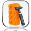

# Robo-Repair 1 - Achievement 251

<!-- media:start (generated by scripts/build_media.py) -->
{ .lu-icon width="128" loading="lazy" }
<!-- media:end -->

[Quest database](./README.md) | [Quest Guide](../Quest%20Guide.md) | [Methodology](./Methodology.md)

**Definition ID: 251** | Achievement | Location / Avant Gardens | Repeatable: False

**Official client name** from the client locale.xml (`Missions_251_name`, en&#95;US). The historical community association below agrees with this name.

## Description

Official client text from locale.xml (en&#95;US):

**Description:** Quick Build 10 smashed Stromling Mechs into turrets.

**Objectives-complete tip:** Robo-Repair 1!

### Objectives

Client task text from locale.xml is shown where it exists; the indented line is the data-derived summary of the same MissionTasks row.

- Rebuild 10 smashed Stromling Mechs.
    - Data summary: Complete 10 matching activity / Quick Build event(s): Sentinel Turret.

## Start, turn-in, and locations

This is an achievement: it is normally discovered/tracked by qualifying progress events once prerequisites permit it, not accepted from a quest giver. Any stored NPC associations below are data references, not an instruction to accept an achievement.

No quest-giver or turn-in association is recorded for this achievement.

Follow a named object for exact XYZ and scene/spawner conditions. Static placements do not prove that the NPC is currently spawned, offers this quest to your character, or is reachable in a deployed server.

## Requirements and quest chain

- Stored prerequisite expression: (empty).
- Inspected server evaluation: TRUE.
- UIPrereqID: (not recorded); shown separately, not misread as a mission ID.
- Cooldown: not recorded (loader default -1); -1 means no cooldown in CanAccept.
- Stored feature gate / localization status: (none) / 2. The generic mission/task loaders mark gate_version unused; other scripts, map gates, and client checks can still restrict availability.
- Referenced as a prerequisite by: [Robo-Repair 2 &#91;252&#93;](252.md). These are potential follow-ups, not a guarantee of an immediate offer.

## Walkthrough / checklist

1. Satisfy the achievement prerequisites. Produce a qualifying progress event so the server can discover/track the achievement; prior actions are not assumed to be retroactive for every task type.
2. Complete 10 matching activity / Quick Build event(s): Sentinel Turret. See objective **1** below for target references and conditions.
3. When all objectives complete, the normal achievement path grants completion/rewards automatically; there is no generic NPC turn-in step.

**These numbered entries are a readable checklist, not evidence that the objective rows must be completed in this order.** Scripted phases, travel routes, puzzle interactions, and custom conditions are not reconstructed unless the data/source evidence supports them.

## Objective details

### Objective 1: Activity / Quick Build (UID 393)

**Client task text:** Rebuild 10 smashed Stromling Mechs.

Complete 10 matching activity / Quick Build event(s): Sentinel Turret.

Target namespace: **ACTIVITY&#95;OR&#95;EVENT&#95;ID**. Stored target value/threshold: **10**.

| Matching / associated object | Mapped zones | Item acquisition data |
| --- | --- | --- |
| [Sentinel Turret (LOT 6254)](sources/object-6254.md) | No matched local placement found | Not an item-template registration |

The listed objects are candidate activities joined through SCRIPTED_ACTIVITY (39) or RebuildComponent.activityID, not an assumption that the activity number is a LOT. Script-created activities can be missing.

| Raw task field | Value |
| --- | --- |
| taskType | 2 |
| target | 6254 |
| targetGroup |  |
| targetValue | 10 |
| taskParam1 |  |
| uid | 393 |
| gate_version |  |

## Rewards

The item slots below are listed completion rewards, not random loot-table rolls. Player eligibility and completion still apply.

| Item reward slot | Item | Granted quantity | Stored count / notes |
| --- | --- | --- | --- |
| First completion / 1 | [Prismatic Baseball Cap (LOT 4924)](../items/4924.md) | 1 | 1 |

| Reward | First completion / stored value | Repeat behavior |
| --- | --- | --- |
| Coins | 0 | Not advertised as repeatable |
| U-Score | 20 | Not advertised as repeatable |
| Reputation | 0 | Not advertised as repeatable |
| Maximum Life | No positive grant defined | First completion only |
| Maximum Imagination | No positive grant defined | First completion only |
| Item backpack slots | No positive grant defined | First completion only |
| Vault item AND vault model slots | No positive grant defined | First completion only |

Emote unlocks (first completion): none with positive IDs recorded.

At the configured level cap, U-Score can be converted into coins using server configuration. Stored base coins are not a quote for that conversion. Reputation and U-Score are processed before the repeat-reward branch; stat increases and emote unlocks are first-completion only.

## Historical community references

- [Robo-Repair 1](https://legouniverse.fandom.com/wiki/Robo-Repair?oldid=150023) — candidate title from Robo-Repair. Matching evidence groups: **U-Score, reward item, region, objective kind, objective threshold**. Revision 150023; retrieved 2026-11-17T09:38:30.724Z.
  Reported factual methods: smash/defeat, build; location labels: Avant Gardens; named objective references: none extracted; named reward references: Prismatic Baseball Cap.

This page provides an original data-derived checklist, not copied wiki dialogue or a claim that the historical walkthrough exactly matches the deployed server.

## Evidence and limitations

[Missions](../../db/Missions.md), [MissionTasks](../../db/MissionTasks.md), [MissionNPCComponent](../../db/MissionNPCComponent.md), [MissionText](../../db/MissionText.md), [MissionEmail](../../db/MissionEmail.md). [Task interpretation and coverage](./Methodology.md). Availability, client presentation, puzzle phases, and custom script behavior can differ.
