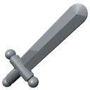

# Paradox Protector 1 - Achievement 293

[Quest database](./README.md) | [Quest Guide](../Quest%20Guide.md) | [Methodology](./Methodology.md)

**Definition ID: 293** | Achievement | Location / Avant Gardens | Repeatable: False

**Official client name** from the client locale.xml (`Missions_293_name`, en&#95;US).

## Description

Official client text from locale.xml (en&#95;US):

**Description:** Smash 25 Stromlings, 25 Stromling Mechs, and 25 Dark Spiderlings.

**Objectives-complete tip:** Paradox Protector 1!

### Objectives

Client task text from locale.xml is shown where it exists; the indented line is the data-derived summary of the same MissionTasks row.

- Smash 25 Stromlings.
    - Data summary: Smash matching targets until the combined counter reaches 25: Stromling / Stromling / Chainsaw Stromling / 2 further allowed templates.
- Smash 25 Stromling Mechs.
    - Data summary: Smash matching targets until the combined counter reaches 25: Stromling Mech / Stromling Mech / Stromling Mech / 1 further allowed templates.
- Smash 25 Dark Spiderlings.
    - Data summary: Smash matching targets until the combined counter reaches 25: Dark Spiderling / Dark Spiderling / Dark Spiderling / 3 further allowed templates.

## Start, turn-in, and locations

This is an achievement: it is normally discovered/tracked by qualifying progress events once prerequisites permit it, not accepted from a quest giver. Any stored NPC associations below are data references, not an instruction to accept an achievement.

No quest-giver or turn-in association is recorded for this achievement.

Follow a named object for exact XYZ and scene/spawner conditions. Static placements do not prove that the NPC is currently spawned, offers this quest to your character, or is reachable in a deployed server.

## Requirements and quest chain

- Stored prerequisite expression: (empty).
- Inspected server evaluation: TRUE.
- UIPrereqID: (not recorded); shown separately, not misread as a mission ID.
- Cooldown: not recorded (loader default -1); -1 means no cooldown in CanAccept.
- Stored feature gate / localization status: (none) / 2. The generic mission/task loaders mark gate_version unused; other scripts, map gates, and client checks can still restrict availability.
- Referenced as a prerequisite by: [Paradox Protector 2 &#91;294&#93;](294.md). These are potential follow-ups, not a guarantee of an immediate offer.

## Walkthrough / checklist

1. Satisfy the achievement prerequisites. Produce a qualifying progress event so the server can discover/track the achievement; prior actions are not assumed to be retroactive for every task type.
2. Smash matching targets until the combined counter reaches 25: Stromling / Stromling / Chainsaw Stromling / 2 further allowed templates. See objective **1** below for target references and conditions.
3. Smash matching targets until the combined counter reaches 25: Stromling Mech / Stromling Mech / Stromling Mech / 1 further allowed templates. See objective **2** below for target references and conditions.
4. Smash matching targets until the combined counter reaches 25: Dark Spiderling / Dark Spiderling / Dark Spiderling / 3 further allowed templates. See objective **3** below for target references and conditions.
5. When all objectives complete, the normal achievement path grants completion/rewards automatically; there is no generic NPC turn-in step.

**These numbered entries are a readable checklist, not evidence that the objective rows must be completed in this order.** Scripted phases, travel routes, puzzle interactions, and custom conditions are not reconstructed unless the data/source evidence supports them.

## Objective details

### Objective 1: Smash (UID 449)

**Client task text:** Smash 25 Stromlings.

Smash matching targets until the combined counter reaches 25: Stromling / Stromling / Chainsaw Stromling / 2 further allowed templates.

Target namespace: **LOT**. Stored target value/threshold: **25**.

| Matching / associated object | Mapped zones | Item acquisition data |
| --- | --- | --- |
| [Stromling (LOT 4712)](sources/object-4712.md) | [Avant Gardens (1100)](locations/zone-1100.md) | Not an item-template registration |
| [Stromling (LOT 6351)](sources/object-6351.md) | [Avant Gardens Survival (1101)](locations/zone-1101.md); [The Battle of Nimbus Station (1204)](locations/zone-1204.md) | Not an item-template registration |
| [Chainsaw Stromling (LOT 8088)](sources/object-8088.md) | No matched local placement found | Not an item-template registration |
| [Hammer Stromling (LOT 8089)](sources/object-8089.md) | No matched local placement found | Not an item-template registration |
| [Stromling (LOT 9744)](sources/object-9744.md) | [Avant Grove (1151)](locations/zone-1151.md); [Nimbus Rock (1250)](locations/zone-1250.md) | Not an item-template registration |

| Raw task field | Value |
| --- | --- |
| taskType | 0 |
| target | 4712 |
| targetGroup | 6351,8088,8089,9744 |
| targetValue | 25 |
| taskParam1 |  |
| uid | 449 |
| gate_version |  |
### Objective 2: Smash (UID 450)

**Client task text:** Smash 25 Stromling Mechs.

Smash matching targets until the combined counter reaches 25: Stromling Mech / Stromling Mech / Stromling Mech / 1 further allowed templates.

Target namespace: **LOT**. Stored target value/threshold: **25**.

| Matching / associated object | Mapped zones | Item acquisition data |
| --- | --- | --- |
| [Stromling Mech (LOT 6253)](sources/object-6253.md) | [Avant Gardens (1100)](locations/zone-1100.md) | Not an item-template registration |
| [Stromling Mech (LOT 6668)](sources/object-6668.md) | [Avant Gardens Survival (1101)](locations/zone-1101.md) | Not an item-template registration |
| [Stromling Mech (LOT 8090)](sources/object-8090.md) | No matched local placement found | Not an item-template registration |
| [Stromling Mech (LOT 8091)](sources/object-8091.md) | No matched local placement found | Not an item-template registration |

| Raw task field | Value |
| --- | --- |
| taskType | 0 |
| target | 6253 |
| targetGroup | 6668,8090,8091 |
| targetValue | 25 |
| taskParam1 |  |
| uid | 450 |
| gate_version |  |
### Objective 3: Smash (UID 740)

**Client task text:** Smash 25 Dark Spiderlings.

Smash matching targets until the combined counter reaches 25: Dark Spiderling / Dark Spiderling / Dark Spiderling / 3 further allowed templates.

Target namespace: **LOT**. Stored target value/threshold: **25**.

| Matching / associated object | Mapped zones | Item acquisition data |
| --- | --- | --- |
| [Dark Spiderling (LOT 6359)](sources/object-6359.md) | [Avant Gardens (1100)](locations/zone-1100.md) | Not an item-template registration |
| [Dark Spiderling (LOT 6454)](sources/object-6454.md) | [Avant Gardens Survival (1101)](locations/zone-1101.md) | Not an item-template registration |
| [Dark Spiderling (LOT 8096)](sources/object-8096.md) | No matched local placement found | Not an item-template registration |
| [Dark Spiderling (LOT 8097)](sources/object-8097.md) | No matched local placement found | Not an item-template registration |
| [Dark Spiderling (LOT 16197)](sources/object-16197.md) | No matched local placement found | Not an item-template registration |
| [Dark Spiderling (LOT 14572)](sources/object-14572.md) | [Avant Gardens (1100)](locations/zone-1100.md) | Not an item-template registration |

| Raw task field | Value |
| --- | --- |
| taskType | 0 |
| target | 6359 |
| targetGroup | 6454,8096,8097,16197,14572 |
| targetValue | 25 |
| taskParam1 |  |
| uid | 740 |
| gate_version |  |

## Rewards

The item slots below are listed completion rewards, not random loot-table rolls. Player eligibility and completion still apply.

| Item reward slot | Item | Granted quantity | Stored count / notes |
| --- | --- | --- | --- |
| First completion / 1 | { .lu-ti width="24" loading="lazy" } [Quality Shortsword (LOT 8499)](../items/8499.md) | 1 | 1 |

| Reward | First completion / stored value | Repeat behavior |
| --- | --- | --- |
| Coins | 0 | Not advertised as repeatable |
| U-Score | 30 | Not advertised as repeatable |
| Reputation | 0 | Not advertised as repeatable |
| Maximum Life | No positive grant defined | First completion only |
| Maximum Imagination | No positive grant defined | First completion only |
| Item backpack slots | No positive grant defined | First completion only |
| Vault item AND vault model slots | No positive grant defined | First completion only |

Emote unlocks (first completion): none with positive IDs recorded.

At the configured level cap, U-Score can be converted into coins using server configuration. Stored base coins are not a quote for that conversion. Reputation and U-Score are processed before the repeat-reward branch; stat increases and emote unlocks are first-completion only.

## Historical community references

No unique, sufficiently corroborated association was established in the researched community infoboxes. Similar names or matching numeric IDs were not treated as proof.

This page provides an original data-derived checklist, not copied wiki dialogue or a claim that the historical walkthrough exactly matches the deployed server.

## Evidence and limitations

[Missions](../../db/Missions.md), [MissionTasks](../../db/MissionTasks.md), [MissionNPCComponent](../../db/MissionNPCComponent.md), [MissionText](../../db/MissionText.md), [MissionEmail](../../db/MissionEmail.md). [Task interpretation and coverage](./Methodology.md). Availability, client presentation, puzzle phases, and custom script behavior can differ.
