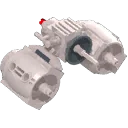
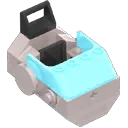
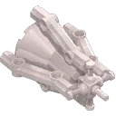
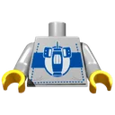

# Pod Person - Achievement 355

[Quest database](./README.md) | [Quest Guide](../Quest%20Guide.md) | [Methodology](./Methodology.md)

**Definition ID: 355** | Achievement | Location / Avant Gardens | Repeatable: False

**Official client name** from the client locale.xml (`Missions_355_name`, en&#95;US).

## Description

Official client text from locale.xml (en&#95;US):

**Description:** Find all 3 Pod rocket modules.

**Objectives-complete tip:** You've found all 3 Pod rocket modules!

### Objectives

Client task text from locale.xml is shown where it exists; the indented line is the data-derived summary of the same MissionTasks row.

- Find a Pod Nose Cone rocket module.
    - Data summary: Gather 1 item(s) from the allowed templates, sharing one counter: Pod Rocket Nose Cone.
- Find a Pod Cockpit rocket module.
    - Data summary: Gather 1 item(s) from the allowed templates, sharing one counter: Pod Rocket Cockpit.
- Find a Pod Engine rocket module.
    - Data summary: Gather 1 item(s) from the allowed templates, sharing one counter: Pod Rocket Engine.

## Start, turn-in, and locations

This is an achievement: it is normally discovered/tracked by qualifying progress events once prerequisites permit it, not accepted from a quest giver. Any stored NPC associations below are data references, not an instruction to accept an achievement.

No quest-giver or turn-in association is recorded for this achievement.

Follow a named object for exact XYZ and scene/spawner conditions. Static placements do not prove that the NPC is currently spawned, offers this quest to your character, or is reachable in a deployed server.

## Requirements and quest chain

- Stored prerequisite expression: (empty).
- Inspected server evaluation: TRUE.
- UIPrereqID: (not recorded); shown separately, not misread as a mission ID.
- Cooldown: not recorded (loader default -1); -1 means no cooldown in CanAccept.
- Stored feature gate / localization status: (none) / 2. The generic mission/task loaders mark gate_version unused; other scripts, map gates, and client checks can still restrict availability.

## Walkthrough / checklist

1. Satisfy the achievement prerequisites. Produce a qualifying progress event so the server can discover/track the achievement; prior actions are not assumed to be retroactive for every task type.
2. Gather 1 item(s) from the allowed templates, sharing one counter: Pod Rocket Nose Cone. See objective **1** below for target references and conditions.
3. Gather 1 item(s) from the allowed templates, sharing one counter: Pod Rocket Cockpit. See objective **2** below for target references and conditions.
4. Gather 1 item(s) from the allowed templates, sharing one counter: Pod Rocket Engine. See objective **3** below for target references and conditions.
5. When all objectives complete, the normal achievement path grants completion/rewards automatically; there is no generic NPC turn-in step.

**These numbered entries are a readable checklist, not evidence that the objective rows must be completed in this order.** Scripted phases, travel routes, puzzle interactions, and custom conditions are not reconstructed unless the data/source evidence supports them.

## Objective details

### Objective 1: Gather items (UID 537)

**Client task text:** Find a Pod Nose Cone rocket module.

Gather 1 item(s) from the allowed templates, sharing one counter: Pod Rocket Nose Cone.

Target namespace: **LOT**. Stored target value/threshold: **1**.

| Matching / associated object | Mapped zones | Item acquisition data |
| --- | --- | --- |
| [Pod Rocket Nose Cone (LOT 4719)](sources/object-4719.md) | No matched local placement found | { .lu-ti width="24" loading="lazy" } [Pod Rocket Nose Cone (LOT 4719)](../items/4719.md) |

- Gathered items are retained by the generic reward-removal path (parameter bit 1).
- Inventory loss does not reduce this task in the inspected decrement path (parameter bit 4).

| Raw task field | Value |
| --- | --- |
| taskType | 11 |
| target | 4719 |
| targetGroup |  |
| targetValue | 1 |
| taskParam1 | 5 |
| uid | 537 |
| gate_version |  |
### Objective 2: Gather items (UID 538)

**Client task text:** Find a Pod Cockpit rocket module.

Gather 1 item(s) from the allowed templates, sharing one counter: Pod Rocket Cockpit.

Target namespace: **LOT**. Stored target value/threshold: **1**.

| Matching / associated object | Mapped zones | Item acquisition data |
| --- | --- | --- |
| [Pod Rocket Cockpit (LOT 4720)](sources/object-4720.md) | No matched local placement found | { .lu-ti width="24" loading="lazy" } [Pod Rocket Cockpit (LOT 4720)](../items/4720.md) |

- Gathered items are retained by the generic reward-removal path (parameter bit 1).
- Inventory loss does not reduce this task in the inspected decrement path (parameter bit 4).

| Raw task field | Value |
| --- | --- |
| taskType | 11 |
| target | 4720 |
| targetGroup |  |
| targetValue | 1 |
| taskParam1 | 5 |
| uid | 538 |
| gate_version |  |
### Objective 3: Gather items (UID 539)

**Client task text:** Find a Pod Engine rocket module.

Gather 1 item(s) from the allowed templates, sharing one counter: Pod Rocket Engine.

Target namespace: **LOT**. Stored target value/threshold: **1**.

| Matching / associated object | Mapped zones | Item acquisition data |
| --- | --- | --- |
| [Pod Rocket Engine (LOT 4721)](sources/object-4721.md) | No matched local placement found | { .lu-ti width="24" loading="lazy" } [Pod Rocket Engine (LOT 4721)](../items/4721.md) |

- Gathered items are retained by the generic reward-removal path (parameter bit 1).
- Inventory loss does not reduce this task in the inspected decrement path (parameter bit 4).

| Raw task field | Value |
| --- | --- |
| taskType | 11 |
| target | 4721 |
| targetGroup |  |
| targetValue | 1 |
| taskParam1 | 5 |
| uid | 539 |
| gate_version |  |

## Rewards

The item slots below are listed completion rewards, not random loot-table rolls. Player eligibility and completion still apply.

| Item reward slot | Item | Granted quantity | Stored count / notes |
| --- | --- | --- | --- |
| First completion / 1 | { .lu-ti width="24" loading="lazy" } [Pod Rocket Shirt (LOT 6232)](../items/6232.md) | 1 | 1 |

| Reward | First completion / stored value | Repeat behavior |
| --- | --- | --- |
| Coins | 0 | Not advertised as repeatable |
| U-Score | 15 | Not advertised as repeatable |
| Reputation | (not recorded) | Not advertised as repeatable |
| Maximum Life | No positive grant defined | First completion only |
| Maximum Imagination | No positive grant defined | First completion only |
| Item backpack slots | No positive grant defined | First completion only |
| Vault item AND vault model slots | No positive grant defined | First completion only |

Emote unlocks (first completion): none with positive IDs recorded.

At the configured level cap, U-Score can be converted into coins using server configuration. Stored base coins are not a quote for that conversion. Reputation and U-Score are processed before the repeat-reward branch; stat increases and emote unlocks are first-completion only.

## Historical community references

No unique, sufficiently corroborated association was established in the researched community infoboxes. Similar names or matching numeric IDs were not treated as proof.

This page provides an original data-derived checklist, not copied wiki dialogue or a claim that the historical walkthrough exactly matches the deployed server.

## Evidence and limitations

[Missions](../../db/Missions.md), [MissionTasks](../../db/MissionTasks.md), [MissionNPCComponent](../../db/MissionNPCComponent.md), [MissionText](../../db/MissionText.md), [MissionEmail](../../db/MissionEmail.md). [Task interpretation and coverage](./Methodology.md). Availability, client presentation, puzzle phases, and custom script behavior can differ.
