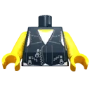

# Smash 'Em All - Achievement 538

[Quest database](./README.md) | [Quest Guide](../Quest%20Guide.md) | [Methodology](./Methodology.md)

**Definition ID: 538** | Achievement | Battle / General | Repeatable: False

**Official client name** from the client locale.xml (`Missions_538_name`, en&#95;US). Historical community name: Smash 'Em All 6 (a candidate association from public wiki research; see the references below).

## Description

Official client text from locale.xml (en&#95;US):

**Description:** Smash 10,000 more enemies.

**Objectives-complete tip:** Smash 'Em All 6!

### Objectives

Client task text from locale.xml is shown where it exists; the indented line is the data-derived summary of the same MissionTasks row.

- Smash 10,000 more enemies.
    - Data summary: Smash matching targets until the combined counter reaches 10000: Stromling / Torchblight - Maelstrom Dragon / Burnshout - Maelstrom Dragon / 85 further allowed templates.

## Start, turn-in, and locations

This is an achievement: it is normally discovered/tracked by qualifying progress events once prerequisites permit it, not accepted from a quest giver. Any stored NPC associations below are data references, not an instruction to accept an achievement.

No quest-giver or turn-in association is recorded for this achievement.

Follow a named object for exact XYZ and scene/spawner conditions. Static placements do not prove that the NPC is currently spawned, offers this quest to your character, or is reachable in a deployed server.

## Requirements and quest chain

- Stored prerequisite expression: 1839.
- Inspected server evaluation: [Smash 'Em All 5 &#91;1839&#93;](1839.md) is complete.
- UIPrereqID: (not recorded); shown separately, not misread as a mission ID.
- Cooldown: not recorded (loader default -1); -1 means no cooldown in CanAccept.
- Stored feature gate / localization status: (none) / 2. The generic mission/task loaders mark gate_version unused; other scripts, map gates, and client checks can still restrict availability.
- Referenced prerequisite definitions: [Smash 'Em All 5 &#91;1839&#93;](1839.md).

## Walkthrough / checklist

1. Satisfy the achievement prerequisites. Produce a qualifying progress event so the server can discover/track the achievement; prior actions are not assumed to be retroactive for every task type.
2. Smash matching targets until the combined counter reaches 10000: Stromling / Torchblight - Maelstrom Dragon / Burnshout - Maelstrom Dragon / 85 further allowed templates. See objective **1** below for target references and conditions.
3. When all objectives complete, the normal achievement path grants completion/rewards automatically; there is no generic NPC turn-in step.

**These numbered entries are a readable checklist, not evidence that the objective rows must be completed in this order.** Scripted phases, travel routes, puzzle interactions, and custom conditions are not reconstructed unless the data/source evidence supports them.

## Objective details

### Objective 1: Smash (UID 811)

**Client task text:** Smash 10,000 more enemies.

Smash matching targets until the combined counter reaches 10000: Stromling / Torchblight - Maelstrom Dragon / Burnshout - Maelstrom Dragon / 85 further allowed templates.

Target namespace: **LOT**. Stored target value/threshold: **10000**.

| Matching / associated object | Mapped zones | Item acquisition data |
| --- | --- | --- |
| [Stromling (LOT 4712)](sources/object-4712.md) | [Avant Gardens (1100)](locations/zone-1100.md) | Not an item-template registration |
| [Torchblight - Maelstrom Dragon (LOT 11225)](sources/object-11225.md) | [Forbidden Valley Dragon Battle (1402)](locations/zone-1402.md) | Not an item-template registration |
| [Burnshout - Maelstrom Dragon (LOT 11226)](sources/object-11226.md) | [Forbidden Valley Dragon Battle (1402)](locations/zone-1402.md) | Not an item-template registration |
| [FV - Grumpy Stromling (LOT 3031)](sources/object-3031.md) | No matched local placement found | Not an item-template registration |
| [FV - Freak Stromling (LOT 3033)](sources/object-3033.md) | No matched local placement found | Not an item-template registration |
| [FV - Hyper Stromling (LOT 3035)](sources/object-3035.md) | No matched local placement found | Not an item-template registration |
| [Stromling Mech (LOT 6253)](sources/object-6253.md) | [Avant Gardens (1100)](locations/zone-1100.md) | Not an item-template registration |
| [Stromling (LOT 6351)](sources/object-6351.md) | [Avant Gardens Survival (1101)](locations/zone-1101.md); [The Battle of Nimbus Station (1204)](locations/zone-1204.md) | Not an item-template registration |
| [Dark Spiderling (LOT 6359)](sources/object-6359.md) | [Avant Gardens (1100)](locations/zone-1100.md) | Not an item-template registration |
| [Stromling (LOT 6392)](sources/object-6392.md) | No matched local placement found | Not an item-template registration |
| [Spider Cave Spider (LOT 6444)](sources/object-6444.md) | No matched local placement found | Not an item-template registration |
| [Dark Spiderling (LOT 6454)](sources/object-6454.md) | [Avant Gardens Survival (1101)](locations/zone-1101.md) | Not an item-template registration |
| [Stromling Pirate (LOT 6550)](sources/object-6550.md) | [Gnarled Forest Deep Dive Map (375)](locations/zone-375.md); [Gnarled Forest (1300)](locations/zone-1300.md) | Not an item-template registration |
| [Stromling Skeleton (LOT 6551)](sources/object-6551.md) | No matched local placement found | Not an item-template registration |
| [Stromling Mech (LOT 6563)](sources/object-6563.md) | No matched local placement found | Not an item-template registration |
| [Stromling Mech (LOT 6668)](sources/object-6668.md) | [Avant Gardens Survival (1101)](locations/zone-1101.md) | Not an item-template registration |
| [Stromling Admiral (LOT 6789)](sources/object-6789.md) | [Gnarled Forest Deep Dive Map (375)](locations/zone-375.md); [Gnarled Forest (1300)](locations/zone-1300.md) | Not an item-template registration |
| [Stromling Ape (LOT 6806)](sources/object-6806.md) | [Gnarled Forest Deep Dive Map (375)](locations/zone-375.md); [Gnarled Forest (1300)](locations/zone-1300.md) | Not an item-template registration |
| [Stromling Pirate (LOT 6974)](sources/object-6974.md) | [Gnarled Forest Survival (1301)](locations/zone-1301.md) | Not an item-template registration |
| [Stromling Admiral (LOT 6975)](sources/object-6975.md) | [Gnarled Forest Survival (1301)](locations/zone-1301.md) | Not an item-template registration |
| [Stromling Ape (LOT 6976)](sources/object-6976.md) | [Gnarled Forest Survival (1301)](locations/zone-1301.md) | Not an item-template registration |
| [Spider Boss 1 (LOT 7151)](sources/object-7151.md) | No matched local placement found | Not an item-template registration |
| [Spider Boss 2 (LOT 7152)](sources/object-7152.md) | No matched local placement found | Not an item-template registration |
| [Blastbreath - Maelstrom Dragon (LOT 7805)](sources/object-7805.md) | [Forbidden Valley Dragon Battle (1402)](locations/zone-1402.md) | Not an item-template registration |
| [Dark Ronin (LOT 7815)](sources/object-7815.md) | [Forbidden Valley (1400)](locations/zone-1400.md) | Not an item-template registration |
| [Maelstrom Horseman (LOT 7816)](sources/object-7816.md) | [Forbidden Valley (1400)](locations/zone-1400.md); [The Battle of Nimbus Station (1204)](locations/zone-1204.md) | Not an item-template registration |
| [Chainsaw Stromling (LOT 8088)](sources/object-8088.md) | No matched local placement found | Not an item-template registration |
| [Hammer Stromling (LOT 8089)](sources/object-8089.md) | No matched local placement found | Not an item-template registration |
| [Stromling Mech (LOT 8090)](sources/object-8090.md) | No matched local placement found | Not an item-template registration |
| [Stromling Mech (LOT 8091)](sources/object-8091.md) | No matched local placement found | Not an item-template registration |
| [Dark Spiderling (LOT 8096)](sources/object-8096.md) | No matched local placement found | Not an item-template registration |
| [Dark Spiderling (LOT 8097)](sources/object-8097.md) | No matched local placement found | Not an item-template registration |
| [Stromling Mech (LOT 8222)](sources/object-8222.md) | No matched local placement found | Not an item-template registration |
| [Hammerhurl Stromling (LOT 8238)](sources/object-8238.md) | [Return to the Venture Explorer (1001)](locations/zone-1001.md) | Not an item-template registration |
| [Dark Ronin (LOT 10512)](sources/object-10512.md) | No matched local placement found | Not an item-template registration |
| [Elite Dark Spiderling (LOT 12387)](sources/object-12387.md) | [Return to the Venture Explorer (1001)](locations/zone-1001.md) | Not an item-template registration |
| [Corrupted Sentry (LOT 8433)](sources/object-8433.md) | [Return to the Venture Explorer (1001)](locations/zone-1001.md) | Not an item-template registration |
| [Hammer Stromling (LOT 12542)](sources/object-12542.md) | [Return to the Venture Explorer (1001)](locations/zone-1001.md) | Not an item-template registration |
| [Stromling Invader (LOT 11212)](sources/object-11212.md) | [Crux Prime (1800)](locations/zone-1800.md) | Not an item-template registration |
| [Stromling Mech Invader (LOT 11213)](sources/object-11213.md) | No matched local placement found | Not an item-template registration |
| [Dark Spiderling Invader (LOT 11214)](sources/object-11214.md) | [Crux Prime (1800)](locations/zone-1800.md) | Not an item-template registration |
| [Stromling Pirate Invader (LOT 11215)](sources/object-11215.md) | [Crux Prime (1800)](locations/zone-1800.md) | Not an item-template registration |
| [Stromling Admiral Invader (LOT 11216)](sources/object-11216.md) | [Crux Prime (1800)](locations/zone-1800.md) | Not an item-template registration |
| [Stromling Ape Invader (LOT 11217)](sources/object-11217.md) | [Crux Prime (1800)](locations/zone-1800.md) | Not an item-template registration |
| [Dark Ronin Invader (LOT 11218)](sources/object-11218.md) | [Crux Prime (1800)](locations/zone-1800.md) | Not an item-template registration |
| [Maelstrom Horseman Invader (LOT 11219)](sources/object-11219.md) | [Crux Prime (1800)](locations/zone-1800.md) | Not an item-template registration |
| [Maelstrom Dragon Invader (LOT 11220)](sources/object-11220.md) | [Crux Prime (1800)](locations/zone-1800.md) | Not an item-template registration |
| [Talli Reeko - Stromling Invader (LOT 11982)](sources/object-11982.md) | [Crux Prime (1800)](locations/zone-1800.md) | Not an item-template registration |
| [Roo Morgg - Stromling Ape Invader (LOT 11987)](sources/object-11987.md) | [Crux Prime (1800)](locations/zone-1800.md) | Not an item-template registration |
| [Butterscorch - Maelstrom Dragon Invader (LOT 11989)](sources/object-11989.md) | [Crux Prime (1800)](locations/zone-1800.md) | Not an item-template registration |
| [Skeleton Miner (LOT 12000)](sources/object-12000.md) | [Crux Prime (1800)](locations/zone-1800.md) | Not an item-template registration |
| [Skeleton Engineer (LOT 12002)](sources/object-12002.md) | [Crux Prime (1800)](locations/zone-1800.md) | Not an item-template registration |
| [Skeleton Pit Boss (LOT 12004)](sources/object-12004.md) | [Crux Prime (1800)](locations/zone-1800.md) | Not an item-template registration |
| [Nuckal - Skeleton Lightning General (LOT 12005)](sources/object-12005.md) | [Crux Prime (1800)](locations/zone-1800.md) | Not an item-template registration |
| [Oni Rider Ikusa - Maelstrom Horseman (LOT 11999)](sources/object-11999.md) | No matched local placement found | Not an item-template registration |
| [Oni Rider Seibatsu - Maelstrom Horseman (LOT 12467)](sources/object-12467.md) | No matched local placement found | Not an item-template registration |
| [Oni Rider Kikin - Maelstrom Horseman (LOT 12468)](sources/object-12468.md) | No matched local placement found | Not an item-template registration |
| [Oni Rider Shi - Maelstrom Horseman (LOT 12469)](sources/object-12469.md) | No matched local placement found | Not an item-template registration |
| [Stromling (LOT 12586)](sources/object-12586.md) | No matched local placement found | Not an item-template registration |
| [Stromling Mech (LOT 12587)](sources/object-12587.md) | No matched local placement found | Not an item-template registration |
| [Dark Spiderling (LOT 12588)](sources/object-12588.md) | No matched local placement found | Not an item-template registration |
| [Stromling Pirate (LOT 12589)](sources/object-12589.md) | No matched local placement found | Not an item-template registration |
| [Stromling Admiral (LOT 12590)](sources/object-12590.md) | No matched local placement found | Not an item-template registration |
| [Kinga Hurl - Stromling Ape (LOT 12591)](sources/object-12591.md) | No matched local placement found | Not an item-template registration |
| [Murgle Blotch - Stromling Champion (LOT 12600)](sources/object-12600.md) | No matched local placement found | Not an item-template registration |
| [Hammerhurl Stromling (LOT 12602)](sources/object-12602.md) | No matched local placement found | Not an item-template registration |
| [Stromling Mech Invader (LOT 12604)](sources/object-12604.md) | No matched local placement found | Not an item-template registration |
| [Elite Dark Spiderling (LOT 12605)](sources/object-12605.md) | No matched local placement found | Not an item-template registration |
| [Whack Bliddo - Dark Spiderling Invader (LOT 12609)](sources/object-12609.md) | No matched local placement found | Not an item-template registration |
| [Dark Ronin (LOT 12610)](sources/object-12610.md) | No matched local placement found | Not an item-template registration |
| [Maelstrom Horseman (LOT 12611)](sources/object-12611.md) | No matched local placement found | Not an item-template registration |
| [Borborygmus - Maelstrom Dragon (LOT 12612)](sources/object-12612.md) | No matched local placement found | Not an item-template registration |
| [Hammer Stromling (LOT 12653)](sources/object-12653.md) | No matched local placement found | Not an item-template registration |
| [Stromling Admiral Elite (LOT 13523)](sources/object-13523.md) | No matched local placement found | Not an item-template registration |
| [Stromling Ape Elite (LOT 13524)](sources/object-13524.md) | No matched local placement found | Not an item-template registration |
| [Maelstrom Spider Queen (LOT 14381)](sources/object-14381.md) | [Spider Queen Battle (1102)](locations/zone-1102.md); [Block Yard (1150)](locations/zone-1150.md) | Not an item-template registration |
| [Dark Spiderling (LOT 16197)](sources/object-16197.md) | No matched local placement found | Not an item-template registration |
| [Dark Spiderling (LOT 14572)](sources/object-14572.md) | [Avant Gardens (1100)](locations/zone-1100.md) | Not an item-template registration |
| [Bone Wolf (LOT 13995)](sources/object-13995.md) | [Ninjago Monastery (2000)](locations/zone-2000.md) | Not an item-template registration |
| [Skeleton Blacksmith (LOT 14024)](sources/object-14024.md) | [Ninjago Monastery (2000)](locations/zone-2000.md) | Not an item-template registration |
| [Skeleton Raider (LOT 14025)](sources/object-14025.md) | [Ninjago Monastery (2000)](locations/zone-2000.md) | Not an item-template registration |
| [Skeleton Commando (LOT 14026)](sources/object-14026.md) | [Ninjago Monastery (2000)](locations/zone-2000.md) | Not an item-template registration |
| [Skeleton Marksman (LOT 14028)](sources/object-14028.md) | [Ninjago Monastery (2000)](locations/zone-2000.md) | Not an item-template registration |
| [Skeleton Mad Scientist (LOT 14029)](sources/object-14029.md) | [Ninjago Monastery (2000)](locations/zone-2000.md) | Not an item-template registration |
| [Skeleton Trooper (LOT 14491)](sources/object-14491.md) | [Ninjago Monastery (2000)](locations/zone-2000.md) | Not an item-template registration |
| [Chopov - Skeleton of Earth (LOT 16047)](sources/object-16047.md) | [Ninjago Monastery (2000)](locations/zone-2000.md) | Not an item-template registration |
| [Krazi - Skeleton of Lightning (LOT 16049)](sources/object-16049.md) | [Ninjago Monastery (2000)](locations/zone-2000.md) | Not an item-template registration |
| [Bonezai - Skeleton of Ice (LOT 16050)](sources/object-16050.md) | [Ninjago Monastery (2000)](locations/zone-2000.md) | Not an item-template registration |

| Raw task field | Value |
| --- | --- |
| taskType | 0 |
| target | 4712 |
| targetGroup | 11225,11226,3031,3033,3035,6253,6351,6359,6392,6444,6454,6550,6551,6563,6668,6789,6806,6974,6975,6976,7151,7152,7805,7815,7816,8088,8089,8090,8091,8096,8097,8222,8238,10512,12387,8433,8238,12542,11212,11213,11214,11215,11216,11217,11218,11219,11220,11982,11987,11989,12000,12002,12004,12005,11999,12467,12468,12469,12586,12587,12588,12589,12590,12591,12600,12602,12604,12605,12609,12610,12611,12612,12653,13523,13524,14381,16197,14572,13995,14024,14025,14026,14026,14028,14029,14491,16047,16049,16050 |
| targetValue | 10000 |
| taskParam1 |  |
| uid | 811 |
| gate_version |  |

## Rewards

The item slots below are listed completion rewards, not random loot-table rolls. Player eligibility and completion still apply.

| Item reward slot | Item | Granted quantity | Stored count / notes |
| --- | --- | --- | --- |
| First completion / 1 | { .lu-ti width="24" loading="lazy" } [Zippered Leather Jacket (LOT 8598)](../items/8598.md) | 1 | 1 |

| Reward | First completion / stored value | Repeat behavior |
| --- | --- | --- |
| Coins | 0 | Not advertised as repeatable |
| U-Score | 540 | Not advertised as repeatable |
| Reputation | (not recorded) | Not advertised as repeatable |
| Maximum Life | No positive grant defined | First completion only |
| Maximum Imagination | No positive grant defined | First completion only |
| Item backpack slots | No positive grant defined | First completion only |
| Vault item AND vault model slots | No positive grant defined | First completion only |

Emote unlocks (first completion): none with positive IDs recorded.

At the configured level cap, U-Score can be converted into coins using server configuration. Stored base coins are not a quote for that conversion. Reputation and U-Score are processed before the repeat-reward branch; stat increases and emote unlocks are first-completion only.

### Completion mail / announcements

| Row | Type | Attachment definition | Meaning |
| --- | --- | --- | --- |
| 40 | 2 | None recorded | Chat achievement announcement; this branch does not send an attachment |

## Historical community references

- [Smash 'Em All 6](https://legouniverse.fandom.com/wiki/Smash_'Em_All?oldid=159377) — candidate title from Smash 'Em All. Matching evidence groups: **U-Score, reward item, objective kind, objective threshold**. Revision 159377; retrieved 2026-11-17T09:38:29.686Z.
  Reported factual methods: smash/defeat; location labels: not extracted; named objective references: none extracted; named reward references: Zippered Leather Jacket.

This page provides an original data-derived checklist, not copied wiki dialogue or a claim that the historical walkthrough exactly matches the deployed server.

## Evidence and limitations

[Missions](../../db/Missions.md), [MissionTasks](../../db/MissionTasks.md), [MissionNPCComponent](../../db/MissionNPCComponent.md), [MissionText](../../db/MissionText.md), [MissionEmail](../../db/MissionEmail.md). [Task interpretation and coverage](./Methodology.md). Availability, client presentation, puzzle phases, and custom script behavior can differ.
