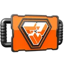

# Get your Assembly Gear! - Quest 588

[Quest database](./README.md) | [Quest Guide](../Quest%20Guide.md) | [Methodology](./Methodology.md)

**Definition ID: 588** | Quest | Location / Nimbus Station | Repeatable: False

**Official client name** from the client locale.xml (`Missions_588_name`, en&#95;US). The historical community association below agrees with this name.

## Description

Official client text from locale.xml (en&#95;US):

**Offer text:** You've got another important choice to make. **Talk to Meldric Steamvalve**, the Assembly Vendor, to pick your first Specialty Kit!

**Accept reply:** Which Specialty Kit will you choose?

**In-progress text:** **Talk to Meldric Steamvalve** in Nimbus Plaza and pick your first Specialty Kit!

**Objectives-complete tip:** Talk to Meldric Steamvalve in Nimbus Plaza and pick your first Specialty Kit!

**Turn-in text:** Welcome to Assembly, builder! **Pick your first Specialty Kit**!

### Objectives

Client task text from locale.xml is shown where it exists; the indented line is the data-derived summary of the same MissionTasks row.

- Talk to Meldric Steamvalve in Nimbus Plaza and pick your first Specialty Kit!
    - Data summary: Talk to DNL -Ellgren Stackwell - Assembly Rep; required progress 1.

## Start, turn-in, and locations

| Role | NPC / object | Mapped candidate zones | Association evidence |
| --- | --- | --- | --- |
| Defined offer object | [Nexus Jay - Nexus Force Recruiter (LOT 7098)](sources/object-7098.md) | [Nimbus Station (1200)](locations/zone-1200.md) | Missions.offer&#95;objectID |
| Defined turn-in object | [Meldric Steamvalve - Assembly Vendor (LOT 6633)](sources/object-6633.md) | [Nimbus Station (1200)](locations/zone-1200.md) | Missions.target&#95;objectID |
| Accepts turn-in | [Meldric Steamvalve - Assembly Vendor (LOT 6633)](sources/object-6633.md) | [Nimbus Station (1200)](locations/zone-1200.md) | MissionNPCComponent 174 |
| Offers mission | [Nexus Jay - Nexus Force Recruiter (LOT 7098)](sources/object-7098.md) | [Nimbus Station (1200)](locations/zone-1200.md) | MissionNPCComponent 43 |

Follow a named object for exact XYZ and scene/spawner conditions. Static placements do not prove that the NPC is currently spawned, offers this quest to your character, or is reachable in a deployed server.

## Requirements and quest chain

- Stored prerequisite expression: 544.
- Inspected server evaluation: [Quest 544 &#91;544&#93;](544.md) is complete.
- UIPrereqID: 47; shown separately, not misread as a mission ID.
- Cooldown: not recorded (loader default -1); -1 means no cooldown in CanAccept.
- Stored feature gate / localization status: (none) / 2. The generic mission/task loaders mark gate_version unused; other scripts, map gates, and client checks can still restrict availability.
- Referenced prerequisite definitions: [Quest 544 &#91;544&#93;](544.md).
- Referenced as a prerequisite by: [Assembly Specialty Kit &#91;815&#93;](815.md); [Aid Me! &#91;867&#93;](867.md); [Quest 1501 &#91;1501&#93;](1501.md); [Cannon Cove Crackshot &#91;1576&#93;](1576.md); [Vertigo Debris &#91;1578&#93;](1578.md); [Dragonmaw Debris &#91;1579&#93;](1579.md); [Drive Five &#91;1580&#93;](1580.md); [Flower Hour &#91;1581&#93;](1581.md); [Cannon Cove Champion &#91;1582&#93;](1582.md); [Time Trooper &#91;1583&#93;](1583.md); [Super Survivor &#91;1584&#93;](1584.md); [Pet Cove Clean Up &#91;1585&#93;](1585.md); [Pet Cove Perk Up &#91;1586&#93;](1586.md); [Back to the Front &#91;1587&#93;](1587.md); [Monument Maintenance &#91;1588&#93;](1588.md); [Mechanized Assault &#91;1589&#93;](1589.md); [Quest 1596 &#91;1596&#93;](1596.md); [Robot, Pirates and Rocks &#91;1597&#93;](1597.md); [Ultra Survivor &#91;1598&#93;](1598.md); [Chaos Ahoy! &#91;1599&#93;](1599.md); [Sweet Siren Songs &#91;1600&#93;](1600.md); [Tiki Party &#91;1601&#93;](1601.md); [Mushroom Masher &#91;1602&#93;](1602.md); [Victory in the Valley &#91;1603&#93;](1603.md); [Rock Fury &#91;1604&#93;](1604.md); [Avant Guardin' &#91;1605&#93;](1605.md); [Cannon Cove Commander &#91;1606&#93;](1606.md); [Gnarly Hike &#91;1607&#93;](1607.md); [Cannon Cove Corsair &#91;1608&#93;](1608.md); [Time Thrasher &#91;1609&#93;](1609.md). These are potential follow-ups, not a guarantee of an immediate offer.

## Walkthrough / checklist

1. Satisfy the prerequisites and any client, map, or script conditions. Check the giver listed above; where none is resolved, the acceptance route remains unknown.
2. Accept the quest before relying on objective credit. Inventory gather tasks, existing flags, and racing parameter-4 tasks have limited acceptance catch-up; other earlier actions are not assumed to count.
3. Talk to DNL -Ellgren Stackwell - Assembly Rep; required progress 1. See objective **1** below for target references and conditions.
4. After all objective counters are satisfied, complete the recorded turn-in interaction. If offered a reward choice, select the desired item rather than assuming all alternatives are granted.

**These numbered entries are a readable checklist, not evidence that the objective rows must be completed in this order.** Scripted phases, travel routes, puzzle interactions, and custom conditions are not reconstructed unless the data/source evidence supports them.

## Objective details

### Objective 1: Talk to NPC (UID 884)

**Client task text:** Talk to Meldric Steamvalve in Nimbus Plaza and pick your first Specialty Kit!

Talk to DNL -Ellgren Stackwell - Assembly Rep; required progress 1.

Target namespace: **LOT**. Stored target value/threshold: **1**.

| Matching / associated object | Mapped zones | Item acquisition data |
| --- | --- | --- |
| [DNL -Ellgren Stackwell - Assembly Rep (LOT 7096)](sources/object-7096.md) | No matched local placement found | Not an item-template registration |

| Raw task field | Value |
| --- | --- |
| taskType | 4 |
| target | 7096 |
| targetGroup |  |
| targetValue | 1 |
| taskParam1 |  |
| uid | 884 |
| gate_version |  |

## Rewards

**Choice reward:** listed item slots are alternatives when the normal mission-choice flow applies; do not assume that all are granted. A selected reward LOT filters item slots in the inspected handler.

| Item reward slot | Item | Granted quantity | Stored count / notes |
| --- | --- | --- | --- |
| First completion / 1 | { .lu-ti width="24" loading="lazy" } [Rank 1 Engineer Kit Package (LOT 7591)](../items/7591.md) | 1 | 1 |
| First completion / 2 | { .lu-ti width="24" loading="lazy" } [Rank 1 Summoner Kit Package (LOT 8033)](../items/8033.md) | 1 | 1 |
| First completion / 3 | { .lu-ti width="24" loading="lazy" } [Rank 1 Inventor Kit Package (LOT 8031)](../items/8031.md) | 1 | 1 |

| Reward | First completion / stored value | Repeat behavior |
| --- | --- | --- |
| Coins | 0 | Not advertised as repeatable |
| U-Score | 30 | Not advertised as repeatable |
| Reputation | 0 | Not advertised as repeatable |
| Maximum Life | No positive grant defined | First completion only |
| Maximum Imagination | No positive grant defined | First completion only |
| Item backpack slots | No positive grant defined | First completion only |
| Vault item AND vault model slots | No positive grant defined | First completion only |

Emote unlocks (first completion): none with positive IDs recorded.

At the configured level cap, U-Score can be converted into coins using server configuration. Stored base coins are not a quote for that conversion. Reputation and U-Score are processed before the repeat-reward branch; stat increases and emote unlocks are first-completion only.

## Historical community references

- [Get your Assembly Gear!](https://legouniverse.fandom.com/wiki/Get_your_Assembly_Gear!?oldid=113540) — candidate title from Get your Assembly Gear!. Matching evidence groups: **U-Score, NPC, objective kind**. Revision 113540; retrieved 2026-11-17T09:38:23.526Z.
  Reported factual methods: talk; location labels: not extracted; named objective references: none extracted; named reward references: none extracted.

This page provides an original data-derived checklist, not copied wiki dialogue or a claim that the historical walkthrough exactly matches the deployed server.

## Evidence and limitations

[Missions](../../db/Missions.md), [MissionTasks](../../db/MissionTasks.md), [MissionNPCComponent](../../db/MissionNPCComponent.md), [MissionText](../../db/MissionText.md), [MissionEmail](../../db/MissionEmail.md). [Task interpretation and coverage](./Methodology.md). Availability, client presentation, puzzle phases, and custom script behavior can differ.
