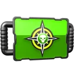

# Get your Venture League Gear! - Quest 589

[Quest database](./README.md) | [Quest Guide](../Quest%20Guide.md) | [Methodology](./Methodology.md)

**Definition ID: 589** | Quest | Location / Nimbus Station | Repeatable: False

**Official client name** from the client locale.xml (`Missions_589_name`, en&#95;US). The historical community association below agrees with this name.

## Description

Official client text from locale.xml (en&#95;US):

**Offer text:** You've got another important choice to make. **Talk to Magnus Bumperdent**, the Venture League Vendor, to pick your first Specialty Kit!

**Accept reply:** Which Specialty Kit will you choose?

**In-progress text:** **Talk to Magnus Bumperdent** in Nimbus Plaza and pick your first Specialty Kit!

**Objectives-complete tip:** Talk to Magnus Bumperdent in Nimbus Plaza and pick your first Specialty Kit!

**Turn-in text:** Ready to explore with Venture League? **Pick your first Specialty Kit**!

### Objectives

Client task text from locale.xml is shown where it exists; the indented line is the data-derived summary of the same MissionTasks row.

- Talk to Magnus Bumperdent in Nimbus Plaza and pick your first Specialty Kit!
    - Data summary: Talk to DNL - Logan Moonshot - Venture League Rep; required progress 1.

## Start, turn-in, and locations

| Role | NPC / object | Mapped candidate zones | Association evidence |
| --- | --- | --- | --- |
| Defined offer object | [Nexus Jay - Nexus Force Recruiter (LOT 7098)](sources/object-7098.md) | [Nimbus Station (1200)](locations/zone-1200.md) | Missions.offer&#95;objectID |
| Defined turn-in object | [Magnus Bumperdent - Venture League Vendor (LOT 6634)](sources/object-6634.md) | [Nimbus Station (1200)](locations/zone-1200.md) | Missions.target&#95;objectID |
| Accepts turn-in | [Magnus Bumperdent - Venture League Vendor (LOT 6634)](sources/object-6634.md) | [Nimbus Station (1200)](locations/zone-1200.md) | MissionNPCComponent 175 |
| Offers mission | [Nexus Jay - Nexus Force Recruiter (LOT 7098)](sources/object-7098.md) | [Nimbus Station (1200)](locations/zone-1200.md) | MissionNPCComponent 43 |

Follow a named object for exact XYZ and scene/spawner conditions. Static placements do not prove that the NPC is currently spawned, offers this quest to your character, or is reachable in a deployed server.

## Requirements and quest chain

- Stored prerequisite expression: 555.
- Inspected server evaluation: [Quest 555 &#91;555&#93;](555.md) is complete.
- UIPrereqID: 46; shown separately, not misread as a mission ID.
- Cooldown: not recorded (loader default -1); -1 means no cooldown in CanAccept.
- Stored feature gate / localization status: (none) / 2. The generic mission/task loaders mark gate_version unused; other scripts, map gates, and client checks can still restrict availability.
- Referenced prerequisite definitions: [Quest 555 &#91;555&#93;](555.md).
- Referenced as a prerequisite by: [Venture League Specialty Kit &#91;812&#93;](812.md); [Of Vital Importance &#91;866&#93;](866.md); [Quest 1500 &#91;1500&#93;](1500.md); [Cannon Cove Crackshot &#91;1539&#93;](1539.md); [Vertigo Debris &#91;1541&#93;](1541.md); [Dragonmaw Debris &#91;1542&#93;](1542.md); [Drive Five &#91;1543&#93;](1543.md); [Flower Hour &#91;1544&#93;](1544.md); [Cannon Cove Champion &#91;1545&#93;](1545.md); [Time Trooper &#91;1546&#93;](1546.md); [Super Survivor &#91;1547&#93;](1547.md); [Pet Cove Clean Up &#91;1548&#93;](1548.md); [Pet Cove Perk Up &#91;1549&#93;](1549.md); [Back to the Front &#91;1550&#93;](1550.md); [Monument Maintenance &#91;1551&#93;](1551.md); [Mechanized Assault &#91;1552&#93;](1552.md); [Quest 1559 &#91;1559&#93;](1559.md); [Hat Trick &#91;1560&#93;](1560.md); [Ultra Survivor &#91;1561&#93;](1561.md); [Chaos Ahoy! &#91;1562&#93;](1562.md); [Sweet Siren Songs &#91;1563&#93;](1563.md); [Tiki Party &#91;1564&#93;](1564.md); [Mushroom Masher &#91;1565&#93;](1565.md); [Victory in the Valley &#91;1566&#93;](1566.md); [Rock Fury &#91;1567&#93;](1567.md); [Avant Guardin' &#91;1568&#93;](1568.md); [Cannon Cove Commander &#91;1569&#93;](1569.md); [Gnarly Hike &#91;1570&#93;](1570.md); [Cannon Cove Corsair &#91;1571&#93;](1571.md); [Time Thrasher &#91;1572&#93;](1572.md). These are potential follow-ups, not a guarantee of an immediate offer.

## Walkthrough / checklist

1. Satisfy the prerequisites and any client, map, or script conditions. Check the giver listed above; where none is resolved, the acceptance route remains unknown.
2. Accept the quest before relying on objective credit. Inventory gather tasks, existing flags, and racing parameter-4 tasks have limited acceptance catch-up; other earlier actions are not assumed to count.
3. Talk to DNL - Logan Moonshot - Venture League Rep; required progress 1. See objective **1** below for target references and conditions.
4. After all objective counters are satisfied, complete the recorded turn-in interaction. If offered a reward choice, select the desired item rather than assuming all alternatives are granted.

**These numbered entries are a readable checklist, not evidence that the objective rows must be completed in this order.** Scripted phases, travel routes, puzzle interactions, and custom conditions are not reconstructed unless the data/source evidence supports them.

## Objective details

### Objective 1: Talk to NPC (UID 885)

**Client task text:** Talk to Magnus Bumperdent in Nimbus Plaza and pick your first Specialty Kit!

Talk to DNL - Logan Moonshot - Venture League Rep; required progress 1.

Target namespace: **LOT**. Stored target value/threshold: **1**.

| Matching / associated object | Mapped zones | Item acquisition data |
| --- | --- | --- |
| [DNL - Logan Moonshot - Venture League Rep (LOT 7095)](sources/object-7095.md) | No matched local placement found | Not an item-template registration |

| Raw task field | Value |
| --- | --- |
| taskType | 4 |
| target | 7095 |
| targetGroup |  |
| targetValue | 1 |
| taskParam1 |  |
| uid | 885 |
| gate_version |  |

## Rewards

**Choice reward:** listed item slots are alternatives when the normal mission-choice flow applies; do not assume that all are granted. A selected reward LOT filters item slots in the inspected handler.

| Item reward slot | Item | Granted quantity | Stored count / notes |
| --- | --- | --- | --- |
| First completion / 1 | { .lu-ti width="24" loading="lazy" } [Rank 1 Buccaneer Kit Package (LOT 7586)](../items/7586.md) | 1 | 1 |
| First completion / 2 | { .lu-ti width="24" loading="lazy" } [Rank 1 Daredevil Kit Package (LOT 8032)](../items/8032.md) | 1 | 1 |
| First completion / 3 | { .lu-ti width="24" loading="lazy" } [Rank 1 Adventurer Kit Package (LOT 8034)](../items/8034.md) | 1 | 1 |

| Reward | First completion / stored value | Repeat behavior |
| --- | --- | --- |
| Coins | 0 | Not advertised as repeatable |
| U-Score | 30 | Not advertised as repeatable |
| Reputation | 0 | Not advertised as repeatable |
| Maximum Life | No positive grant defined | First completion only |
| Maximum Imagination | No positive grant defined | First completion only |
| Item backpack slots | No positive grant defined | First completion only |
| Vault item AND vault model slots | No positive grant defined | First completion only |

Emote unlocks (first completion): none with positive IDs recorded.

At the configured level cap, U-Score can be converted into coins using server configuration. Stored base coins are not a quote for that conversion. Reputation and U-Score are processed before the repeat-reward branch; stat increases and emote unlocks are first-completion only.

## Historical community references

- [Get your Venture League Gear!](https://legouniverse.fandom.com/wiki/Get_your_Venture_League_Gear!?oldid=113545) — candidate title from Get your Venture League Gear!. Matching evidence groups: **U-Score, NPC, objective kind**. Revision 113545; retrieved 2026-11-17T09:38:23.526Z.
  Reported factual methods: talk; location labels: not extracted; named objective references: none extracted; named reward references: none extracted.

This page provides an original data-derived checklist, not copied wiki dialogue or a claim that the historical walkthrough exactly matches the deployed server.

## Evidence and limitations

[Missions](../../db/Missions.md), [MissionTasks](../../db/MissionTasks.md), [MissionNPCComponent](../../db/MissionNPCComponent.md), [MissionText](../../db/MissionText.md), [MissionEmail](../../db/MissionEmail.md). [Task interpretation and coverage](./Methodology.md). Availability, client presentation, puzzle phases, and custom script behavior can differ.
