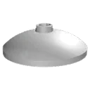

# Stop the Horsemen! - Quest 594

[Quest database](./README.md) | [Quest Guide](../Quest%20Guide.md) | [Methodology](./Methodology.md)

**Definition ID: 594** | Quest | Location / Forbidden Valley | Repeatable: False

**Official client name** from the client locale.xml (`Missions_594_name`, en&#95;US). The historical community association below agrees with this name.

## Description

Official client text from locale.xml (en&#95;US):

**Offer text:** To build is to battle! Take the Path of the Skeletal Steed to Cavalry Hill, then build Maelstrom Turrets to block the crypts!

**Accept reply:** Follow the Path of the Skeletal Steed to Cavalry Hill.

**In-progress text:** Smash the statues above the crypts on Cavalry Hill in Forbidden Valley, then rebuild them into turrets.

**Objectives-complete tip:** Return to Brickmaster Clang in Forbidden Valley.

**Turn-in text:** You are a worthy builder. Tell Master Fong I approve.

### Objectives

Client task text from locale.xml is shown where it exists; the indented line is the data-derived summary of the same MissionTasks row.

- Smash the statues above the crypt doors in Forbidden Valley and rebuild them into turrets.
    - Data summary: Complete 3 matching activity / Quick Build event(s): FV - Horsemen Blocker / FV-Stone Warrior pedistal.

## Start, turn-in, and locations

| Role | NPC / object | Mapped candidate zones | Association evidence |
| --- | --- | --- | --- |
| Defined offer object | [Brickmaster Clang - Paradox Ninja (LOT 7423)](sources/object-7423.md) | [Forbidden Valley (1400)](locations/zone-1400.md) | Missions.offer&#95;objectID |
| Defined turn-in object | [Brickmaster Clang - Paradox Ninja (LOT 7423)](sources/object-7423.md) | [Forbidden Valley (1400)](locations/zone-1400.md) | Missions.target&#95;objectID |
| Offers mission | [Brickmaster Clang - Paradox Ninja (LOT 7423)](sources/object-7423.md) | [Forbidden Valley (1400)](locations/zone-1400.md) | MissionNPCComponent 61 |
| Accepts turn-in | [Brickmaster Clang - Paradox Ninja (LOT 7423)](sources/object-7423.md) | [Forbidden Valley (1400)](locations/zone-1400.md) | MissionNPCComponent 61 |

Follow a named object for exact XYZ and scene/spawner conditions. Static placements do not prove that the NPC is currently spawned, offers this quest to your character, or is reachable in a deployed server.

## Requirements and quest chain

- Stored prerequisite expression: 496:2.
- Inspected server evaluation: [The Ninja Masters &#91;496&#93;](496.md) is in exact state 2.
- UIPrereqID: (not recorded); shown separately, not misread as a mission ID.
- Cooldown: not recorded (loader default -1); -1 means no cooldown in CanAccept.
- Stored feature gate / localization status: (none) / 2. The generic mission/task loaders mark gate_version unused; other scripts, map gates, and client checks can still restrict availability.
- Referenced prerequisite definitions: [The Ninja Masters &#91;496&#93;](496.md).

## Walkthrough / checklist

1. Satisfy the prerequisites and any client, map, or script conditions. Check the giver listed above; where none is resolved, the acceptance route remains unknown.
2. Accept the quest before relying on objective credit. Inventory gather tasks, existing flags, and racing parameter-4 tasks have limited acceptance catch-up; other earlier actions are not assumed to count.
3. Complete 3 matching activity / Quick Build event(s): FV - Horsemen Blocker / FV-Stone Warrior pedistal. See objective **1** below for target references and conditions.
4. After all objective counters are satisfied, complete the recorded turn-in interaction. If offered a reward choice, select the desired item rather than assuming all alternatives are granted.

**These numbered entries are a readable checklist, not evidence that the objective rows must be completed in this order.** Scripted phases, travel routes, puzzle interactions, and custom conditions are not reconstructed unless the data/source evidence supports them.

## Objective details

### Objective 1: Activity / Quick Build (UID 897)

**Client task text:** Smash the statues above the crypt doors in Forbidden Valley and rebuild them into turrets.

Complete 3 matching activity / Quick Build event(s): FV - Horsemen Blocker / FV-Stone Warrior pedistal.

Target namespace: **ACTIVITY&#95;OR&#95;EVENT&#95;ID**. Stored target value/threshold: **3**.

| Matching / associated object | Mapped zones | Item acquisition data |
| --- | --- | --- |
| [FV - Horsemen Blocker (LOT 8329)](sources/object-8329.md) | No matched local placement found | Not an item-template registration |
| [FV-Stone Warrior pedistal (LOT 8551)](sources/object-8551.md) | [Forbidden Valley (1400)](locations/zone-1400.md) | Not an item-template registration |

The listed objects are candidate activities joined through SCRIPTED_ACTIVITY (39) or RebuildComponent.activityID, not an assumption that the activity number is a LOT. Script-created activities can be missing.

| Raw task field | Value |
| --- | --- |
| taskType | 2 |
| target | 8329 |
| targetGroup |  |
| targetValue | 3 |
| taskParam1 |  |
| uid | 897 |
| gate_version |  |

## Rewards

The item slots below are listed completion rewards, not random loot-table rolls. Player eligibility and completion still apply.

| Item reward slot | Item | Granted quantity | Stored count / notes |
| --- | --- | --- | --- |
| First completion / 1 | { .lu-ti width="24" loading="lazy" } [White Conical Hat (LOT 2647)](../items/2647.md) | 1 | 1 |

| Reward | First completion / stored value | Repeat behavior |
| --- | --- | --- |
| Coins | 200 | Not advertised as repeatable |
| U-Score | 210 | Not advertised as repeatable |
| Reputation | 0 | Not advertised as repeatable |
| Maximum Life | No positive grant defined | First completion only |
| Maximum Imagination | No positive grant defined | First completion only |
| Item backpack slots | No positive grant defined | First completion only |
| Vault item AND vault model slots | No positive grant defined | First completion only |

Emote unlocks (first completion): none with positive IDs recorded.

At the configured level cap, U-Score can be converted into coins using server configuration. Stored base coins are not a quote for that conversion. Reputation and U-Score are processed before the repeat-reward branch; stat increases and emote unlocks are first-completion only.

## Historical community references

- [Stop the Horsemen!](https://legouniverse.fandom.com/wiki/Stop_the_Horsemen!?oldid=113562) — candidate title from Stop the Horsemen!. Matching evidence groups: **U-Score, coins, NPC, reward item**. Revision 113562; retrieved 2026-11-17T09:38:18.243Z.
  Reported factual methods: smash/defeat; location labels: not extracted; named objective references: Forbidden Valley; named reward references: White Conical Hat.

This page provides an original data-derived checklist, not copied wiki dialogue or a claim that the historical walkthrough exactly matches the deployed server.

## Evidence and limitations

[Missions](../../db/Missions.md), [MissionTasks](../../db/MissionTasks.md), [MissionNPCComponent](../../db/MissionNPCComponent.md), [MissionText](../../db/MissionText.md), [MissionEmail](../../db/MissionEmail.md). [Task interpretation and coverage](./Methodology.md). Availability, client presentation, puzzle phases, and custom script behavior can differ.
