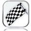

# Race Series 1 - Quest 668

<!-- media:start (generated by scripts/build_media.py) -->
{ .lu-icon width="128" loading="lazy" }
<!-- media:end -->

[Quest database](./README.md) | [Quest Guide](../Quest%20Guide.md) | [Methodology](./Methodology.md)

**Definition ID: 668** | Quest | Racing / Nimbus Station | Repeatable: False

**Official client name** from the client locale.xml (`Missions_668_name`, en&#95;US).

## Description

Official client text from locale.xml (en&#95;US):

**Offer text:** Ready for your first Race Series? Win 1 race each at Vertigo Loop and Keelhaul Canyon! Minimum of 3 players per race.

**Accept reply:** You've won races before, just do it again and you'll take the Series!

**In-progress text:** Win 1 race each at the Vertigo Loop and Keelhaul Canyon racetracks.

**Objectives-complete tip:** Return to Velocity Lane in Nimbus Station.

**Turn-in text:** Congratulations, champ! More challenges are coming down the track!

### Objectives

Client task text from locale.xml is shown where it exists; the indented line is the data-derived summary of the same MissionTasks row.

- Win 1 race each at the Vertigo Loop and Keelhaul Canyon racetracks.
    - Data summary: Win first place on both Nimbus Station (1203) and Gnarled Forest (1303). The server completes this task when both track bits are set (mask 3), despite stored targetValue 1.

## Start, turn-in, and locations

| Role | NPC / object | Mapped candidate zones | Association evidence |
| --- | --- | --- | --- |
| Defined offer object | [Velocity Lane - Racing Trainer (LOT 9821)](sources/object-9821.md) | [Nimbus Station (1200)](locations/zone-1200.md) | Missions.offer&#95;objectID |
| Defined turn-in object | [Velocity Lane - Racing Trainer (LOT 9821)](sources/object-9821.md) | [Nimbus Station (1200)](locations/zone-1200.md) | Missions.target&#95;objectID |
| Offers mission | [Velocity Lane - Racing Trainer (LOT 9821)](sources/object-9821.md) | [Nimbus Station (1200)](locations/zone-1200.md) | MissionNPCComponent 62 |
| Accepts turn-in | [Velocity Lane - Racing Trainer (LOT 9821)](sources/object-9821.md) | [Nimbus Station (1200)](locations/zone-1200.md) | MissionNPCComponent 62 |

Follow a named object for exact XYZ and scene/spawner conditions. Static placements do not prove that the NPC is currently spawned, offers this quest to your character, or is reachable in a deployed server.

## Requirements and quest chain

- Stored prerequisite expression: 637.
- Inspected server evaluation: [That Velocity Lass &#91;637&#93;](637.md) is complete.
- UIPrereqID: (not recorded); shown separately, not misread as a mission ID.
- Cooldown: not recorded (loader default -1); -1 means no cooldown in CanAccept.
- Stored feature gate / localization status: (none) / 2. The generic mission/task loaders mark gate_version unused; other scripts, map gates, and client checks can still restrict availability.
- Referenced prerequisite definitions: [That Velocity Lass &#91;637&#93;](637.md).

## Walkthrough / checklist

1. Satisfy the prerequisites and any client, map, or script conditions. Check the giver listed above; where none is resolved, the acceptance route remains unknown.
2. Accept the quest before relying on objective credit. Inventory gather tasks, existing flags, and racing parameter-4 tasks have limited acceptance catch-up; other earlier actions are not assumed to count.
3. Win first place on both Nimbus Station (1203) and Gnarled Forest (1303). The server completes this task when both track bits are set (mask 3), despite stored targetValue 1. See objective **1** below for target references and conditions.
4. After all objective counters are satisfied, complete the recorded turn-in interaction. If offered a reward choice, select the desired item rather than assuming all alternatives are granted.

**These numbered entries are a readable checklist, not evidence that the objective rows must be completed in this order.** Scripted phases, travel routes, puzzle interactions, and custom conditions are not reconstructed unless the data/source evidence supports them.

## Objective details

### Objective 1: Racing (UID 984)

**Client task text:** Win 1 race each at the Vertigo Loop and Keelhaul Canyon racetracks.

Win first place on both Nimbus Station (1203) and Gnarled Forest (1303). The server completes this task when both track bits are set (mask 3), despite stored targetValue 1.

Target namespace: **ZONE&#95;ID**. Stored target value/threshold: **1**.

Target worlds: [Vertigo Loop Racetrack (1203)](locations/zone-1203.md); [Keelhaul Canyon Racetrack (1303)](locations/zone-1303.md).

| Raw task field | Value |
| --- | --- |
| taskType | 23 |
| target | 0 |
| targetGroup | 1203,1303 |
| targetValue | 1 |
| taskParam1 | 15 |
| uid | 984 |
| gate_version |  |

## Rewards

The item slots below are listed completion rewards, not random loot-table rolls. Player eligibility and completion still apply.

| Item reward slot | Item | Granted quantity | Stored count / notes |
| --- | --- | --- | --- |
| First completion / 1 | [Very Large Bag of Faction Tokens (LOT 12424)](../items/12424.md) | 1 | 1 |

| Reward | First completion / stored value | Repeat behavior |
| --- | --- | --- |
| Coins | 0 | Not advertised as repeatable |
| U-Score | 45 | Not advertised as repeatable |
| Reputation | 0 | Not advertised as repeatable |
| Maximum Life | No positive grant defined | First completion only |
| Maximum Imagination | No positive grant defined | First completion only |
| Item backpack slots | No positive grant defined | First completion only |
| Vault item AND vault model slots | No positive grant defined | First completion only |

Emote unlocks (first completion): none with positive IDs recorded.

At the configured level cap, U-Score can be converted into coins using server configuration. Stored base coins are not a quote for that conversion. Reputation and U-Score are processed before the repeat-reward branch; stat increases and emote unlocks are first-completion only.

## Historical community references

No unique, sufficiently corroborated association was established in the researched community infoboxes. Similar names or matching numeric IDs were not treated as proof.

This page provides an original data-derived checklist, not copied wiki dialogue or a claim that the historical walkthrough exactly matches the deployed server.

## Evidence and limitations

[Missions](../../db/Missions.md), [MissionTasks](../../db/MissionTasks.md), [MissionNPCComponent](../../db/MissionNPCComponent.md), [MissionText](../../db/MissionText.md), [MissionEmail](../../db/MissionEmail.md). [Task interpretation and coverage](./Methodology.md). Availability, client presentation, puzzle phases, and custom script behavior can differ.
