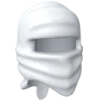
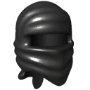

# Talk to Numb Chuck - Quest 689

[Quest database](./README.md) | [Quest Guide](../Quest%20Guide.md) | [Methodology](./Methodology.md)

**Definition ID: 689** | Quest | Location / Forbidden Valley | Repeatable: False

**Official client name** from the client locale.xml (`Missions_689_name`, en&#95;US).

## Description

Official client text from locale.xml (en&#95;US):

**Offer text:** You are now ready to speak to Numb Chuck, our most learned Ninja. He resides in the highest branches of our Tree.

**Accept reply:** Smash the anvil and make your way to Numb Chuck.

**In-progress text:** Use the Maelstrom Hammer to smash the anvil in the Great Tree. Then find a way to reach Numb Chuck.

**Objectives-complete tip:** Smash the anvil and find a way up to Numb Chuck.

**Turn-in text:** Is it just dumb luck that you have found Numb Chuck? Kii-yaa!!

### Objectives

Client task text from locale.xml is shown where it exists; the indented line is the data-derived summary of the same MissionTasks row.

- Talk to Numb Chuck in the Great Tree in Forbidden Valley.
    - Data summary: Talk to Numb Chuck - Paradox Agent; required progress 1.

## Start, turn-in, and locations

| Role | NPC / object | Mapped candidate zones | Association evidence |
| --- | --- | --- | --- |
| Defined offer object | [Master Fong Shader - Paradox Sensei (LOT 7414)](sources/object-7414.md) | [Forbidden Valley (1400)](locations/zone-1400.md) | Missions.offer&#95;objectID |
| Defined turn-in object | [Numb Chuck - Paradox Agent (LOT 7426)](sources/object-7426.md) | [Forbidden Valley (1400)](locations/zone-1400.md) | Missions.target&#95;objectID |
| Offers mission | [Master Fong Shader - Paradox Sensei (LOT 7414)](sources/object-7414.md) | [Forbidden Valley (1400)](locations/zone-1400.md) | MissionNPCComponent 53 |
| Accepts turn-in | [Numb Chuck - Paradox Agent (LOT 7426)](sources/object-7426.md) | [Forbidden Valley (1400)](locations/zone-1400.md) | MissionNPCComponent 58 |

Follow a named object for exact XYZ and scene/spawner conditions. Static placements do not prove that the NPC is currently spawned, offers this quest to your character, or is reachable in a deployed server.

## Requirements and quest chain

- Stored prerequisite expression: 496.
- Inspected server evaluation: [The Ninja Masters &#91;496&#93;](496.md) is complete.
- UIPrereqID: (not recorded); shown separately, not misread as a mission ID.
- Cooldown: not recorded (loader default -1); -1 means no cooldown in CanAccept.
- Stored feature gate / localization status: (none) / 2. The generic mission/task loaders mark gate_version unused; other scripts, map gates, and client checks can still restrict availability.
- Referenced prerequisite definitions: [The Ninja Masters &#91;496&#93;](496.md).
- Referenced as a prerequisite by: [Study the Maelstrom &#91;736&#93;](736.md). These are potential follow-ups, not a guarantee of an immediate offer.

## Walkthrough / checklist

1. Satisfy the prerequisites and any client, map, or script conditions. Check the giver listed above; where none is resolved, the acceptance route remains unknown.
2. Accept the quest before relying on objective credit. Inventory gather tasks, existing flags, and racing parameter-4 tasks have limited acceptance catch-up; other earlier actions are not assumed to count.
3. Talk to Numb Chuck - Paradox Agent; required progress 1. See objective **1** below for target references and conditions.
4. After all objective counters are satisfied, complete the recorded turn-in interaction. If offered a reward choice, select the desired item rather than assuming all alternatives are granted.

**These numbered entries are a readable checklist, not evidence that the objective rows must be completed in this order.** Scripted phases, travel routes, puzzle interactions, and custom conditions are not reconstructed unless the data/source evidence supports them.

## Objective details

### Objective 1: Talk to NPC (UID 1021)

**Client task text:** Talk to Numb Chuck in the Great Tree in Forbidden Valley.

Talk to Numb Chuck - Paradox Agent; required progress 1.

Target namespace: **LOT**. Stored target value/threshold: **1**.

| Matching / associated object | Mapped zones | Item acquisition data |
| --- | --- | --- |
| [Numb Chuck - Paradox Agent (LOT 7426)](sources/object-7426.md) | [Forbidden Valley (1400)](locations/zone-1400.md) | Not an item-template registration |

| Raw task field | Value |
| --- | --- |
| taskType | 4 |
| target | 7426 |
| targetGroup |  |
| targetValue | 1 |
| taskParam1 |  |
| uid | 1021 |
| gate_version |  |

## Rewards

**Choice reward:** listed item slots are alternatives when the normal mission-choice flow applies; do not assume that all are granted. A selected reward LOT filters item slots in the inspected handler.

| Item reward slot | Item | Granted quantity | Stored count / notes |
| --- | --- | --- | --- |
| First completion / 1 | { .lu-ti width="24" loading="lazy" } [Maelstrom-Infused White Ninja Hood (LOT 2641)](../items/2641.md) | 1 | 1 |
| First completion / 2 | { .lu-ti width="24" loading="lazy" } [Maelstrom-Infused Black Ninja Hood (LOT 2642)](../items/2642.md) | 1 | 1 |

| Reward | First completion / stored value | Repeat behavior |
| --- | --- | --- |
| Coins | 0 | Not advertised as repeatable |
| U-Score | 205 | Not advertised as repeatable |
| Reputation | 0 | Not advertised as repeatable |
| Maximum Life | No positive grant defined | First completion only |
| Maximum Imagination | No positive grant defined | First completion only |
| Item backpack slots | No positive grant defined | First completion only |
| Vault item AND vault model slots | No positive grant defined | First completion only |

Emote unlocks (first completion): none with positive IDs recorded.

At the configured level cap, U-Score can be converted into coins using server configuration. Stored base coins are not a quote for that conversion. Reputation and U-Score are processed before the repeat-reward branch; stat increases and emote unlocks are first-completion only.

## Historical community references

No unique, sufficiently corroborated association was established in the researched community infoboxes. Similar names or matching numeric IDs were not treated as proof.

This page provides an original data-derived checklist, not copied wiki dialogue or a claim that the historical walkthrough exactly matches the deployed server.

## Evidence and limitations

[Missions](../../db/Missions.md), [MissionTasks](../../db/MissionTasks.md), [MissionNPCComponent](../../db/MissionNPCComponent.md), [MissionText](../../db/MissionText.md), [MissionEmail](../../db/MissionEmail.md). [Task interpretation and coverage](./Methodology.md). Availability, client presentation, puzzle phases, and custom script behavior can differ.
