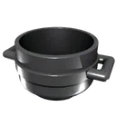

# Medic! 1 - Achievement 690

[Quest database](./README.md) | [Quest Guide](../Quest%20Guide.md) | [Methodology](./Methodology.md)

**Definition ID: 690** | Achievement | Battle / General | Repeatable: False

**Official client name** from the client locale.xml (`Missions_690_name`, en&#95;US). The historical community association below agrees with this name.

## Description

Official client text from locale.xml (en&#95;US):

**Description:** Collect 1000 Life power-ups.

**Objectives-complete tip:** Medic! 1

### Objectives

Client task text from locale.xml is shown where it exists; the indented line is the data-derived summary of the same MissionTasks row.

- Collect 1000 Life power-ups.
    - Data summary: Collect matching power-ups until progress reaches 1000; skill IDs 5, 902, 903, 904, 905. These are skill IDs, not pickup LOTs.

## Start, turn-in, and locations

This is an achievement: it is normally discovered/tracked by qualifying progress events once prerequisites permit it, not accepted from a quest giver. Any stored NPC associations below are data references, not an instruction to accept an achievement.

No quest-giver or turn-in association is recorded for this achievement.

Follow a named object for exact XYZ and scene/spawner conditions. Static placements do not prove that the NPC is currently spawned, offers this quest to your character, or is reachable in a deployed server.

## Requirements and quest chain

- Stored prerequisite expression: (empty).
- Inspected server evaluation: TRUE.
- UIPrereqID: (not recorded); shown separately, not misread as a mission ID.
- Cooldown: not recorded (loader default -1); -1 means no cooldown in CanAccept.
- Stored feature gate / localization status: (none) / 2. The generic mission/task loaders mark gate_version unused; other scripts, map gates, and client checks can still restrict availability.
- Referenced as a prerequisite by: [Medic! &#91;1735&#93;](1735.md). These are potential follow-ups, not a guarantee of an immediate offer.

## Walkthrough / checklist

1. Satisfy the achievement prerequisites. Produce a qualifying progress event so the server can discover/track the achievement; prior actions are not assumed to be retroactive for every task type.
2. Collect matching power-ups until progress reaches 1000; skill IDs 5, 902, 903, 904, 905. These are skill IDs, not pickup LOTs. See objective **1** below for target references and conditions.
3. When all objectives complete, the normal achievement path grants completion/rewards automatically; there is no generic NPC turn-in step.

**These numbered entries are a readable checklist, not evidence that the objective rows must be completed in this order.** Scripted phases, travel routes, puzzle interactions, and custom conditions are not reconstructed unless the data/source evidence supports them.

## Objective details

### Objective 1: Collect power-ups (UID 1022)

**Client task text:** Collect 1000 Life power-ups.

Collect matching power-ups until progress reaches 1000; skill IDs 5, 902, 903, 904, 905. These are skill IDs, not pickup LOTs.

Target namespace: **POWERUP&#95;SKILL&#95;ID**. Stored target value/threshold: **1000**.

| Matching / associated object | Mapped zones | Item acquisition data |
| --- | --- | --- |
| [Life Powerup 1 point (LOT 177)](sources/object-177.md) | No matched local placement found | Not an item-template registration |
| [Life Powerup 2 points (LOT 11915)](sources/object-11915.md) | No matched local placement found | Not an item-template registration |
| [Life Powerup 3 points (LOT 11916)](sources/object-11916.md) | No matched local placement found | Not an item-template registration |
| [Life Powerup 5 points (LOT 11917)](sources/object-11917.md) | No matched local placement found | Not an item-template registration |
| [Life Powerup 10 points (LOT 11920)](sources/object-11920.md) | No matched local placement found | Not an item-template registration |

Pickup candidates are joined through ObjectSkills and Objects.type=Powerup. The actual progress event carries the pickup skill ID.

| Raw task field | Value |
| --- | --- |
| taskType | 21 |
| target | 5 |
| targetGroup | 902,903,904,905 |
| targetValue | 1000 |
| taskParam1 |  |
| uid | 1022 |
| gate_version |  |

## Rewards

The item slots below are listed completion rewards, not random loot-table rolls. Player eligibility and completion still apply.

| Item reward slot | Item | Granted quantity | Stored count / notes |
| --- | --- | --- | --- |
| First completion / 1 | { .lu-ti width="24" loading="lazy" } [Cauldron of Life (LOT 7787)](../items/7787.md) | 1 | 1 |

| Reward | First completion / stored value | Repeat behavior |
| --- | --- | --- |
| Coins | 0 | Not advertised as repeatable |
| U-Score | 15 | Not advertised as repeatable |
| Reputation | 0 | Not advertised as repeatable |
| Maximum Life | No positive grant defined | First completion only |
| Maximum Imagination | No positive grant defined | First completion only |
| Item backpack slots | No positive grant defined | First completion only |
| Vault item AND vault model slots | No positive grant defined | First completion only |

Emote unlocks (first completion): none with positive IDs recorded.

At the configured level cap, U-Score can be converted into coins using server configuration. Stored base coins are not a quote for that conversion. Reputation and U-Score are processed before the repeat-reward branch; stat increases and emote unlocks are first-completion only.

### Completion mail / announcements

| Row | Type | Attachment definition | Meaning |
| --- | --- | --- | --- |
| 47 | 2 | None recorded | Chat achievement announcement; this branch does not send an attachment |

## Historical community references

- [Medic! 1](https://legouniverse.fandom.com/wiki/Medic!?oldid=159380) — candidate title from Medic!. Matching evidence groups: **U-Score, reward item, objective threshold**. Revision 159380; retrieved 2026-11-17T09:38:36.406Z.
  Reported factual methods: collect/gather; location labels: not extracted; named objective references: Life; named reward references: Cauldron of Life.

This page provides an original data-derived checklist, not copied wiki dialogue or a claim that the historical walkthrough exactly matches the deployed server.

## Evidence and limitations

[Missions](../../db/Missions.md), [MissionTasks](../../db/MissionTasks.md), [MissionNPCComponent](../../db/MissionNPCComponent.md), [MissionText](../../db/MissionText.md), [MissionEmail](../../db/MissionEmail.md). [Task interpretation and coverage](./Methodology.md). Availability, client presentation, puzzle phases, and custom script behavior can differ.
