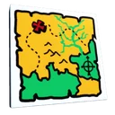

# Pajama Parrrty - Quest 742

[Quest database](./README.md) | [Quest Guide](../Quest%20Guide.md) | [Methodology](./Methodology.md)

**Definition ID: 742** | Quest | Location / Forbidden Valley | Repeatable: False

**Official client name** from the client locale.xml (`Missions_742_name`, en&#95;US).

## Description

Official client text from locale.xml (en&#95;US):

**Offer text:** I'm marooned in Ninja country and I can't get out! Find me a Ninja costume so I can get back to Gnarled Forest!

**Accept reply:** Hurry up, if them Ninjas catch me I'm done for!

**In-progress text:** Find some Pirate-Sized Ninja Clothes for Robbie Jibhanger in Forbidden Valley.

**Objectives-complete tip:** Return to Robbie Jibhanger in Forbidden Valley.

**Turn-in text:** Hope no one sees me in this, I'll be keelhauled for sure! But they'll keep me safe. Have some map, swabbie!

### Objectives

Client task text from locale.xml is shown where it exists; the indented line is the data-derived summary of the same MissionTasks row.

- Bring Pirate-Sized Ninja Clothes to Robbie Jibhanger in Forbidden Valley.
    - Data summary: Gather 1 item(s) from the allowed templates, sharing one counter: Pirate-Sized Ninja Clothes.

## Start, turn-in, and locations

| Role | NPC / object | Mapped candidate zones | Association evidence |
| --- | --- | --- | --- |
| Defined offer object | [Robbie Jibhanger - Pirate Spy (LOT 8659)](sources/object-8659.md) | [Forbidden Valley (1400)](locations/zone-1400.md) | Missions.offer&#95;objectID |
| Defined turn-in object | [Robbie Jibhanger - Pirate Spy (LOT 8659)](sources/object-8659.md) | [Forbidden Valley (1400)](locations/zone-1400.md) | Missions.target&#95;objectID |
| Offers mission | [Robbie Jibhanger - Pirate Spy (LOT 8659)](sources/object-8659.md) | [Forbidden Valley (1400)](locations/zone-1400.md) | MissionNPCComponent 69 |
| Accepts turn-in | [Robbie Jibhanger - Pirate Spy (LOT 8659)](sources/object-8659.md) | [Forbidden Valley (1400)](locations/zone-1400.md) | MissionNPCComponent 69 |

Follow a named object for exact XYZ and scene/spawner conditions. Static placements do not prove that the NPC is currently spawned, offers this quest to your character, or is reachable in a deployed server.

## Requirements and quest chain

- Stored prerequisite expression: 745:2.
- Inspected server evaluation: [X Marks the Spot &#91;745&#93;](745.md) is in exact state 2.
- UIPrereqID: (not recorded); shown separately, not misread as a mission ID.
- Cooldown: not recorded (loader default -1); -1 means no cooldown in CanAccept.
- Stored feature gate / localization status: (none) / 2. The generic mission/task loaders mark gate_version unused; other scripts, map gates, and client checks can still restrict availability.
- Referenced prerequisite definitions: [X Marks the Spot &#91;745&#93;](745.md).

## Walkthrough / checklist

1. Satisfy the prerequisites and any client, map, or script conditions. Check the giver listed above; where none is resolved, the acceptance route remains unknown.
2. Accept the quest before relying on objective credit. Inventory gather tasks, existing flags, and racing parameter-4 tasks have limited acceptance catch-up; other earlier actions are not assumed to count.
3. Gather 1 item(s) from the allowed templates, sharing one counter: Pirate-Sized Ninja Clothes. See objective **1** below for target references and conditions.
4. After all objective counters are satisfied, complete the recorded turn-in interaction. If offered a reward choice, select the desired item rather than assuming all alternatives are granted.

**These numbered entries are a readable checklist, not evidence that the objective rows must be completed in this order.** Scripted phases, travel routes, puzzle interactions, and custom conditions are not reconstructed unless the data/source evidence supports them.

## Objective details

### Objective 1: Gather items (UID 1087)

**Client task text:** Bring Pirate-Sized Ninja Clothes to Robbie Jibhanger in Forbidden Valley.

Gather 1 item(s) from the allowed templates, sharing one counter: Pirate-Sized Ninja Clothes.

Target namespace: **LOT**. Stored target value/threshold: **1**.

| Matching / associated object | Mapped zones | Item acquisition data |
| --- | --- | --- |
| [Pirate-Sized Ninja Clothes (LOT 8655)](sources/object-8655.md) | No matched local placement found | { .lu-ti width="24" loading="lazy" } [Pirate-Sized Ninja Clothes (LOT 8655)](../items/8655.md) |

- Gathered targets can be removed from item/quest inventory when rewards are granted.
- Losing required items can reduce progress and return a ready quest to active.

| Raw task field | Value |
| --- | --- |
| taskType | 11 |
| target | 8655 |
| targetGroup |  |
| targetValue | 1 |
| taskParam1 | 2 |
| uid | 1087 |
| gate_version |  |

## Rewards

The item slots below are listed completion rewards, not random loot-table rolls. Player eligibility and completion still apply.

| Item reward slot | Item | Granted quantity | Stored count / notes |
| --- | --- | --- | --- |
| First completion / 1 | { .lu-ti width="24" loading="lazy" } [Map Piece 3 (LOT 8654)](../items/8654.md) | 1 | 1 |

| Reward | First completion / stored value | Repeat behavior |
| --- | --- | --- |
| Coins | 0 | Not advertised as repeatable |
| U-Score | 205 | Not advertised as repeatable |
| Reputation | 0 | Not advertised as repeatable |
| Maximum Life | No positive grant defined | First completion only |
| Maximum Imagination | No positive grant defined | First completion only |
| Item backpack slots | No positive grant defined | First completion only |
| Vault item AND vault model slots | No positive grant defined | First completion only |

Emote unlocks (first completion): none with positive IDs recorded.

At the configured level cap, U-Score can be converted into coins using server configuration. Stored base coins are not a quote for that conversion. Reputation and U-Score are processed before the repeat-reward branch; stat increases and emote unlocks are first-completion only.

## Historical community references

No unique, sufficiently corroborated association was established in the researched community infoboxes. Similar names or matching numeric IDs were not treated as proof.

This page provides an original data-derived checklist, not copied wiki dialogue or a claim that the historical walkthrough exactly matches the deployed server.

## Evidence and limitations

[Missions](../../db/Missions.md), [MissionTasks](../../db/MissionTasks.md), [MissionNPCComponent](../../db/MissionNPCComponent.md), [MissionText](../../db/MissionText.md), [MissionEmail](../../db/MissionEmail.md). [Task interpretation and coverage](./Methodology.md). Availability, client presentation, puzzle phases, and custom script behavior can differ.
