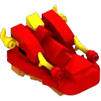

# Challenge of the Ronin - Quest 764

[Quest database](./README.md) | [Quest Guide](../Quest%20Guide.md) | [Methodology](./Methodology.md)

**Definition ID: 764** | Quest | Location / Forbidden Valley | Repeatable: False

**Official client name** from the client locale.xml (`Missions_764_name`, en&#95;US).

## Description

Official client text from locale.xml (en&#95;US):

**Offer text:** All those Dark Ronin make it really hard to get through here. Bet you can't smash 20 of the statues before the Ronin appear!

**Repeat offer text:** It's a bit safer here but there's still more statues to smash!

**Accept reply:** Remember, you gotta smash the statues before the Dark Ronin appear!

**In-progress text:** Smash 20 statues in Forbidden Valley before the Dark Ronin appear.

**Objectives-complete tip:** Return to Bill Shido by the Fallen Gate in Forbidden Valley.

**Turn-in text:** Whoa, you got 'em all! Man, you're fast. And powerful. In fact, I think I'm a little afraid of you now.

### Objectives

Client task text from locale.xml is shown where it exists; the indented line is the data-derived summary of the same MissionTasks row.

- Smash 20 statues in Forbidden Valley before the Dark Ronin appear.
    - Data summary: Smash matching targets until the combined counter reaches 20: FV-Stone Warrior Spawner 1.

## Start, turn-in, and locations

| Role | NPC / object | Mapped candidate zones | Association evidence |
| --- | --- | --- | --- |
| Defined offer object | [Bill Shido - Ninja Messenger (LOT 9457)](sources/object-9457.md) | [Forbidden Valley (1400)](locations/zone-1400.md) | Missions.offer&#95;objectID |
| Defined turn-in object | [Bill Shido - Ninja Messenger (LOT 9457)](sources/object-9457.md) | [Forbidden Valley (1400)](locations/zone-1400.md) | Missions.target&#95;objectID |
| Offers mission | [Bill Shido - Ninja Messenger (LOT 9457)](sources/object-9457.md) | [Forbidden Valley (1400)](locations/zone-1400.md) | MissionNPCComponent 70 |
| Accepts turn-in | [Bill Shido - Ninja Messenger (LOT 9457)](sources/object-9457.md) | [Forbidden Valley (1400)](locations/zone-1400.md) | MissionNPCComponent 70 |

Follow a named object for exact XYZ and scene/spawner conditions. Static placements do not prove that the NPC is currently spawned, offers this quest to your character, or is reachable in a deployed server.

## Requirements and quest chain

- Stored prerequisite expression: 763.
- Inspected server evaluation: [Vapor Where? &#91;763&#93;](763.md) is complete.
- UIPrereqID: (not recorded); shown separately, not misread as a mission ID.
- Cooldown: not recorded (loader default -1); -1 means no cooldown in CanAccept.
- Stored feature gate / localization status: (none) / 2. The generic mission/task loaders mark gate_version unused; other scripts, map gates, and client checks can still restrict availability.
- Referenced prerequisite definitions: [Vapor Where? &#91;763&#93;](763.md).

## Walkthrough / checklist

1. Satisfy the prerequisites and any client, map, or script conditions. Check the giver listed above; where none is resolved, the acceptance route remains unknown.
2. Accept the quest before relying on objective credit. Inventory gather tasks, existing flags, and racing parameter-4 tasks have limited acceptance catch-up; other earlier actions are not assumed to count.
3. Smash matching targets until the combined counter reaches 20: FV-Stone Warrior Spawner 1. See objective **1** below for target references and conditions.
4. After all objective counters are satisfied, complete the recorded turn-in interaction. If offered a reward choice, select the desired item rather than assuming all alternatives are granted.

**These numbered entries are a readable checklist, not evidence that the objective rows must be completed in this order.** Scripted phases, travel routes, puzzle interactions, and custom conditions are not reconstructed unless the data/source evidence supports them.

## Objective details

### Objective 1: Smash (UID 1111)

**Client task text:** Smash 20 statues in Forbidden Valley before the Dark Ronin appear.

Smash matching targets until the combined counter reaches 20: FV-Stone Warrior Spawner 1.

Target namespace: **LOT**. Stored target value/threshold: **20**.

| Matching / associated object | Mapped zones | Item acquisition data |
| --- | --- | --- |
| [FV-Stone Warrior Spawner 1 (LOT 8571)](sources/object-8571.md) | [Forbidden Valley (1400)](locations/zone-1400.md) | Not an item-template registration |

| Raw task field | Value |
| --- | --- |
| taskType | 0 |
| target | 8571 |
| targetGroup |  |
| targetValue | 20 |
| taskParam1 |  |
| uid | 1111 |
| gate_version |  |

## Rewards

The item slots below are listed completion rewards, not random loot-table rolls. Player eligibility and completion still apply.

| Item reward slot | Item | Granted quantity | Stored count / notes |
| --- | --- | --- | --- |
| First completion / 1 | { .lu-ti width="24" loading="lazy" } [Ninja Dragon Rocket Nose Cone (LOT 9746)](../items/9746.md) | 1 | 0; zero normalized to one by server |

| Reward | First completion / stored value | Repeat behavior |
| --- | --- | --- |
| Coins | 200 | Not advertised as repeatable |
| U-Score | 220 | Not advertised as repeatable |
| Reputation | 0 | Not advertised as repeatable |
| Maximum Life | No positive grant defined | First completion only |
| Maximum Imagination | No positive grant defined | First completion only |
| Item backpack slots | No positive grant defined | First completion only |
| Vault item AND vault model slots | No positive grant defined | First completion only |

Emote unlocks (first completion): none with positive IDs recorded.

At the configured level cap, U-Score can be converted into coins using server configuration. Stored base coins are not a quote for that conversion. Reputation and U-Score are processed before the repeat-reward branch; stat increases and emote unlocks are first-completion only.

## Historical community references

No unique, sufficiently corroborated association was established in the researched community infoboxes. Similar names or matching numeric IDs were not treated as proof.

This page provides an original data-derived checklist, not copied wiki dialogue or a claim that the historical walkthrough exactly matches the deployed server.

## Evidence and limitations

[Missions](../../db/Missions.md), [MissionTasks](../../db/MissionTasks.md), [MissionNPCComponent](../../db/MissionNPCComponent.md), [MissionText](../../db/MissionText.md), [MissionEmail](../../db/MissionEmail.md). [Task interpretation and coverage](./Methodology.md). Availability, client presentation, puzzle phases, and custom script behavior can differ.
