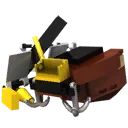
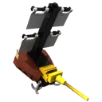
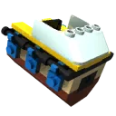
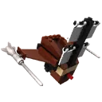

# Arrr is for Rocket! - Quest 770

[Quest database](./README.md) | [Quest Guide](../Quest%20Guide.md) | [Methodology](./Methodology.md)

**Definition ID: 770** | Quest | Location / Gnarled Forest | Repeatable: False

**Official client name** from the client locale.xml (`Missions_770_name`, en&#95;US).

## Description

Official client text from locale.xml (en&#95;US):

**Offer text:** Them slippery Ninjas stole the barrels that had our new rocket pieces! Can you steal ‘em back from Forbidden Valley?

**Accept reply:** Be careful when you go to Forbidden Valley, them Ninjas are everywhere!

**In-progress text:** Go to Forbidden Valley and find 3 missing barrels.

**Objectives-complete tip:** Head back to Gnarled Forest and talk to Betty Hatchesbatten.

**Turn-in text:** They were in rough shape but now they're good as new. Here, see what you can do with 'em!

### Objectives

Client task text from locale.xml is shown where it exists; the indented line is the data-derived summary of the same MissionTasks row.

- Find the barrel that has the Nose Cone rocket module.
    - Data summary: Gather 1 item(s) from the allowed templates, sharing one counter: Broken Pirate Rocket Nose Cone.
- Find the barrel that has the Cockpit rocket module.
    - Data summary: Gather 1 item(s) from the allowed templates, sharing one counter: Broken Pirate Rocket Cockpit.
- Find the barrel that has the Engine rocket module.
    - Data summary: Gather 1 item(s) from the allowed templates, sharing one counter: Broken Pirate Rocket Engine.

## Start, turn-in, and locations

| Role | NPC / object | Mapped candidate zones | Association evidence |
| --- | --- | --- | --- |
| Defined offer object | [Betty Hatchesbatten - Pirate Guard (LOT 1933)](sources/object-1933.md) | [Gnarled Forest Deep Dive Map (375)](locations/zone-375.md); [Gnarled Forest (1300)](locations/zone-1300.md) | Missions.offer&#95;objectID |
| Defined turn-in object | [Betty Hatchesbatten - Pirate Guard (LOT 1933)](sources/object-1933.md) | [Gnarled Forest Deep Dive Map (375)](locations/zone-375.md); [Gnarled Forest (1300)](locations/zone-1300.md) | Missions.target&#95;objectID |
| Offers mission | [Betty Hatchesbatten - Pirate Guard (LOT 1933)](sources/object-1933.md) | [Gnarled Forest Deep Dive Map (375)](locations/zone-375.md); [Gnarled Forest (1300)](locations/zone-1300.md) | MissionNPCComponent 71 |
| Accepts turn-in | [Betty Hatchesbatten - Pirate Guard (LOT 1933)](sources/object-1933.md) | [Gnarled Forest Deep Dive Map (375)](locations/zone-375.md); [Gnarled Forest (1300)](locations/zone-1300.md) | MissionNPCComponent 71 |

Follow a named object for exact XYZ and scene/spawner conditions. Static placements do not prove that the NPC is currently spawned, offers this quest to your character, or is reachable in a deployed server.

## Requirements and quest chain

- Stored prerequisite expression: 229.
- Inspected server evaluation: [Monarch of the Sea &#91;229&#93;](229.md) is complete.
- UIPrereqID: (not recorded); shown separately, not misread as a mission ID.
- Cooldown: not recorded (loader default -1); -1 means no cooldown in CanAccept.
- Stored feature gate / localization status: (none) / 2. The generic mission/task loaders mark gate_version unused; other scripts, map gates, and client checks can still restrict availability.
- Referenced prerequisite definitions: [Monarch of the Sea &#91;229&#93;](229.md).
- Referenced as a prerequisite by: [Chantey Shanty Visitor &#91;1197&#93;](1197.md). These are potential follow-ups, not a guarantee of an immediate offer.

## Walkthrough / checklist

1. Satisfy the prerequisites and any client, map, or script conditions. Check the giver listed above; where none is resolved, the acceptance route remains unknown.
2. Accept the quest before relying on objective credit. Inventory gather tasks, existing flags, and racing parameter-4 tasks have limited acceptance catch-up; other earlier actions are not assumed to count.
3. Gather 1 item(s) from the allowed templates, sharing one counter: Broken Pirate Rocket Nose Cone. See objective **1** below for target references and conditions.
4. Gather 1 item(s) from the allowed templates, sharing one counter: Broken Pirate Rocket Cockpit. See objective **2** below for target references and conditions.
5. Gather 1 item(s) from the allowed templates, sharing one counter: Broken Pirate Rocket Engine. See objective **3** below for target references and conditions.
6. After all objective counters are satisfied, complete the recorded turn-in interaction. If offered a reward choice, select the desired item rather than assuming all alternatives are granted.

**These numbered entries are a readable checklist, not evidence that the objective rows must be completed in this order.** Scripted phases, travel routes, puzzle interactions, and custom conditions are not reconstructed unless the data/source evidence supports them.

## Objective details

### Objective 1: Gather items (UID 1117)

**Client task text:** Find the barrel that has the Nose Cone rocket module.

Gather 1 item(s) from the allowed templates, sharing one counter: Broken Pirate Rocket Nose Cone.

Target namespace: **LOT**. Stored target value/threshold: **1**.

| Matching / associated object | Mapped zones | Item acquisition data |
| --- | --- | --- |
| [Broken Pirate Rocket Nose Cone (LOT 9640)](sources/object-9640.md) | No matched local placement found | { .lu-ti width="24" loading="lazy" } [Broken Pirate Rocket Nose Cone (LOT 9640)](../items/9640.md) |

- Gathered targets can be removed from item/quest inventory when rewards are granted.
- Losing required items can reduce progress and return a ready quest to active.

| Raw task field | Value |
| --- | --- |
| taskType | 11 |
| target | 9640 |
| targetGroup |  |
| targetValue | 1 |
| taskParam1 |  |
| uid | 1117 |
| gate_version |  |
### Objective 2: Gather items (UID 1147)

**Client task text:** Find the barrel that has the Cockpit rocket module.

Gather 1 item(s) from the allowed templates, sharing one counter: Broken Pirate Rocket Cockpit.

Target namespace: **LOT**. Stored target value/threshold: **1**.

| Matching / associated object | Mapped zones | Item acquisition data |
| --- | --- | --- |
| [Broken Pirate Rocket Cockpit (LOT 9641)](sources/object-9641.md) | No matched local placement found | { .lu-ti width="24" loading="lazy" } [Broken Pirate Rocket Cockpit (LOT 9641)](../items/9641.md) |

- Gathered targets can be removed from item/quest inventory when rewards are granted.
- Losing required items can reduce progress and return a ready quest to active.

| Raw task field | Value |
| --- | --- |
| taskType | 11 |
| target | 9641 |
| targetGroup |  |
| targetValue | 1 |
| taskParam1 |  |
| uid | 1147 |
| gate_version |  |
### Objective 3: Gather items (UID 1148)

**Client task text:** Find the barrel that has the Engine rocket module.

Gather 1 item(s) from the allowed templates, sharing one counter: Broken Pirate Rocket Engine.

Target namespace: **LOT**. Stored target value/threshold: **1**.

| Matching / associated object | Mapped zones | Item acquisition data |
| --- | --- | --- |
| [Broken Pirate Rocket Engine (LOT 9642)](sources/object-9642.md) | No matched local placement found | { .lu-ti width="24" loading="lazy" } [Broken Pirate Rocket Engine (LOT 9642)](../items/9642.md) |

- Gathered targets can be removed from item/quest inventory when rewards are granted.
- Losing required items can reduce progress and return a ready quest to active.

| Raw task field | Value |
| --- | --- |
| taskType | 11 |
| target | 9642 |
| targetGroup |  |
| targetValue | 1 |
| taskParam1 |  |
| uid | 1148 |
| gate_version |  |

## Rewards

The item slots below are listed completion rewards, not random loot-table rolls. Player eligibility and completion still apply.

| Item reward slot | Item | Granted quantity | Stored count / notes |
| --- | --- | --- | --- |
| First completion / 1 | { .lu-ti width="24" loading="lazy" } [Pirate Rocket Nose Cone (LOT 9295)](../items/9295.md) | 1 | 1 |
| First completion / 2 | { .lu-ti width="24" loading="lazy" } [Pirate Rocket Cockpit (LOT 9296)](../items/9296.md) | 1 | 1 |
| First completion / 3 | { .lu-ti width="24" loading="lazy" } [Pirate Rocket Engine (LOT 9297)](../items/9297.md) | 1 | 1 |

| Reward | First completion / stored value | Repeat behavior |
| --- | --- | --- |
| Coins | 150 | Not advertised as repeatable |
| U-Score | 105 | Not advertised as repeatable |
| Reputation | 0 | Not advertised as repeatable |
| Maximum Life | No positive grant defined | First completion only |
| Maximum Imagination | No positive grant defined | First completion only |
| Item backpack slots | No positive grant defined | First completion only |
| Vault item AND vault model slots | No positive grant defined | First completion only |

Emote unlocks (first completion): none with positive IDs recorded.

At the configured level cap, U-Score can be converted into coins using server configuration. Stored base coins are not a quote for that conversion. Reputation and U-Score are processed before the repeat-reward branch; stat increases and emote unlocks are first-completion only.

## Historical community references

No unique, sufficiently corroborated association was established in the researched community infoboxes. Similar names or matching numeric IDs were not treated as proof.

This page provides an original data-derived checklist, not copied wiki dialogue or a claim that the historical walkthrough exactly matches the deployed server.

## Evidence and limitations

[Missions](../../db/Missions.md), [MissionTasks](../../db/MissionTasks.md), [MissionNPCComponent](../../db/MissionNPCComponent.md), [MissionText](../../db/MissionText.md), [MissionEmail](../../db/MissionEmail.md). [Task interpretation and coverage](./Methodology.md). Availability, client presentation, puzzle phases, and custom script behavior can differ.
