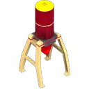

# A Worthy Builder 1 - Achievement 81

[Quest database](./README.md) | [Quest Guide](../Quest%20Guide.md) | [Methodology](./Methodology.md)

**Definition ID: 81** | Achievement | Build / No subtype | Repeatable: False

**Official client name** from the client locale.xml (`Missions_81_name`, en&#95;US). The historical community association below agrees with this name.

## Description

Official client text from locale.xml (en&#95;US):

**Description:** Complete any 10 Quick Builds.

**Objectives-complete tip:** A Worthy Builder 1!

### Objectives

Client task text from locale.xml is shown where it exists; the indented line is the data-derived summary of the same MissionTasks row.

- Complete any 10 Quick Builds.
    - Data summary: Complete 10 matching activity / Quick Build event(s): ? - Crate Solo / ? - Flower Solo / ? - Nimbus Coil Group Optional (3 parts) / 262 further allowed templates.

## Start, turn-in, and locations

This is an achievement: it is normally discovered/tracked by qualifying progress events once prerequisites permit it, not accepted from a quest giver. Any stored NPC associations below are data references, not an instruction to accept an achievement.

No quest-giver or turn-in association is recorded for this achievement.

Follow a named object for exact XYZ and scene/spawner conditions. Static placements do not prove that the NPC is currently spawned, offers this quest to your character, or is reachable in a deployed server.

## Requirements and quest chain

- Stored prerequisite expression: (empty).
- Inspected server evaluation: TRUE.
- UIPrereqID: (not recorded); shown separately, not misread as a mission ID.
- Cooldown: not recorded (loader default -1); -1 means no cooldown in CanAccept.
- Stored feature gate / localization status: (none) / 2. The generic mission/task loaders mark gate_version unused; other scripts, map gates, and client checks can still restrict availability.
- Referenced as a prerequisite by: [A Worthy Builder 2 &#91;82&#93;](82.md). These are potential follow-ups, not a guarantee of an immediate offer.

## Walkthrough / checklist

1. Satisfy the achievement prerequisites. Produce a qualifying progress event so the server can discover/track the achievement; prior actions are not assumed to be retroactive for every task type.
2. Complete 10 matching activity / Quick Build event(s): ? - Crate Solo / ? - Flower Solo / ? - Nimbus Coil Group Optional (3 parts) / 262 further allowed templates. See objective **1** below for target references and conditions.
3. When all objectives complete, the normal achievement path grants completion/rewards automatically; there is no generic NPC turn-in step.

**These numbered entries are a readable checklist, not evidence that the objective rows must be completed in this order.** Scripted phases, travel routes, puzzle interactions, and custom conditions are not reconstructed unless the data/source evidence supports them.

## Objective details

### Objective 1: Activity / Quick Build (UID 90)

**Client task text:** Complete any 10 Quick Builds.

Complete 10 matching activity / Quick Build event(s): ? - Crate Solo / ? - Flower Solo / ? - Nimbus Coil Group Optional (3 parts) / 262 further allowed templates.

Target namespace: **ACTIVITY&#95;OR&#95;EVENT&#95;ID**. Stored target value/threshold: **10**.

| Matching / associated object | Mapped zones | Item acquisition data |
| --- | --- | --- |
| [? - Crate Solo (LOT 1645)](sources/object-1645.md) | No matched local placement found | Not an item-template registration |
| [? - Flower Solo (LOT 1687)](sources/object-1687.md) | No matched local placement found | Not an item-template registration |
| [? - Nimbus Coil Group Optional (3 parts) (LOT 1709)](sources/object-1709.md) | No matched local placement found | Not an item-template registration |
| [? - Nimbus Coil Solo (LOT 1710)](sources/object-1710.md) | No matched local placement found | Not an item-template registration |
| [Moving Tesla Coil Solo (LOT 1798)](sources/object-1798.md) | No matched local placement found | Not an item-template registration |
| [GF - Gnarled Forest Outhouse Rebuild (LOT 1875)](sources/object-1875.md) | No matched local placement found | Not an item-template registration |
| [GF - Ninja Detector Rebuild (LOT 2218)](sources/object-2218.md) | No matched local placement found | Not an item-template registration |
| [ACTIVITY ONLY - Rebuild 20 (LOT 2350)](sources/object-2350.md) | No matched local placement found | Not an item-template registration |
| [ACTIVITY ONLY - Rebuild 21 (LOT 2354)](sources/object-2354.md) | No matched local placement found | Not an item-template registration |
| [FV - Ninja Rebuild Platform Whole (LOT 2441)](sources/object-2441.md) | No matched local placement found | Not an item-template registration |
| [1 Piece Outhouse Rebuild (LOT 2451)](sources/object-2451.md) | No matched local placement found | Not an item-template registration |
| [AG - Thinker Rebuild Whole (LOT 2492)](sources/object-2492.md) | No matched local placement found | Not an item-template registration |
| [AG - Burnos Hotdog Stand (LOT 2602)](sources/object-2602.md) | No matched local placement found | Not an item-template registration |
| [GF - Ninja Platform Small (LOT 2636)](sources/object-2636.md) | No matched local placement found | Not an item-template registration |
| [Contest - Stair Rebuild (LOT 2682)](sources/object-2682.md) | No matched local placement found | Not an item-template registration |
| [Team Nine Times Rebuild Platform (LOT 2692)](sources/object-2692.md) | No matched local placement found | Not an item-template registration |
| [Contest - Large Bridge Rebuild (LOT 2748)](sources/object-2748.md) | No matched local placement found | Not an item-template registration |
| [Contest - Small Bridge Rebuild (LOT 2754)](sources/object-2754.md) | No matched local placement found | Not an item-template registration |
| [Team Nine Times Rebuildable Cannon (LOT 2781)](sources/object-2781.md) | No matched local placement found | Not an item-template registration |
| [Contest - Bouncer Rebuild (LOT 2812)](sources/object-2812.md) | No matched local placement found | Not an item-template registration |
| [Pinball Rebuild - Whole (LOT 2869)](sources/object-2869.md) | No matched local placement found | Not an item-template registration |
| [Contest - mech Rebuild (LOT 2908)](sources/object-2908.md) | No matched local placement found | Not an item-template registration |
| [FV - Ninja Mech Rebuild 2 (LOT 3080)](sources/object-3080.md) | No matched local placement found | Not an item-template registration |
| [FV - Ninja Arch Small Rebuild (LOT 3114)](sources/object-3114.md) | No matched local placement found | Not an item-template registration |
| [ZP - PVP Bridge Rebuild (LOT 3340)](sources/object-3340.md) | No matched local placement found | Not an item-template registration |
| [ZP - Bubble Blower Rebuild (LOT 3348)](sources/object-3348.md) | No matched local placement found | Not an item-template registration |
| [ZP - Train Bridge Rebuild (LOT 3356)](sources/object-3356.md) | No matched local placement found | Not an item-template registration |
| [AG - Rotating Gear3 (LOT 3498)](sources/object-3498.md) | No matched local placement found | Not an item-template registration |
| [AG - Quickbuild Bouncer (LOT 3511)](sources/object-3511.md) | No matched local placement found | Not an item-template registration |
| [AG - Robotanist Quickbuild (LOT 4021)](sources/object-4021.md) | No matched local placement found | Not an item-template registration |
| [AG - Zorillo Mosaic Collection Build (LOT 4022)](sources/object-4022.md) | No matched local placement found | Not an item-template registration |
| [Classic Rocket Rebuild TEST (LOT 4736)](sources/object-4736.md) | No matched local placement found | Not an item-template registration |
| [Dot Wall 1 (LOT 4758)](sources/object-4758.md) | No matched local placement found | Not an item-template registration |
| [Dot Wall 2 (LOT 4759)](sources/object-4759.md) | No matched local placement found | Not an item-template registration |
| [QB system test (LOT 4771)](sources/object-4771.md) | No matched local placement found | Not an item-template registration |
| [Blue Bouncer (LOT 4810)](sources/object-4810.md) | No matched local placement found | Not an item-template registration |
| [Red Bouncer (LOT 4811)](sources/object-4811.md) | No matched local placement found | Not an item-template registration |
| [AG - Path - rebuild section 1 (LOT 4825)](sources/object-4825.md) | No matched local placement found | Not an item-template registration |
| [Test - Quickbuild Moving Platform (LOT 4871)](sources/object-4871.md) | No matched local placement found | Not an item-template registration |
| [AG - QB Robotanist (LOT 4928)](sources/object-4928.md) | No matched local placement found | Not an item-template registration |
| [AG - Air Bouncer QuickBuild (LOT 4929)](sources/object-4929.md) | No matched local placement found | Not an item-template registration |
| [AG - Monument Platform Quick Build (LOT 4955)](sources/object-4955.md) | [Avant Gardens (1100)](locations/zone-1100.md) | Not an item-template registration |
| [GC - Portal Rebuild (LOT 4984)](sources/object-4984.md) | No matched local placement found | Not an item-template registration |
| [Quick Build Cannon (LOT 5858)](sources/object-5858.md) | No matched local placement found | Not an item-template registration |
| [Quick Build Cannon Rapid Fire (LOT 5860)](sources/object-5860.md) | No matched local placement found | Not an item-template registration |
| [Quick Build Cannon Slow (LOT 5862)](sources/object-5862.md) | No matched local placement found | Not an item-template registration |
| [Bridge QB (LOT 5894)](sources/object-5894.md) | No matched local placement found | Not an item-template registration |
| [AG - Air Bouncer QuickBuild Blue (LOT 5904)](sources/object-5904.md) | [Avant Gardens (1100)](locations/zone-1100.md) | Not an item-template registration |
| [BTF AutoTurret (LOT 6089)](sources/object-6089.md) | No matched local placement found | Not an item-template registration |
| [AG - Air Bouncer QuickBuild Green (LOT 6206)](sources/object-6206.md) | [Avant Gardens (1100)](locations/zone-1100.md) | Not an item-template registration |
| [Quick Build Wall of Hate (LOT 6340)](sources/object-6340.md) | No matched local placement found | Not an item-template registration |
| [Deployable Sentinel Turret (LOT 6394)](sources/object-6394.md) | No matched local placement found | Not an item-template registration |
| [AG - Gap Platform (LOT 6447)](sources/object-6447.md) | [Avant Gardens (1100)](locations/zone-1100.md); [Crux Prime (1800)](locations/zone-1800.md) | Not an item-template registration |
| [QB Spider Wall (LOT 6483)](sources/object-6483.md) | No matched local placement found | Not an item-template registration |
| [Test Quickbuild (LOT 6543)](sources/object-6543.md) | No matched local placement found | Not an item-template registration |
| [Defender Bouncer QB (LOT 6569)](sources/object-6569.md) | No matched local placement found | Not an item-template registration |
| [Defender Wall QB (LOT 6570)](sources/object-6570.md) | No matched local placement found | Not an item-template registration |
| [Defender Capture-Object QB (LOT 6573)](sources/object-6573.md) | No matched local placement found | Not an item-template registration |
| [Attacker Bridge QB (LOT 6575)](sources/object-6575.md) | No matched local placement found | Not an item-template registration |
| [Mining Drill (LOT 6603)](sources/object-6603.md) | No matched local placement found | Not an item-template registration |
| [Spider Cave QB Teleporter Destination (LOT 7017)](sources/object-7017.md) | No matched local placement found | Not an item-template registration |
| [Spider Cave QB Exploding Barrel (LOT 7072)](sources/object-7072.md) | No matched local placement found | Not an item-template registration |
| [FV - Tree Platform Quick Build (LOT 9483)](sources/object-9483.md) | [Forbidden Valley (1400)](locations/zone-1400.md) | Not an item-template registration |
| [Pirate Raft QB Moving Platform (LOT 9907)](sources/object-9907.md) | No matched local placement found | Not an item-template registration |
| [Basic Platform Model (LOT 10385)](sources/object-10385.md) | No matched local placement found | { .lu-ti width="24" loading="lazy" } [Basic Platform Model (LOT 10385)](../items/10385.md) |
| [AG Property Pushback Platform 1 (LOT 10426)](sources/object-10426.md) | No matched local placement found | { .lu-ti width="24" loading="lazy" } [AG Property Pushback Platform 1 (LOT 10426)](../items/10426.md) |
| [AG Property Pushback Platform 2 (LOT 10445)](sources/object-10445.md) | No matched local placement found | { .lu-ti width="24" loading="lazy" } [AG Property Pushback Platform 2 (LOT 10445)](../items/10445.md) |
| [pink and purple moving platform (LOT 10703)](sources/object-10703.md) | [Avant Grove (1151)](locations/zone-1151.md); [Raven Bluff (1450)](locations/zone-1450.md); [Chantey Shanty (1350)](locations/zone-1350.md); [Nimbus Rock (1250)](locations/zone-1250.md); [Nimbus Isle (1251)](locations/zone-1251.md) | Not an item-template registration |
| [GF Property Pushback Model - Tombstone (LOT 11001)](sources/object-11001.md) | No matched local placement found | { .lu-ti width="24" loading="lazy" } [GF Property Pushback Model - Tombstone (LOT 11001)](../items/11001.md) |
| [NS Property Pushback Model - Rhino (LOT 11009)](sources/object-11009.md) | No matched local placement found | { .lu-ti width="24" loading="lazy" } [NS Property Pushback Model - Rhino (LOT 11009)](../items/11009.md) |
| [FV Property Pushback Model - Spike Platform (LOT 11011)](sources/object-11011.md) | No matched local placement found | { .lu-ti width="24" loading="lazy" } [FV Property Pushback Model - Spike Platform (LOT 11011)](../items/11011.md) |
| [AM - Center draw bridge (LOT 12047)](sources/object-12047.md) | [Crux Prime (1800)](locations/zone-1800.md) | Not an item-template registration |
| [NJ - Dragracer QB moving platform (LOT 13636)](sources/object-13636.md) | No matched local placement found | Not an item-template registration |
| [AG Mech Rebuild (LOT 14670)](sources/object-14670.md) | [Avant Gardens (1100)](locations/zone-1100.md) | Not an item-template registration |
| [ZP - Bubble Blower (LOT 3219)](sources/object-3219.md) | No matched local placement found | Not an item-template registration |
| [ZP - Park Bench 1 (LOT 3221)](sources/object-3221.md) | No matched local placement found | Not an item-template registration |
| [ZP - Park Bench 2 (LOT 3223)](sources/object-3223.md) | No matched local placement found | Not an item-template registration |
| [Broombot (LOT 3247)](sources/object-3247.md) | No matched local placement found | Not an item-template registration |
| [XXX - IvanTestQuickBuild (LOT 3377)](sources/object-3377.md) | No matched local placement found | Not an item-template registration |
| [AG - QuickBuild Statue (LOT 3419)](sources/object-3419.md) | No matched local placement found | Not an item-template registration |
| [ZP - Quickbuild AC (LOT 3523)](sources/object-3523.md) | No matched local placement found | Not an item-template registration |
| [TEST - Quickbuild requirements test (LOT 3552)](sources/object-3552.md) | No matched local placement found | Not an item-template registration |
| [ZP - Hazmat Van Rebuild (LOT 3717)](sources/object-3717.md) | No matched local placement found | Not an item-template registration |
| [ZP - fire hydrant quickbuild (LOT 3932)](sources/object-3932.md) | No matched local placement found | Not an item-template registration |
| [ZP - Carport Quickbuild (LOT 3935)](sources/object-3935.md) | [Nimbus Station (1200)](locations/zone-1200.md) | Not an item-template registration |
| [IMG Water Cooler (LOT 3946)](sources/object-3946.md) | No matched local placement found | Not an item-template registration |
| [LIFE BBQ Grill (LOT 3949)](sources/object-3949.md) | No matched local placement found | Not an item-template registration |
| [AG - Hotdog Stand Quickbuild (LOT 4046)](sources/object-4046.md) | No matched local placement found | Not an item-template registration |
| [AG - Transition QB (LOT 4640)](sources/object-4640.md) | No matched local placement found | Not an item-template registration |
| [AG - Test Cannon Rebuild (LOT 4647)](sources/object-4647.md) | No matched local placement found | Not an item-template registration |
| [Land Mine QB (LOT 6002)](sources/object-6002.md) | No matched local placement found | Not an item-template registration |
| [QB - Bear Trap (LOT 6445)](sources/object-6445.md) | No matched local placement found | Not an item-template registration |
| [GF - QB Non-Smash Wall (LOT 6878)](sources/object-6878.md) | [Crux Prime (1800)](locations/zone-1800.md) | Not an item-template registration |
| [GF - Arch Build (LOT 4833)](sources/object-4833.md) | No matched local placement found | Not an item-template registration |
| [Test - Quickbuild Bouncer (LOT 4838)](sources/object-4838.md) | No matched local placement found | Not an item-template registration |
| [Test - Quickbuild Springpad (LOT 4839)](sources/object-4839.md) | No matched local placement found | Not an item-template registration |
| [Test - Moving obstacle bouncer (LOT 4910)](sources/object-4910.md) | No matched local placement found | Not an item-template registration |
| [Test - Quickbuild Switch (LOT 4913)](sources/object-4913.md) | No matched local placement found | Not an item-template registration |
| [AG - Monument Platform QuickBuild (LOT 4931)](sources/object-4931.md) | No matched local placement found | Not an item-template registration |
| [GF - Cannon QB (LOT 5631)](sources/object-5631.md) | No matched local placement found | Not an item-template registration |
| [AG - Monument Equipment Activator ReBuild (LOT 5650)](sources/object-5650.md) | [Avant Gardens (1100)](locations/zone-1100.md) | Not an item-template registration |
| [AG - Monument Platform Blue QuickBuild (LOT 5903)](sources/object-5903.md) | [Avant Gardens (1100)](locations/zone-1100.md) | Not an item-template registration |
| [Test - Moving Platform Springpad (LOT 6341)](sources/object-6341.md) | No matched local placement found | Not an item-template registration |
| [PROTOTYPE - GF Small Tiki quickbuild (LOT 6343)](sources/object-6343.md) | No matched local placement found | Not an item-template registration |
| [PROTOTYPE - GF Med Tiki quickbuild (LOT 6344)](sources/object-6344.md) | No matched local placement found | Not an item-template registration |
| [PROTOTYPE - GF Large Tiki quickbuild (LOT 6345)](sources/object-6345.md) | No matched local placement found | Not an item-template registration |
| [GF - Choicebuild Small Tiki (LOT 6491)](sources/object-6491.md) | No matched local placement found | Not an item-template registration |
| [GF - Choicebuild Medium Tiki (LOT 6492)](sources/object-6492.md) | No matched local placement found | Not an item-template registration |
| [GF - Choicebuild Large Tiki (LOT 6493)](sources/object-6493.md) | No matched local placement found | Not an item-template registration |
| [Boulder Moving Platform QB (LOT 6514)](sources/object-6514.md) | No matched local placement found | Not an item-template registration |
| [Spider Cave Den QB Platform (LOT 6539)](sources/object-6539.md) | No matched local placement found | Not an item-template registration |
| [GF - QB Ravine Platform (LOT 6599)](sources/object-6599.md) | No matched local placement found | Not an item-template registration |
| [Pirate Siege QB Switch (LOT 6729)](sources/object-6729.md) | No matched local placement found | Not an item-template registration |
| [GF - Pirate Moving Platform (LOT 6819)](sources/object-6819.md) | [Gnarled Forest Deep Dive Map (375)](locations/zone-375.md); [Gnarled Forest (1300)](locations/zone-1300.md) | Not an item-template registration |
| [GF - Choicebuild Pillar 1 (LOT 7003)](sources/object-7003.md) | No matched local placement found | Not an item-template registration |
| [GF - Choicebuild Pillar 2 (LOT 7004)](sources/object-7004.md) | No matched local placement found | Not an item-template registration |
| [GF - Choicebuild Pillar 3 (LOT 7005)](sources/object-7005.md) | No matched local placement found | Not an item-template registration |
| [Gnarled Forest Bouncer Quickbuild (LOT 7157)](sources/object-7157.md) | [Gnarled Forest Deep Dive Map (375)](locations/zone-375.md); [Gnarled Forest (1300)](locations/zone-1300.md) | Not an item-template registration |
| [Bridge QB (LOT 8098)](sources/object-8098.md) | No matched local placement found | Not an item-template registration |
| [Gnarled Forest Cliff Bouncer Quickbuild (LOT 10010)](sources/object-10010.md) | [Gnarled Forest Deep Dive Map (375)](locations/zone-375.md); [Gnarled Forest (1300)](locations/zone-1300.md) | Not an item-template registration |
| [NS - Paradox  Control Panel (LOT 10055)](sources/object-10055.md) | [Nimbus Station (1200)](locations/zone-1200.md) | Not an item-template registration |
| [nextower&#95;sentPlatfom (LOT 12931)](sources/object-12931.md) | No matched local placement found | Not an item-template registration |
| [rebuild&#95;nt&#95;rebuildpipe (LOT 12932)](sources/object-12932.md) | No matched local placement found | Not an item-template registration |
| [NJ - Mod Platform 10x10 (LOT 13572)](sources/object-13572.md) | No matched local placement found | Not an item-template registration |
| [NJ - Mod Platform 20x20 (LOT 13573)](sources/object-13573.md) | No matched local placement found | Not an item-template registration |
| [NT - Assembly Hall Bouncer Quickbuild (LOT 14179)](sources/object-14179.md) | [Nexus Tower (1900)](locations/zone-1900.md) | Not an item-template registration |
| [GF - Ninja Mech Rebuild - Whole (LOT 2579)](sources/object-2579.md) | No matched local placement found | Not an item-template registration |
| [FV QB Bouncer from Smashable (LOT 7804)](sources/object-7804.md) | [Forbidden Valley (1400)](locations/zone-1400.md) | Not an item-template registration |
| [FV - QB Zen Bamboo (LOT 8207)](sources/object-8207.md) | No matched local placement found | Not an item-template registration |
| [PR - Bridge&#95;QB (LOT 3519)](sources/object-3519.md) | No matched local placement found | Not an item-template registration |
| [AG - Custombuild Scene Transition Rocket (LOT 4732)](sources/object-4732.md) | No matched local placement found | Not an item-template registration |
| [QB Custom test (LOT 4899)](sources/object-4899.md) | No matched local placement found | Not an item-template registration |
| [AG - Maelstrom Collector (LOT 6355)](sources/object-6355.md) | No matched local placement found | Not an item-template registration |
| [AG - PH Maelstrom Collector Machine (LOT 6689)](sources/object-6689.md) | No matched local placement found | Not an item-template registration |
| [Property Claim Marker (LOT 8302)](sources/object-8302.md) | No matched local placement found | [Property Claim Marker (LOT 8302)](../items/8302.md) |
| [NJ mon - QB skull counterweight (LOT 16141)](sources/object-16141.md) | [Battle Against Frakjaw! (2001)](locations/zone-2001.md); [Ninjago Monastery (2000)](locations/zone-2000.md) | Not an item-template registration |
| [Quick Build Wall (LOT 5863)](sources/object-5863.md) | No matched local placement found | Not an item-template registration |
| [Defender Land Mine QB (LOT 6572)](sources/object-6572.md) | [Forbidden Valley Siege (1401)](locations/zone-1401.md) | Not an item-template registration |
| [Siege-Bouncer QB (LOT 6574)](sources/object-6574.md) | [Forbidden Valley Siege (1401)](locations/zone-1401.md) | Not an item-template registration |
| [Siege-Gate QB (LOT 6737)](sources/object-6737.md) | [Forbidden Valley Siege (1401)](locations/zone-1401.md) | Not an item-template registration |
| [Siege-Attacker Ramp (LOT 6741)](sources/object-6741.md) | [Forbidden Valley Siege (1401)](locations/zone-1401.md) | Not an item-template registration |
| [Siege-Defender Brig (LOT 6744)](sources/object-6744.md) | [Forbidden Valley Siege (1401)](locations/zone-1401.md) | Not an item-template registration |
| [Siege-Bridge (LOT 6745)](sources/object-6745.md) | [Forbidden Valley Siege (1401)](locations/zone-1401.md) | Not an item-template registration |
| [New QB Land Mine (LOT 7226)](sources/object-7226.md) | No matched local placement found | Not an item-template registration |
| [Unnamed LOT 14202 (LOT 14202)](sources/object-14202.md) | No matched local placement found | Not an item-template registration |
| [Unnamed LOT 14206 (LOT 14206)](sources/object-14206.md) | No matched local placement found | Not an item-template registration |
| [Unnamed LOT 14207 (LOT 14207)](sources/object-14207.md) | No matched local placement found | Not an item-template registration |
| [Unnamed LOT 14208 (LOT 14208)](sources/object-14208.md) | No matched local placement found | Not an item-template registration |
| [Unnamed LOT 14209 (LOT 14209)](sources/object-14209.md) | No matched local placement found | Not an item-template registration |
| [Unnamed LOT 14210 (LOT 14210)](sources/object-14210.md) | No matched local placement found | Not an item-template registration |
| [Unnamed LOT 14211 (LOT 14211)](sources/object-14211.md) | No matched local placement found | Not an item-template registration |
| [Unnamed LOT 14212 (LOT 14212)](sources/object-14212.md) | No matched local placement found | Not an item-template registration |
| [Unnamed LOT 14213 (LOT 14213)](sources/object-14213.md) | No matched local placement found | Not an item-template registration |
| [GF- Quick Build X (LOT 7001)](sources/object-7001.md) | [Gnarled Forest Deep Dive Map (375)](locations/zone-375.md); [Gnarled Forest (1300)](locations/zone-1300.md) | Not an item-template registration |
| [AG - Quick Build X Pet Dig (LOT 9474)](sources/object-9474.md) | [Avant Gardens (1100)](locations/zone-1100.md) | Not an item-template registration |
| [AG - Choice Build Buff Station (LOT 6412)](sources/object-6412.md) | [Avant Gardens Survival (1101)](locations/zone-1101.md) | Not an item-template registration |
| [AG - Choice Build Shield Generator (LOT 6413)](sources/object-6413.md) | No matched local placement found | Not an item-template registration |
| [AG - Stone Wall Rebuild (LOT 5874)](sources/object-5874.md) | No matched local placement found | Not an item-template registration |
| [AG - Survival Rebuildable Wall (LOT 6352)](sources/object-6352.md) | No matched local placement found | Not an item-template registration |
| [Spider Cave Rock QB (LOT 6495)](sources/object-6495.md) | No matched local placement found | Not an item-template registration |
| [GF - QB Smash Wall (LOT 6715)](sources/object-6715.md) | [Gnarled Forest Deep Dive Map (375)](locations/zone-375.md); [Gnarled Forest (1300)](locations/zone-1300.md) | Not an item-template registration |
| [GF - Pirate QB Crows Nest (LOT 6714)](sources/object-6714.md) | [Forbidden Valley (1400)](locations/zone-1400.md); [Gnarled Forest Deep Dive Map (375)](locations/zone-375.md); [Gnarled Forest (1300)](locations/zone-1300.md) | Not an item-template registration |
| [NS - Guitar QB (LOT 4039)](sources/object-4039.md) | [Nimbus Station (1200)](locations/zone-1200.md) | Not an item-template registration |
| [NS - Bass Guitar QB (LOT 4040)](sources/object-4040.md) | [Nimbus Station (1200)](locations/zone-1200.md) | Not an item-template registration |
| [NS - Keyboard QB (LOT 4041)](sources/object-4041.md) | [Nimbus Station (1200)](locations/zone-1200.md) | Not an item-template registration |
| [NS - Drum QB (LOT 4042)](sources/object-4042.md) | [Nimbus Station (1200)](locations/zone-1200.md) | Not an item-template registration |
| [Portable Drumset (LOT 9264)](sources/object-9264.md) | No matched local placement found | Not an item-template registration |
| [GF - Pirate Arch QB (LOT 6917)](sources/object-6917.md) | [Gnarled Forest Deep Dive Map (375)](locations/zone-375.md); [Gnarled Forest (1300)](locations/zone-1300.md) | Not an item-template registration |
| [NS - PH Duck Quickbuild (LOT 6653)](sources/object-6653.md) | No matched local placement found | Not an item-template registration |
| [Spider Cave Auto Turret QB (LOT 6327)](sources/object-6327.md) | No matched local placement found | Not an item-template registration |
| [Spider Cave Spider Trap A (LOT 6516)](sources/object-6516.md) | No matched local placement found | Not an item-template registration |
| [Spider Cave Spider Trap B (LOT 6517)](sources/object-6517.md) | No matched local placement found | Not an item-template registration |
| [Spider Cave Rail QB (LOT 6527)](sources/object-6527.md) | No matched local placement found | Not an item-template registration |
| [Spider Cave Rail Turret QB (LOT 6528)](sources/object-6528.md) | No matched local placement found | Not an item-template registration |
| [Spider Cave Auto Turret QB 2 (LOT 6538)](sources/object-6538.md) | No matched local placement found | Not an item-template registration |
| [Defender Auto-Turret QB (LOT 6571)](sources/object-6571.md) | No matched local placement found | Not an item-template registration |
| [AG - Choicebuild Speaker (LOT 5845)](sources/object-5845.md) | [Nimbus Station (1200)](locations/zone-1200.md) | Not an item-template registration |
| [AG - Choicebuild Lasers (LOT 5846)](sources/object-5846.md) | [Nimbus Station (1200)](locations/zone-1200.md) | Not an item-template registration |
| [AG - Choicebuild Spotlight (LOT 5847)](sources/object-5847.md) | [Nimbus Station (1200)](locations/zone-1200.md) | Not an item-template registration |
| [AG - Choicebuild Fireworks (LOT 5848)](sources/object-5848.md) | [Nimbus Station (1200)](locations/zone-1200.md) | Not an item-template registration |
| [AG - Space Ship QuickBuild Bouncer (LOT 6316)](sources/object-6316.md) | [Return to the Venture Explorer (1001)](locations/zone-1001.md); [Venture Explorer (1000)](locations/zone-1000.md) | Not an item-template registration |
| [AM - Remote Detonator (LOT 12188)](sources/object-12188.md) | No matched local placement found | Not an item-template registration |
| [AM - Bouncer Sentinel Quickbuild (LOT 12271)](sources/object-12271.md) | [Crux Prime (1800)](locations/zone-1800.md) | Not an item-template registration |
| [AM - Sentinel QB moving platform (LOT 12273)](sources/object-12273.md) | No matched local placement found | Not an item-template registration |
| [AM - Sentinel QB  platform (LOT 12274)](sources/object-12274.md) | [Crux Prime (1800)](locations/zone-1800.md) | Not an item-template registration |
| [AM - Venture QB moving platform (LOT 12275)](sources/object-12275.md) | [Crux Prime (1800)](locations/zone-1800.md) | Not an item-template registration |
| [AM - Large Venture QB Platform (LOT 12278)](sources/object-12278.md) | No matched local placement found | Not an item-template registration |
| [AM - Large Sentinel QB  platform (LOT 12279)](sources/object-12279.md) | No matched local placement found | Not an item-template registration |
| [AM - smash build computer from dropship (LOT 12545)](sources/object-12545.md) | [Crux Prime (1800)](locations/zone-1800.md) | Not an item-template registration |
| [AM Skullkin QB Bouncer (LOT 13053)](sources/object-13053.md) | [Crux Prime (1800)](locations/zone-1800.md) | Not an item-template registration |
| [Unnamed LOT 13093 (LOT 13093)](sources/object-13093.md) | No matched local placement found | Not an item-template registration |
| [AM Dropship Turbine (LOT 13116)](sources/object-13116.md) | [Crux Prime (1800)](locations/zone-1800.md) | Not an item-template registration |
| [NT - Bouncer Sentinel Quickbuild (LOT 14175)](sources/object-14175.md) | [Nexus Tower (1900)](locations/zone-1900.md) | Not an item-template registration |
| [AM - Bouncer Venture Quickbuild (LOT 12272)](sources/object-12272.md) | [Crux Prime (1800)](locations/zone-1800.md) | Not an item-template registration |
| [Venture Crate Quickbuild (LOT 14034)](sources/object-14034.md) | [Nexus Tower (1900)](locations/zone-1900.md) | Not an item-template registration |
| [Doctor Overbuild's Property Device Quickbuild (LOT 14131)](sources/object-14131.md) | No matched local placement found | Not an item-template registration |
| [AG - Rebuild Finish Line (LOT 6097)](sources/object-6097.md) | [Avant Gardens (1100)](locations/zone-1100.md) | Not an item-template registration |
| [AG - Beacon Quickbuild (LOT 6209)](sources/object-6209.md) | [Avant Gardens (1100)](locations/zone-1100.md) | Not an item-template registration |
| [Spider Boss Rebuild dish (LOT 9501)](sources/object-9501.md) | No matched local placement found | Not an item-template registration |
| [Sentinel Turret (LOT 6254)](sources/object-6254.md) | No matched local placement found | Not an item-template registration |
| [AG - Rebuildable Wall (LOT 6319)](sources/object-6319.md) | [Avant Gardens (1100)](locations/zone-1100.md); [Crux Prime (1800)](locations/zone-1800.md) | Not an item-template registration |
| [SPIDER BOSS - Rebuildable (LOT 8619)](sources/object-8619.md) | No matched local placement found | Not an item-template registration |
| [Farm Silo Model 1 (LOT 10369)](sources/object-10369.md) | No matched local placement found | { .lu-ti width="24" loading="lazy" } [Farm Silo Model 1 (LOT 10369)](../items/10369.md) |
| [NS - Imagination Fountain (LOT 6648)](sources/object-6648.md) | No matched local placement found | Not an item-template registration |
| [GF - Siren (LOT 6685)](sources/object-6685.md) | [Gnarled Forest Deep Dive Map (375)](locations/zone-375.md); [Gnarled Forest (1300)](locations/zone-1300.md) | Not an item-template registration |
| [GF - Headless Siren (LOT 6686)](sources/object-6686.md) | [Gnarled Forest Deep Dive Map (375)](locations/zone-375.md); [Gnarled Forest (1300)](locations/zone-1300.md) | Not an item-template registration |
| [GF - Rebuildable Jail Wall (LOT 7100)](sources/object-7100.md) | [Gnarled Forest Deep Dive Map (375)](locations/zone-375.md); [Gnarled Forest (1300)](locations/zone-1300.md) | Not an item-template registration |
| [NS -Statue QB (LOT 7796)](sources/object-7796.md) | [Nimbus Station (1200)](locations/zone-1200.md) | Not an item-template registration |
| [FV - Horsemen Blocker (LOT 8329)](sources/object-8329.md) | No matched local placement found | Not an item-template registration |
| [FV-Stone Warrior pedistal (LOT 8551)](sources/object-8551.md) | [Forbidden Valley (1400)](locations/zone-1400.md) | Not an item-template registration |
| [VE Instance - Ship Turret (LOT 8432)](sources/object-8432.md) | No matched local placement found | Not an item-template registration |
| [AG Survival Choice Build Turret (LOT 8568)](sources/object-8568.md) | No matched local placement found | Not an item-template registration |
| [Engineer Turret Rank 1 (LOT 9303)](sources/object-9303.md) | No matched local placement found | Not an item-template registration |
| [Engineer Turret Rank 2 (LOT 9304)](sources/object-9304.md) | No matched local placement found | Not an item-template registration |
| [Engineer Turret Rank 3 (LOT 9305)](sources/object-9305.md) | No matched local placement found | Not an item-template registration |
| [Engineer Rank 1 Generator (LOT 9520)](sources/object-9520.md) | No matched local placement found | Not an item-template registration |
| [Engineer Rank 2 Generator (LOT 9521)](sources/object-9521.md) | No matched local placement found | Not an item-template registration |
| [Engineer Rank 3 Generator (LOT 9522)](sources/object-9522.md) | No matched local placement found | Not an item-template registration |
| [&#91;DNL&#93; Valiant Cleaner (LOT 12618)](sources/object-12618.md) | No matched local placement found | Not an item-template registration |
| [Paradox Pipe Fix (LOT 9645)](sources/object-9645.md) | [Forbidden Valley (1400)](locations/zone-1400.md) | Not an item-template registration |
| [FV Quick Build Rock (LOT 9691)](sources/object-9691.md) | [Forbidden Valley (1400)](locations/zone-1400.md) | Not an item-template registration |
| [FV - Quick Build Red Crate (LOT 9738)](sources/object-9738.md) | No matched local placement found | Not an item-template registration |
| [FV Quick Build Pipes (LOT 10039)](sources/object-10039.md) | [Forbidden Valley (1400)](locations/zone-1400.md) | Not an item-template registration |
| [AM - Skeleton Growlspeaker (LOT 12174)](sources/object-12174.md) | [Crux Prime (1800)](locations/zone-1800.md) | Not an item-template registration |
| [AM - rebuilt computer from dropship (LOT 12177)](sources/object-12177.md) | [Crux Prime (1800)](locations/zone-1800.md) | Not an item-template registration |
| [AM - Venture QB  platform (LOT 12276)](sources/object-12276.md) | [Crux Prime (1800)](locations/zone-1800.md) | Not an item-template registration |
| [AM - Shield Generator QB (LOT 12287)](sources/object-12287.md) | [Crux Prime (1800)](locations/zone-1800.md) | Not an item-template registration |
| [AM - Permanent sheild generator (LOT 13170)](sources/object-13170.md) | [Crux Prime (1800)](locations/zone-1800.md) | Not an item-template registration |
| [Winter Snowman QB (LOT 12301)](sources/object-12301.md) | No matched local placement found | Not an item-template registration |
| [NT - Imagination Collector1 (LOT 12408)](sources/object-12408.md) | [Nexus Tower (1900)](locations/zone-1900.md) | Not an item-template registration |
| [NT - Imagination Collector2 (LOT 12409)](sources/object-12409.md) | No matched local placement found | Not an item-template registration |
| [NT - Imagination Collector3 (LOT 12410)](sources/object-12410.md) | No matched local placement found | Not an item-template registration |
| [NT - Pipe Rebuild1 (LOT 12411)](sources/object-12411.md) | [Nexus Tower (1900)](locations/zone-1900.md) | Not an item-template registration |
| [NT - Pipe Rebuild2 (LOT 12412)](sources/object-12412.md) | No matched local placement found | Not an item-template registration |
| [NT - Pipe Rebuild3 (LOT 12413)](sources/object-12413.md) | No matched local placement found | Not an item-template registration |
| [NT - Pipe Rebuild4 (LOT 12414)](sources/object-12414.md) | No matched local placement found | Not an item-template registration |
| [NT - Pipe Rebuild5 (LOT 12415)](sources/object-12415.md) | No matched local placement found | Not an item-template registration |
| [NT - Pipe Rebuild6 (LOT 12416)](sources/object-12416.md) | [Nexus Tower (1900)](locations/zone-1900.md) | Not an item-template registration |
| [NT - Sentinel Crate Rebuildable (LOT 13070)](sources/object-13070.md) | [Nexus Tower (1900)](locations/zone-1900.md) | Not an item-template registration |
| [AM - Sentinel Turret (LOT 13171)](sources/object-13171.md) | No matched local placement found | Not an item-template registration |
| [Altar of Imagination (LOT 14396)](sources/object-14396.md) | [Ninjago Monastery (2000)](locations/zone-2000.md) | Not an item-template registration |
| [nj mon - qb dragon in a box (LOT 16043)](sources/object-16043.md) | [Ninjago Monastery (2000)](locations/zone-2000.md) | Not an item-template registration |
| [nj mon - qb catapult pad (LOT 16107)](sources/object-16107.md) | [Ninjago Monastery (2000)](locations/zone-2000.md) | Not an item-template registration |
| [PR - QB Birdhouse (LOT 7616)](sources/object-7616.md) | [Pet Cove (1201)](locations/zone-1201.md) | Not an item-template registration |
| [PR - QB Bridge (LOT 7617)](sources/object-7617.md) | [Pet Cove (1201)](locations/zone-1201.md) | Not an item-template registration |
| [NJ QB Archery Target (LOT 14427)](sources/object-14427.md) | [Ninjago Monastery (2000)](locations/zone-2000.md) | Not an item-template registration |
| [NJ - Skulken Bouncer QB (LOT 14423)](sources/object-14423.md) | [Ninjago Monastery (2000)](locations/zone-2000.md) | Not an item-template registration |
| [NJ QB Ornate Dragon Statue Earth (LOT 14411)](sources/object-14411.md) | No matched local placement found | Not an item-template registration |
| [NJ QB Ornate Dragon Statue Fire (LOT 14413)](sources/object-14413.md) | No matched local placement found | Not an item-template registration |
| [NJ QB Ornate Dragon Statue Ice (LOT 14414)](sources/object-14414.md) | No matched local placement found | Not an item-template registration |
| [NJ QB Ornate Dragon Statue Lightning (LOT 14415)](sources/object-14415.md) | No matched local placement found | Not an item-template registration |
| [NJ QB Generic Smashable 2 (LOT 14420)](sources/object-14420.md) | No matched local placement found | Not an item-template registration |
| [NJ - Ninjago Bouncer QB (LOT 14424)](sources/object-14424.md) | [Ninjago Monastery (2000)](locations/zone-2000.md) | Not an item-template registration |
| [NJ - QB Railpost Large Earth (LOT 14425)](sources/object-14425.md) | [Ninjago Monastery (2000)](locations/zone-2000.md) | Not an item-template registration |
| [NJ - QB Railpost Large Fire (LOT 14435)](sources/object-14435.md) | [Battle Against Frakjaw! (2001)](locations/zone-2001.md); [Ninjago Monastery (2000)](locations/zone-2000.md) | Not an item-template registration |
| [NJ - QB Railpost Large Ice (LOT 14436)](sources/object-14436.md) | [Ninjago Monastery (2000)](locations/zone-2000.md) | Not an item-template registration |
| [NJ - QB Railpost Large Lightning (LOT 14437)](sources/object-14437.md) | [Ninjago Monastery (2000)](locations/zone-2000.md) | Not an item-template registration |
| [NJ - QB Railpost Small Earth (LOT 14438)](sources/object-14438.md) | No matched local placement found | Not an item-template registration |
| [NJ - QB Railpost Small Fire (LOT 14439)](sources/object-14439.md) | No matched local placement found | Not an item-template registration |
| [NJ - QB Railpost Small Ice (LOT 14440)](sources/object-14440.md) | [Ninjago Monastery (2000)](locations/zone-2000.md) | Not an item-template registration |
| [NJ - QB Railpost Small Lightning (LOT 14441)](sources/object-14441.md) | No matched local placement found | Not an item-template registration |
| [NJ - QB Ninjago Platform 10 x 10 Moving (LOT 14533)](sources/object-14533.md) | No matched local placement found | Not an item-template registration |
| [NJ - QB Ninjago Platform 20 x 40 (LOT 14534)](sources/object-14534.md) | [Ninjago Monastery (2000)](locations/zone-2000.md) | Not an item-template registration |
| [NJ - QB Ninjago Platform 10 x 10 (LOT 14537)](sources/object-14537.md) | [Ninjago Monastery (2000)](locations/zone-2000.md) | Not an item-template registration |
| [Unnamed LOT 16717 (LOT 16717)](sources/object-16717.md) | No matched local placement found | Not an item-template registration |

The listed objects are candidate activities joined through SCRIPTED_ACTIVITY (39) or RebuildComponent.activityID, not an assumption that the activity number is a LOT. Script-created activities can be missing.

| Raw task field | Value |
| --- | --- |
| taskType | 2 |
| target | 6 |
| targetGroup | 7,8,9,10,11,12,13,15,17,19,20,21,23,25,26,27,28,29,30,31,36,45,106,107,110,111,112,113,114,123,124,125,6097,6209,6254,6319,6447,6648,6685,6686,7100,7796,8329,8432,8568,9303,9645,9691,10039,12047,12174,12177,12271,12272,12274,12276,12287,12301,12408,12409,12410,12411,12412,12413,12414,12415,12416,12545,13053,13070,13116,13171,14044,14670,14396,14425,14435,14436,14437,14440,14534,14537,16043,16107,7616,7617,14427,14424,14423,118 |
| targetValue | 10 |
| taskParam1 |  |
| uid | 90 |
| gate_version |  |

## Rewards

The item slots below are listed completion rewards, not random loot-table rolls. Player eligibility and completion still apply.

| Item reward slot | Item | Granted quantity | Stored count / notes |
| --- | --- | --- | --- |
| First completion / 1 | { .lu-ti width="24" loading="lazy" } [Basic Tree Model Pack (LOT 9775)](../items/9775.md) | 1 | 1 |

| Reward | First completion / stored value | Repeat behavior |
| --- | --- | --- |
| Coins | 0 | Not advertised as repeatable |
| U-Score | 40 | Not advertised as repeatable |
| Reputation | (not recorded) | Not advertised as repeatable |
| Maximum Life | No positive grant defined | First completion only |
| Maximum Imagination | No positive grant defined | First completion only |
| Item backpack slots | No positive grant defined | First completion only |
| Vault item AND vault model slots | No positive grant defined | First completion only |

Emote unlocks (first completion): none with positive IDs recorded.

At the configured level cap, U-Score can be converted into coins using server configuration. Stored base coins are not a quote for that conversion. Reputation and U-Score are processed before the repeat-reward branch; stat increases and emote unlocks are first-completion only.

## Historical community references

- [A Worthy Builder 1](https://legouniverse.fandom.com/wiki/A_Worthy_Builder?oldid=157723) — candidate title from A Worthy Builder. Matching evidence groups: **U-Score, reward item, objective kind, objective threshold**. Revision 157723; retrieved 2026-11-17T09:38:30.182Z.
  Reported factual methods: build, complete objectives; location labels: not extracted; named objective references: none extracted; named reward references: Basic Tree Model Pack.

This page provides an original data-derived checklist, not copied wiki dialogue or a claim that the historical walkthrough exactly matches the deployed server.

## Evidence and limitations

[Missions](../../db/Missions.md), [MissionTasks](../../db/MissionTasks.md), [MissionNPCComponent](../../db/MissionNPCComponent.md), [MissionText](../../db/MissionText.md), [MissionEmail](../../db/MissionEmail.md). [Task interpretation and coverage](./Methodology.md). Availability, client presentation, puzzle phases, and custom script behavior can differ.
