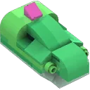

# Crazy Snails - Quest 945

[Quest database](./README.md) | [Quest Guide](../Quest%20Guide.md) | [Methodology](./Methodology.md)

**Definition ID: 945** | Quest | LUPs / No subtype | Repeatable: False

**Official client name** from the client locale.xml (`Missions_945_name`, en&#95;US). The historical community association below agrees with this name.

## Description

Official client text from locale.xml (en&#95;US):

**Offer text:** Find the slugs who think they are snails. Smash 5 fake shells and return to me for more mission instructions.

**Accept reply:** Thanks for your help.

**In-progress text:** It's great that you're helping us. There are still more shells to smash. Look high and low. They are sneaky and shy.

**Objectives-complete tip:** Return to Draggle in Portabello.

**Turn-in text:** Thank you for helping us this far. Here is your reward. Find my brother Baggle for the next part of this quest.

### Objectives

Client task text from locale.xml is shown where it exists; the indented line is the data-derived summary of the same MissionTasks row.

- Smash Slug houses.
    - Data summary: Smash matching targets until the combined counter reaches 5: WBL - Smash&#95;mini&#95;villa / WBL - Smash&#95;small&#95;house / WBL - Smash-house.

## Start, turn-in, and locations

| Role | NPC / object | Mapped candidate zones | Association evidence |
| --- | --- | --- | --- |
| Defined offer object | [Draggle (LOT 10984)](sources/object-10984.md) | [Portabello (1604)](locations/zone-1604.md) | Missions.offer&#95;objectID |
| Defined turn-in object | [Draggle (LOT 10984)](sources/object-10984.md) | [Portabello (1604)](locations/zone-1604.md) | Missions.target&#95;objectID |
| Offers mission | [Draggle (LOT 10984)](sources/object-10984.md) | [Portabello (1604)](locations/zone-1604.md) | MissionNPCComponent 98 |
| Accepts turn-in | [Draggle (LOT 10984)](sources/object-10984.md) | [Portabello (1604)](locations/zone-1604.md) | MissionNPCComponent 98 |

Follow a named object for exact XYZ and scene/spawner conditions. Static placements do not prove that the NPC is currently spawned, offers this quest to your character, or is reachable in a deployed server.

## Requirements and quest chain

- Stored prerequisite expression: (empty).
- Inspected server evaluation: TRUE.
- UIPrereqID: (not recorded); shown separately, not misread as a mission ID.
- Cooldown: not recorded (loader default -1); -1 means no cooldown in CanAccept.
- Stored feature gate / localization status: (none) / 2. The generic mission/task loaders mark gate_version unused; other scripts, map gates, and client checks can still restrict availability.
- Referenced as a prerequisite by: [Hidden Flies &#91;946&#93;](946.md). These are potential follow-ups, not a guarantee of an immediate offer.

## Walkthrough / checklist

1. Satisfy the prerequisites and any client, map, or script conditions. Check the giver listed above; where none is resolved, the acceptance route remains unknown.
2. Accept the quest before relying on objective credit. Inventory gather tasks, existing flags, and racing parameter-4 tasks have limited acceptance catch-up; other earlier actions are not assumed to count.
3. Smash matching targets until the combined counter reaches 5: WBL - Smash&#95;mini&#95;villa / WBL - Smash&#95;small&#95;house / WBL - Smash-house. See objective **1** below for target references and conditions.
4. After all objective counters are satisfied, complete the recorded turn-in interaction. If offered a reward choice, select the desired item rather than assuming all alternatives are granted.

**These numbered entries are a readable checklist, not evidence that the objective rows must be completed in this order.** Scripted phases, travel routes, puzzle interactions, and custom conditions are not reconstructed unless the data/source evidence supports them.

## Objective details

### Objective 1: Smash (UID 1367)

**Client task text:** Smash Slug houses.

Smash matching targets until the combined counter reaches 5: WBL - Smash&#95;mini&#95;villa / WBL - Smash&#95;small&#95;house / WBL - Smash-house.

Target namespace: **LOT**. Stored target value/threshold: **5**.

| Matching / associated object | Mapped zones | Item acquisition data |
| --- | --- | --- |
| [WBL - Smash&#95;mini&#95;villa (LOT 10724)](sources/object-10724.md) | [Portabello (1604)](locations/zone-1604.md) | Not an item-template registration |
| [WBL - Smash&#95;small&#95;house (LOT 10725)](sources/object-10725.md) | [Portabello (1604)](locations/zone-1604.md) | Not an item-template registration |
| [WBL - Smash-house (LOT 10727)](sources/object-10727.md) | [Portabello (1604)](locations/zone-1604.md) | Not an item-template registration |

| Raw task field | Value |
| --- | --- |
| taskType | 0 |
| target | 10724 |
| targetGroup | 10725,10727 |
| targetValue | 5 |
| taskParam1 |  |
| uid | 1367 |
| gate_version |  |

## Rewards

The item slots below are listed completion rewards, not random loot-table rolls. Player eligibility and completion still apply.

| Item reward slot | Item | Granted quantity | Stored count / notes |
| --- | --- | --- | --- |
| First completion / 1 | { .lu-ti width="24" loading="lazy" } [Jadeoria Rocket Nose Cone (LOT 11192)](../items/11192.md) | 1 | 1 |

| Reward | First completion / stored value | Repeat behavior |
| --- | --- | --- |
| Coins | 0 | Not advertised as repeatable |
| U-Score | 40 | Not advertised as repeatable |
| Reputation | 0 | Not advertised as repeatable |
| Maximum Life | No positive grant defined | First completion only |
| Maximum Imagination | No positive grant defined | First completion only |
| Item backpack slots | No positive grant defined | First completion only |
| Vault item AND vault model slots | No positive grant defined | First completion only |

Emote unlocks (first completion): none with positive IDs recorded.

At the configured level cap, U-Score can be converted into coins using server configuration. Stored base coins are not a quote for that conversion. Reputation and U-Score are processed before the repeat-reward branch; stat increases and emote unlocks are first-completion only.

## Historical community references

- [Crazy Snails](https://legouniverse.fandom.com/wiki/Crazy_Snails?oldid=113614) — candidate title from Crazy Snails. Matching evidence groups: **U-Score, NPC, objective kind**. Revision 113614; retrieved 2026-11-17T09:38:19.812Z.
  Reported factual methods: smash/defeat; location labels: not extracted; named objective references: none extracted; named reward references: none extracted.

This page provides an original data-derived checklist, not copied wiki dialogue or a claim that the historical walkthrough exactly matches the deployed server.

## Evidence and limitations

[Missions](../../db/Missions.md), [MissionTasks](../../db/MissionTasks.md), [MissionNPCComponent](../../db/MissionNPCComponent.md), [MissionText](../../db/MissionText.md), [MissionEmail](../../db/MissionEmail.md). [Task interpretation and coverage](./Methodology.md). Availability, client presentation, puzzle phases, and custom script behavior can differ.
