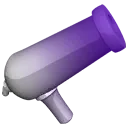

# Off the Hooks - Quest 980

[Quest database](./README.md) | [Quest Guide](../Quest%20Guide.md) | [Methodology](./Methodology.md)

**Definition ID: 980** | Quest | Location / Crux Prime | Repeatable: False

**Official client name** from the client locale.xml (`Missions_980_name`, en&#95;US). The historical community association below agrees with this name.

## Description

Official client text from locale.xml (en&#95;US):

**Offer text:** Since you're armed and all, how 'bout a favor? I got attacked by some Stromling Admirals and I'd like a little payback!

**Accept reply:** There should still be plenty of those Admirals wandering around. Teach 'em a lesson!

**In-progress text:** Smash 15 Stromling Admirals on Crux Prime.

**Objectives-complete tip:** The Stromling Admirals have had enough. Return to Sherland Powers on Crux Prime.

**Turn-in text:** Wham! Pow! Blammo! Good thing those monsters didn't get a taste of my right hook!

### Objectives

Client task text from locale.xml is shown where it exists; the indented line is the data-derived summary of the same MissionTasks row.

- Smash 15 Stromling Admirals on Crux Prime.
    - Data summary: Smash matching targets until the combined counter reaches 15: Stromling Admiral Invader / Admiral Flogmore - Stromling Admiral Invader.

## Start, turn-in, and locations

| Role | NPC / object | Mapped candidate zones | Association evidence |
| --- | --- | --- | --- |
| Defined offer object | [Sherland Powers - Nexus Force Pilot (LOT 11997)](sources/object-11997.md) | [Crux Prime (1800)](locations/zone-1800.md) | Missions.offer&#95;objectID |
| Defined turn-in object | [Sherland Powers - Nexus Force Pilot (LOT 11997)](sources/object-11997.md) | [Crux Prime (1800)](locations/zone-1800.md) | Missions.target&#95;objectID |
| Offers mission | [Sherland Powers - Nexus Force Pilot (LOT 11997)](sources/object-11997.md) | [Crux Prime (1800)](locations/zone-1800.md) | MissionNPCComponent 107 |
| Accepts turn-in | [Sherland Powers - Nexus Force Pilot (LOT 11997)](sources/object-11997.md) | [Crux Prime (1800)](locations/zone-1800.md) | MissionNPCComponent 107 |

Follow a named object for exact XYZ and scene/spawner conditions. Static placements do not prove that the NPC is currently spawned, offers this quest to your character, or is reachable in a deployed server.

## Requirements and quest chain

- Stored prerequisite expression: 979.
- Inspected server evaluation: [Black Box &#91;979&#93;](979.md) is complete.
- UIPrereqID: (not recorded); shown separately, not misread as a mission ID.
- Cooldown: not recorded (loader default -1); -1 means no cooldown in CanAccept.
- Stored feature gate / localization status: auramar / 2. The generic mission/task loaders mark gate_version unused; other scripts, map gates, and client checks can still restrict availability.
- Referenced prerequisite definitions: [Black Box &#91;979&#93;](979.md).
- Referenced as a prerequisite by: [Bomb Squad &#91;1275&#93;](1275.md). These are potential follow-ups, not a guarantee of an immediate offer.

## Walkthrough / checklist

1. Satisfy the prerequisites and any client, map, or script conditions. Check the giver listed above; where none is resolved, the acceptance route remains unknown.
2. Accept the quest before relying on objective credit. Inventory gather tasks, existing flags, and racing parameter-4 tasks have limited acceptance catch-up; other earlier actions are not assumed to count.
3. Smash matching targets until the combined counter reaches 15: Stromling Admiral Invader / Admiral Flogmore - Stromling Admiral Invader. See objective **1** below for target references and conditions.
4. After all objective counters are satisfied, complete the recorded turn-in interaction. If offered a reward choice, select the desired item rather than assuming all alternatives are granted.

**These numbered entries are a readable checklist, not evidence that the objective rows must be completed in this order.** Scripted phases, travel routes, puzzle interactions, and custom conditions are not reconstructed unless the data/source evidence supports them.

## Objective details

### Objective 1: Smash (UID 1416)

**Client task text:** Smash 15 Stromling Admirals on Crux Prime.

Smash matching targets until the combined counter reaches 15: Stromling Admiral Invader / Admiral Flogmore - Stromling Admiral Invader.

Target namespace: **LOT**. Stored target value/threshold: **15**.

| Matching / associated object | Mapped zones | Item acquisition data |
| --- | --- | --- |
| [Stromling Admiral Invader (LOT 11216)](sources/object-11216.md) | [Crux Prime (1800)](locations/zone-1800.md) | Not an item-template registration |
| [Admiral Flogmore - Stromling Admiral Invader (LOT 11986)](sources/object-11986.md) | No matched local placement found | Not an item-template registration |

- Stored task gate: auramar (not enforced by the inspected generic task loader)

| Raw task field | Value |
| --- | --- |
| taskType | 0 |
| target | 11216 |
| targetGroup | 11986 |
| targetValue | 15 |
| taskParam1 |  |
| uid | 1416 |
| gate_version | auramar |

## Rewards

The item slots below are listed completion rewards, not random loot-table rolls. Player eligibility and completion still apply.

| Item reward slot | Item | Granted quantity | Stored count / notes |
| --- | --- | --- | --- |
| First completion / 1 | { .lu-ti width="24" loading="lazy" } [Pocket Cannon (LOT 12554)](../items/12554.md) | 5 | 5 |

| Reward | First completion / stored value | Repeat behavior |
| --- | --- | --- |
| Coins | 0 | Not advertised as repeatable |
| U-Score | 320 | Not advertised as repeatable |
| Reputation | 0 | Not advertised as repeatable |
| Maximum Life | No positive grant defined | First completion only |
| Maximum Imagination | No positive grant defined | First completion only |
| Item backpack slots | No positive grant defined | First completion only |
| Vault item AND vault model slots | No positive grant defined | First completion only |

Emote unlocks (first completion): none with positive IDs recorded.

At the configured level cap, U-Score can be converted into coins using server configuration. Stored base coins are not a quote for that conversion. Reputation and U-Score are processed before the repeat-reward branch; stat increases and emote unlocks are first-completion only.

## Historical community references

- [Off the Hooks](https://legouniverse.fandom.com/wiki/Off_the_Hooks?oldid=128836) — candidate title from Off the Hooks. Matching evidence groups: **U-Score, NPC, reward item, objective kind, objective threshold**. Revision 128836; retrieved 2026-11-17T09:38:21.338Z.
  Reported factual methods: smash/defeat; location labels: not extracted; named objective references: none extracted; named reward references: Pocket Cannon.

This page provides an original data-derived checklist, not copied wiki dialogue or a claim that the historical walkthrough exactly matches the deployed server.

## Evidence and limitations

[Missions](../../db/Missions.md), [MissionTasks](../../db/MissionTasks.md), [MissionNPCComponent](../../db/MissionNPCComponent.md), [MissionText](../../db/MissionText.md), [MissionEmail](../../db/MissionEmail.md). [Task interpretation and coverage](./Methodology.md). Availability, client presentation, puzzle phases, and custom script behavior can differ.
