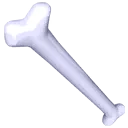

# Bone Deep - Quest 993

[Quest database](./README.md) | [Quest Guide](../Quest%20Guide.md) | [Methodology](./Methodology.md)

**Definition ID: 993** | Quest | Location / Nimbus Station | Repeatable: False

**Official client name** from the client locale.xml (`Missions_993_name`, en&#95;US). The historical community association below agrees with this name.

## Description

Official client text from locale.xml (en&#95;US):

**Offer text:** I hear there are strange bones buried on Crux Prime. Use your new Skeleton Dragon pet to dig them up. Then bring them back to me!

**Accept reply:** Search Crux Prime for Bone Digs, then use your Skeleton Pet to dig them up!

**In-progress text:** Use the Skeleton Dragon Pet to dig up 10 Bone Digs on Crux Prime, then take the bones back to Mardolf.

**Objectives-complete tip:** You've found enough bones. Now return to Mardolf the Orange in Nimbus Station.

**Turn-in text:** These aren't just bones you've found! We can use them to build something strange and ingenious!

### Objectives

Client task text from locale.xml is shown where it exists; the indented line is the data-derived summary of the same MissionTasks row.

- Use the Skeleton Dragon Pet to dig up 10 Bone Digs on Crux Prime.
    - Data summary: Gather 10 item(s) from the allowed templates, sharing one counter: Skeleton Bone.

## Start, turn-in, and locations

| Role | NPC / object | Mapped candidate zones | Association evidence |
| --- | --- | --- | --- |
| Defined offer object | [Mardolf the Orange - Assembly Wizard (LOT 6635)](sources/object-6635.md) | [Nimbus Station (1200)](locations/zone-1200.md) | Missions.offer&#95;objectID |
| Defined turn-in object | [Mardolf the Orange - Assembly Wizard (LOT 6635)](sources/object-6635.md) | [Nimbus Station (1200)](locations/zone-1200.md) | Missions.target&#95;objectID |
| Offers mission | [Mardolf the Orange - Assembly Wizard (LOT 6635)](sources/object-6635.md) | [Nimbus Station (1200)](locations/zone-1200.md) | MissionNPCComponent 17 |
| Accepts turn-in | [Mardolf the Orange - Assembly Wizard (LOT 6635)](sources/object-6635.md) | [Nimbus Station (1200)](locations/zone-1200.md) | MissionNPCComponent 17 |

Follow a named object for exact XYZ and scene/spawner conditions. Static placements do not prove that the NPC is currently spawned, offers this quest to your character, or is reachable in a deployed server.

## Requirements and quest chain

- Stored prerequisite expression: 994.
- Inspected server evaluation: [Mardolf Knows &#91;994&#93;](994.md) is complete.
- UIPrereqID: (not recorded); shown separately, not misread as a mission ID.
- Cooldown: not recorded (loader default -1); -1 means no cooldown in CanAccept.
- Stored feature gate / localization status: auramar / 2. The generic mission/task loaders mark gate_version unused; other scripts, map gates, and client checks can still restrict availability.
- Referenced prerequisite definitions: [Mardolf Knows &#91;994&#93;](994.md).
- Referenced as a prerequisite by: [The Bone Builder &#91;1300&#93;](1300.md). These are potential follow-ups, not a guarantee of an immediate offer.

## Walkthrough / checklist

1. Satisfy the prerequisites and any client, map, or script conditions. Check the giver listed above; where none is resolved, the acceptance route remains unknown.
2. Accept the quest before relying on objective credit. Inventory gather tasks, existing flags, and racing parameter-4 tasks have limited acceptance catch-up; other earlier actions are not assumed to count.
3. Gather 10 item(s) from the allowed templates, sharing one counter: Skeleton Bone. See objective **1** below for target references and conditions.
4. After all objective counters are satisfied, complete the recorded turn-in interaction. If offered a reward choice, select the desired item rather than assuming all alternatives are granted.

**These numbered entries are a readable checklist, not evidence that the objective rows must be completed in this order.** Scripted phases, travel routes, puzzle interactions, and custom conditions are not reconstructed unless the data/source evidence supports them.

## Objective details

### Objective 1: Gather items (UID 1428)

**Client task text:** Use the Skeleton Dragon Pet to dig up 10 Bone Digs on Crux Prime.

Gather 10 item(s) from the allowed templates, sharing one counter: Skeleton Bone.

Target namespace: **LOT**. Stored target value/threshold: **10**.

| Matching / associated object | Mapped zones | Item acquisition data |
| --- | --- | --- |
| [Skeleton Bone (LOT 12322)](sources/object-12322.md) | No matched local placement found | { .lu-ti width="24" loading="lazy" } [Skeleton Bone (LOT 12322)](../items/12322.md) |

- Stored task gate: auramar (not enforced by the inspected generic task loader)
- Gathered targets can be removed from item/quest inventory when rewards are granted.
- Losing required items can reduce progress and return a ready quest to active.

| Raw task field | Value |
| --- | --- |
| taskType | 11 |
| target | 12322 |
| targetGroup |  |
| targetValue | 10 |
| taskParam1 |  |
| uid | 1428 |
| gate_version | auramar |

## Rewards

**Choice reward:** listed item slots are alternatives when the normal mission-choice flow applies; do not assume that all are granted. A selected reward LOT filters item slots in the inspected handler.

| Item reward slot | Item | Granted quantity | Stored count / notes |
| --- | --- | --- | --- |
| First completion / 1 | { .lu-ti width="24" loading="lazy" } [Skeleton Rocket Nose Cone Package (LOT 12889)](../items/12889.md) | 1 | 1 |
| First completion / 2 | { .lu-ti width="24" loading="lazy" } [Skeleton Rocket Cockpit Package (LOT 12890)](../items/12890.md) | 1 | 1 |
| First completion / 3 | { .lu-ti width="24" loading="lazy" } [Skeleton Rocket Engine Package (LOT 12891)](../items/12891.md) | 1 | 1 |
| First completion / 4 | { .lu-ti width="24" loading="lazy" } [Fright Speed Car Part Pack (LOT 13073)](../items/13073.md) | 1 | 1 |

| Reward | First completion / stored value | Repeat behavior |
| --- | --- | --- |
| Coins | 0 | Not advertised as repeatable |
| U-Score | 305 | Not advertised as repeatable |
| Reputation | 0 | Not advertised as repeatable |
| Maximum Life | No positive grant defined | First completion only |
| Maximum Imagination | No positive grant defined | First completion only |
| Item backpack slots | No positive grant defined | First completion only |
| Vault item AND vault model slots | No positive grant defined | First completion only |

Emote unlocks (first completion): none with positive IDs recorded.

At the configured level cap, U-Score can be converted into coins using server configuration. Stored base coins are not a quote for that conversion. Reputation and U-Score are processed before the repeat-reward branch; stat increases and emote unlocks are first-completion only.

## Historical community references

- [Bone Deep](https://legouniverse.fandom.com/wiki/Bone_Deep?oldid=140586) — candidate title from Bone Deep. Matching evidence groups: **U-Score, NPC, objective threshold**. Revision 140586; retrieved 2026-11-17T09:38:20.821Z.
  Reported factual methods: not categorized; location labels: not extracted; named objective references: Skeleton Dragon; named reward references: none extracted.

This page provides an original data-derived checklist, not copied wiki dialogue or a claim that the historical walkthrough exactly matches the deployed server.

## Evidence and limitations

[Missions](../../db/Missions.md), [MissionTasks](../../db/MissionTasks.md), [MissionNPCComponent](../../db/MissionNPCComponent.md), [MissionText](../../db/MissionText.md), [MissionEmail](../../db/MissionEmail.md). [Task interpretation and coverage](./Methodology.md). Availability, client presentation, puzzle phases, and custom script behavior can differ.
