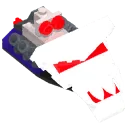

# Starskull Rocket Nose Cone - quest/objective source LOT 12848

<!-- media:start (generated by scripts/build_media.py) -->
{ .lu-icon width="128" loading="lazy" }
<!-- media:end -->

[Quest database](../README.md) | [Methodology](../Methodology.md)

Associated quest/achievement definitions: [Scrubby Bubbles &#91;1665&#93;](../1665.md).

Item acquisition: [Starskull Rocket Nose Cone (LOT 12848)](../../items/12848.md).

## Candidate placements / spawner waypoints

Coordinates are static map XYZ, not confirmed live NPC positions. Multiple scene objects and waypoints may refer to a shared spawn mechanism; counts are not population estimates. Feature gates and disabled auto-spawning are retained, and client-only objects are excluded.

No placement was found in successfully parsed maps with an exact ZoneTable asset-path match. Scripted, missing, or unused content remains possible.
