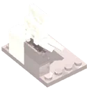

# NT&#95;Assembly Pet Console - quest/objective source LOT 13879

<!-- media:start (generated by scripts/build_media.py) -->
{ .lu-icon .lu-on-dark width="128" loading="lazy" }
<!-- media:end -->

[Quest database](../README.md) | [Methodology](../Methodology.md)

## Candidate placements / spawner waypoints

Coordinates are static map XYZ, not confirmed live NPC positions. Multiple scene objects and waypoints may refer to a shared spawn mechanism; counts are not population estimates. Feature gates and disabled auto-spawning are retained, and client-only objects are excluded.

| Zone | X | Y | Z | Origin | Conditions |
| --- | --- | --- | --- | --- | --- |
| [Nexus Tower (1900)](../locations/zone-1900.md) | -108.314 | 1218.24 | 86.436 | Scene nd&#95;nexus&#95;tower&#95;26&#95;subscene&#95;26.lvl (Subscene 26), layer 0 | Scene precondition: 37 ; 175 &#124;179 |
