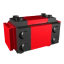

# GF - Red Crate - quest/objective source LOT 2305

<!-- media:start (generated by scripts/build_media.py) -->
{ .lu-icon width="128" loading="lazy" }
<!-- media:end -->

[Quest database](../README.md) | [Methodology](../Methodology.md)

## Candidate placements / spawner waypoints

Coordinates are static map XYZ, not confirmed live NPC positions. Multiple scene objects and waypoints may refer to a shared spawn mechanism; counts are not population estimates. Feature gates and disabled auto-spawning are retained, and client-only objects are excluded.

| Zone | X | Y | Z | Origin | Conditions |
| --- | --- | --- | --- | --- | --- |
| [Avant Gardens (1100)](../locations/zone-1100.md) | 515.089 | 399.107 | 378.562 | Spawner path: RedCrate | Automatic spawning disabled; trigger/script may be required |
