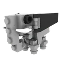

# Elephant Pet - quest/objective source LOT 3050

<!-- media:start (generated by scripts/build_media.py) -->
{ .lu-icon width="128" loading="lazy" }
<!-- media:end -->

[Quest database](../README.md) | [Methodology](../Methodology.md)

Item acquisition: [Elephant Pet (LOT 3050)](../../items/3050.md).

## Candidate placements / spawner waypoints

Coordinates are static map XYZ, not confirmed live NPC positions. Multiple scene objects and waypoints may refer to a shared spawn mechanism; counts are not population estimates. Feature gates and disabled auto-spawning are retained, and client-only objects are excluded.

| Zone | X | Y | Z | Origin | Conditions |
| --- | --- | --- | --- | --- | --- |
| [Gnarled Forest Deep Dive Map (375)](../locations/zone-375.md) | -303.409 | 301.814 | 346.983 | Scene nd&#95;gnarled&#95;forest&#95;7&#95;junction.lvl (Junction), layer 0; LOT 176 spawner | Scene precondition: 48; Automatic spawning disabled; trigger/script may be required |
| [Gnarled Forest Deep Dive Map (375)](../locations/zone-375.md) | -318.819 | 301.804 | 343.324 | Scene nd&#95;gnarled&#95;forest&#95;7&#95;junction.lvl (Junction), layer 0; LOT 176 spawner | Scene precondition: 48; Automatic spawning disabled; trigger/script may be required |
| [Gnarled Forest Deep Dive Map (375)](../locations/zone-375.md) | -284.932 | 302.081 | 380.52 | Scene nd&#95;gnarled&#95;forest&#95;7&#95;junction.lvl (Junction), layer 0; LOT 176 spawner | Scene precondition: 48; Automatic spawning disabled; trigger/script may be required |
| [Gnarled Forest (1300)](../locations/zone-1300.md) | -303.409 | 301.814 | 346.983 | Scene nd&#95;gnarled&#95;forest&#95;7&#95;junction.lvl (Junction), layer 0; LOT 176 spawner | Scene precondition: 48; Automatic spawning disabled; trigger/script may be required |
| [Gnarled Forest (1300)](../locations/zone-1300.md) | -318.819 | 301.804 | 343.324 | Scene nd&#95;gnarled&#95;forest&#95;7&#95;junction.lvl (Junction), layer 0; LOT 176 spawner | Scene precondition: 48; Automatic spawning disabled; trigger/script may be required |
| [Gnarled Forest (1300)](../locations/zone-1300.md) | -284.932 | 302.081 | 380.52 | Scene nd&#95;gnarled&#95;forest&#95;7&#95;junction.lvl (Junction), layer 0; LOT 176 spawner | Scene precondition: 48; Automatic spawning disabled; trigger/script may be required |
