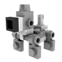

# Terrier Pet - quest/objective source LOT 3254

<!-- media:start (generated by scripts/build_media.py) -->
{ .lu-icon .lu-on-dark width="128" loading="lazy" }
<!-- media:end -->

[Quest database](../README.md) | [Methodology](../Methodology.md)

Item acquisition: [Terrier Pet (LOT 3254)](../../items/3254.md).

## Candidate placements / spawner waypoints

Coordinates are static map XYZ, not confirmed live NPC positions. Multiple scene objects and waypoints may refer to a shared spawn mechanism; counts are not population estimates. Feature gates and disabled auto-spawning are retained, and client-only objects are excluded.

| Zone | X | Y | Z | Origin | Conditions |
| --- | --- | --- | --- | --- | --- |
| [Pet Cove (1201)](../locations/zone-1201.md) | 49.661 | 189.248 | -102.153 | Scene nd&#95;ns&#95;pet&#95;ranch.lvl (Global Scene), layer 0; LOT 176 spawner | Automatic spawning disabled; trigger/script may be required |
| [Pet Cove (1201)](../locations/zone-1201.md) | 56.855 | 190.003 | -119.169 | Scene nd&#95;ns&#95;pet&#95;ranch.lvl (Global Scene), layer 0; LOT 176 spawner | Automatic spawning disabled; trigger/script may be required |
| [Pet Cove (1201)](../locations/zone-1201.md) | 69.287 | 189.606 | -102.324 | Scene nd&#95;ns&#95;pet&#95;ranch.lvl (Global Scene), layer 0; LOT 176 spawner | Automatic spawning disabled; trigger/script may be required |
