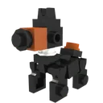

# Doberman Pet - quest/objective source LOT 5635

<!-- media:start (generated by scripts/build_media.py) -->
{ .lu-icon width="128" loading="lazy" }
<!-- media:end -->

[Quest database](../README.md) | [Methodology](../Methodology.md)

Item acquisition: [Doberman Pet (LOT 5635)](../../items/5635.md).

## Candidate placements / spawner waypoints

Coordinates are static map XYZ, not confirmed live NPC positions. Multiple scene objects and waypoints may refer to a shared spawn mechanism; counts are not population estimates. Feature gates and disabled auto-spawning are retained, and client-only objects are excluded.

| Zone | X | Y | Z | Origin | Conditions |
| --- | --- | --- | --- | --- | --- |
| [Avant Gardens (1100)](../locations/zone-1100.md) | 189.005 | 381.981 | -211.41 | Spawner path: Pet&#95;Dovermen | Scene precondition: 247; Automatic spawning disabled; trigger/script may be required |
| [Avant Gardens (1100)](../locations/zone-1100.md) | 174.603 | 380.252 | -199.715 | Spawner path: Pet&#95;Dovermen | Scene precondition: 247; Automatic spawning disabled; trigger/script may be required |
| [Avant Gardens (1100)](../locations/zone-1100.md) | 194.455 | 381.567 | -197.489 | Spawner path: Pet&#95;Dovermen | Scene precondition: 247; Automatic spawning disabled; trigger/script may be required |
