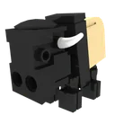

# Buffalo Pet - quest/objective source LOT 5636

<!-- media:start (generated by scripts/build_media.py) -->
{ .lu-icon width="128" loading="lazy" }
<!-- media:end -->

[Quest database](../README.md) | [Methodology](../Methodology.md)

Item acquisition: [Buffalo Pet (LOT 5636)](../../items/5636.md).

## Candidate placements / spawner waypoints

Coordinates are static map XYZ, not confirmed live NPC positions. Multiple scene objects and waypoints may refer to a shared spawn mechanism; counts are not population estimates. Feature gates and disabled auto-spawning are retained, and client-only objects are excluded.

| Zone | X | Y | Z | Origin | Conditions |
| --- | --- | --- | --- | --- | --- |
| [Avant Gardens (1100)](../locations/zone-1100.md) | 550.132 | 399.409 | 285.401 | Spawner path: Pet&#95;Buffalo | Scene precondition: 247; Automatic spawning disabled; trigger/script may be required |
| [Avant Gardens (1100)](../locations/zone-1100.md) | 531.772 | 399.49 | 296.219 | Spawner path: Pet&#95;Buffalo | Scene precondition: 247; Automatic spawning disabled; trigger/script may be required |
| [Avant Gardens (1100)](../locations/zone-1100.md) | 530.211 | 399.257 | 321.557 | Spawner path: Pet&#95;Buffalo | Scene precondition: 247; Automatic spawning disabled; trigger/script may be required |
| [Avant Gardens (1100)](../locations/zone-1100.md) | 518.076 | 399.457 | 339.77 | Spawner path: Pet&#95;Buffalo | Scene precondition: 247; Automatic spawning disabled; trigger/script may be required |
| [Avant Gardens (1100)](../locations/zone-1100.md) | 536.757 | 399.313 | 352.838 | Spawner path: Pet&#95;Buffalo | Scene precondition: 247; Automatic spawning disabled; trigger/script may be required |
| [Avant Gardens (1100)](../locations/zone-1100.md) | 548.315 | 399.308 | 335.377 | Spawner path: Pet&#95;Buffalo | Scene precondition: 247; Automatic spawning disabled; trigger/script may be required |
| [Avant Gardens (1100)](../locations/zone-1100.md) | 541.061 | 399.307 | 320.058 | Spawner path: Pet&#95;Buffalo | Scene precondition: 247; Automatic spawning disabled; trigger/script may be required |
| [Avant Gardens (1100)](../locations/zone-1100.md) | 552.865 | 399.282 | 313.329 | Spawner path: Pet&#95;Buffalo | Scene precondition: 247; Automatic spawning disabled; trigger/script may be required |
| [Avant Gardens (1100)](../locations/zone-1100.md) | 556.538 | 399.698 | 299.704 | Spawner path: Pet&#95;Buffalo | Scene precondition: 247; Automatic spawning disabled; trigger/script may be required |
